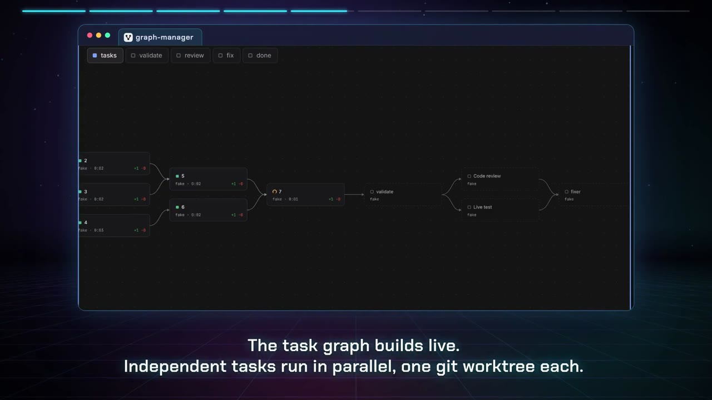

# graph-execution

**Turn a spec into a reviewed, tested pull request.**

graph-execution plans a task graph from your PRD, runs coding agents in parallel in their own git worktrees, gates every task, then has a code reviewer and a live tester check the merged result before it opens the PR. It works with Claude Code, Codex, OpenCode and Qwen Code, and runs on your machine.

Website: [graph-execution.com](https://graph-execution.com)

[](docs/assets/demo.mp4)

▶ [Watch the 60-second demo](docs/assets/demo.mp4)

## Why graph-execution

Most agent tools make code faster. graph-execution makes the result something you can merge.

- **Verified, not just generated.** Every task passes your gate (build, lint, tests) before it merges. Then a code reviewer and a live tester check the merged result against the spec, and a fixer handles blockers and majors.
- **Any agent.** Claude Code, Codex, OpenCode or Qwen Code, chosen per run.
- **Parallel by default.** Independent tasks run at the same time, each in its own git worktree. A task that depends on others starts after they have merged.
- **A web app for the whole loop.** `graph-execution manager` clones your repos, opens agent terminals, shows every run live and creates the PR.
- **Multi-repo runs and sandboxes.** One run across several repos, and agents in their own Docker container when you want them isolated.

## Quick start

Node.js 20 or later.

```bash
npm install -g graph-execution && graph-execution manager
```

It listens on http://127.0.0.1:7420, prints a generated password saved in its data directory, and opens the browser.

**Use the CLI directly.** The same package is the engine you can run without the web app. The minimal run is in the [CLI quick start](packages/graph-execution/README.md#quick-start).

## How it works

1. Connect GitHub or GitLab with a personal access token, then clone a repository into a workspace.
2. Open a terminal in that workspace (Claude Code, Codex, OpenCode, Qwen Code, or a plain shell).
3. Plan the tasks from a PRD in the terminal. The spec file opens beside the terminal while it is written. **Start run** takes that spec and the tasks folder.
4. Watch the run live. Independent tasks run at the same time, each agent in its own git worktree. A task that depends on others starts after those have merged. By default a validation gate runs on each task before it merges.
5. After every task has merged, one code reviewer and a live tester judge the whole result, then a fixer handles blockers and majors. That review runs once for the merged graph, not on each task. Human review is off unless you turn it on in Start run, pass `--human-review`, or set `"humanReview": true`.
6. When the run is applied, **Create PR** (or **Create MR** on GitLab) opens the pull request.

Agents run in full-auto mode with your user's permissions unless you run them in a sandbox ([sandboxed runs](apps/graph-manager/README.md#sandboxed-runs)).

## Built by itself

graph-execution is developed with graph-execution. Every feature started as a spec and shipped as a run: the specs are in [`docs/prd/done/`](docs/prd/done/), the task graphs in [`.agents/tasks/`](.agents/tasks/), and the workflow in [`CLAUDE.md`](CLAUDE.md).

## Docs

- [CLI documentation](packages/graph-execution/README.md)
- [Web app](apps/graph-manager/README.md)

## The web app

`graph-execution manager` is the web app in this package. From the browser you connect GitHub or GitLab, clone repositories into workspaces, open terminals, follow every run, and open a pull request from an applied run.

The quick start command prints the address it is listening on, then a password line, and opens the browser. With the defaults the address is http://127.0.0.1:7420.

When no password is saved yet, one is generated (24 random bytes, base64url) and written to `password` in the data directory (mode 600). Later starts read that file. Set `GM_PASSWORD` to a non-blank value to choose your own. A blank value counts as unset. A password taken from `GM_PASSWORD` is not written to the file. The flags are `--port`, `--host`, `--data-dir`, `--workspaces-dir` and `--no-open`. On Linux, `npm install` compiles `node-pty` and needs Python 3, make and a C++ compiler; macOS and Windows get a prebuilt binary.

The default data directory and the Docker image are under [Development](#development).

## Development

This repository is an npm workspaces monorepo.

| Workspace | What it is |
| --- | --- |
| [`packages/graph-execution`](packages/graph-execution/README.md) | The CLI engine, published to npm as `graph-execution` |
| [`apps/graph-manager`](apps/graph-manager/README.md) | The web app source, shipped inside the `graph-execution` npm package (`graph-execution manager`) and as a Docker image |
| [`apps/site`](apps/site/README.md) | The [graph-execution.com](https://graph-execution.com) landing site (Astro, static) |

`graph-execution manager` keeps its data in `~/.graph-manager` unless `GM_DATA_DIR` or `--data-dir` is set. The generated password is `~/.graph-manager/password`. Repositories are cloned under `~/graph-manager-workspaces` unless `GM_WORKSPACES_DIR` or `--workspaces-dir` is set.

The web app also ships as one Docker image, built from this repo:

```bash
docker build -f apps/graph-manager/Dockerfile -t graph-manager:dev .
docker run -d -e GM_PASSWORD='choose-a-password' -p 127.0.0.1:7420:7420 \
  -v gm-data:/data -v gm-workspaces:/workspaces graph-manager:dev
```

See [`apps/graph-manager/README.md`](apps/graph-manager/README.md) for configuration, setup, sandboxed runs and the security notes.

Run these at the repository root:

```bash
npm ci                              # install all workspaces
npm run typecheck                   # runs the build below, then type-checks every workspace
npm run lint                        # eslint over the whole repo
npm test                            # every workspace's tests
npm run build                       # build the engine, then the web app, then copy it into the engine's dist/manager
npm run build -w graph-execution    # build the engine into packages/graph-execution/dist
```

After a build, run the CLI from the root with `node packages/graph-execution/dist/cli.js`. `node packages/graph-execution/dist/cli.js manager` needs the full `npm run build`: an engine build on its own removes `dist/manager`, and the command then exits 2 with `graph-manager is not part of this build: run npm run build at the repository root`.

Contributing: [CONTRIBUTING.md](CONTRIBUTING.md).

## License

MIT, see [LICENSE](LICENSE). Contributions are accepted under the [Contributor License Agreement](CLA.md).
