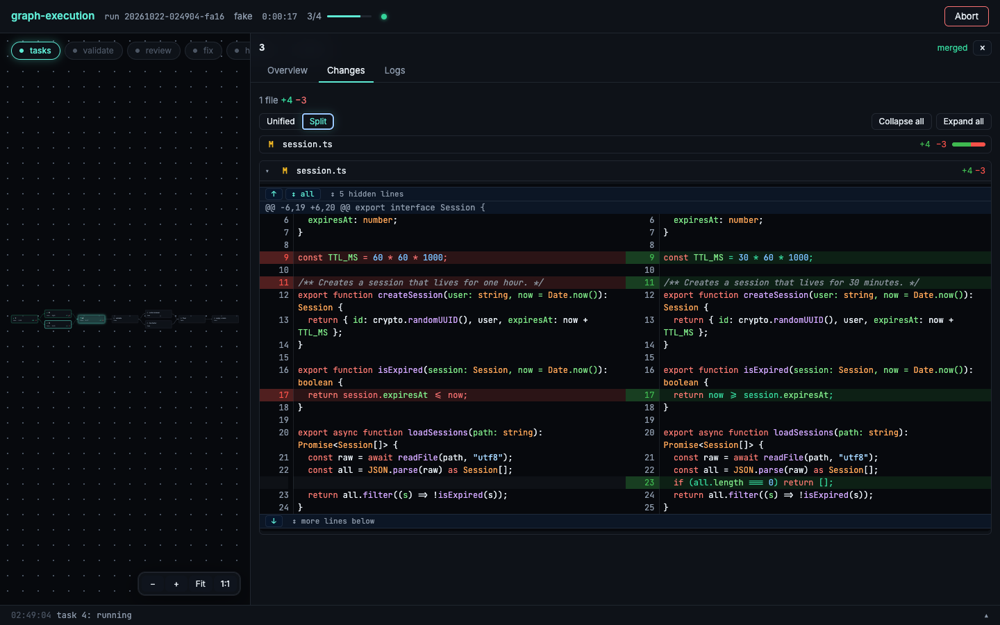
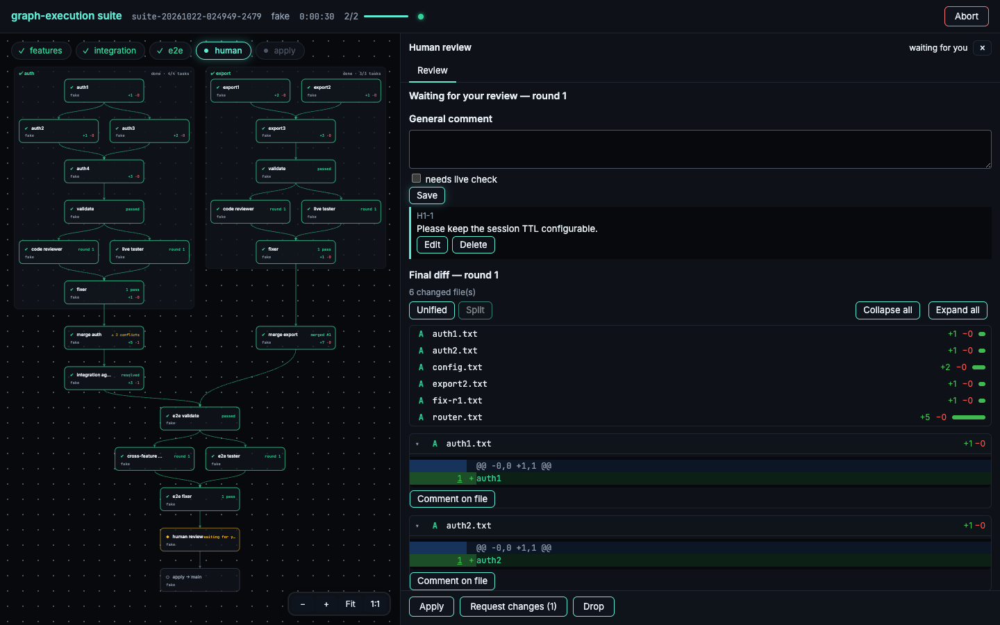
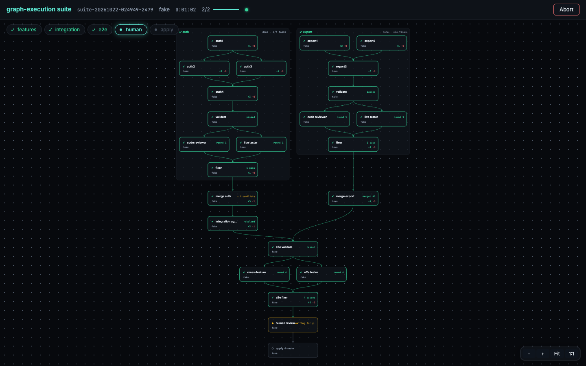

# graph-execution

[](https://www.npmjs.com/package/graph-execution)

Run a folder of tasks arranged as a dependency graph (DAG) with headless AI coding agents (Claude Code, Codex, OpenCode, Qwen Code).

- Independent tasks run in parallel, each in its own git worktree.
- Each finished task is merged into an integration branch `graph/<run-id>`, which unlocks the tasks that depend on it.
- When every task is merged, a review loop runs. Your validation commands come first, then a code reviewer and a live tester run in parallel and judge the result against your PRD. A fixer handles blockers and majors, for up to 3 fix passes.
- Once the review is clean, the result lands on the branch you started the run from as **uncommitted changes**: review them in `git diff` or your editor, then commit them yourself (`--no-merge` keeps it on its own branch only).
- The run is resumable.

## Requirements

- Node.js 20 or later, and git.
- The CLI of the provider you choose must be on the `PATH` and already logged in: `claude` (Claude Code), `codex`, `opencode` or `qwen` (Qwen Code 0.6 or later). graph-execution stores no credentials. For `qwen`, log in with `qwen` interactively once, or set the API key in Qwen Code's `settings.json`; don't put `--openai-api-key` in `GRAPH_EXECUTION_QWEN_ARGS`, because run logs aren't redacted.
- macOS, Linux or Windows.

### Windows notes

graph-execution runs on Windows in Windows Terminal, PowerShell or cmd. A few things behave differently there:

- **Provider CLIs** installed through npm (`claude.cmd` and similar) are found through `PATH` and `PATHEXT`, like any other command.
- **Prompts go to the agent's stdin**, not its command line, on every platform. On Windows, npm's `.cmd` shims run through `cmd.exe`, which caps a command line at 8,191 characters. Reviewer prompts (spec plus the whole diff) are far longer than that and used to fail with "The command line is too long".
- **`validate` and `setup` commands** run through `cmd.exe`, not a POSIX shell. `&&` chains work. `export`, `rm -rf`, `$VAR` and shell globs don't. Write commands that both shells accept, such as `npm test` or `node scripts/check.js`, or call `bash -c "…"` if Git Bash is installed.
- **Aborting a run** (Ctrl+C) kills each running agent and its child processes with `taskkill /T`. On macOS and Linux, processes an agent leaves running after it exits (for example an app the live tester started) are killed too. Windows can't trace a process back to an agent that has already exited, so such leftovers can survive there and need to be stopped by hand.
- **The "drop them" command** in the end-of-run summary quotes paths with double quotes. It works in cmd and PowerShell 7. Windows PowerShell 5.1 doesn't support `&&`, so run its two parts one after the other there.

## Installation

The package is published on npm as [`graph-execution`](https://www.npmjs.com/package/graph-execution). Run it without installing:

```bash
npx graph-execution --help
```

Or install it globally to get the `graph-execution` command:

```bash
npm install -g graph-execution
```

## Usage

```bash
npx graph-execution ./tasks --spec PRD.md --provider claude
```

```
graph-execution <tasks-dir> --spec <prd-file> --provider claude|codex|opencode|qwen [--concurrency 3] [--model <m>] [--no-merge] [--human-review|--no-human-review] [--no-worktree] [--web]
graph-execution --resume [--run <id>] [--no-merge] [--web]
graph-execution open [--run <id>]
graph-execution suite --feature <tasks-dir>:<prd> --feature <tasks-dir>:<prd> ... --provider <name> [--concurrency 3] [--model <m>] [--no-merge] [--human-review|--no-human-review] [--web]
graph-execution suite --resume [--run <suite-id>] [--web]
graph-execution list
graph-execution clean [<run-id>] [--done] [--force] [--yes]
graph-execution install skills [--target agents|claude|both] [--force]
graph-execution readme [--print]
```

| Option | Meaning |
|---|---|
| `<tasks-dir>` | Folder of `*.json` task files (see below). |
| `--spec <file>` | **Required.** The PRD that the reviewers and the fixer judge the result against. The run refuses to start if the file is missing, unreadable or empty. |
| `--provider <name>` | **Required.** One provider is used for every agent in the run: `claude`, `codex`, `opencode` or `qwen`. |
| `--concurrency <n>` | Maximum number of tasks running at once. Overrides `concurrency` in the config file. Default: 3. |
| `--model <m>` | Model name passed to the provider CLI. |
| `--resume [--run <id>]` | Resume an interrupted or aborted run. Without `--run` it resumes the latest run. |
| `--no-merge` | Keep the result on `graph/<run-id>` only, instead of applying it to your branch at the end. |
| `--human-review` / `--no-human-review` | Pause before applying so you can review the result and ask for changes, or apply without that pause. Overrides `humanReview` in the config for this run. Not allowed with `--resume`. See [human review](#human-review-optional). |
| `--no-worktree` | Run without worktrees: one task at a time, in your own checkout. See [running without worktrees](#running-without-worktrees). |
| `--web` | Start the run as a background process owned by the operating system (not by your shell or your agent), open its live page in the browser and exit. Works with `--resume`. Over SSH it prints the URL and an `ssh -L` hint instead. See [the web view](#the-web-view). |
| `open [--run <id>]` | Reopen the page of a run or suite started with `--web`, while its process is alive. `--run` takes a run id or a suite id (`suite-…`). Without it, it opens the latest run or suite. |
| `suite ...` | Run several features in parallel and integrate them. See [suites](#suites). |
| `list`, `clean` | Show and delete old runs, suites and leftover branches. See [cleaning up runs](#cleaning-up-runs). |

`graph-execution readme` opens this README, rendered, in your browser. If no browser can be opened (over SSH, in CI), it prints the path of the HTML file instead. `--print` writes the markdown to stdout, for example to pipe it into `less`.

Run it from inside the git repository you want to change. Worktrees are cut from **committed** state, so uncommitted changes are not visible to the agents. The tool prints a warning about them and continues.

The spec and the task folder are the exception: they **don't need to be committed**. The tool copies both into `.graph-execution/<run-id>/context/` and tells every task agent where they are, so a task can say "see `PRD.md` section 7" even if `PRD.md` was never committed. They don't trigger the warning either.

### The live view

The run shows as one top-down graph: the tasks with arrows to the tasks that depend on them, then validate → code reviewer and live tester → fixer → apply. Running nodes have a heavy border and a spinner.

When the graph is taller than the terminal, it shows in a scrollable window: use the **mouse wheel**, `↑`/`↓` (or `j`/`k`), `PgUp`/`PgDn`, and `g`/`G` for top and bottom. The window follows the running tasks until you scroll; press `f` to follow again. While the window is scrollable, the terminal's own text selection needs a modifier (Shift-drag in most terminals, Option-drag in iTerm2). When the run ends, the whole graph and the summary are printed in full, so you can scroll back through them in the terminal as usual.

### The web view

`--web` shows the same graph as the terminal, in a browser page, with the final summary on the page when the run ends. The page has one button: **Abort** (with a confirm dialog) while the run is going, **Close** after it ends.

- The run lives in its own background process, so **closing the tab does not stop the run**. `graph-execution open` brings the page back.
- The page is served on `127.0.0.1` only, and requests with a foreign `Host` or `Origin` header are refused.
- After the run ends, the process stays up so you can read the summary, until you press **Close**.


- **Full-viewport page.** The graph fills the window; the page itself never scrolls. Each node card shows its status, provider, elapsed time and `+`/`−` counts, and a running node pulses. The events list is a drawer at the bottom.
- **The graph is a canvas.** Drag it (or scroll) to move around, ctrl+scroll or pinch to zoom, or use the **−**, **+**, **fit** and **1:1** buttons in its corner. Double-click the background to fit it again. Dragging from a node doesn't select it.
- **Click a node** to open the right panel with the tabs **Overview** (its failure with **Retry** and **Merge**, its test plan), **Changes**, **Logs**, and **Review** while a human review waits.
- **Resizable panel.** Drag its left edge (up to 85% of the window); the width is kept across reloads. Below 900px wide it becomes a full-screen sheet.
- **Changes.** A file tree, then one section per file with highlighted code (highlight.js, loaded lazily as files scroll into view). Switch **Unified** and **Split** (split needs a panel at least 900px wide), collapse files, and expand the context around a hunk 20 lines at a time. Diffs load on demand and refresh while the agent works; lockfiles and files with more than 1000 changed lines start collapsed and carry a `large` hint, and files over 2000 diff lines are shown as plain text.
- **Live logs.** The Logs tab streams the node's agent logs as they are written. It stops following when you scroll up (a chip shows how many new lines came in), and it has a filter box.
- **Keyboard shortcuts.** `F` fits the graph, `+`/`-` zoom, `0` goes to actual size, `E` toggles the events drawer, and `Esc` closes the panel (or the summary).
- **Works offline.** The page, its styles, scripts and the highlighter are bundled with the package and served from `/assets/`: no CDN, no network access needed. Animations pause while the tab is hidden.
- Finished nodes keep their final changes. A node without changes shows `No changes yet`.

The original design left a web dashboard out of scope; the web view is the run view added later, and the terminal view is unchanged.

### Starting a run from your agent

After the `to-tasks` skill has written the task folder, your agent asks whether to start the run. The bundled `run-graph` skill then runs `graph-execution … --web` and **stops**: it never monitors the run, because the page does that. The launcher exits with:

| Code | Meaning |
|---|---|
| `0` | Started. The page is open (or its URL is printed). |
| `2` | Error. Nothing was started, or the run process died before its page was up; the tail of its log is printed. |
| `3` | The hand-off was blocked (for example by a strict sandbox). Nothing was started. The exact foreground command is printed, to run in your own terminal. |

To outlive your shell and your agent, the run is handed to the operating system with `launchctl` (macOS), `systemd-run --user` (Linux) or `schtasks` (Windows), and falls back to a detached process.

### What a run produces

```
graph/<run-id>                        # integration branch with all merged tasks and fixes
.graph-execution/<run-id>/
  state.json  lock                    # run state (used by --resume) and PID lock
  logs/<agent>.log                    # full output of every agent
  reports/round<N>/{code,tester}.json # review reports for each round
  reports/round<N>/fixer-comments.json # human review: the fixer's note per comment
  human/round<H>.json                 # human review: your comments for pause H
  worktrees/                          # task, integration and reviewer worktrees (removed on success)
```

`.graph-execution/` is added to `.git/info/exclude`, which is local and never committed. The run state therefore never makes your working tree look dirty.

### The final step: your branch gets the changes, uncommitted

When the review ends clean (exit code 0), the tool applies `graph/<run-id>` to the branch that was checked out when the run started, **as uncommitted changes**. Nothing is committed or staged: changed files show as modified, and new files as plain untracked files, just like files you create yourself. Your editor's source control view shows all of them, and discarding one there restores or deletes it as you'd expect. It is a real three-way merge (`git merge --squash`), so it works even if you committed on your branch while the run was going.

The final summary lists every changed file with its line counts (new files marked `(new)`) and the run's commits, and tells you what to do next:

- **Review:** your editor's source control view, or `git status` and `git diff` (plain `git diff` does not list untracked new files).
- **Keep:** commit as usual, new files included. Git has a commit message ready that lists the run's commits.
- **Drop:** the summary prints the exact command, for example `git restore . && git clean -f -- src/new.ts test/new.test.ts`. It deletes only the files the run created, never your own untracked files.

**Your own uncommitted changes don't block it.** If tracked files had uncommitted changes, the tool saves them first (they also stay in `git stash list` as `graph-execution: your changes before applying graph/<run-id>`), applies the result, and puts your changes back on top. You end up with both in the same diff, and the summary lists only the run's files. In that case the drop command resets the checkout and applies your changes back from that backup, so you get back exactly what you had.

**Overlaps become merge conflicts, not failures.** A file changed by both the run and your uncommitted edits, or by the run and a commit made on your branch during the run, is left as a regular merge conflict: conflict markers in the file, and the file shows as conflicted in your editor. The summary lists these files. Resolve them as usual, then `git add` them. With your own edits, the markers say `Updated upstream` (the run's version) and `Stashed changes` (yours).

It does not apply the changes, and tells you why, when:

- the review loop is exhausted (exit 1) or the run aborts (exit 2);
- the code reviewer gave up (see below), so the result was never reviewed;
- you switched to another branch while the run was going;
- git refuses the merge, for example because a new file of the run would overwrite an untracked file of yours. It is rolled back, so your checkout is left exactly as it was;
- the run conflicts with commits made on your branch during the run **and** you have uncommitted changes. Two sets of conflicts can't be stacked, so your changes are put back exactly as they were (staging included);
- you passed `--no-merge`, or the run started on a detached HEAD.

In those cases bring it in yourself once you are ready:

```bash
git log --oneline main..graph/<run-id>
git merge --squash --no-commit graph/<run-id>
```

### Running without worktrees

Every task normally gets a fresh worktree, and `setup` runs in each one. On a big repository, or with a slow `npm ci`, that can take minutes per task. `--no-worktree` skips worktrees entirely:

- The `setup` commands run **once**, in your checkout, before the first task.
- Your checkout switches to `graph/<run-id>`. Nothing is rewritten, because the branch starts at your current commit. Ignored files such as `node_modules` stay in place.
- Tasks run **one at a time** (`--concurrency` above 1 is refused). Each task commits straight onto `graph/<run-id>`, so there is no merge step. A retry first resets the checkout to where the task started.
- The review runs there too, with the code reviewer and the live tester one after the other. HEAD is detached at the reviewed commit while each one runs.
- At the end the checkout goes back to your branch, and the result is applied as uncommitted changes, as in [the final step](#the-final-step-your-branch-gets-the-changes-uncommitted).

It needs a branch checked out and no uncommitted changes to tracked files (the spec and the task files included), because resets between attempts would lose them. Commit or stash them first. Untracked files are fine: they are hidden from git for the duration of the run (listed in `.git/info/exclude` and removed from it at the end). Agents' `git add -A` and the tool's cleanups don't touch them. **Don't edit files in the checkout while the run is going.**

If the run aborts, your checkout stays on `graph/<run-id>` with whatever the agents left, for inspection. `--resume` continues it (it discards what was left uncommitted there). To get back to your branch instead, run `git checkout <your-branch>`. A later `--resume` switches back to `graph/<run-id>` by itself, as long as your branch has no uncommitted changes to tracked files.

## Task file format

Each task is one JSON file in the tasks folder:

```json
{
  "id": "4",
  "content": "## Export endpoint\n\nImplement `GET /export` ...\n\n## Acceptance criteria\n- ...",
  "dependencies": ["2", "3"],
  "validate": null
}
```

| Field | Meaning |
|---|---|
| `id` | Unique non-empty string. |
| `content` | Markdown. **It is the main thing the task agent sees**, so make it self-sufficient: what to build, which files to read, acceptance criteria. The agent is also told where copies of the spec and the task files are, and may read them when the content refers to them. It does not get the content of the dependency tasks, but their code is already in its worktree. |
| `dependencies` | Ids of the tasks that must be merged before this one starts. Optional, defaults to `[]`. |
| `validate` | Optional per-task override: a list of commands, `false` to skip validation for this task, or `null`/absent to use `validate` from the config. Ignored with `validateAt: "end"`. |

The graph is validated before any agent runs. Invalid JSON, duplicate ids, unknown dependencies, self-dependencies and cycles are all reported at once, and the run exits with code 2.

Example (a diamond): `1` has no dependencies, `2` and `3` depend on `1`, and `4` depends on `2` and `3`. Tasks 2 and 3 run in parallel after 1 is merged, and 4 starts from a worktree that already contains 1, 2 and 3.

A task succeeds only when its agent exits cleanly **and** makes a new commit. The task agent is told to commit when it is done.

Agents are asked to commit their work. If one finishes cleanly but leaves changes uncommitted (it forgot, or committed only part), the tool commits the rest for it (`Task <id>: changes the agent left uncommitted`) instead of failing the attempt. The same goes for the fixer. Files that were already uncommitted when the agent started, such as output of `setup` or of a validation command, are left out of that commit. Only an agent that changed nothing at all counts as a failed attempt ("made no commit") and is retried.

A task whose work already exists (for example because an earlier task delivered it) is not a failure. The agent is told to record that with an empty commit (`git commit --allow-empty`), which goes through validation and merges like any other. A retry is also told why the previous attempt failed.

## Configuration: `graph-execution.config.json`

This file is optional and lives at the repository root. Unknown keys are rejected, so typos are caught at startup.

```json
{
  "setup": ["npm ci"],
  "validate": ["npx tsc --noEmit", "npx eslint .", "npm run build"],
  "concurrency": 3,
  "attempts": 3,
  "validationRounds": 3,
  "fixPasses": 3,
  "humanReview": false,
  "keepRuns": 5
}
```

| Key | Default | Meaning |
|---|---|---|
| `setup` | `[]` | Commands run once in every new worktree (tasks and reviewers) before the agent starts, for example `npm ci`. |
| `validate` | `[]` | Gate commands, run directly without AI after each task, once all tasks are merged, and after each fix pass. Failing output (its tail) goes back to the agent. |
| `validateAt` | `"task"` | When the gate runs during the task phase. `"task"`: after each task, then once more on the merged result. `"end"`: only on the merged result, once every task is merged. Tasks are not validated on their own, and a task file's own `validate` list is ignored. Either way, a failure on the merged result goes to the fixer. |
| `validateParallel` | `false` | Run the `validate` commands all at once instead of one after another. Every command runs to the end, so the agent gets all failures in one round instead of one at a time. Only use it when the commands don't interfere with each other (for example two of them writing the same build output). `setup` always runs first and in order. |
| `concurrency` | `3` | Maximum number of parallel tasks. `--concurrency` overrides it. |
| `attempts` | `3` | Attempts for every agent invocation: task, merge resolver, reviewer, tester and fixer. |
| `validationRounds` | `3` | Fix rounds when validation fails: after a task, on the merged result before the review, or after a fix pass. They do not consume fix passes. |
| `fixPasses` | `3` | Fix passes in the review loop. Every [human review](#human-review-optional) round gets a fresh budget of this size. |
| `humanReview` | `false` | Pause after the review loop and wait for you before applying. `--human-review` / `--no-human-review` override it. See [human review](#human-review-optional). |
| `loopDetection` | `{ "repeats": 5 }` | Stops an agent stuck in a loop and retries it: the same tool call `repeats` times in a row, or the same cycle of 2–3 calls `repeats` times. Identical means same tool and same input (a call's `description` is ignored). The stopped run counts as a failed attempt, and the next attempt starts in a fresh worktree and is told why. Works for every provider and every agent (task, resolver, reviewer, tester, fixer). `false` turns it off. |
| `keepRuns` | `5` | Applied runs kept by the automatic cleanup at run start; `0` disables it. Only applied runs count and are deleted (folder, worktrees and `graph/<run-id>` branch); unfinished, `done` and live runs are never deleted automatically. When unfinished runs exist, the start prints a hint such as `3 unfinished runs use 650 MB, run graph-execution clean`. `--resume` does not clean up. `graph-execution clean` also uses it. |

The hashes of the config, the tasks folder and the spec are recorded when the run starts. `--resume` refuses to continue if any of them changed.

## `REVIEW.md` and `TESTING.md` (optional)

Both files are read from the repository root at startup and passed to the reviewers in their prompts. They therefore work even when they are not committed. Neither file is required. A missing file never causes an error.

- **`REVIEW.md`**: your conventions for the **code reviewer**. Without it, the reviewer applies general rules for bugs, security and correctness.
- **`TESTING.md`**: tells the **live tester** how to boot the app, which endpoints or URLs to hit, which credentials to use and what to check. Without it, the tester tries its best using the README and the package scripts. If the tester cannot run the app, it records a "live test not performed" note that appears in the final summary, and the run does not fail.

## Test plans (optional)

A test plan is a list of cases the live tester must check. It lives in `<tasks-dir>/test-plan.json`. The `to-tasks` skill drafts it from the PRD and shows it to you in the quiz step, where you can edit it or say "no plan".

```json
{ "cases": [ { "id": "P1", "title": "Create an item", "steps": ["POST /items with {\"name\":\"a\"}"], "expected": "201, and GET /items lists it", "priority": "must" } ] }
```

Ids match `^[A-Za-z0-9_-]+$` and are unique. `steps` and `cases` are non-empty. `priority` is `must` or `should`. Don't put credentials in the plan; the tester finds them in `TESTING.md`.

The tester reports a verdict for every case, every review round:

| Result | Finding |
|---|---|
| `must` case fails | blocker |
| `should` case fails | major |
| any case is `blocked` | major |

If a `must` failure is still open after the last fix pass, the result is not applied to your branch.

A malformed plan fails `graph-execution` at startup. Edits to the file are picked up on `--resume`. The final summary shows a line such as `Test plan: 7/8 passed (1 blocked)`, and the web view's live tester panel shows the checklist. Without the file, nothing changes.

## Human review (optional)

Turn on `"humanReview": true` in `graph-execution.config.json` (or pass `--human-review`) to review the result before it lands on your branch. When the review loop ends, the run does not apply anything. It pauses and the web view shows **Waiting for your review**, with the final diff (the run's starting commit against the integration branch). The pause comes whether the loop ended clean or with open blockers or majors.

The page's graph has a **human review** node between the fixer and the apply. It reads `waiting for you` during a pause, `changes, round N` while the agents work on your comments, then `approved` or `dropped`. Click it to jump to the review.

The review is the panel's **Review** tab, with a sticky bar of **Apply**, **Request changes** and **Drop** at the bottom, so the decision is always in reach while you scroll the diff.



Your changes go through the same checks as the agents' changes: you don't edit the result yourself, you comment, and the fixer, validation, code reviewer and live tester handle the comments.

1. The run pauses. Read the diff and add comments.
2. Press **Request changes**. Your open comments become blocker findings, and the fixer works on them first.
3. Validation, the code reviewer and the live tester run again, with a fresh `fixPasses` budget. The phase line reads `fix pass 1/3 (human round 1)`.
4. The run pauses again. Each comment shows how it was handled. Resolve or reopen comments, comment more and go again, or apply.

| Action | What happens |
|---|---|
| Apply | Applies `graph/<run-id>` to your branch as uncommitted changes, like the [final step](#the-final-step-your-branch-gets-the-changes-uncommitted). Exit code 0. With `--no-merge` the button reads **Finish** and only ends the run. |
| Apply anyway | The same, offered instead of **Apply** while blockers or majors are open. A confirm dialog lists the count; the summary records that it was applied with open findings. |
| Request changes | Needs at least one open comment. Starts a fix pass with a fresh `fixPasses` budget. There is no limit on human rounds. |
| Drop | Applies nothing, after a confirm dialog. The worktrees are removed and `graph/<run-id>` is kept. Exit code 0 if the last review had no open blockers or majors, otherwise 1. |

### Comments

- A **line comment** is anchored to a file and a line of the diff, and keeps a short snippet of the code. A **file comment** has a file only. A **general comment** has neither.
- **Select lines like on GitHub.** Hover a line and press the `+` in the gutter, or click it. Drag the `+` to comment on a range, or shift-click a second `+`. The keyboard works too: focus a `+` with Tab and press Enter, then Shift+Up or Shift+Down to extend. A range stays inside one hunk of one file. You can comment on **deleted lines**: they are anchored to the old side of the file (`side: "old"`), added and unchanged lines to the new side.
- The composer is **markdown** with Write and Preview tabs and a small toolbar. A comment has a text and a **needs live check** box. The box also sends the comment to the live tester as an extra `must` case, so a failure is a blocker. It stays in the plan every round until you resolve the comment.
- **Suggested changes.** On new-side lines, **Suggestion** puts the selected lines into a ` ```suggestion ` block. Edit them: the fixer applies a suggestion exactly as written, replacing the commented lines, and the reviewer checks that it did. Deleted lines cannot take a suggestion.
- Comments show as **threads** under their line, with edit, delete, resolve and reopen. The **Comments** tab lists every comment grouped by round and file, with open, resolved and all filters; click one to jump to its lines. Files with open comments show a 💬 count.
- The **round switcher** shows an earlier round on its own diff, with its own threads, so a comment is never shown on a diff it was not written on. The suite page (`graph-execution suite --web --human-review`) has the same review in its right-hand panel.
- Comments get ids like `H1-2` (human round 1, comment 2). They stay pinned to the round they were written on: they are not moved onto the next diff, and are listed under previous comments with their snippet.
- Comments are saved as you type them. You can edit and delete comments of the current round.

### How each comment was handled

After a human round, the next pause shows for every comment:

- the **fixer's note** (the fixer writes one per comment; a missing note shows as "no note");
- the **code reviewer's verdict**, `addressed` or `not_addressed`, with its evidence. Every open comment needs a verdict with evidence, or the report is retried like any malformed report;
- for a live-check comment, the live tester's result.

You decide, not the reviewer: **Resolve** closes a comment even if the reviewer said `not_addressed`, and **Reopen** (with an optional follow-up text) opens it again even if it was addressed. Only open comments go into the next **Request changes**.

### Files

```
.graph-execution/<run-id>/
  human/round<H>.json                  # the comments of pause H, written as you edit them
  reports/round<N>/fixer-comments.json # [{ "id": "H1-1", "note": "..." }]
```

Rounds keep counting up across human rounds, so `reports/round<N>/` folders never collide.

### Without `--web`, and resume

Human review happens in the web view. If you did not pass `--web`, the web server still starts in the same process, next to the terminal view. The terminal view only shows the URL: `waiting for your review: http://127.0.0.1:<port>/`.

Waiting is saved state. Ctrl+C while waiting exits with code 2 and applies nothing; `graph-execution --resume` brings back the same pause with your comments, and `graph-execution open` does the same for a run started with `--web`. The effective setting is saved in the run, so `--resume` takes neither `--human-review` nor `--no-human-review`. A run with `humanReview` off behaves as before.

## The review loop

After every task is merged:

1. **Validation gate.** `validate` runs on `graph/<run-id>`. Tasks that pass on their own can still break once merged together. If the gate fails, the fixer gets the failing output, commits a fix, and the gate runs again, for up to `validationRounds` rounds. These rounds don't use up a fix pass. If it still fails after that, the run aborts (exit code 2, resumable). The live view then shows a **validation fixer** node between `validate` and the reviewers.
2. **Review.** The code reviewer and the live tester run in parallel. Each gets its own throwaway worktree, detached at the head of the integration branch, so they never touch it. Both receive the full `--spec` and the path of the tasks folder. The code reviewer also gets the diff against the starting commit and `REVIEW.md`. The tester also gets `TESTING.md`, the list of changed files and, when there is one, the [test plan](#test-plans-optional). Each one writes a JSON report with findings of severity `blocker`, `major` or `minor`. A finding without a concrete failure scenario is downgraded to minor.
3. **Fix.** If any blocker or major is still open, the fixer receives both reports and the spec, commits fixes on the integration branch, and validation runs again. Then the reviewers re-review: they verify the previous findings and may only add new blockers or majors.
4. The loop ends **clean** as soon as a review has no open blockers or majors. The result is then applied to your branch as uncommitted changes (see [the final step](#the-final-step-your-branch-gets-the-changes-uncommitted)). Otherwise it stops after **3 fix passes**, which means at most 4 reviews. Minor findings are listed in the final summary and never trigger a fix pass.

### Reports that don't parse

Agents don't always write the JSON exactly right. The tool handles that in three steps:

1. **Repair.** Before the strict schema check, unambiguous slips are fixed silently: JSON inside a Markdown code fence, a bare findings array, a missing `round` or `reviewer`, severity or status in another case or a common alias (`Critical` → `blocker`, `high` → `major`, `not fixed` → `not_fixed`), a missing `status` (`open`) or `id` (`F1`, `F2`, ...), and `"line": "42"`.
2. **Retry with feedback.** A report that still fails gets up to 3 attempts. Each retry is told exactly what was wrong (for example `findings.2.severity: invalid option`) and is shown the file it wrote, so it can reuse its findings and only fix the format.
3. **Give up without stopping the run.** After 3 failed attempts, the report records a note (`code review not performed: ...` or `live test not performed: ...`) that appears in the final summary. The previous round's unresolved findings stay open, so they still count. If it was the **code reviewer** that gave up, the result is not applied to your branch automatically.

## When a node fails: summary and retry

A node is **failed** when it errored or used all its attempts: a task, the validation gate, the validation fixer, the fixer, the code reviewer, the live tester, or the apply step.

The tool asks the same provider and model for a short plain-language explanation and a verdict (`likely to work`, `unlikely to help`, `unclear`) on retrying, and shows both on the node. It is advice only. It costs one extra agent call per failure, and is never made for Ctrl+C or Abort.

**Retry** re-runs that node:

- **Web:** click the failed node, then press **Retry**.
- **Terminal:** the view stays open after a failure. Arrows pick the failed node, `r` retries it and `q` quits (Ctrl+C also quits).

Retry resets the node's attempts to 0 and re-enters the run like `--resume` does, in the same process, so tasks the failure had interrupted restart as well.

**Merge as it is** is offered next to Retry whenever the result can still go to your branch (not with `--no-merge`, and not after it was applied):

- **Web:** the **Merge into `<branch>` as it is** button in the failure panel, with a confirm dialog.
- **Terminal:** the `m` key.

It applies `graph/<run-id>` to your branch as uncommitted changes, exactly like the last step of a clean run (the same stash, conflict and refusal rules, see [the final step](#the-final-step-your-branch-gets-the-changes-uncommitted)), and ends the run with the usual summary. What lands is only what was merged so far, plus any fixes: the failed node's own work is not included, tasks that depend on it never ran, and the code was not reviewed. The exit code stays that of the failure, and the worktrees are kept. A later `--resume` that finishes cleanly would apply the result a second time, so drop or commit what you merged first.

Retry is not offered:

- after Ctrl+C or Abort (use `--resume`);
- after Close or `q`;
- for a reviewer or tester once the result was applied to your branch;
- without a TTY (terminal view).

## Cleaning up runs

`graph-execution list` shows every run (status, age, size, branches) and the leftover `graph/*` and `graph-task/*` branches that have no run folder.

`graph-execution clean` deletes leftovers. It prints what it would delete and the space it frees, then asks `Delete these? [y/N]`.

| Command | Deletes |
|---|---|
| `clean` | Unfinished runs, applied runs beyond the newest `keepRuns`, and orphan branches. |
| `clean <run-id>` | Only that run. |
| `clean --done` | Also runs that finished without apply (`--no-merge` results). |
| `clean --force` | Also branches with commits that are not merged anywhere else. |
| `clean --yes` | Skips the question. Required when stdin is not a terminal (otherwise exit code 2). |

Never deleted: runs that are still running, branches that are checked out in a worktree, and (without `--force`) branches of unfinished or finished-without-apply runs that hold commits not on any other branch. The run folder is still deleted in that case, and the kept branches are named. Exit code 1 means a deletion failed.

## Suites

```bash
graph-execution suite --feature tasks/auth:PRD-auth.md --feature tasks/export:PRD-export.md --provider claude
```

A suite runs several features at once, each with its own task folder and PRD, and integrates them at the end. At least two `--feature <tasks-dir>:<prd>` are required.

- **One child run per feature.** Each feature is a normal run with its own graph, review loop and logs under `.graph-execution/suite-<id>/features/<run-id>/`. Nothing is applied to your branch while the features run.
- **Split concurrency and queue.** `--concurrency` (or the config value) is the cap for the whole suite, split across the features. Features beyond the cap wait in a queue and start when a slot frees up.
- **Integration at the end.** The finished features are merged one by one into `suite/<id>`. When a merge conflicts, an integration agent resolves it.
- **E2E phase.** On `suite/<id>` a cross-feature reviewer and an e2e tester run, and a fixer handles their findings, like the review loop of a run. `"e2eReview": false` in `graph-execution.config.json` keeps only the validation.
- **One apply.** A clean result is applied once to the branch you started on, as uncommitted changes. `--no-merge`, a detached HEAD or a code review that was not performed leave the result on `suite/<id>`.
- **Human review.** With `--human-review` (or `humanReview` in the config), the suite pauses before its one apply so you can review the combined diff, comment and request changes, as for a [run](#human-review-optional). It needs `--web`.
- **`--web`.** `graph-execution suite ... --web` starts the suite in the background and opens one page, styled like a run's page (dark, with the same nodes, colors and diffs), that draws the whole suite as one graph of graphs:
  - **A box per feature** with that feature's whole run: its tasks, then validate → code reviewer and live tester → fixer (and the validation fixer once it has run). A review round shows the reviewer and the tester running until each one's report is written.
  - **A merge node per feature**, in the order the features finished (`merged #1`, `#2`). The first merge lands on an empty suite branch, so a conflict always shows on a later merge: the files it shares with the features merged before it. A merge that conflicted carries `⚠ N conflicts`.
  - **An integration agent node** under each merge that conflicted. It shows the agent working (`resolving 2 files`, `try 2/3`), `resolved` with its `+`/`−` counts, or `gave up after 3` with a **retry** badge.
  - **The e2e phase** on the combined result (e2e validate → cross-feature review and e2e tester → e2e fixer), then, with human review on, a **human review** node (`waiting for you`, `changes, round N`, `approved`, `dropped`; click it to jump to the review), then the apply.
  - **Click any node or feature box** for a side panel: what it does, its changed files with diffs (a merge or the integration agent marks the conflicted files), its agent logs, and its buttons. A failed feature has **Retry** while the others keep running. The integration agent that gave up has **Retry integration**. **Start integration** appears in the header when the other features are done and some keep failing: it excludes the failed ones and integrates the rest.
  - The graph, the panel, the shortcuts and the offline assets are the same as on a run's page.

    

  - **Abort** stops the suite; once it has ended, **Close** ends the process. A feature that fails never ends a web suite by itself.
  - Closing the tab does not stop the suite. `graph-execution open` brings the page back (`--run suite-<id>` for a specific suite).
- **`--resume`.** `graph-execution suite --resume [--run <suite-id>]` restarts the features that are not done (a feature with a run is resumed) and continues with the integration. Without `--run` it takes the latest suite. Add `--web` to continue it in the background with its page.

What a suite produces:

```
suite/<id>                                 # the suite branch: each feature merged in turn, then the e2e fixes
.graph-execution/suite-<id>/
  suite.json  lock  run.log                # suite state (used by --resume), PID lock, suite log
  web.json                                 # the page's URL, while the --web process is alive
  logs/<feature>.log                       # output of each feature's process
  logs/integration-<feature>.log           # the integration agent, for a merge that conflicted
  logs/code-r<N>.log, tester-r<N>.log, ... # the e2e phase's agents
  worktrees/integration/                   # the suite branch's worktree
  features/<run-id>/                       # each feature's run folder, like a normal run's
```

`suite.json` records, per conflicted merge, the integration agent's conflicted files, which try it is on, and whether it is running, resolved or gave up. `graph-execution list` shows a suite as one line, and `graph-execution clean <suite-id>` deletes it with its feature runs.

## Exit codes

| Code | Meaning | What is kept |
|---|---|---|
| `0` | Success: every task is merged and the last review has no open blockers or majors (or you chose Apply anyway or Drop in a [human review](#human-review-optional)). The result is applied to your branch as uncommitted changes unless something stopped it (see [the final step](#the-final-step-your-branch-gets-the-changes-uncommitted)). | The branch `graph/<run-id>` and `.graph-execution/<run-id>/` (state, logs, reports). **All worktrees are removed.** |
| `1` | Review loop exhausted: blockers or majors are still open after the last fix pass. | Everything: branch, worktrees, reports. |
| `2` | Abort: retries exhausted, merge resolver failed, validation exhausted, Ctrl+C (also while waiting for a human review), or a startup failure (bad arguments, invalid graph, invalid config, missing spec, provider not on the `PATH`, not a git repo). | Everything, ready for `--resume`. |
| `3` | Launcher only (`--web`): the hand-off to the operating system was blocked and nothing was started. The foreground command to run yourself is printed. See [starting a run from your agent](#starting-a-run-from-your-agent). | Nothing. |

## Resume

```bash
graph-execution --resume            # latest run
graph-execution --resume --run <id> # a specific run
```

An aborted run prints the exact resume command. On resume:

- git is the source of truth. Tasks recorded as `merged` must still have their merge commit on the branch, otherwise they run again.
- Tasks interrupted while running get a fresh worktree, and their attempt counter is kept. A task that failed gets 3 new attempts. With `--no-worktree`, their commits are dropped and the checkout is reset to where the task started.
- The review loop continues from the saved round and step. Valid existing reports are not generated again.
- A run that was waiting for your [human review](#human-review-optional) pauses again, with your comments. `--resume` takes no `--human-review` flag: the saved setting is used.
- A PID lock file prevents two concurrent resumes of the same run.

`graph-execution --resume --web` continues the run in the background. While the run's process is alive, **Retry** (see [when a node fails](#when-a-node-fails-summary-and-retry)) is the in-process equivalent.

## Skills: `graph-execution install skills`

```bash
graph-execution install skills                 # → .agents/skills/to-tasks/ and run-graph/
graph-execution install skills --target claude # → .claude/skills/ (Claude Code project skills)
graph-execution install skills --target both
graph-execution install skills --force         # overwrite existing installs
```

This copies two bundled skills into the current directory.

**`to-tasks`** turns a PRD into a task folder:

- It explores the codebase, drafts vertical (tracer-bullet) slices and a [test plan](#test-plans-optional), and asks you about granularity, dependencies and test cases until you approve them.
- It writes one task file per slice to `.agents/tasks/<id>.json` in the format above, plus `test-plan.json`. Each `content` is a full, self-sufficient issue.
- **Several PRDs** become the features of a [suite](#suites): one task folder per feature, `.agents/tasks/<feature>/`, each with its own test plan. It keeps features independent of each other (they run in parallel and never see each other's code) and prefers additive edits to files that several features touch, which the integration agent merges at the end.
- At the end it runs the bundled `validate-tasks.mjs` on every task folder, a standalone Node script with no dependencies that applies the same rules as graph-execution. It keeps fixing the files until the script passes.

**`run-graph`** starts a run or a suite from your agent:

- One task folder: it runs `graph-execution <tasks-dir> --spec <prd> --provider <name> --web`. Several feature folders: `graph-execution suite --feature <dir>:<prd> ... --provider <name> --web`. Either goes to the background and its page opens in your browser.
- It passes `--concurrency`, `--model`, `--no-merge` and `--human-review` only when you ask for them, and checks with `graph-execution list` that nothing else is running first.
- It then stops. It never monitors the run. On exit code 3 it gives you the foreground command to run yourself.

Refusal is per skill folder: an existing skill folder is not overwritten unless you pass `--force`. Skipped ones are listed, and the command exits with code 2 only when nothing was installed.

Then run:

```bash
npx graph-execution .agents/tasks --spec PRD.md --provider claude --web
npx graph-execution suite --feature .agents/tasks/auth:PRD-auth.md --feature .agents/tasks/export:PRD-export.md --provider claude --web
```

## Safety

- **Agents run in full-auto mode** in their worktree: `claude --dangerously-skip-permissions`, `codex exec --dangerously-bypass-approvals-and-sandbox`, `opencode run --auto`, `qwen --yolo`. **This is not a sandbox.** Agents can run arbitrary commands with your user's permissions, so only run tasks and specs you trust.
- The tool itself **never pushes**. It never commits on your current branch. At the very end of a clean run it leaves the result there as uncommitted changes, rolled back if git refuses the merge (`--no-merge` to skip it). Otherwise it writes only to `.graph-execution/` and to git worktree and branch metadata.
- Logs are not redacted. Don't put secrets in task files, `TESTING.md` or the spec unless you accept that they appear in `.graph-execution/<run-id>/logs/`.

## Manual smoke test with real providers

The automated tests use a fake provider. Before a release, run this checklist once per provider (`claude`, `codex`, `opencode`, `qwen`):

1. **Prepare a scratch repo.**
   ```bash
   mkdir /tmp/ge-smoke && cd /tmp/ge-smoke && git init -b main && npm init -y
   mkdir tasks
   echo '{ "id": "1", "content": "Create src/sum.js (CommonJS) exporting sum(a, b).", "dependencies": [] }' > tasks/1.json
   echo '{ "id": "2", "content": "Create src/mul.js (CommonJS) exporting mul(a, b).", "dependencies": ["1"] }' > tasks/2.json
   echo '{ "id": "3", "content": "Create src/sub.js (CommonJS) exporting sub(a, b).", "dependencies": ["1"] }' > tasks/3.json
   echo '{ "id": "4", "content": "Create src/index.js (CommonJS) re-exporting sum, mul and sub.", "dependencies": ["2", "3"] }' > tasks/4.json
   printf '# Tiny math lib\nsrc/index.js exports sum, mul and sub (CommonJS).\n' > PRD.md
   echo '{ "validate": ["node src/sum.js"] }' > graph-execution.config.json
   git add -A && git commit -m "smoke inputs"
   ```
   Task 1 creates `src/sum.js`, so every task after it passes the validation gate.
2. **Check startup.** Make sure the provider CLI is installed and logged in (`claude --version`, `codex --version`, `opencode --version`, `qwen --version`).
3. **Run it.** `npx graph-execution ./tasks --spec PRD.md --provider <name>`
   - [ ] The startup warning about full-auto agents is printed.
   - [ ] The TUI shows the diamond. Tasks 2 and 3 run at the same time. The footer shows where the agent logs are, and the summary appears under the graph at the end.
   - [ ] The phase bar goes through tasks → validate → review (→ fix pass N/3 if anything was found).
   - [ ] The final summary shows the branch `graph/<run-id>`, any minor findings and the next steps.
4. **Check the result.**
   - [ ] `echo $?` prints `0`.
   - [ ] `git worktree list` shows only the main checkout.
   - [ ] `git branch --list 'graph/*'` shows the run branch, and `git log graph/<run-id>` shows 4 task merges.
   - [ ] `git status` is clean and you are still on `main` at the same commit.
   - [ ] `.graph-execution/<run-id>/` contains `state.json`, `logs/` and `reports/round0/{code,tester}.json`.
5. **Abort and resume.** Start a new run and press Ctrl+C while a task is running.
   - [ ] Exit code `2`. The message names the step and prints `graph-execution --resume --run <id>`.
   - [ ] `graph-execution --resume` continues without redoing merged tasks and ends with exit code `0`.
6. **Missing spec.** `npx graph-execution ./tasks --provider <name>` exits with code `2` before any agent runs.
7. **Skills.** In an empty folder, `npx graph-execution install skills` creates `.agents/skills/to-tasks/` and `.agents/skills/run-graph/`. Running it a second time skips both. `--force` overwrites.

### Web view and retry

Run these once each on Windows, macOS and a Linux desktop, started by hand and from Claude Code and Codex:

- [ ] `--web` opens the page and shows the live graph.
- [ ] The run survives closing the agent or the shell.
- [ ] **Abort** works (after the confirm dialog).
- [ ] `--resume --web` continues the run.
- [ ] **Close** ends the process.
- [ ] `graph-execution open` reopens a live page, and fails cleanly after Close.
- [ ] Over SSH, the URL and the `ssh -L` hint are printed.
- [ ] A strict sandbox gives exit code 3 with a usable foreground command.
- [ ] With `--human-review --web`, the run pauses at "Waiting for your review". A line comment (with *needs live check*) and a general comment survive closing the page. **Request changes** shows the fixer note and reviewer verdict per comment at the next pause; **Resolve**, then **Apply** ends the run with exit code `0`. Ctrl+C while waiting exits with `2`, and `--resume` shows the same pause.
- [ ] A task made to fail shows the AI summary and verdict. **Retry** (web) and `r` (terminal) re-run it, and the run completes.

## Development

```bash
npm install
npm run typecheck && npm run lint && npm test
npm run build && npm pack --dry-run   # the tarball contains only dist/, skills/ and README.md
```

The tests drive the CLI with a hidden `--provider fake`, scripted through the `GRAPH_EXECUTION_FAKE_SCRIPT` env var.

## License

MIT
