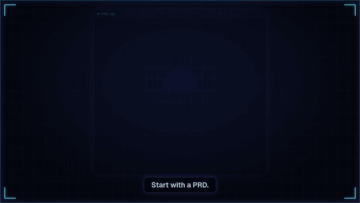

# graph-execution

graph-execution's app is graph-manager: connect a GitHub or GitLab repository, plan a task graph from a PRD, and run headless coding agents (Claude Code, Codex, OpenCode, Qwen Code) in parallel, each in its own git worktree. Each task passes a validation gate as it lands, and after every task has merged one code reviewer and a live tester review the whole graph.



## Quick start

Node.js 20 or later.

```bash
npm install -g graph-execution && graph-execution manager
```

It listens on http://127.0.0.1:7420, prints a generated password saved in `~/.graph-manager/password`, and opens the browser.

**Use the CLI directly.** The engine under the app is the `graph-execution` command. The minimal run is in the [CLI quick start](packages/graph-execution/README.md#quick-start).

## How it works

1. Connect GitHub or GitLab with a personal access token, then clone a repository into a workspace.
2. Open a terminal in that workspace (Claude Code, Codex, OpenCode, Qwen Code, or a plain shell).
3. Plan the tasks from a PRD in the terminal. The spec file opens beside the terminal while it is written. **Start run** takes that spec and the tasks folder.
4. Watch the run live. Independent tasks run at the same time, each agent in its own git worktree. A task that depends on others starts after those have merged. By default a validation gate runs on each task before it merges.
5. After every task has merged, one code reviewer and a live tester judge the whole result, then a fixer handles blockers and majors. That review runs once for the merged graph, not on each task. Human review is off unless you turn it on in Start run, pass `--human-review`, or set `"humanReview": true`.
6. When the run is applied, **Create PR** (or **Create MR** on GitLab) opens the pull request.

Agents run in full-auto mode with your user's permissions. This is not a sandbox.

## Docs

- [CLI documentation](packages/graph-execution/README.md)
- [graph-manager](apps/graph-manager/README.md)

## graph-manager

graph-manager is the web app. The CLI above is the engine it starts runs with. From the browser you connect GitHub or GitLab, clone repositories into workspaces, open terminals, follow every run, and open a pull request from an applied run.

The quick start command prints its address and the password for the login page, then opens the browser:

```text
graph-manager listening on http://127.0.0.1:7420
Password: kq3ZJ0cXo1b9mVd2wTn5Hs8yLr4uAe7P (saved in /home/ada/.graph-manager/password)
```

The password is generated on the first start and saved in `~/.graph-manager/password`. Set `GM_PASSWORD` to a non-blank value to choose your own. A blank value counts as unset. A password taken from `GM_PASSWORD` is not written to the file. The flags are `--port`, `--host`, `--data-dir`, `--workspaces-dir` and `--no-open`. On Linux, `npm install` compiles `node-pty` and needs Python 3, make and a C++ compiler; macOS and Windows get a prebuilt binary.

It also ships as one Docker image:

```bash
docker build -f apps/graph-manager/Dockerfile -t graph-manager:dev .
docker run -d -e GM_PASSWORD='choose-a-password' -p 127.0.0.1:7420:7420 \
  -v gm-data:/data -v gm-workspaces:/workspaces graph-manager:dev
```

See [`apps/graph-manager/README.md`](apps/graph-manager/README.md) for the configuration, the first steps, sandboxed runs and the security notes.

## Development

This repository is an npm workspaces monorepo.

| Workspace | What it is |
| --- | --- |
| [`packages/graph-execution`](packages/graph-execution/README.md) | The CLI engine, published to npm as `graph-execution` |
| [`apps/graph-manager`](apps/graph-manager/README.md) | The web app, shipped inside the `graph-execution` npm package (`graph-execution manager`) and as a Docker image |

Run these at the repository root:

```bash
npm ci                              # install all workspaces
npm run typecheck                   # runs the build below, then type-checks every workspace
npm run lint                        # eslint over the whole repo
npm test                            # every workspace's tests
npm run build                       # build the engine, then graph-manager, then copy graph-manager into the engine's dist/manager
npm run build -w graph-execution    # build the engine only, into packages/graph-execution/dist
```

After a build, run the CLI from the root with `node packages/graph-execution/dist/cli.js`. `node packages/graph-execution/dist/cli.js manager` needs the full `npm run build`: the engine-only build removes `dist/manager`'s bundle, and the command then exits 2 with `graph-manager is not part of this build: run npm run build at the repository root`.

Contributing: [CONTRIBUTING.md](CONTRIBUTING.md).

## License

MIT, see [LICENSE](LICENSE). Contributions are accepted under the [Contributor License Agreement](CLA.md).
