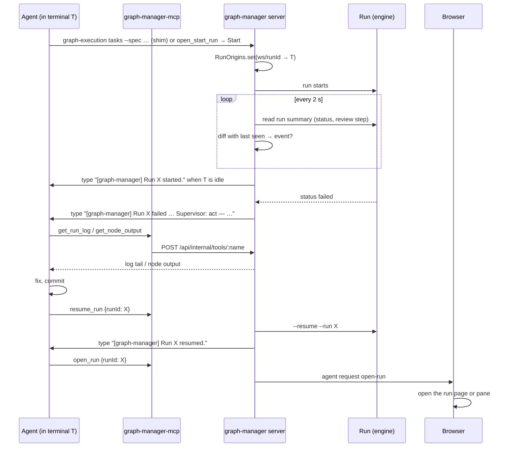

# Agent supervisor: graph-manager MCP tools for runs, and run events to the agent

## Problem

An agent opened in a graph-manager terminal (Claude Code, Codex, OpenCode, Qwen Code) has one graph-manager tool today, `open_start_run` (see `docs/wiki/features/agent-tools.md`). After it starts a run it is blind: it can't see whether the run is going, failed or finished, can't read the run's log or a task's output, can't stop or resume it, and can't point the user's screen at it. The user has to watch the Runs page and come back to the terminal to tell the agent what happened. Unattended runs that fail at night stay failed until morning.

## Goals

1. **KAN-91** New tools in graph-manager's tool registry (`apps/graph-manager/src/server/tools/`), all scoped to the calling terminal's workspace:
   1. `open_run`: jump the user's screen to a run (KAN-91 #1).
   2. `open_graph`: open a run's graph, or a task folder's graph, optionally focused on one node (KAN-91 #2).
   3. `refresh_ui`: make every open graph-manager tab reload its data (KAN-91 #3).
   4. `list_runs`: the status of each run in the workspace (KAN-91 #4).
   5. `cancel_run`: stop a running run (KAN-91 #5).
   6. `get_run_log`: the tail of a run's `run.log` (KAN-91 #6).
   7. `list_graphs`: the task folders in the workspace (KAN-91 #7).
   8. `propose_graph`: show a task folder the agent wrote as a draft graph for the user to approve; Approve opens the prefilled Start run form (KAN-91 #8).
   9. `resume_run`: resume a failed, aborted or interrupted run by id (KAN-91 #9).
   10. `get_node_output`: what one node (task or review agent) of a run produced (KAN-91 #10).
   11. `get_artifacts`: the files a run wrote (KAN-91 #11).
2. **KAN-92** An event-driven supervisor: graph-manager remembers which agent terminal started each run, watches those runs, and types a one-line event into that agent's terminal when the run starts, enters review, succeeds, fails, is resumed or is cancelled.
3. **KAN-92** A per-workspace **Supervisor** setting, `report` (default) or `act`. The failure event tells the agent either to report to the user only, or to find the cause, fix it, commit and call `resume_run`. No cap on reruns.
4. The `run-graph` skill tells the agent about the events and the tools; README and wiki updated.

## Flow

## Decisions

| Decision | Why |
| --- | --- |
| Events reach the agent by typing one line into its terminal (PTY) followed by Enter, only once the terminal has been quiet for `WORKING_MS` (3 s). Lines queue in order per terminal. | The user chose PTY typing. MCP stdio servers can't wake an idle agent, and typing works the same for all four agents. Waiting for a quiet terminal avoids typing into the middle of the agent's output or an in-progress turn. |
| A run's events go only to the terminal that started it. If that terminal was closed, has exited, or isn't an agent terminal (no `agent`), the event is dropped. | The user's choice. Typing into a plain shell would run the text as a command. |
| Also drop the event when the agent terminal's foreground process is its shell (the user quit the agent). | Same reason: the shell would execute the line. |
| Origins are kept in memory (`RunOrigins`), not in `graph-manager.json`. | Terminals don't survive a restart either, so a saved origin would point at nothing. |
| Origins are recorded by: the shim (non-sandbox runs started in a terminal; it picks the run id and tells the server), the sandbox internal route (the shim now sends `GM_TERMINAL_ID`), `POST /api/runs/:ws` with `originTerminalId` (Start run opened from an agent request), and `resume_run` (the caller becomes the origin). | These are every way an agent can start or resume a run. A run started from the UI with no agent request has no origin and sends no events. |
| The shim generates the run id (same `gm-<yyyymmdd-hhmmss>-<4 hex>` format as `newRunId`) and sets `GRAPH_EXECUTION_RUN_ID` for the engine, instead of parsing the engine's output. | The engine already honours that variable (`packages/graph-execution/src/runner/startup.ts`), and the id is known before the run starts, so the first event isn't missed. The shim stays dependency-free. |
| Event detection polls the run summaries of origin runs every 2 s (`listWorkspaceRuns`), server-side, and diffs status and review step against the last seen values. | Reuses the status logic the Runs page already uses (including `interrupted` and `failure`). Only runs with an origin are watched, so the cost is small. |
| Events are run-level only: `started`, `review` (the run entered its review phase: `reviewStep` became set), `succeeded` (`applied` or `done`), `failed` (`failed` or `interrupted`), `resumed` (back to `running` after failed/aborted/interrupted), `cancelled` (`aborted`). No node events. | The ticket. The agent pulls node detail with `get_node_output` and `get_run_log`. |
| The first time the watcher sees a run it sends `started`, then, if the run already ended, its end event too. | Fast runs (the fake provider) can end between two polls. |
| The Supervisor setting lives in `workspaceSettings[<ws>].supervisor`: `"report"` or `"act"`, default `report` when unset. It is edited in the workspace settings drawer. | The user's choice: one setting per workspace, report by default. |
| The mode is written into the `failed` event's text. In `act` the text says: inspect, fix the cause, commit, then `resume_run`. In `report` it says: tell the user what failed, do not change code or rerun. No cap on reruns. | The agent needs the instruction at the moment of failure; the user chose "the setting is the only control". |
| UI tools (`open_run`, `open_graph`, `propose_graph`, `refresh_ui`) reuse the agent-request queue (`agent-requests.ts`) with new `kind`s and return at once. | The pattern `open_start_run` set: non-blocking, browsers already poll every 2 s. |
| `open_run`: a tab whose Terminals page shows the calling terminal opens the run in the next free pane (the existing run-pane mechanism); other tabs show a toast `<Agent> in <repo>: run <id>` with **Open** that goes to `/runs/:ws/:runId`. | Same "pop up where the terminal is" rule as `open_start_run`. |
| `open_graph` with a `runId` opens `/runs/:ws/:runId?node=<id>`, and the run page selects and scrolls to that node. With a `tasksDir` it opens a read-only graph preview dialog of that folder. | "Graph" means a run's task graph or a task folder; both have an id the agent knows. |
| `propose_graph` shows the same preview dialog with **Approve** and **Reject**. Approve opens the prefilled Start run form (with `originTerminalId`). Reject types `[graph-manager] The user rejected the graph <tasksDir>.` into the calling terminal. | The user chose "agent writes the task folder, tool proposes it". graph-manager doesn't run its own LLM. |
| `refresh_ui` goes to every tab and makes it re-fetch the overview and the current page's data. | "Refresh when stale" has no single target. |
| `cancel_run` uses the run page's `POST /abort` when the run is live, and `ctx.sandboxes.stop` for a sandboxed run whose page doesn't answer. A run that isn't running is a tool error. | Same effect as Ctrl+C or the UI's abort; worktrees and state are kept so the run can be resumed. |
| `resume_run` calls the existing `resumeRun(ctx, ws, runId)`. It takes no "answers": the engine has no input-wait other than the human review round, which has its own UI. | Keeps the tool to what the engine supports. |
| Read tools return plain text (Markdown tables/blocks), capped: `get_run_log` default 200 lines, max 2000; `get_node_output` default 200 lines, max 2000; `list_runs` the 20 newest by default. | Agents read text; caps keep the context small. |
| Every tool only sees the calling terminal's workspace. A run id or path of another workspace is "unknown run" / "not inside the workspace". | KAN-91 #4: own-workspace scope only. |

## Non-goals

- Machine-wide run status across workspaces (KAN-91 #4 notes it as a later opt-in).
- Node-level events in the stream.
- graph-manager generating specs or tasks itself with an LLM.
- Dictated answers on resume.
- Persisting run origins or queued events across a graph-manager restart.
- Tools for the agents inside a run (task agents); these tools are for terminal agents only.
- Suites: `resume_run`, `cancel_run` and events don't handle suite runs (`resumeRun` already refuses them; the watcher skips runs whose summary `kind` is a suite).
- Windows-specific behaviour (no MCP shim there today).

## User stories

- As a user, I ask the agent to run my tasks and go to sleep; when the run fails, the agent (in `act` mode) reads the log, fixes the cause, commits and resumes the run without me.
- As a user who wants control, I leave the workspace on `report`; when a run fails the agent tells me which task failed and why, and doesn't touch the code.
- As an agent, I call `list_runs` to see what's running in my workspace before starting something new.
- As an agent, I call `get_node_output` for a failed task to read its error without pulling the whole log.
- As an agent, I call `open_run` after a run finishes so the user's screen shows it.
- As an agent, I write a task folder and call `propose_graph`; the user sees the graph, clicks Approve and starts the run.
- As a user, I open the workspace settings and switch **Supervisor** between "Report to me" and "Fix and rerun".

## Requirements

### Tools (KAN-91)

All in `apps/graph-manager/src/server/tools/<file>.ts`, `defineTool({ name, description, input, run })` (`tools/types.ts`), registered in `TOOLS` in `tools/index.ts`, with a test file next to each. Every tool returns `{ isError: true, text: "this terminal is not inside a graph-manager workspace" }` when `tc.workspace` is undefined, and `{ isError: true, text: "unknown run <id>" }` for a run id that isn't a valid run id (`isRunId`) or has no run folder in the workspace.

| Tool | Input (zod) | Result text |
| --- | --- | --- |
| `list_runs` | `{ status?: "running"\|"failed"\|"applied"\|"done"\|"aborted"\|"interrupted", limit?: int 1–100 (20) }` | First line `Supervisor: report` or `Supervisor: act`. Then a Markdown table, newest first: `run`, `status`, `failure`, `tasks` (e.g. `3/5 merged, 1 failed`), `started`, `tasksDir`. `No runs in this workspace.` when empty. |
| `get_run_log` | `{ runId, lines?: int 1–2000 (200) }` | The last `lines` lines of `<runDir>/run.log`, in a fenced block, headed `run.log of <runId> (last N lines)`. `run <id> has no run.log yet` when missing. |
| `get_node_output` | `{ runId, node, lines?: int 1–2000 (200) }` | For a task id: its status, attempts and error from `state.json` / the cached view, then the tail of its agent log under `<runDir>/logs/` (the file(s) `writeAgentLogs` wrote for that node: all attempts of a label share one file; when a node has several files, e.g. validation logs, the newest by mtime). Review agents (reviewer, tester, fixer, gate) by their node id the same way. `unknown node <node> in run <id>; nodes: a, b, …` when not found. |
| `get_artifacts` | `{ runId }` | The files the run changed (path, status, +/-), from git between `state.startingCommit` and the run's integration branch (`state.integrationBranch`); when that branch is gone and the run is `applied`, from the working tree, with a warning that it may include the user's own edits, plus the run's own report files (`summary`, review/test reports) under the run folder as paths relative to the workspace. A run that isn't `applied`/`done` returns what is merged so far and says so. |
| `list_graphs` | `{}` | Task folders in the workspace: every folder under `.agents/tasks/` (recursively) that directly holds task files, with task count and, when a spec with the same name exists in `docs/prd/` or `docs/prd/done/`, that spec. Markdown table `tasksDir`, `tasks`, `spec`. |
| `open_run` | `{ runId }` | Queues agent request `{ kind: "open-run", runId }`; `Opened run <id> in graph-manager.` |
| `open_graph` | `{ runId?, tasksDir?, node? }` exactly one of runId/tasksDir | Queues `{ kind: "open-graph", runId?, tasksDir?, node? }`; node must exist in the run/folder. |
| `propose_graph` | `{ tasksDir, spec, provider?, options? }` (as `open_start_run`) | Validates like `open_start_run`, queues `{ kind: "propose-graph", prefill }`; `Showed the graph of <tasksDir> to the user for approval. If they approve, the Start run form opens; if they reject, you'll get a message in this terminal.` |
| `refresh_ui` | `{}` | Queues `{ kind: "refresh" }` (not tied to a terminal: every tab acts on it, it expires after 10 s instead of being acked). `Asked graph-manager's open tabs to refresh.` |
| `cancel_run` | `{ runId }` | Live page: `POST <page>/abort` through the same access the proxy uses (`livePage(runDir)` gives the URL and token). Else sandboxed with a record: `ctx.sandboxes.stop`. Else error `run <id> is not running (<status>)`. Success: `Stopped run <id>. Resume it with resume_run.` |
| `resume_run` | `{ runId }` | `resumeRun(ctx, ws, runId)` (`routes/resume.ts`); a `SandboxError` becomes a tool error with its message (and output tail). On success records the caller as the run's origin: `Resumed run <id>. You'll get its events in this terminal.` |

### Agent requests and the web

- `apps/graph-manager/src/server/agent-requests.ts`: `AgentRequest.kind` becomes `"start-run" | "open-run" | "open-graph" | "propose-graph" | "refresh"` with a discriminated union for the payload. `add` keeps "replaces a pending one of the same terminal" only per kind. `refresh` requests have no terminal and expire after 10 s.
- `POST /api/agent-requests/:id/ack` accepts an optional body `{ result?: "approved" | "rejected" }`. For a `propose-graph` request acked with `rejected`, the server types the reject line into the request's terminal through the supervisor's delivery queue.
- `apps/graph-manager/src/web/agentRequests.tsx` (`AgentRequestHost`): handles the new kinds as in the Decisions table. Toast texts: `<Agent> in <repo>: run <id>` (open-run), `<Agent> in <repo> wants to show you a graph` (open-graph, propose-graph). The graph preview dialog uses the existing `TaskGraph` component (`web/pages/TaskGraph.tsx`) with the folder's graph from a new `GET /api/workspaces/:id/graph?tasksDir=…` (nodes, edges, layers, built like `buildGraph`/`layersOf` in `server/runs.ts` from the task files).
- `web/pages/RunDetail.tsx`: reads `?node=<id>`, shows the static view (as `#pr` does, also for a live run), selects that node and scrolls it into view.
- `refresh`: the host bumps a refresh counter that the overview poll and the page data hooks depend on, so they re-fetch now.
- `web/pages/StartRunDrawer.tsx`: when opened from an agent request (`start-run` or approved `propose-graph`), `POST /api/runs/:ws` carries `originTerminalId: <terminalId>`.

### Run origins and the supervisor (KAN-92)

- New `apps/graph-manager/src/server/run-origins.ts`: `RunOrigins` with `set(wsId, runId, terminalId)`, `get(wsId, runId)`, `delete`, `entries()`. In memory, on `AppContext` as `runOrigins`.
- New `apps/graph-manager/src/server/supervisor.ts`:
  - `RunEventWatcher`: started in `buildApp` (stopped on close), interval `ctx.config.supervisorPollMs` (default 2000, settable for tests). Each tick, for each workspace with origins, `listWorkspaceRuns(ws, …)`, and for each run with an origin compares `{ status, reviewStep }` with the last seen and emits events in this order: `started` (first sight), `resumed`, `review`, then `succeeded` / `failed` / `cancelled`. After an end event the run stays watched (a resume can bring it back). An origin whose terminal no longer exists is deleted.
  - `deliver(terminalId, line)`: appends to the terminal's queue in `TerminalManager` (below).
- Event lines (one line, no newline inside, prefixed `[graph-manager] `):
  - `Run <id> started (<tasksDir>).`
  - `Run <id> entered review.`
  - `Run <id> succeeded (<status>). Call get_artifacts to see what it wrote, open_run to show it.`
  - `Run <id> was cancelled.`
  - `Run <id> was resumed.`
  - `Run <id> failed: <failure>. ` + mode text:
    - report: `Supervisor: report. Tell the user what failed and why (get_run_log, get_node_output); do not change code or rerun.`
    - act: `Supervisor: act. Find the cause with get_run_log and get_node_output, fix it, commit, then call resume_run with runId <id>.`
- `apps/graph-manager/src/server/terminals.ts`: `TerminalManager.typeWhenIdle(id, line): boolean` queues a line; a timer types queued lines one at a time when the terminal has had no output for `WORKING_MS` and isn't exited: write the line (control characters stripped), then `\r` 100 ms later. Before typing, drop the line when the terminal has no `agent` or its foreground process (`process`) is the shell it was spawned with. Removing or killing a terminal drops its queue. Returns false when the terminal is unknown or not an agent terminal.
- Origins:
  - `shim.ts`: in engine mode, when `GM_INTERNAL_URL`, `GM_INTERNAL_TOKEN` and `GM_TERMINAL_ID` are set and the args start a run (first positional isn't a subcommand: `suite clean list open install readme skills`, and no `--help`/`--version`): generate a run id, set `GRAPH_EXECUTION_RUN_ID` for the engine child, and `POST /api/internal/run-origins { terminalId, cwd, runId }` before spawning (best effort: a failure prints nothing and the engine still runs). With `--resume --run <id>`, register that id. `--resume` without `--run`: no origin.
  - `POST /api/internal/run-origins` (in `routes/internal.ts`, behind `denied`): resolves the workspace of `cwd`, 400 when none, records the origin, 204.
  - Sandbox mode: the shim adds `terminalId: env.GM_TERMINAL_ID` to the `sandbox-runs` body; the route records the origin for the new or resumed run id when present.
  - `POST /api/runs/:ws`: optional `originTerminalId` in `startBody`; recorded (when that terminal exists) after the run starts, with the id the route returns.
- Setting:
  - `store.ts`: `workspaceSettings[*].supervisor: z.enum(["report", "act"]).optional()`.
  - `GET /api/workspaces/:id/supervisor` → `{ mode: "report" | "act" }`; `PUT` the same body → 204. 404 for an unknown workspace, 400 for another value.
  - `web/pages/WorkspaceSettingsDrawer.tsx`: a fieldset **Supervisor** with two radio choices, "Report to me" (`report`) and "Fix and rerun" (`act`), and the hint "What the agent that started a run does when the run fails." Saved with the drawer's other settings.

### Skills and docs

- `packages/graph-execution/skills/run-graph/SKILL.md`: in a graph-manager terminal, after starting a run, the agent will get `[graph-manager] …` lines in its terminal; it should follow the instructions in them, and use `list_runs`, `get_run_log`, `get_node_output`, `get_artifacts`, `cancel_run`, `resume_run`, `open_run` when they are among its tools. Don't poll `state.json` with a sleep loop when those tools are there.
- `packages/graph-execution/skills/to-tasks/SKILL.md`: prefer `propose_graph` over `open_start_run` when available, so the user sees the graph first.
- `apps/graph-manager/README.md`: the tool list and the Supervisor setting.
- `docs/wiki/features/agent-supervisor.md` with a decision table (decision, why, ticket), known follow-ups and code references; linked from `docs/wiki/index.md`.

## Acceptance criteria

- [ ] `GET /api/internal/tools` lists `open_start_run`, `list_runs`, `get_run_log`, `get_node_output`, `get_artifacts`, `list_graphs`, `open_run`, `open_graph`, `propose_graph`, `refresh_ui`, `cancel_run`, `resume_run`.
- [ ] Each tool called for a terminal outside a workspace returns `isError` with `this terminal is not inside a graph-manager workspace`; a run id of another workspace returns `unknown run <id>`.
- [ ] `list_runs` on a workspace with a failed fake run shows a row with status `failed` and its failure, and the first line `Supervisor: report`.
- [ ] `get_run_log { runId, lines: 5 }` returns exactly the last 5 lines of `run.log`.
- [ ] `get_node_output` for a failed task of a fake run includes its status `failed` and the tail of its agent log; an unknown node lists the valid node ids.
- [ ] `get_artifacts` for an applied fake run lists the files the run changed.
- [ ] `list_graphs` lists `.agents/tasks/<name>` folders with task counts.
- [ ] `cancel_run` on a live run makes its status `aborted`; on a finished run it returns `run <id> is not running (applied)`.
- [ ] `resume_run` on an aborted run starts it again and the caller becomes its origin.
- [ ] `open_run`, `open_graph`, `propose_graph` queue agent requests of the right kind; the web host opens the run pane / page, the `?node=` selection, and the preview dialog with Approve/Reject; Reject types the reject line into the terminal.
- [ ] `refresh_ui` makes an open tab run an extra overview poll (`/api/runs` fetched again) within 2 s, and the current page re-fetch its data.
- [ ] A run started from an agent terminal through the shim gets an origin; the agent terminal receives `[graph-manager] Run <id> started (…)` and, for a run that fails, `[graph-manager] Run <id> failed: … Supervisor: report. …`.
- [ ] With the workspace's Supervisor set to `act`, the failure line contains `Supervisor: act.` and `resume_run with runId <id>`.
- [ ] No line is typed into a plain (non-agent) terminal, a closed terminal, or an agent terminal whose foreground process is its shell.
- [ ] Lines are typed only after the terminal has been quiet for 3 s, one at a time, each followed by `\r`.
- [ ] `PUT /api/workspaces/:id/supervisor { mode: "act" }` then `GET` returns `{ mode: "act" }`; unset returns `report`; the drawer shows the setting and saves it.
- [ ] `npm run typecheck && npm run lint && npm test` pass.
