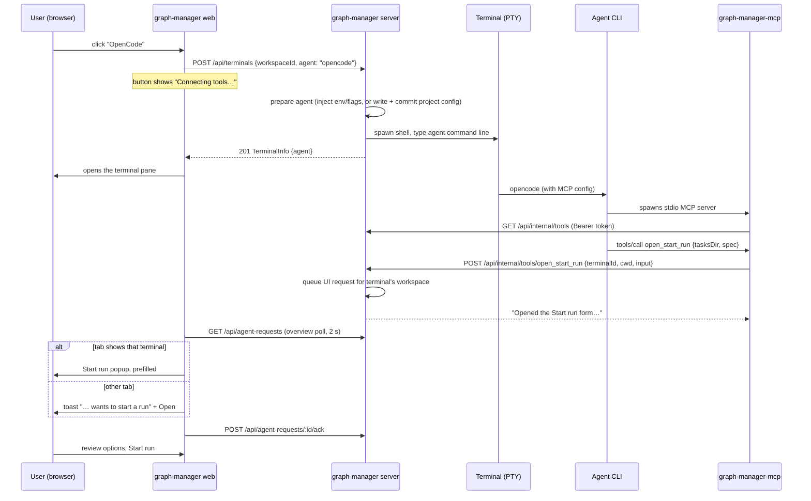

# Agent tools: graph-manager MCP tools for agents opened in its terminals

## Problem

An agent (Claude Code, Codex, OpenCode, Qwen Code) opened in a graph-manager terminal can only talk to graph-manager through the `graph-execution` shim. When it finishes writing a task folder with `to-tasks`, it either starts the run itself with defaults, or tells the user to go to **Runs → Start run** and type the tasks folder and spec again. There is no way for graph-execution developers to give these agents tools that act on graph-manager's UI, and each agent CLI takes tools (MCP servers) differently: some accept them on the command line or in an env var, some only read a config file in the project.

Today the user opens a plain shell terminal and types `claude` (or another agent) by hand, so graph-manager doesn't know which agent runs there and can't set it up.

## Goals

These ids are not Jira tickets: the work was agreed with the user in conversation.

1. **AT-01** A tool registry in graph-manager's server: graph-execution developers add a tool by writing one TypeScript module (name, description, zod input schema, handler) and registering it.
2. **AT-02** One MCP server, `graph-manager-mcp`, a dependency-free stdio command on the terminals' `PATH` that lists and calls the registry's tools through graph-manager's internal API.
3. **AT-03** Agent buttons on the Terminals page: **Claude Code**, **Codex**, **OpenCode** and **Qwen Code**. Each one connects the MCP server to that agent (injected at launch where the agent supports it, otherwise written into the project's config file and committed), shows a loading state while it does, then opens a terminal running that agent. The plain terminal stays as a secondary option.
4. **AT-04** The first tool, `open_start_run`: opens graph-manager's **Start run** popup prefilled with the tasks folder, spec, and optionally the provider and run options, in the browser tab that shows the calling terminal. The user reviews and clicks Start.
5. **AT-05** The `to-tasks` and `run-graph` skills call `open_start_run` when it is available, and keep today's behaviour otherwise.
6. **AT-06** Docs: the graph-manager README (agent buttons, the tool, how to add a tool) and a wiki page.

## Flow



## Decisions

| Decision | Why |
| --- | --- |
| Tools are for graph-execution developers to add in code: `apps/graph-manager/src/server/tools/<name>.ts`, registered in `tools/index.ts`. No config-file tools. | The user chose a code registry; "developers" means people working on graph-execution, not its users. |
| One MCP server for every agent: `graph-manager-mcp`, a stdio JSON-RPC server written by hand with only `node:` imports, like the shim. It fetches the tool list from graph-manager on `tools/list` and forwards `tools/call`. | No new dependency; starts fast; the tool list lives in one place (the server registry), so adding a tool never touches the MCP command or agent configs. |
| The MCP command authenticates with the per-boot `GM_INTERNAL_TOKEN` and finds the caller with a new per-terminal `GM_TERMINAL_ID` env var, both inherited from the terminal through the agent. | Reuses KAN-88's internal API pattern; the token never lands in a file. |
| Injection over committing: Claude via `--mcp-config <file>` plus `--allowedTools mcp__graph-manager`; Codex via `-c mcp_servers.graph-manager.command=…` overrides; OpenCode via the `OPENCODE_CONFIG_CONTENT` env var. Only Qwen Code (no flag or env var for MCP servers) gets its project config `.qwen/settings.json` written and committed. | The user chose "inject, commit only if needed": it keeps the user's repos clean. |
| Each agent is described by an adapter (`server/agents.ts`): id, label, binary, how it connects (`inject` or `project-config`), and the function that builds its command line, env and config. | Adding an agent, or moving one from commit to inject when its CLI gains a flag, is a one-entry change. |
| A committed config uses the bare command `graph-manager-mcp` (no absolute path, no token) and only the `graph-manager` entry is added or replaced; the rest of the JSON is kept. | The commit is portable across machines and graph-manager installs and holds no secrets. |
| The commit contains only the config file, on the current branch, message `chore: connect graph-manager tools for <Agent label>`, never pushed. It is refused (no terminal opens, 409 with the reason) when the file has other uncommitted changes, or the repo is mid-merge, rebase, cherry-pick or has a detached HEAD. When the file already holds the same entry, nothing is written or committed. | The user's other edits are never committed, and the check is idempotent. |
| The agent runs inside the terminal's shell: the shell is spawned with the agent's extra env, and the agent's command line is typed into it once, followed by Enter. Quitting the agent leaves a shell prompt. Restart re-types the command. | The user chose "in a shell". The command shows in the shell history and can be rerun. |
| Agents keep their normal permission prompts; only graph-manager's tools are pre-allowed where the agent supports it (Claude `--allowedTools mcp__graph-manager`, Qwen `"trust": true`). | The user chose normal permissions. |
| `open_start_run` returns right away with a text result and doesn't wait for the user. | The user chose not to block the agent. |
| UI requests are queued in memory on the server (`AgentRequests`), returned by `GET /api/agent-requests`, polled with the overview every 2 s, removed on ack or after 24 h. A new request from the same terminal replaces its pending one. | Works with the existing polling; no new WebSocket channel; a request made while no tab is open shows up when one opens. |
| A tab whose Terminals page shows the calling terminal in a visible pane opens the Start run popup directly; every other tab shows a toast `<Agent> in <repo> wants to start a run` with **Open**, which opens the same popup. The first tab that opens it acks the request. | The user chose "pop up where the terminal is". |
| The Start run drawer is mounted once at the app level (also used by the Terminals page) and gets a `prefill` prop; a prefill wins over the workspace's saved run defaults. | The popup must open on the Terminals page without navigating away from the agent. |
| Agent availability is checked by looking up the binary on the server's `PATH` (`GET /api/agents`); a missing CLI's button is disabled with the tooltip `<binary> is not installed`. | Only Claude Code ships in the Docker image. |
| The skills mention the tool by its MCP name `open_start_run` from server `graph-manager` and use it only when it is listed among the agent's tools. | Outside graph-manager the skills behave as today. |

## Non-goals

- Tools for the agents graph-execution itself spawns during a run (task, review, tester agents).
- Tools declared in config files, or tools added by end users.
- Pushing the committed config, or editing user-level agent config (`~/.claude.json`, `~/.qwen/settings.json`, …).
- Persisting agent requests across server restarts.
- Windows-specific launch handling beyond what plain terminals already do (the shim is not written on Windows; agent buttons there may be disabled when `graph-manager-mcp` can't be written).
- Changing the engine (`packages/graph-execution`) other than its bundled skills.

## User stories

- As a graph-execution developer, I add a tool by writing `src/server/tools/my-tool.ts` and adding it to the registry, and every agent opened from graph-manager can call it after a rebuild.
- As a user, I click **Claude Code** on the Terminals page, see "Connecting tools…" on the button, then land in a terminal where Claude Code is already running with graph-manager's tools.
- As a user, I click **Qwen Code** in a repo that has never used it; graph-manager commits `.qwen/settings.json` with only the tools entry, then opens Qwen Code. The next time it commits nothing.
- As a user, when the agent finishes `to-tasks`, the Start run popup opens next to the terminal with the tasks folder and spec filled in; I change the concurrency and click Start run.
- As a user who has a second tab on the Runs page, I get a toast there instead of a popup.

## Requirements

### Tool registry (server)

- `apps/graph-manager/src/server/tools/types.ts`:
  ```ts
  export interface ToolContext {
    ctx: AppContext;              // config, store, terminals, …
    terminal: TerminalInfo;       // the calling terminal (has workspaceId, agent)
    workspace?: Workspace;        // the terminal's workspace, if any
    cwd: string;                  // the MCP process's cwd (absolute)
  }
  export interface ToolResult { text: string; isError?: boolean }
  export interface GmTool<S extends z.ZodType = z.ZodType> {
    name: string;                 // snake_case, unique
    description: string;          // shown to the agent
    input: S;                     // zod schema of the arguments
    run(input: z.infer<S>, tc: ToolContext): Promise<ToolResult>;
  }
  ```
- `apps/graph-manager/src/server/tools/index.ts` exports `TOOLS: GmTool[]` and `toolList()` returning `{ name, description, inputSchema }[]`, where `inputSchema` is `z.toJSONSchema(tool.input)` (zod 4).
- A test checks every registered tool: unique snake_case name, non-empty description, input schema that converts to a JSON Schema object.

### Internal API

- In `apps/graph-manager/src/server/routes/internal.ts` (same Bearer token and loopback checks as `/api/internal/sandbox-runs`; factor the check into one helper):
  - `GET /api/internal/tools` → `200 { tools: [{ name, description, inputSchema }] }`.
  - `POST /api/internal/tools/:name` with body `{ terminalId: string, cwd: string, input: unknown }`:
    - unknown tool → 404 `{ error: "unknown tool <name>" }`;
    - unknown terminal → 400 `{ error: "unknown terminal <id>" }`;
    - input fails the schema → 200 `{ text: "invalid arguments: <zod message>", isError: true }`;
    - otherwise 200 with the tool's `ToolResult`.

### Terminals

- `CreateTerminal` and `TerminalInfo` gain `agent?: AgentId` (`"claude" | "codex" | "opencode" | "qwen"`). `CreateTerminal` also gains `env?: Record<string,string>` (added at spawn, also on restart) and `input?: string` (written to the PTY once after spawn, and again after each restart).
- Every terminal gets `GM_TERMINAL_ID=<id>` in its env. `GM_TERMINAL_ID` joins `STRIPPED_ENV` so an outer graph-manager's value never leaks.
- `writeGraphExecutionShim`'s sibling `writeMcpShim(binDir, mcpJs)` writes `<binDir>/graph-manager-mcp` (`#!/bin/sh\nexec node "<mcpJs>" "$@"`, mode 755); skipped on Windows like the existing shim.
- Default title of an agent terminal: `<Agent label> · <repo>` (e.g. `Claude Code · hello`), workspaces root: `<Agent label>`.

### Agent adapters (`apps/graph-manager/src/server/agents.ts`)

- `AGENTS: AgentAdapter[]`, one per agent:

  | id | label | binary | connect | launch |
  | --- | --- | --- | --- | --- |
  | `claude` | Claude Code | `claude` | inject | `claude --mcp-config <dataDir>/agents/claude-mcp.json --allowedTools mcp__graph-manager` |
  | `codex` | Codex | `codex` | inject | `codex -c 'mcp_servers.graph-manager.command="graph-manager-mcp"'` |
  | `opencode` | OpenCode | `opencode` | inject | `opencode`, env `OPENCODE_CONFIG_CONTENT={"$schema":"https://opencode.ai/config.json","mcp":{"graph-manager":{"type":"local","command":["graph-manager-mcp"],"enabled":true}}}` |
  | `qwen` | Qwen Code | `qwen` | project-config | `qwen`; file `.qwen/settings.json` gets `mcpServers["graph-manager"] = { "command": "graph-manager-mcp", "trust": true }` |

- The Claude file `<dataDir>/agents/claude-mcp.json` is `{"mcpServers":{"graph-manager":{"type":"stdio","command":"graph-manager-mcp","args":[]}}}`, written at startup (mode 644) — no secrets in it.
- Command lines are built as argv arrays and quoted for the shell with one helper (POSIX single quotes; PowerShell quoting on Windows).
- `isInstalled(adapter, env)`: the binary is found on `PATH` (checking `PATHEXT` on Windows), without spawning it.
- `prepareProjectConfig(adapter, workspacePath)` for `project-config` agents:
  1. Read the file (missing → `{}`; invalid JSON → `AgentPrepareError(409, "<file> is not valid JSON")`).
  2. If `mcpServers["graph-manager"]` already deep-equals the entry → return `{ changed: false }`.
  3. Refuse with 409 when `git status --porcelain -- <file>` is non-empty, or `.git/MERGE_HEAD`, `.git/REBASE_HEAD`, `rebase-merge/`, `rebase-apply/`, `CHERRY_PICK_HEAD` exist, or HEAD is detached: `cannot commit <file>: <reason>`.
  4. Write the file (2-space JSON + newline, other keys kept), `git add -- <file>`, `git commit -m "chore: connect graph-manager tools for <label>" -- <file>`. Commit failure → 409 with git's last lines, and the file is restored.
  5. Return `{ changed: true, commit: <sha> }`.

### Routes

- `GET /api/agents` → `{ agents: [{ id, label, installed, connect: "inject" | "project-config" }] }`.
- `POST /api/terminals` accepts `agent?: AgentId`. With an agent: unknown → 400; not installed → 400 `{ error: "<binary> is not installed" }`; terminal not in a workspace and agent is `project-config` → 400 `{ error: "<label> needs a workspace" }`; preparation errors → their status and message; otherwise 201 `TerminalInfo` with `agent`, plus `connected: { changed, commit? }` for project-config agents.

### Agent requests (UI requests from tools)

- `apps/graph-manager/src/server/agent-requests.ts`: `class AgentRequests` with `add(req)`, `list()`, `ack(id)`; requests `{ id, kind: "start-run", terminalId, workspaceId, agent?, createdAt, prefill: { tasksDir, spec, provider?, options? } }`. A new request from the same terminal replaces its pending one. Entries older than 24 h are dropped on read.
- Routes (cookie-authenticated, like the rest of `/api`): `GET /api/agent-requests` → `{ requests }`; `POST /api/agent-requests/:id/ack` → 204, unknown → 404.
- `AppContext` gains `agentRequests` and `agents` (the adapters with their resolved paths).

### The `open_start_run` tool (`src/server/tools/open-start-run.ts`)

- Description: `Open graph-manager's Start run form for the user, prefilled with a task folder and spec. Call it when a task folder is written, validated and committed, instead of starting the run yourself. The user reviews the options and starts the run.`
- Input: `{ tasksDir: string, spec: string, provider?: "claude"|"codex"|"opencode"|"qwen"|"fake", options?: RunOptionsBody (runOptionsSchema) }` (`options.extraArgs` carries extra arguments). Paths may be relative to the MCP process's cwd or to the workspace root.
- Errors (`isError: true`): the terminal is not in a workspace (`this terminal is not inside a graph-manager workspace`); `tasksDir` not a folder inside the workspace; `spec` not a file inside the workspace (reuse `insideWorkspace` from `routes/runs.ts`).
- On success: queues a `start-run` request with paths made relative to the workspace root and returns `Opened the Start run form in graph-manager with tasks folder <tasksDir> and spec <spec>. The user will review the options and start the run; do not start it yourself.`

### MCP command (`src/server/mcp.ts`, built to `dist/server/mcp.js`)

- Only `node:` imports. Reads newline-delimited JSON-RPC 2.0 from stdin, writes responses to stdout, logs to stderr.
- `initialize` → `{ protocolVersion: <client's, else "2025-06-18">, capabilities: { tools: {} }, serverInfo: { name: "graph-manager", version } }`; `notifications/initialized` ignored; `ping` → `{}`; `tools/list` → `{ tools }` from `GET /api/internal/tools`; `tools/call` → `{ content: [{ type: "text", text }], isError }` from `POST /api/internal/tools/:name` with `{ terminalId: GM_TERMINAL_ID, cwd: process.cwd(), input: arguments }`; unknown method → JSON-RPC error `-32601`.
- Without `GM_INTERNAL_URL`, `GM_INTERNAL_TOKEN` or `GM_TERMINAL_ID`: `tools/list` returns no tools, and `tools/call` returns `isError: true` with `graph-manager tools work only in a graph-manager terminal`. Network errors become `isError` results, never a crash.
- The logic is a pure `handleMessage(msg, env, fetch)` function so tests drive it without a process; one test spawns the built file and does a real `initialize` + `tools/list` round trip.

### Web

- `web/types.ts`: `TerminalInfo.agent?`, `AgentInfo`, `AgentRequest`.
- Terminals page (`TerminalSidebar.tsx`, `Terminals.tsx`): the sidebar's primary action becomes a row of agent buttons (`data-testid="agent-btn-<id>"`, label = agent label), with **Plain terminal** (`data-testid="new-terminal"`, keeps `Ctrl Space, n`) as a secondary button. Clicking an agent button opens the same New terminal dialog (workspace + title) titled `New <label> terminal`; Create posts `{ workspaceId, title, agent }`. While the request runs, the dialog's Create button and the agent button show a spinner and `Connecting tools…`, and stay disabled. Errors show in the dialog. A disabled button has `title="<binary> is not installed"`. Terminals with an agent show the agent label as a tag in the sidebar row.
- `overview.tsx` polls `GET /api/agent-requests` with the other requests and exposes `agentRequests`.
- A new `AgentRequestHost` mounted in `App.tsx` inside the providers: for each request not yet handled in this tab, if the Terminals page shows the request's terminal in a visible pane (exposed through a small context the Terminals page sets), it acks and opens the Start run drawer with `initialWorkspace = workspaceId` and `prefill`; otherwise it shows a toast `<Agent label or "An agent"> in <repo> wants to start a run` with **Open**, which acks and opens the drawer in place.
- `StartRunDrawer` gains `prefill?: { tasksDir: string; spec: string; provider?: Provider; options?: RunOptionsBody }`; when given, it is applied after the workspace's run defaults load (provider and options fall back to the defaults when absent).

### Skills (`packages/graph-execution/skills/` — find the bundled copies with `git ls-files | grep SKILL.md`; also `.claude/skills/` in this repo)

- `to-tasks`: final step — if the tool `open_start_run` (MCP server `graph-manager`) is available, call it with the tasks folder and spec after validation and commit, and tell the user the Start run form is open; otherwise offer `run-graph` as today.
- `run-graph`: when the user asks to start a run in a graph-manager terminal and the tool is available, call `open_start_run` instead of running the CLI, unless the user asked to start it without them (then run it as today).

## Acceptance criteria

- [ ] `GET /api/internal/tools` with the token lists `open_start_run` with a JSON Schema object whose `required` contains `tasksDir` and `spec`; without the token it is 401.
- [ ] `POST /api/internal/tools/open_start_run` from a terminal inside a workspace with an existing tasks folder and spec returns `isError` false and the text starting `Opened the Start run form`; `GET /api/agent-requests` then holds one `start-run` request with workspace-relative paths.
- [ ] The same call with a missing spec returns `isError: true` and no request is queued; from a terminal at the workspaces root it returns `this terminal is not inside a graph-manager workspace`.
- [ ] `POST /api/agent-requests/<id>/ack` → 204 and the request is gone; an unknown id → 404.
- [ ] Spawning `node dist/server/mcp.js` with the env of a test server and sending `initialize` then `tools/list` returns `open_start_run`; with no env, `tools/list` returns `[]`.
- [ ] `POST /api/terminals {workspaceId, agent: "claude"}` with a fake `claude` on PATH returns 201 with `agent: "claude"` and the fake receives `--mcp-config <file> --allowedTools mcp__graph-manager`; the file names the `graph-manager-mcp` command.
- [ ] The same for `codex` (gets `-c mcp_servers.graph-manager.command="graph-manager-mcp"`) and `opencode` (gets `OPENCODE_CONFIG_CONTENT` whose `mcp.graph-manager.command` is `["graph-manager-mcp"]`).
- [ ] `POST /api/terminals {agent: "qwen"}` in a clean repo commits only `.qwen/settings.json` (other keys of an existing file kept) with message `chore: connect graph-manager tools for Qwen Code`; a second call adds no commit; with an uncommitted edit to that file it returns 409 `cannot commit .qwen/settings.json: …` and no terminal is created.
- [ ] An agent not on PATH → `GET /api/agents` says `installed: false`, `POST /api/terminals` → 400 `<binary> is not installed`, and its button is disabled with that tooltip.
- [ ] Quitting the agent in an agent terminal leaves a shell running (the terminal is not `exited`); every terminal's env has `GM_TERMINAL_ID` equal to its id.
- [ ] Terminals page: four agent buttons and **Plain terminal**; clicking an agent shows `Connecting tools…` until the POST resolves, then the new terminal opens in a pane.
- [ ] With the calling terminal visible, a queued request opens the Start run drawer with the tasks folder and spec inputs set to the prefill and acks it; on the Runs page the same request shows the `wants to start a run` toast instead, and **Open** opens the prefilled drawer.
- [ ] The `to-tasks` and `run-graph` skills mention `open_start_run`.
- [ ] `apps/graph-manager/README.md` documents the agent buttons, `open_start_run`, and "Adding a tool". (The wiki page is written after the run, outside the tasks.)
- [ ] `npm run typecheck && npm run lint && npm test` pass.
