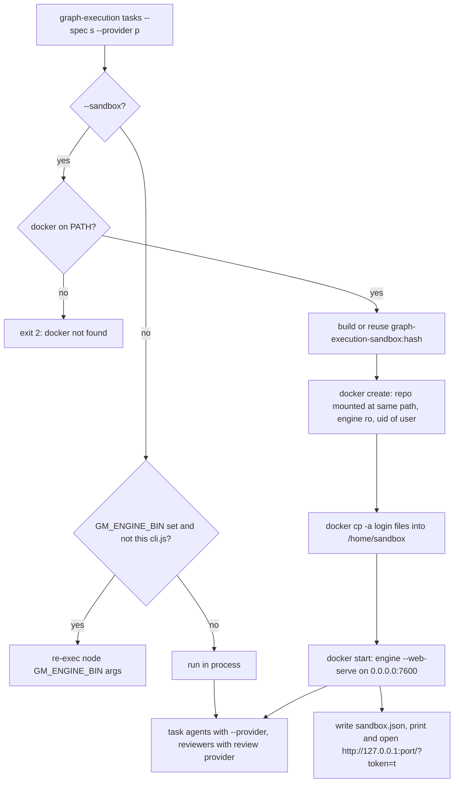

# More agents, review provider, standalone sandbox and agent-opened Start run

## Problem

Five gaps, reported together by the maintainer:

1. **Reviewers always use the run's provider and model** unless someone writes a reviewers file and sets `provider`/`model` on each reviewer. There is no quick way to say "build with Codex, review with Claude Opus" for one run, from the CLI or from graph-manager's Start run form.
2. **Only four agent CLIs are supported** (`claude`, `codex`, `opencode`, `qwen`). Users want **pi**, **oh-my-pi** (`omp`) and **GitHub Copilot CLI** (`copilot`), with every feature the other agents have: engine provider, loop detection, reviewers, graph-manager terminals with graph-manager's tools, the sandbox CLIs image, login copy into sandboxes, icons, skills, docs.
3. **The npm package alone has no sandbox.** `graph-execution --sandbox` exits 2 with "--sandbox needs graph-manager". A user of the plain CLI cannot keep agents away from the rest of the machine.
4. **When an agent opens the Start run form** (graph-manager's `open_start_run` tool), the panel appears with the same 24px slide as any drawer. Nothing tells the user that the agent opened it.
5. **graph-manager's agents do not always get the skills or the engine of the running graph-manager.** Skills are synced only into `~/.claude/skills` and `~/.agents/skills`, which some agents do not read. An agent that runs `npx graph-execution`, a global `graph-execution`, `node_modules/.bin/graph-execution`, or a terminal on Windows (where no shim is written) runs whatever version npm finds, not the engine graph-manager ships.

## Goals

1. Run-level **review provider and model**: `--review-provider <name>` and `--review-model <m>` flags, `reviewProvider`/`reviewModel` config keys, and two fields in graph-manager's Start run form (and `open_start_run`).
2. Three new providers, **`pi`**, **`omp`** and **`copilot`**, everywhere the existing four are supported.
3. One **provider catalog** in the engine, exported from `graph-execution/api`, that graph-manager uses instead of its own copies of the provider lists, login files, key variables, CLI packages and skill folders.
4. A **standalone sandbox**: `graph-execution … --sandbox` with the local `docker` CLI, a bundled Dockerfile, a `sandbox` config section, image flags on the run (`--sandbox-image`, `--sandbox-base`, `--sandbox-line`) and `graph-execution sandbox build|dockerfile|config` commands to build, preview and save the image settings. `--resume`, `open`, `list`, abort and the web view work for sandboxed runs.
5. An **audit** that every engine feature documented in the package README works without graph-manager, with a fake-provider test for each.
6. An **agent-opened Start run animation**: full slide-in, a one-time accent glow and an "Opened by <agent>" badge with the agent's icon.
7. graph-manager **syncs the skills into every agent's user skill folder** and makes **every `graph-execution` an agent can start in its terminals run graph-manager's own engine** (self-delegation in the engine, a Windows `.cmd` shim, a visible engine path and version).

## Workflow



## Decisions

| Decision | Why |
| --- | --- |
| Review provider precedence: a reviewer's own `provider` in the reviewers file, then `--review-provider`, then `reviewProvider` in the config, then `--provider`. Model: the reviewer's own `model`; else, for a reviewer with no own provider, `--review-model`, then `reviewModel`, then `--model`; a reviewer with its own provider and no model keeps today's fallback to `--model`. | The reviewers file is the most specific. A review model is meant for the review provider, so it is not forced onto a reviewer that names another provider. |
| The review provider and model are resolved once at start (flag, else config) and saved in `state.json` as `reviewProvider`/`reviewModel`. The run's `reviewers.json` copy is unchanged (byte copy, only when a reviewers file is given). `readRunReviewers(runDir, { reviewProvider, reviewModel })` applies them to every reviewer without its own provider when reviewers are read, so the run, resume, retries and human-review rounds all get them. `--resume` takes neither flag. | Always rewriting the copy would make built-in runs look "custom" (node titles, `hashes.reviewers`) and break the byte-copy guarantee. |
| The fixer, gate fixer, resolver and summarizer keep the run's provider and model. | The user asked for reviewers only; the fixer edits code, like the task agents. |
| Suites keep the built-in reviewers and the run provider (unchanged). | Out of scope; listed as a follow-up. |
| A provider catalog `src/providers/catalog.ts` holds, per provider: id, label, CLI binary, npm package, login files (relative to HOME), login env keys, session env pattern, user skill folders, MCP support. `getProvider`, `PROVIDERS`, `REVIEWER_PROVIDERS`, `install skills` and every graph-manager list read it. | Adding an agent touched 15 files; with one table, an agent cannot be half-added again. graph-manager already imports `graph-execution/api`. |
| New provider ids are `pi`, `omp` and `copilot`. Labels "pi", "oh-my-pi" and "GitHub Copilot". | The CLI binary names; short and unambiguous. |
| Each new adapter follows the pattern in `providers/claude.ts`: prompt on stdin, unattended flags, JSON output parsed into `output` and `tool` events, `GRAPH_EXECUTION_<NAME>_ARGS` for extra flags, `--model` passed through. The exact flags are in Requirements. | Same contract as the four existing providers, so loop detection, idle timeout, abort and retries work unchanged. |
| The image can be set three ways, most specific first: run flags (`--sandbox-image`, `--sandbox-base`, `--sandbox-line`), then the config's `sandbox` section, then the bundled default. `graph-execution sandbox config` edits the config section from the CLI. | The user asked to configure the image from the CLI; flags for one run, a command to save it for the repo. |
| The standalone sandbox uses the `docker` CLI through execa, not the Docker socket API. | The CLI handles contexts, Docker Desktop and remote daemons; no socket path guessing. graph-manager keeps its own socket client. |
| `--sandbox` implies `--web`: the host CLI builds, starts the container, prints and opens the run page and exits. | The engine in the container is a detached `--web-serve` process, like in graph-manager. |
| The image is `graph-execution-sandbox:<12 hex of sha256(Dockerfile)>`, built from a Dockerfile generated from the bundled template: `FROM <base>`, `npm install -g` of the CLI packages of the run's providers (task and reviewers), a `/home/sandbox` with mode 1777, then the config's extra lines. It is built with `docker build -t <tag> -` (no build context). | Docker builds the CLIs for the container's OS and CPU (the macOS "Exec format error" lesson). Hash tags make identical recipes share an image. |
| The engine is not installed in the image: the running package (its `dist`, `skills`, `package.json` and runtime dependencies) is copied once per version into `~/.cache/graph-execution/sandbox-engine/<version>-<mtime>/` and bind-mounted read-only at `/opt/graph-execution`. | A local build and a published version run the same way, and an engine upgrade does not rebuild the image. The engine's dependencies are pure JavaScript. |
| The git top-level of the repo is bind-mounted read-write at the same absolute path; nothing else of the host is mounted. | Worktrees and `state.json` hold absolute paths. |
| The container runs as the host user's uid:gid with `--security-opt no-new-privileges`, `--init`, a fixed hostname `sbx-<8 hex>`, and the limits from config (default 2 CPUs, 4096 MB, 2048 PIDs). Network is open. | Files written in the repo stay owned by the user. Same defaults as graph-manager's sandboxes. |
| Login files are staged in a 0700 temp dir, copied with `docker cp -a <dir>/. <ctr>:/home/sandbox` before start, and the temp dir is deleted at once. Login env keys, `GRAPH_EXECUTION_*` (except the ones the sandbox sets), and the git identity are passed with `-e`. | Credentials never stay on the host outside their normal place, and the container's copy dies with the container. `-a` keeps the user's uid, which the container runs as. |
| The run page is published on `127.0.0.1:<free port>` only, with a per-run token (`GRAPH_EXECUTION_WEB_TOKEN`). The engine's web server also accepts `?token=<t>` on a page request, answers with a redirect that sets an HttpOnly `SameSite=Strict` cookie, and accepts the cookie afterwards (as well as the existing header). | Other containers on the default bridge can reach a container's port 7600; the browser cannot send a header. |
| The host CLI writes `.graph-execution/<run-id>/sandbox.json` `{ container, image, url, token, host }`. `open`, `list`, `clean` and `--resume` use it and `docker inspect` for liveness of a sandboxed run. | PIDs inside the container mean nothing to the host. |
| A sandboxed run resumes only in a new sandbox: `--resume --run <id> --sandbox`. It checks that the old container is gone (`docker inspect`), then passes `GRAPH_EXECUTION_TAKE_LOCK_FROM=<old hostname>`. A plain `--resume` keeps today's exit 2 with the hint, now naming `--sandbox`. | Same rule as graph-manager. |
| In a graph-manager terminal, `--sandbox` keeps going through graph-manager's shim. Inside any sandbox (`GRAPH_EXECUTION_SANDBOX=1`), `--sandbox` exits 2 "already running in a sandbox". | graph-manager owns Docker on its host; no nested containers. |
| Windows hosts: `--sandbox` exits 2 "the sandbox needs Linux or macOS; on Windows use WSL". | A Windows path cannot be mounted at the same path in a Linux container. |
| Drawer gets an `entrance="agent"` mode and a `badge` slot; only `AgentRequestHost` uses it. Slide from `translateX(100%)` in 420 ms `cubic-bezier(.2,.8,.2,1)`, then one 1.6 s accent glow (box-shadow). Badge: agent icon + "Opened by <label>" under the title. `prefers-reduced-motion`: no animation, badge kept. | The user chose "slide + agent glow". |
| Skills are synced into every catalog provider's user skill folders, deduplicated, in addition to today's two. Same marker and hash rules as today. | Every agent then sees the to-spec, to-tasks and run-graph skills of the running engine. |
| graph-manager's terminals get `GRAPH_EXECUTION_DELEGATE=<graph-manager's shim.js>` (or the engine `cli.js` when there is no shim) and `GM_ENGINE_BIN=<engine cli.js>`. The engine, before commander parses, re-execs `node $GRAPH_EXECUTION_DELEGATE <args>` (stdio inherited, exit code passed through via `setExitCode`, `GRAPH_EXECUTION_DELEGATED=1` set) when `GRAPH_EXECUTION_DELEGATE` is set, is an existing `.js` file, `GRAPH_EXECUTION_DELEGATED` is not `1`, and the running `cli.js` realpath differs from `GM_ENGINE_BIN`'s realpath. | Catches `npx graph-execution`, global installs and `node_modules/.bin` alike, with no PATH tricks. Going through the shim keeps `--sandbox` handled by graph-manager. |
| graph-manager writes `graph-execution.cmd` (and `graph-manager-mcp.cmd`) shims on Windows. At startup, when `GM_GRAPH_EXECUTION_BIN` resolves to a bare command instead of a `.js` file, it logs a warning; `GET /api/health` reports the engine path and version, shown in Settings. | Windows terminals today run whatever is on the PATH. |

## Non-goals

- Reviewer provider/model for suites, the fixer or the resolver.
- Podman, rootless Docker, Kubernetes or remote-daemon path mapping for the standalone sandbox; Windows hosts.
- Network egress filtering in sandboxes.
- Rewriting graph-manager's sandbox to use the engine's sandbox code.
- `open_start_run` or any graph-manager MCP tool working without graph-manager.
- Agents other than pi, oh-my-pi and Copilot.

## User stories

- As a CLI user, I run `graph-execution .agents/tasks/x --spec s.md --provider codex --review-provider claude --review-model opus` and the reviewers run Claude Opus while tasks run Codex.
- As a graph-manager user, I pick "Review provider: claude, Review model: opus" in Start run.
- As a pi, oh-my-pi or Copilot user, I pass `--provider pi|omp|copilot` and the run works like with Claude; in graph-manager I open a pi, oh-my-pi or Copilot terminal and the agent has graph-manager's tools (where the CLI supports MCP) and the skills.
- As a CLI user, I run `graph-execution sandbox config --base python:3.12-bookworm --line 'RUN npm i -g pnpm'` once, or pass `--sandbox-image my/image` for one run, without editing JSON by hand.
- As a CLI user without graph-manager, I add `--sandbox` and the run happens in a Docker container that sees only my repo; I watch it in the browser, abort it there, and resume it with `--resume --run <id> --sandbox`.
- As a graph-manager user, when the agent calls `open_start_run`, I see the panel slide in with a glow and "Opened by Claude Code".
- As a graph-manager user, whatever command my agent uses to start graph-execution, the run uses graph-manager's engine.

## Requirements

### 1. Provider catalog (engine)

- New `packages/graph-execution/src/providers/catalog.ts`:
  ```ts
  export interface ProviderInfo {
    id: string; label: string; bin: string; npmPackage: string;
    loginFiles: string[];      // relative to HOME, trailing "/" = folder
    loginEnv: string[];        // env keys that log in without files
    sessionEnv: RegExp;        // env vars a running session of this CLI sets (stripped from terminals)
    userSkillDirs: string[];   // relative to HOME
    projectSkillDir: string;   // relative to the repo, for `install skills --target <id>`
    mcp: "inject" | "project-config" | "user-config" | "extension";
  }
  export const PROVIDER_CATALOG: readonly ProviderInfo[];
  export const PROVIDER_IDS: readonly string[]; // claude, codex, opencode, qwen, pi, omp, copilot
  ```
  The existing four entries take their values from today's code: `LOGIN_FILES`/`LOGIN_KEYS` in `apps/graph-manager/src/server/sandbox-run.ts`, `CLI_PACKAGES` in `sandbox-image.ts`, `AGENT_SESSION_ENV` in `terminals.ts`.
- `cli.ts` `PROVIDERS`, `review/reviewers.ts` `REVIEWER_PROVIDERS`, `providers/index.ts` `getProvider` derive from it (`fake` stays hidden and test-only).
- Exported from `src/api.ts`. graph-manager's `sandbox-run.ts`, `sandbox-image.ts`, `terminals.ts`, `routes/runs.ts`, `web/pages/StartRunDrawer.tsx`, `web/types.ts`, `web/agentRequests.tsx` labels and `skills.ts` use it The web bundle cannot import `graph-execution/api` (it pulls in Node modules), so the web keeps its own id/label lists (`web/types.ts` `AgentId`, `StartRunDrawer` `PROVIDERS`, `AGENT_LABELS`, `FALLBACK_AGENTS`) and a server-side test asserts they equal the catalog's ids and labels.
- A test asserts that every catalog id has: an adapter in `getProvider`, an `AgentIcon`, a graph-manager agent adapter, and a README row.

### 2. New providers (engine)

`src/providers/pi.ts`, `omp.ts`, `copilot.ts` with tests modelled on `qwen.test.ts` (args, line parsing, tool-call extraction, stdin prompt via the fake-bin fixture). Exact flags and JSON shapes: see **Appendix A** (filled from the CLIs' own help and source). `providers/tools.ts` gets a tool-call extractor per new format; `agents/loop.ts` ignores their volatile input keys. `GRAPH_EXECUTION_PI_ARGS`, `GRAPH_EXECUTION_OMP_ARGS`, `GRAPH_EXECUTION_COPILOT_ARGS`.

### 3. New agents in graph-manager

- `AGENTS` in `server/agents.ts` gets `pi`, `omp`, `copilot` with the graph-manager tools connected as in Appendix A: Copilot by `--additional-mcp-config` (`inject`); oh-my-pi by graph-manager's entry merged into the user file `~/.omp/agent/mcp.json` at startup (`user-config`, same keep-other-keys rule as qwen's project file); pi, which has no MCP, by a small pi extension graph-manager writes to `<dataDir>/agents/pi-graph-manager.ts` and passes with `-e` (`extension`). The extension spawns `graph-manager-mcp`, speaks MCP JSON-RPC over stdio (`initialize`, `tools/list`, `tools/call`) and registers each tool with `pi.registerTool`, passing the MCP `inputSchema` as `parameters` (TypeBox schemas are JSON Schema). It has no imports other than `node:` modules.
- `AgentIcon.tsx` gets an icon per new agent (simple monogram SVG paths are fine), `FALLBACK_AGENTS` in `Terminals.tsx`, `AgentId` in `web/types.ts`, the agent labels.
- The sandbox CLIs image installs the new packages; login files and keys per catalog.
- `AGENT_SESSION_ENV` includes their session variables.

### 4. Review provider and model

- CLI: `--review-provider <name>` (validated like `--provider`), `--review-model <m>`. Not allowed with `--resume` (exit 2 "--review-provider cannot be used with --resume; the run keeps the review provider it started with").
- Config: `reviewProvider` (enum of providers), `reviewModel` (string) in `configSchema`; README configuration table.
- `preflight` checks the review provider's CLI on the PATH at startup (exit 2, as for a reviewer's provider today).
- At start the resolved `reviewProvider`/`reviewModel` are saved in `state.json` (`stateSchema` gets both as optional strings). `readRunReviewers` takes them as an optional second argument and applies the precedence; `run.ts` (the providers map and `runReviewPhase`), `preflight` (resume check) and every other caller pass `state.reviewProvider`/`state.reviewModel`. The web view's reviewer nodes show "provider · model" when it differs from the run's. In graph-manager's sandbox paths the review provider is added to the `providers` list used for the login copy.
- graph-manager: `runOptionsSchema` gets `reviewProvider` and `reviewModel`; `RunOptionsFields.tsx` shows "Review provider" (select with "Same as run") and "Review model" (text); they become `--review-provider` / `--review-model`; `open_start_run`'s `options` accepts them.

### 5. Standalone sandbox (engine)

- New `src/sandbox/` module: `docker.ts` (execa wrapper: `version`, `build`, `create`, `cp`, `start`, `inspect`, `rm`, `logs`), `image.ts` (Dockerfile generation, tag, build), `engine.ts` (engine copy to the cache), `run.ts` (start/resume a sandboxed run), with unit tests against a fake `docker` script on the PATH (pattern: `src/__fixtures__/fake-bin.ts`).
- Bundled template `packages/graph-execution/sandbox/Dockerfile.template`, added to `files` in `package.json`.
- Config `sandbox` section:
  ```json
  { "sandbox": { "image": "optional ready-made image (skips the build)", "base": "node:24.22.1-bookworm",
    "dockerfile": ["extra Dockerfile lines"], "cpus": 2, "memoryMb": 4096, "pids": 2048, "env": ["EXTRA_VAR"] } }
  ```
  A `FROM` line in `dockerfile` is a config error. A ready-made `image` must have the CLIs of the run's providers on its PATH (checked with `docker run --rm <image> sh -c 'command -v <bin>'` before start; exit 2 naming the missing CLI).
- **Image from the CLI, per run.** Run flags override the config's `sandbox` section for one run and need `--sandbox` (else exit 2 "--sandbox-image needs --sandbox"):
  - `--sandbox-image <image>`: a ready-made image (no build), replaces `sandbox.image`.
  - `--sandbox-base <image>`: the `FROM` of the generated Dockerfile, replaces `sandbox.base`. A base must be glibc-based and have `node` >= 20, `npm` and `git`; when the build's first step `node --version && npm --version && git --version` fails, the error says so.
  - `--sandbox-line <dockerfile line>` (repeatable): extra Dockerfile lines, appended after the config's `dockerfile` lines; `--no-sandbox-config-lines` drops the config's lines for this run.
  - `--sandbox-cpus <n>`, `--sandbox-memory <MB>`, `--sandbox-pids <n>`: the limits.
  - `--sandbox-image` together with `--sandbox-base` or `--sandbox-line` exits 2 "--sandbox-image is a ready-made image; it cannot be combined with --sandbox-base or --sandbox-line".
  - The resolved settings are saved in `state.json` as `sandbox: { image, base?, lines?, cpus, memoryMb, pids }`, and `--resume --sandbox` reuses them (the image flags are not allowed with `--resume`, same rule as `--reviewers`).
- **Image commands** (`graph-execution sandbox …`), all taking the same `--sandbox-image/--sandbox-base/--sandbox-line` overrides as `--image/--base/--line`:
  - `sandbox build [--provider <p>...] [--no-cache]` builds (or rebuilds) the image and prints its tag. Without `--provider`, the CLIs of every catalog provider are installed.
  - `sandbox dockerfile [--provider <p>...]` prints the generated Dockerfile and its tag without building.
  - `sandbox config [--image <i> | --base <b>] [--line <l>]... [--clear-lines] [--cpus n] [--memory MB] [--pids n] [--unset-image]` edits the `sandbox` section of `graph-execution.config.json` at the repo root (creating the file or section when missing, keeping every other key and the file's 2-space formatting), validates it with `configSchema`, and prints the resulting section. With no option it only prints the current section and the effective defaults.
- `--sandbox` on a run: needs `docker` (`docker version` ok) else exit 2 "--sandbox needs Docker: the docker command was not found or cannot reach a daemon"; refuses on Windows and inside a sandbox (messages above). Build output streams to the terminal. The container command is `node /opt/graph-execution/dist/cli.js <original args without --sandbox/--web> --web-serve` with `GRAPH_EXECUTION_SANDBOX=1`, `GRAPH_EXECUTION_SANDBOX_IMAGE`, `GRAPH_EXECUTION_WEB_HOST=0.0.0.0`, `GRAPH_EXECUTION_WEB_PORT=7600`, `GRAPH_EXECUTION_WEB_TOKEN`, `HOME=/home/sandbox`, `PATH` with the image's own PATH. Also `GRAPH_EXECUTION_RUN_ID=<run id chosen by the host>` (on resume, `--resume --run <id>`), `GRAPH_EXECUTION_READY_FILE=<runDir>/.ready.json` (required by `--web-serve`) and `GRAPH_EXECUTION_WEB_PUBLIC_PORT=<host port>`. The host picks a free local port first (listen on port 0, close) and publishes `-p 127.0.0.1:<port>:7600`. The engine's web server today accepts only `Host`/`Origin` `127.0.0.1:<listen port>` and `localhost:<listen port>` (`src/web/server.ts` `handle()`); with `GRAPH_EXECUTION_WEB_PUBLIC_PORT` set it also accepts that port, otherwise the browser gets 421 on the published port.
- After start, the host waits (up to 60 s) for the run's `web.json`, reads the published port with `docker port`, writes `sandbox.json`, prints `Run <id> started in a sandbox: http://127.0.0.1:<port>/?token=<t>` and opens it (same opener as `--web`). On a start failure it prints the container logs, removes the container and exits 2.
- `open`, `list`, `clean`, `--resume` handle `sandbox.json` as described in Decisions. Today a lock from another host counts as held forever (`lockHolder` in `src/state/state.ts`); when the run dir has `sandbox.json`, liveness is `docker inspect` of its container instead (gone or exited = not live; docker unavailable = unknown, treated as live). The `acquireLock` message for a foreign lock names both graph-manager and `--resume --run <id> --sandbox`. `clean` removes a sandboxed run only when its container is gone; `clean` also removes exited `ge-sbx-*` containers of runs it deletes.
- The suite command refuses `--sandbox` (exit 2 "suites cannot run in a sandbox yet").

### 6. Standalone audit

- Each README feature (reviewers file, run options flags, human review, test plans, suites, list/open/clean, install skills, readme, resume, sandbox) has at least one end-to-end test with `--provider fake` that does not touch graph-manager. Missing ones are added; any feature found broken without graph-manager is fixed.
- `graph-execution install skills --target` accepts `agents`, `claude`, `both` (unchanged) plus each catalog provider id (`--target pi` writes to the project-level folder that agent reads, from the catalog) and `all`.

### 7. Agent-opened Start run (graph-manager web)

- `Drawer` props: `entrance?: "default" | "agent"`, `badge?: ReactNode`. With `"agent"` the `aside` has class `drawer drawer-agent`; `badge` renders below the header as `<div className="drawer-badge" data-testid="drawer-badge">`.
- `StartRunDrawer` gets `openedBy?: { agent?: string; label: string }` and passes `entrance="agent"` and a badge `<AgentIcon id=…/> Opened by <label>` when set; `AgentRequestHost` passes it from the request (`requestText`'s label; "An agent" when unknown).
- CSS in `web/ui/base.css`: `@keyframes gm-drawer-enter { from { transform: translateX(100%); } }`, `@keyframes gm-agent-glow { 0% { box-shadow: 0 0 0 0 var(--ac) } 40% { box-shadow: 0 0 0 4px color-mix(in srgb, var(--ac) 45%, transparent), var(--shadow) } 100% { box-shadow: var(--shadow) } }`; `.drawer-agent { animation: gm-drawer-enter 420ms cubic-bezier(.2,.8,.2,1), gm-agent-glow 1.6s ease-out 420ms 1; }`; reduced-motion rule extended to `.drawer-agent`.
- Opening Start run from a button keeps today's look (no badge, no class).

### 8. Skills and engine in graph-manager

- `userSkillRoots` returns today's two plus every catalog provider's `userSkillDirs` (absolute, deduplicated; `CLAUDE_CONFIG_DIR` still honoured).
- Engine self-delegation in `src/cli.ts` before commander parses (in a small `src/launch/delegate.ts` with tests).
- `terminalEnv` sets `GM_ENGINE_BIN` (engine `.js`) and `GRAPH_EXECUTION_DELEGATE` (shim.js, else the engine `.js`); `GM_ENGINE_BIN` is no longer stripped for terminals.
- Windows `.cmd` shims for `graph-execution` and `graph-manager-mcp`.
- Startup warning and `GET /api/health` `{ engine: { bin, version } }`; Settings shows "Engine: <version> (<path>)".
- `run-graph` skill text: "In a graph-manager terminal any `graph-execution`, `npx graph-execution` included, runs graph-manager's engine."

## Acceptance criteria

- [ ] `graph-execution <tasks> --spec s --provider fake --review-provider fake --review-model m` saves `reviewProvider: "fake"`, `reviewModel: "m"` in `state.json`, and the reviewer agents run with model `m` on the fake provider (the fake script records the model); a run without a reviewers file still has no `reviewers.json` copy.
- [ ] A reviewer with its own `provider` in the reviewers file keeps it when `--review-provider` is given.
- [ ] `--resume --review-provider claude` exits 2 with the message above.
- [ ] `--review-provider nope` exits 2 listing the providers.
- [ ] `--provider pi|omp|copilot` is accepted by `--help` and by `parseProvider`; with the CLI missing, startup exits 2 `the "pi" CLI was not found on the PATH; …`.
- [ ] Each new adapter's unit tests pass: argv, prompt on stdin, assistant text extraction, tool-call extraction, extra args env var.
- [ ] `GET /api/agents` lists 7 agents; opening a terminal for each new agent runs its CLI.
- [ ] The sandbox CLIs Dockerfile installs 7 CLI packages and `bun`; `LOGIN_FILES` has entries for all 7 providers.
- [ ] Start run shows "Review provider" and "Review model"; starting a run with them passes `--review-provider`/`--review-model` to the engine.
- [ ] `graph-execution … --sandbox` without docker on PATH exits 2 with "--sandbox needs Docker".
- [ ] With the fake docker on PATH, `--sandbox` calls `build` (or reuses an existing tag), `create` with the repo mounted at its own path, `cp -a`, `start`, writes `sandbox.json`, prints the URL with `?token=` and exits 0; the staged login dir is gone afterwards.
- [ ] The web server accepts `?token=` once, sets the cookie, and then serves with the cookie; without token or cookie it answers 401 when a token is configured.
- [ ] `--resume --run <id> --sandbox` with the old container gone starts a new one with `GRAPH_EXECUTION_TAKE_LOCK_FROM`; with it still running exits 2 "the run's sandbox is still running".
- [ ] `--sandbox --sandbox-base node:22-bookworm --sandbox-line 'RUN apt-get install -y jq'` builds a Dockerfile starting `FROM node:22-bookworm` and containing that line, and `state.json` records them; `--sandbox-image x --sandbox-line y` exits 2; `--sandbox-image x` without `--sandbox` exits 2.
- [ ] `graph-execution sandbox config --base node:22-bookworm --line 'RUN echo hi'` writes `{"sandbox":{"base":"node:22-bookworm","dockerfile":["RUN echo hi"]}}` into the config, keeping other keys; `--line 'FROM x'` exits 2 without writing.
- [ ] `graph-execution sandbox dockerfile --provider pi` prints a Dockerfile with `npm install -g @mariozechner/pi-coding-agent` and the tag, and runs no docker command.
- [ ] `graph-execution sandbox build --provider claude` generates a Dockerfile containing `npm install -g @anthropic-ai/claude-code` and tags `graph-execution-sandbox:<12 hex>`.
- [ ] `install skills --target all` installs into every catalog provider's project folder.
- [ ] An agent-opened Start run has `.drawer-agent` and the badge "Opened by Claude Code"; one opened from the Runs page has neither.
- [ ] graph-manager startup syncs skills into each catalog folder (test with a temp HOME).
- [ ] With `GRAPH_EXECUTION_DELEGATE` pointing to another .js and `GM_ENGINE_BIN` to a different cli.js, running the engine re-execs the delegate (test prints the delegate's argv) and does not loop.
- [ ] `npm run typecheck && npm run lint && npm test` pass.

## Appendix A: new CLIs

Researched on pi 0.73.1, oh-my-pi 18.18.8 and `@github/copilot` 1.0.109, by reading their source and running each against a fake OpenAI-compatible server. Sample JSONL lines below are real output, shortened.

### pi (`@mariozechner/pi-coding-agent`, bin `pi`, Node >= 20.6)

| Item | Value |
| --- | --- |
| Command | `pi --mode json --no-session [--model <provider/id or pattern>]` + `$GRAPH_EXECUTION_PI_ARGS`; prompt on **stdin** (a non-TTY stdin is read, trimmed and used as the prompt; no argument). |
| Approvals | None: pi never asks. No flag needed. |
| Assistant text | `{"type":"message_end","message":{"role":"assistant","content":[{"type":"text","text":"Let me look."},{"type":"toolCall","id":"call_1","name":"bash","arguments":{"command":"echo hi"}}],"stopReason":"toolUse"}}` → output the `text` items. Ignore `message_update` deltas (they would duplicate text). |
| Tool call | `{"type":"tool_execution_start","toolCallId":"call_1","toolName":"bash","args":{"command":"echo hi"}}` → `{ name: toolName, input: args }`. Finished: `tool_execution_end`. Count `tool_execution_start` only. |
| Failure | **`--mode json` exits 0 even when the model request fails.** The adapter tracks the last assistant `message_end`; when its `stopReason` is `"error"` or `"aborted"` (an `errorMessage` is present) and the process exited 0, `done` resolves to exit code 1 and the error message is emitted as output. Also exit 1 for no key/model. |
| Session env | `PI_CODING_AGENT=true` (strip in terminals: `^PI_CODING_AGENT$`). |
| Login files | `.pi/agent/auth.json`, `.pi/agent/models.json`, `.pi/agent/settings.json`. Keys: `ANTHROPIC_API_KEY`, `ANTHROPIC_OAUTH_TOKEN`, `OPENAI_API_KEY`, `GEMINI_API_KEY`, `OPENROUTER_API_KEY`, `XAI_API_KEY`, `GROQ_API_KEY`, `MISTRAL_API_KEY`, `DEEPSEEK_API_KEY`. |
| Skills | User: `~/.pi/agent/skills`, `~/.agents/skills`. Project: `.pi/skills`, `.agents/skills`. Does not read `.claude/skills`. |
| MCP | None. Extensions: `-e <file.ts>`, format `export default function (pi) { pi.registerTool({ name, label, description, parameters, async execute(id, params, signal, onUpdate, ctx) { return { content: [{ type: "text", text }], details: {} }; } }) }`. |
| Interactive | `pi`. Package `@mariozechner/pi-coding-agent`. |

### oh-my-pi (`@oh-my-pi/pi-coding-agent`, bin `omp`, **Bun >= 1.4.4 only**)

| Item | Value |
| --- | --- |
| Command | `omp --mode json --no-session --auto-approve [--model <name or provider/id>]` + `$GRAPH_EXECUTION_OMP_ARGS`; prompt on **stdin** (read untrimmed; a pipe runs print mode). Always pass `--auto-approve` so a user's `approvalMode` setting cannot deny tools. |
| Runtime | The bin has `#!/usr/bin/env bun`; `node` cannot run it. The startup check also requires `bun` on the PATH: `the "omp" CLI needs Bun: install it from https://bun.sh`. The sandbox CLIs images install `bun` (npm package `bun`) next to `omp`. |
| JSON | Same event names and message shapes as pi; one parser (`piJsonLine` in `tools.ts` / a shared `pi-json.ts`) serves both. Extra fields (`partialArgs`, `streamIndex`, `duration`, `ttft`) are ignored. |
| Failure | Exits 1 on `stopReason` error/aborted, also in json mode; keep the pi check anyway. 3 when `--max-cost` is hit. |
| Session env | `OMPCODE=1`; omp also sets `CLAUDECODE=1`, `AGENT=1`, `PI_SESSION_ID`, `PI_SESSION_FILE`, `PI_TOOL_CALL_ID` in its children (strip: `^(OMPCODE|AGENT|PI_SESSION_ID|PI_SESSION_FILE|PI_TOOL_CALL_ID)$`; `CLAUDECODE` is already stripped). |
| Login files | `.omp/agent/agent.db` (SQLite, holds `omp login` credentials), `.omp/agent/config.yml`, `.omp/agent/models.yml`. Keys as pi, plus `COPILOT_GITHUB_TOKEN`. |
| Skills | User: `~/.omp/agent/skills`, `~/.agents/skills`. Project: `.omp/skills`, `.agents/skills`, `.claude/skills`, `.github/skills`. |
| MCP | Native. User file `~/.omp/agent/mcp.json`: `{"mcpServers":{"graph-manager":{"type":"stdio","command":"graph-manager-mcp"}}}`. No CLI flag. |
| Interactive | `omp`. |

### GitHub Copilot CLI (`@github/copilot`, bin `copilot`)

| Item | Value |
| --- | --- |
| Command | `copilot --output-format json --allow-all --no-auto-update [--model <id>]` + `$GRAPH_EXECUTION_COPILOT_ARGS`; prompt on **stdin with no `-p`** (with `-p`, stdin is ignored). Env `COPILOT_AUTO_UPDATE=false`. Model ids are bare (`claude-sonnet-5.5`, `gpt-5.3-codex`, `auto`). |
| Approvals | Without `--allow-all`, headless runs **deny** every shell/edit/path/URL tool and still exit 0. `--allow-all` (= tools + paths + URLs) is required. |
| Assistant text | `{"type":"assistant.message","data":{"content":"Let me look.","toolRequests":[…]}}` → `data.content`. Ignore `assistant.message_delta`. |
| Tool call | `{"type":"tool.execution_start","data":{"toolCallId":"call_1","toolName":"bash","arguments":{"command":"ls"}}}` → `{ name: toolName, input: arguments }`. Finished: `tool.execution_complete`. |
| Failure | Exit 1 on model error, no prompt or parse error; `session.error` lines carry the message. Last line `{"type":"result","exitCode":…}`. |
| Sessions | No `--no-session`. The adapter passes `--session-id <random uuid>` and, after the run, deletes `<COPILOT_HOME or ~/.copilot>/session-state/<uuid>` (best effort). |
| Session env | `COPILOT_CLI=1`, `COPILOT_AGENT_SESSION_ID`, `COPILOT_LOADER_PID`, `COPILOT_CLI_PATH`, `COPILOT_CLI_BINARY_VERSION`, `COPILOT_CLI_RESOLVED_DIST_DIR` (strip `^COPILOT_(CLI|AGENT_SESSION_ID|LOADER_PID|CLI_PATH|CLI_BINARY_VERSION|CLI_RESOLVED_DIST_DIR)$`). |
| Login | `copilot login` stores the token in the OS keychain, or in plain text under `~/.copilot/` without one. Login files: `.copilot/config.json`, `.copilot/settings.json` (never the whole folder: `session-state` is large). Keys: `COPILOT_GITHUB_TOKEN`, `GH_TOKEN`, `GITHUB_TOKEN`. The README says a sandbox needs `COPILOT_GITHUB_TOKEN` when the host keeps the login in a keychain. |
| Skills | User: `~/.copilot/skills`, `~/.agents/skills`. Project: `.github/skills`, `.agents/skills`, `.claude/skills`. |
| MCP | Native. graph-manager writes `<dataDir>/agents/copilot-mcp.json` `{"mcpServers":{"graph-manager":{"type":"local","command":"graph-manager-mcp","args":[],"tools":["*"]}}}` and launches `copilot --additional-mcp-config @<that file>`. |
| Runtime | A Node loader that runs a native binary from `@github/copilot-<platform>-<arch>` (~213 MB). |
| Interactive | `copilot`. |

### Existing agents' skill folders (catalog values)

| Provider | User skill dirs | Project skill dir |
| --- | --- | --- |
| claude | `~/.claude/skills` (or `$CLAUDE_CONFIG_DIR/skills`) | `.claude/skills` |
| codex | `~/.agents/skills`, `~/.codex/skills` | `.agents/skills` |
| opencode | `~/.agents/skills`, `~/.config/opencode/skills` | `.opencode/skills` |
| qwen | `~/.qwen/skills` | `.qwen/skills` |
| pi | `~/.pi/agent/skills` (or `$PI_CODING_AGENT_DIR/skills`), `~/.agents/skills` | `.pi/skills` |
| omp | `~/.omp/agent/skills`, `~/.agents/skills` | `.omp/skills` |
| copilot | `~/.copilot/skills` (or `$COPILOT_HOME/skills`), `~/.agents/skills` | `.github/skills` |
