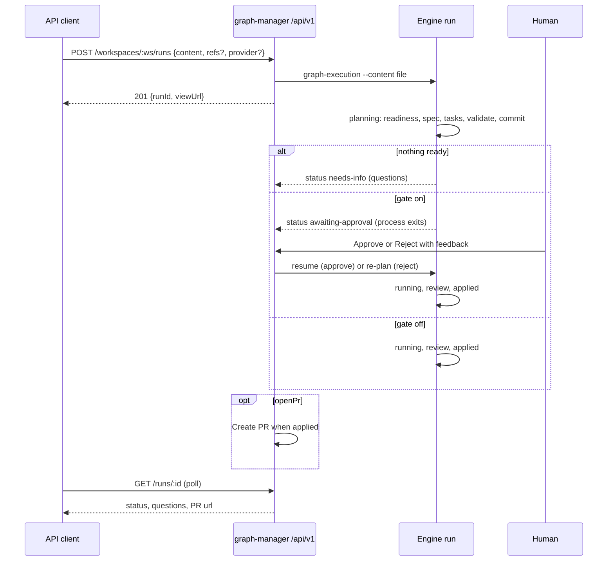

# Automation API: start a run from plain content

## Problem

A run can start only from a spec and a task folder that already exist. Writing them takes a human in a terminal with the `to-spec` and `to-tasks` skills, and `to-spec` stops to wait for the human's approval. Nothing outside graph-manager can start work either: the only login is the admin password with a session cookie (GM-03), which a service cannot use.

So no tool (a Jira poller, a GitHub-issues bot, a script) can hand graph-execution "here is what to build" and get a pull request back. The first such tool is a separate Jira integration service (`graph-execution-jira`, its own repository and spec), which needs everything in this spec. Nothing in this spec knows about Jira.

## Goals

1. **Plan stage in the engine.** `graph-execution --content <file>` starts a run from any markdown: an agent writes the spec and the tasks, checks them, commits them, and then the run goes on as today.
2. **Readiness inside the run.** The planner first decides whether the content can be built. Content that can't ends the run as `needs-info` with questions. With `refs`, only the unclear items are dropped and the rest goes on.
3. **Approval gate.** By default a planned run stops at `awaiting-approval`. It goes on only after a human approves the plan in graph-manager. A rejection with feedback plans again.
4. **API tokens** in graph-manager: named, scoped bearer tokens that the admin creates and revokes.
5. **`/api/v1`**: a versioned automation API to start runs from content, read them, approve or reject them, resume or abort them, open their PRs, and list workspaces.
6. **Approval queue** page in graph-manager, plus the source refs shown as links on runs.
7. **Extension slot**: `GM_EXTENSIONS` adds a nav item that shows an external service's UI through graph-manager's proxy in an iframe.

## Flow



## Decisions

| Decision | Why |
|---|---|
| The input is free markdown (`content`) plus optional `refs: [{ref, url?, title?}]`, not a ticket schema | Any tracker or a person can send it. Refs are the only structure needed: to drop one unclear item, to link the run, to find it again. |
| Without refs the content is one unit: either all of it is ready or the run ends `needs-info` | There is nothing to drop by. |
| Planning is the first stage of the same run (same run id, same run page), not a separate command or endpoint | One call starts everything. The client and the run page see one lifecycle. |
| New run statuses `planning`, `needs-info`, `awaiting-approval` in `runStatusSchema` | The client and graph-manager read where the run is from `state.json`, as today. |
| At `awaiting-approval` the process **exits** (code `EXIT_AWAITING_APPROVAL`). Approve and reject resume it with `--resume --run <id>` plus `--approve-plan` or `--replan <file>` | An approval can take days. A waiting process or sandbox container would hold resources the whole time. Resume, sandbox resume included, already exists. |
| `needs-info` is final: the process exits with `EXIT_NEEDS_INFO` | The client asks the questions and starts a new run when the content changes. |
| The gate is on by default. The engine flag is `--no-plan-gate`, the API field `gate: "approve" \| "auto"` | Keep a human in the loop until the plans are trusted. |
| The planner is a new agent role `planner`. Its prompt is the bundled `to-spec` and `to-tasks` skills plus a headless preamble that says: never ask, write the questions to the result file | One source for "how to write a spec and tasks", shared by humans in terminals and by the engine. |
| The engine checks the planned tasks with the same `validateGraph` and `loadTestPlan` as a normal start, and gives the planner up to `planAttempts` (default 3) fix rounds | A broken task folder must not reach `awaiting-approval`. |
| The planned files go in `docs/prd/<name>.md` and `.agents/tasks/<name>/`, committed on the run's integration branch. `<name>` comes from the planner, kebab-case, made unique with `-2`, `-3`… | It's the same layout as the manual flow, so the result looks the same, and agents only see committed files. |
| The input hashes (`hashes`) are written when planning ends. Resuming a run still in `planning` plans again from scratch | No spec or tasks exist to hash before planning. |
| Tokens look like `gmt_<32 random bytes base64url>`. Only a SHA-256 hash is stored, and the plain token is shown once | A leaked `graph-manager.json` must not leak working tokens. |
| Bearer tokens work only on `/api/v1/*`. There they replace the cookie and skip the Origin check. Cookie sessions also work on `/api/v1` | Browsers can't send a bearer token across sites by themselves, so the Origin check (CSRF) isn't needed for it. The old `/api/*` stays cookie-only. |
| Scopes: `runs:start`, `runs:read`, `runs:approve`, `runs:control`, `runs:pr`, `workspaces:read` | A poller doesn't need `runs:approve`. |
| One implicit tenant. A token record keeps `createdBy: "admin"` | graph-manager has one user. Users can be added later without breaking v1 clients. |
| `sandbox` defaults to `true` on `/api/v1` | Unattended runs must not touch a human's checkout or each other. A client may pass `false` (tests, laptops without Docker). |
| `provider` defaults to the workspace's saved default (`runDefaults[ws].provider`), else 400 | This is the "configured main provider". |
| `openPr: true` makes graph-manager run the existing Create PR job when the run reaches `applied` | Reuses `pr.ts`. The PR branch stays `gm/<runId>`. |
| `idempotencyKey`: a second start with the same key in the same workspace returns the first run (200), not a new one | A client that retries after a timeout doesn't start a duplicate run. |
| Progress is polled. No webhooks in v1 | Clients run on a schedule anyway. |
| The extension UI is an iframe of `/ext/<name>/` that graph-manager proxies, not Module Federation | No build coupling between repositories. It reuses the run-page proxy (GM-07). |

## Non-goals

- Anything that knows Jira (the `graph-execution-jira` repository does).
- Webhooks or push events.
- Multiple users, per-user tokens, SSO.
- Licensing or premium checks.
- Custom PR branch names.
- Module Federation, or extension widgets inside graph-manager's own pages.
- Changing how a run starts from an existing spec and task folder.

## User stories

- As an integration service, I start a run with a token and markdown content, and I poll it until it needs info, waits for approval, fails or has a PR.
- As an integration service, I send three items with refs. One of them is unclear, so I get questions for that ref while the other two go on.
- As the admin, I create a token with only the scopes a service needs, see when it was last used, and revoke it.
- As the admin, I see planned runs waiting for approval, read their spec and tasks, and approve them, or reject them with feedback that is planned again.
- As a CLI user, I run `graph-execution --content notes.md --provider claude --web` and get a spec, tasks and the run, without writing them myself.
- As the admin, I set `GM_EXTENSIONS=jira=http://jira:8080` and get a "jira" item in the nav that shows that service's UI.

## Requirements

### Engine (`packages/graph-execution`)

- **CLI** (`src/cli.ts`):
  - New option `--content <file>`. It is mutually exclusive with `[tasks-dir]` and `--spec`; giving both is a usage error, exit 2.
  - New options `--refs <file>` (a JSON array `[{ref, url?, title?}]`) and `--no-plan-gate`.
  - For resume: `--approve-plan` and `--replan <file>` (the feedback markdown), valid only with `--resume`.
  - `--content` works with `--web`, `--sandbox`, `--provider`, `--model` and all run options.
- **State** (`src/state/state.ts`):
  - `runStatusSchema` adds `planning`, `needs-info` and `awaiting-approval`.
  - `stateSchema` gets an optional `plan` object: `{ contentPath, refs, gate, name?, attempts, questions: [{ref?, questions: string[]}], dropped: string[], feedback: string[] }`.
  - `specPath`, `tasksDir` and `hashes` may be absent while `status` is `planning`.
  - The schema stays readable by older graph-manager code where the fields are present. Export the new statuses through `src/api.ts`.
- **Exit codes** (`src/state/errors.ts`): `EXIT_NEEDS_INFO` and `EXIT_AWAITING_APPROVAL`, exported from `src/api.ts`. Pick unused numbers and document them in the README's exit code table.
- **Planner** (new `src/plan/`):
  - New `AgentRole` `"planner"` in `src/providers/types.ts`.
  - The prompt is a headless preamble, then the text of `skills/to-spec/SKILL.md` and `skills/to-tasks/SKILL.md`, then the content, the refs, and any reject feedback.
  - It runs in the integration branch's worktree.
  - It writes `docs/prd/<name>.md`, `.agents/tasks/<name>/*.json` and `test-plan.json`, and `.graph-execution/<run-id>/plan/result.json` (`{ name, ready: string[], notReady: [{ref, questions}] }`, zod-checked). Without refs: `{ name, ready: boolean, questions }`.
- **Plan loop**: run the planner, then read `result.json`, then `loadTasks` + `validateGraph` + `loadTestPlan`.
  - On an error, run the planner again with the error text, up to `planAttempts` (a config key, default 3, also `--plan-attempts`).
  - Then commit the spec and tasks on the integration branch (`Plan: <name>`), write `hashes`, and set `specPath` / `tasksDir`.
  - If nothing is ready: `needs-info`, exit `EXIT_NEEDS_INFO`.
  - If the gate is on: `awaiting-approval`, exit `EXIT_AWAITING_APPROVAL`.
  - Otherwise: `running`, and the normal run goes on in the same process.
- **Resume**:
  - `--approve-plan` on an `awaiting-approval` run sets it to `running` and runs as today.
  - `--replan <file>` appends the feedback to `plan.feedback`, sets it to `planning`, and plans again (removing the previous plan commit's files first).
  - Resume without either flag on an `awaiting-approval` run is a usage error that names both flags.
- **Fake provider** (`src/providers/fake.ts`): a planner mode for tests. It writes a fixed one-task spec and tasks. A line `NOT-READY: <ref>` in the content puts that ref in `notReady` with one question, and `NOT-READY` without refs makes the whole content not ready. `TESTING.md` documents it.
- **Run page**:
  - It shows `planning`, `needs-info` (with the questions per ref) and `awaiting-approval` (with links to the spec and the task list) as run states.
  - The graph appears once the tasks exist.

### graph-manager: tokens (`apps/graph-manager`)

- **Store** (`src/server/store.ts`): `apiTokens: Record<id, { name, hash, scopes, createdAt, lastUsedAt?, createdBy: "admin" }>`.
- **Admin routes** (cookie only, under `/api/tokens`):
  - `GET` lists tokens without hashes.
  - `POST {name, scopes}` returns the plain `token` once.
  - `DELETE /:id` revokes a token.
- **Auth** (`src/server/auth.ts`):
  - On `/api/v1/*`, `Authorization: Bearer gmt_…` is checked against the stored hashes with a constant-time comparison. It updates `lastUsedAt` (at most once a minute) and skips the Origin check.
  - A wrong or revoked token answers 401 `{"error":"invalid token"}`.
  - A missing scope answers 403 `{"error":"missing scope runs:approve"}`.
  - Bearer is ignored outside `/api/v1`.
- **UI**: Settings → **API tokens**.
  - A table with name, scopes, created and last used, and a Revoke button.
  - A **Create token** form (name, scope checkboxes) that shows the token once, with a copy button and the text "Copy it now. You won't see it again."

### graph-manager: `/api/v1`

Every response is JSON. A run object is:

```json
{ "runId": "gm-…", "workspace": "<ws id>", "status": "planning|needs-info|awaiting-approval|running|applied|done|failed|aborted",
  "refs": [{"ref":"KAN-41","url":"…"}], "questions": [{"ref":"KAN-42","questions":["…"]}], "dropped": ["KAN-42"],
  "spec": "docs/prd/<name>.md", "tasksDir": ".agents/tasks/<name>", "viewUrl": "/runs/…", "pr": {"url":"…"},
  "error": "failure summary, only when failed", "createdAt": "…", "updatedAt": "…" }
```

`viewUrl` is relative to graph-manager's origin. `error` is the run's failure summary (the same text as the run page shows), present only for `failed`.

| Method and path | Scope | Behaviour |
|---|---|---|
| `POST /api/v1/workspaces/:ws/runs` | `runs:start` | Body `{content (1..200000 chars), refs?, provider?, model?, gate?: "approve"\|"auto", sandbox?: boolean (default true), openPr?: boolean, idempotencyKey?, options?}`. Writes the content and refs to `<dataDir>/inputs/<runId>/` and starts the engine with `--content`. Returns `201 {runId, viewUrl}`, `200` with the existing run for a known `idempotencyKey`, `400` for a bad body or no provider, `404` for an unknown workspace |
| `GET /api/v1/runs/:id` | `runs:read` | The run object, or 404 |
| `GET /api/v1/runs?workspace=&status=&ref=` | `runs:read` | `{runs: [...]}`, newest first, filters ANDed |
| `POST /api/v1/runs/:id/approve` | `runs:approve` | Only in `awaiting-approval` (else 409). Resumes with `--approve-plan`. Returns the run object |
| `POST /api/v1/runs/:id/reject` | `runs:approve` | Body `{feedback}` (required). Only in `awaiting-approval` (else 409). Resumes with `--replan` |
| `POST /api/v1/runs/:id/resume` | `runs:control` | Only `failed` or `aborted` (else 409). Same as the existing resume |
| `POST /api/v1/runs/:id/abort` | `runs:control` | Same as the existing abort |
| `POST /api/v1/runs/:id/pr` | `runs:pr` | Starts Create PR. Only `applied` (else 409) |
| `GET /api/v1/workspaces` | `workspaces:read` | `{workspaces: [{id, forge, owner, repo, defaultProvider?}]}` |

- **Registry**: `apiRuns: Record<"<ws>/<runId>", { refs, openPr, idempotencyKey?, startedBy: tokenId | "admin" }>` in the store.
- **Auto PR**: a loop runs every 15 s in graph-manager. For `apiRuns` with `openPr` whose run is `applied` and that have no PR, it starts Create PR once. A failure is logged and shown on the run, not retried in a loop.
- The cookie UI's approve and reject (below) use the same handlers.

### graph-manager: UI

- **Approvals page**:
  - Nav item **Approvals**, with a count badge of runs in `awaiting-approval` across workspaces.
  - Each row has the workspace, the refs as links, the planned spec (opened in the existing spec viewer) and the task count.
  - **Approve**, and **Request changes**, which opens a textarea; the feedback is required.
- **Runs**:
  - A run with `refs` shows them as links (`KAN-41 ↗`) on its card and its detail.
  - The status chips cover the three new statuses.
  - `needs-info` shows the questions.

### graph-manager: extension slot

- `GM_EXTENSIONS="jira=http://jira:8080,other=http://…"` is parsed in `src/server/config.ts`. Names must match `^[a-z][a-z0-9-]{0,31}$`; a bad value stops startup with a clear error.
- For each extension:
  - a nav item with the name
  - a client route `/x/<name>` that renders an iframe of `/ext/<name>/`
  - a login-protected proxy `/ext/<name>/*` → `<url>/*` (HTTP and WebSocket, same Origin check as the run-page proxy), which adds the header `X-GM-Extension-Secret: <GM_EXTENSION_SECRET>` and `X-GM-User: admin`
- If `GM_EXTENSIONS` is set without `GM_EXTENSION_SECRET`, startup stops with a clear error.
- With no `GM_EXTENSIONS` there is no nav item and no route.

### Docs

- README:
  - `--content`, `--refs`, `--no-plan-gate`, `--approve-plan`, `--replan` and `--plan-attempts`
  - the new statuses and exit codes
  - a "Automation API" section with token setup and a curl example
  - `GM_EXTENSIONS` and `GM_EXTENSION_SECRET` in the graph-manager README
- `docs/wiki/features/automation-api.md` with the decision table, linked from `docs/wiki/index.md`.

## Acceptance criteria

- [ ] `graph-execution --content c.md --provider fake` (gate off via `--no-plan-gate`) writes `docs/prd/<name>.md` and `.agents/tasks/<name>/`, commits them on the integration branch, runs the task, and ends `applied`.
- [ ] With the gate on, the same command ends with `status: "awaiting-approval"` in `state.json` and exit code `EXIT_AWAITING_APPROVAL`. Then `--resume --run <id> --approve-plan` finishes it as `applied`.
- [ ] `--resume --run <id> --replan fb.md` plans again, and `plan.feedback` contains the feedback text.
- [ ] Content with `NOT-READY` and no refs ends `needs-info` with exit `EXIT_NEEDS_INFO` and the questions in `state.json`.
- [ ] Content with refs `A`, `B` and `NOT-READY: B` drops `B` (`plan.dropped == ["B"]`, questions for `B`) and plans `A`.
- [ ] A planner that writes an invalid task folder gets the validation error in its next prompt. After `planAttempts` failures the run ends `failed` with the error in the summary.
- [ ] `--content` together with a tasks dir or `--spec` exits 2 with a usage message.
- [ ] `POST /api/tokens` returns a `gmt_` token once. `GET /api/tokens` never shows the token or its hash. After `DELETE`, the token gets 401.
- [ ] `/api/v1/*` without a token or cookie → 401. A token without `runs:approve` calling approve → 403 `missing scope runs:approve`. A bearer token on `/api/workspaces` (non-v1) → 401.
- [ ] `POST /api/v1/workspaces/:ws/runs` with `{content, sandbox:false, provider:"fake"}` → 201. `GET /api/v1/runs/:id` then shows `planning` and, later, `awaiting-approval`.
- [ ] A second POST with the same `idempotencyKey` → 200 with the same `runId`.
- [ ] POST without `provider` on a workspace with no saved default → 400 `{"error":"no provider: pass provider or start a run in this workspace once"}`.
- [ ] `approve` on a run that isn't `awaiting-approval` → 409.
- [ ] `GET /api/v1/runs?ref=A` returns only runs whose refs contain `A`.
- [ ] With `openPr: true` and a connected forge, an applied run gets a PR without a click (tested with the existing PR test doubles).
- [ ] The Approvals page lists an `awaiting-approval` run. **Approve** moves it to `running`. **Request changes** with empty feedback is disabled.
- [ ] A run with refs shows `A ↗` links on its card.
- [ ] With `GM_EXTENSIONS=demo=http://127.0.0.1:<port>` and `GM_EXTENSION_SECRET` set, the nav shows **demo**, `/ext/demo/` returns the upstream page, and the upstream receives `X-GM-Extension-Secret`. Logged out, `/ext/demo/` → 401. `GM_EXTENSIONS` without the secret fails startup.
- [ ] `npm run typecheck && npm run lint && npm test` pass.
