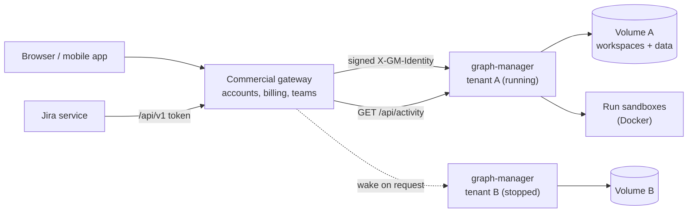
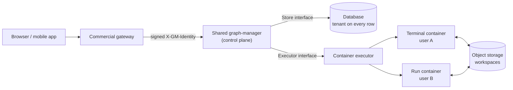
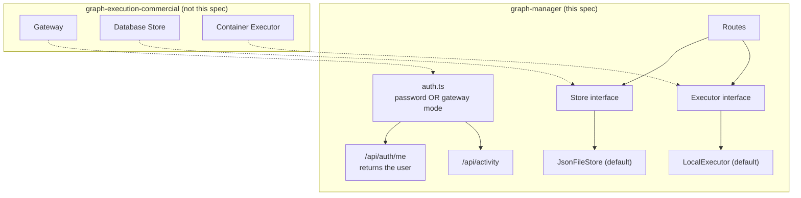

# Commercial groundwork: gateway sign-in, signed-in user, activity, Store and Executor seams

## Problem

A commercial, hosted graph-execution is planned in a separate private repository (`romm0109/graph-execution-commercial`): anyone can register, and paid features such as the Jira service (KAN-96) live there, not in this MIT repository.

graph-manager today is built for one person on one machine:

- **Sign-in** is one shared password (`GM_PASSWORD`, `apps/graph-manager/src/server/auth.ts`). A hosted service that already knows who the user is (its own accounts, OAuth, SSO) has no way to tell graph-manager "this request is user X". Self-hosters who put an auth proxy (oauth2-proxy, Authelia, Cloudflare Access) in front of graph-manager have the same problem: they log in twice.
- **Nobody is named.** `/api/auth/me` answers `{ ok: true }`; runs and PRs are not attributed to anyone.
- **Nothing outside can tell whether an instance is busy.** A host that stops idle instances to save money cannot know whether a terminal or a run is still live.
- **State and execution are hard-wired.** Every route reads one JSON file (`DataStore` in `src/server/store.ts`) and every terminal and run is a local process (`pty.spawn` in `src/server/terminals.ts`, `execa` in `src/server/routes/runs.ts`). A later multi-tenant service cannot swap either without forking graph-manager.

This spec adds the small, generally useful seams the commercial service needs, and nothing commercial. The open-source graph-manager stays a single-user app, and its default behaviour does not change.

## Background: the two hosting architectures

This section explains why the seams are shaped this way. It is context for the agents; the work in this spec is only the open-source part.

### Architecture A (launch): one sleeping graph-manager per tenant

The commercial gateway owns accounts and billing. Each tenant (a user or a team) gets its own unchanged graph-manager container with its own volume. The gateway signs every request it forwards ("this is user X"), and stops a container when `/api/activity` says nothing is live. A stopped container costs only its disk; the next request wakes it.



- Isolation comes from the container: a terminal is a shell, and it can only reach its own tenant's files.
- Cost per tenant: disk while asleep, compute while open or running.
- Open-source needs from this spec: gateway sign-in (Goal 1), the signed-in user (Goal 2) and the activity endpoint (Goal 3).

### Architecture B (at scale): one shared control plane, throwaway containers

One graph-manager serves every tenant. Its state lives in a database, and every terminal and run is a short-lived container started by an executor. Workspaces are kept in object storage and restored into the container when it starts.



- No instance per tenant, no cold start, one deploy.
- The commercial repo supplies a database `Store` and a container `Executor`. The open-source defaults stay the JSON file and local processes.
- Open-source needs from this spec: the `Store` and `Executor` interfaces (Goals 4 and 5), so B can be built later without forking graph-manager. Making graph-manager itself multi-tenant (tenant on every record and route) is not part of this spec.

### What changes in this repository



## Goals

1. **Gateway sign-in mode.** With `GM_AUTH=gateway`, graph-manager trusts a short-lived signed identity header from a gateway in front of it instead of the password. Password mode stays the default and is unchanged.
2. **The signed-in user.** `/api/auth/me` returns the user; the UI shows their name; a run started from graph-manager and a PR opened from it record who did it.
3. **Activity endpoint.** `GET /api/activity` says whether anything is live (terminals, runs, recent requests), so a host can stop idle instances safely.
4. **`Store` interface.** Routes depend on a `Store` interface; today's JSON file becomes `JsonFileStore`, its default implementation. `buildApp` accepts any `Store`.
5. **`Executor` interface.** Spawning a terminal process and starting a non-sandboxed run go through an `Executor` interface; today's behaviour becomes `LocalExecutor`, its default. `buildApp` accepts any `Executor`.
6. **Docs.** A wiki page explains gateway mode, the activity endpoint and the two seams, with an auth-proxy example for self-hosters.

## Decisions

| Decision | Why |
|---|---|
| Accounts, registration, billing, teams, SSO, the Jira service and hosting all live in the commercial repo, never here | Open core: the MIT graph-manager stays a simple single-user app; the commercial value is in the hosted service. |
| Gateway mode is opt-in: `GM_AUTH=gateway` plus `GM_GATEWAY_SECRET` (at least 32 characters). `GM_AUTH` unset or `password` = today's behaviour | No change for existing users. A missing or short secret stops startup with a clear error, so a misconfigured instance never runs open. |
| The identity is a JWT signed with HS256 in the header `X-GM-Identity`, verified with Node's `crypto` (no new dependency). Only `alg: HS256` is accepted | Any gateway can produce it with a standard JWT library. Rejecting other algorithms (including `none`) closes the classic JWT pitfalls. |
| Claims: `sub` (user id, required), `name` (required), `email` (optional), `iat` and `exp` (required). `exp` must be in the future and at most 10 minutes after `iat`; 30 seconds of clock skew are allowed | Short-lived tokens limit the damage of a leaked header; the gateway signs a fresh one on every request. |
| In gateway mode a request without a valid header gets 401 `{"error":"gateway identity required"}`; the password login route answers 404 and no session cookie is set or accepted | One way in per mode. graph-manager must only be reachable through the gateway, and the docs say so. |
| The header is also checked on WebSocket upgrades and the run-page proxy, exactly where the session is checked today (`needsAuth`) | The gateway forwards upgrades with the header; terminals and run pages must not become a way around it. |
| The Origin check (`needsSameOrigin` / `originAllowed`) stays on in gateway mode | The gateway forwards the browser's Origin and Host; CSRF protection still applies. |
| `/api/internal/*` (terminal bearer token) and `/healthz` are unchanged in both modes | They are machine-to-machine and already have their own checks. |
| The user is `{ id, name, email? }`. In password mode it is `{ id: "admin", name: "admin" }` | One shape for the UI and attribution in both modes; matches the existing `createdBy: "admin"` convention. |
| Logout in gateway mode: the UI's log-out item goes to `GM_GATEWAY_LOGOUT_URL` when set, and is hidden when it is not | graph-manager has no session of its own to end in gateway mode; the gateway owns the session. |
| Attribution: runs started via `POST /api/runs/:ws` store `startedBy: <user id>` and PRs store `createdBy: <user id>` in the store; the PR body gets a line `Opened by <name> with graph-manager.` | Who did what is visible, without touching git identity (which stays the configured `GIT_AUTHOR_*`). |
| `GET /api/activity` requires sign-in like every `/api` route. The response is `{ busy, terminals, liveRuns, lastRequestAt }` | A gateway calls it with its own signed identity (for example `sub: "gateway"`). No new unauthenticated surface. |
| `busy` is true when any terminal has a live process, or any run of any workspace is live, or a sandbox container is recorded. Requests to `/api/activity` itself and `/healthz` do not update `lastRequestAt` | The host's own polling must not keep an instance awake. |
| `Store` is an interface with exactly today's `DataStore` surface: `get(): Data`, `update(fn): Promise<void>`, `reviewers(): Reviewer[]`, `file` removed from the interface | A pure extraction: no route changes behaviour, and the risk stays low. A database implementation can keep an in-memory snapshot per tenant and write through. |
| `Executor` covers two things only: spawning a terminal process (`spawnPty`) and starting a non-sandboxed engine run (`startEngine`). Docker sandboxes stay in `Sandboxes` | These are the two places that start local processes. Sandboxes are already containers; folding them in is a later step. |
| The interfaces are exported from graph-manager's package entry for the commercial repo to implement, but are documented as unstable (may change in a minor release) | The commercial repo is the only implementer for now; locking the shape too early would slow both repos. |
| This work starts after `feat/automation-api` (KAN-96) and the multi-repo work (KAN-95) are merged to `main` | Both touch `auth.ts`, `store.ts` and the routes; building on top avoids merge conflicts. |

## Non-goals

- Multi-tenant graph-manager: a tenant on every record, per-user workspaces or per-user forge tokens in one process.
- A database `Store`, a container `Executor`, object-storage workspaces, or any other commercial implementation.
- Registration, user management, roles, teams, billing, licensing or feature flags.
- OIDC/OAuth sign-in inside graph-manager, or asymmetric (RS256/EdDSA) identity tokens.
- Stopping or waking instances: the host does that; graph-manager only reports activity.
- Changing how Docker sandboxes start or how API tokens on `/api/v1` work.
- Changing the git author identity of commits made by runs.

## User stories

- As the commercial gateway, I forward a browser request with `X-GM-Identity: <JWT>` and graph-manager serves it as that user, with no password page.
- As the commercial gateway, I poll `GET /api/activity` every minute and stop the container after 15 minutes of `busy: false`.
- As a self-hoster behind an auth proxy, I set `GM_AUTH=gateway` and a shared secret, have my proxy sign the header, and log in once.
- As a user, I see my name in graph-manager's top bar, and my name on the PRs I open from it.
- As a self-hoster with no gateway, I upgrade and nothing changes: the password login works as before and the UI shows "admin".
- As the commercial developer, I pass my own `Store` and `Executor` to `buildApp` and graph-manager uses them without any fork.

## Requirements

### Config (`apps/graph-manager/src/server/config.ts`)

- New variables in the zod env schema (around lines 96–106) and on `Config`:
  - `GM_AUTH`: `"password" | "gateway"`, default `"password"`. Any other value: `ConfigError` `GM_AUTH must be "password" or "gateway"`.
  - `GM_GATEWAY_SECRET`: required when `GM_AUTH=gateway`, at least 32 characters. Missing: `GM_GATEWAY_SECRET is required when GM_AUTH=gateway`. Too short: `GM_GATEWAY_SECRET must be at least 32 characters`.
  - `GM_GATEWAY_LOGOUT_URL`: optional, must be an absolute `http(s)` URL.
- `Config.auth`: `{ mode: "password" } | { mode: "gateway"; secret: string; logoutUrl?: string }`.
- In gateway mode `GM_PASSWORD` is not required and not read (`resolvePassword` in `password.ts` is skipped). `main.ts` prints `graph-manager: gateway sign-in (X-GM-Identity)` instead of the password hint.
- `GM_GATEWAY_SECRET` is removed from the environment of terminals and engine runs, the same way `GM_PASSWORD` is today (`delete env.GM_PASSWORD` in `routes/runs.ts`, and `STRIPPED_ENV` at `terminals.ts` line 99).

### Identity (`apps/graph-manager/src/server/identity.ts`, new)

- `export interface User { id: string; name: string; email?: string }`.
- `export const ADMIN_USER: User = { id: "admin", name: "admin" }`.
- `export function verifyIdentity(header: string | undefined, secret: string, now = Date.now()): User | undefined`:
  - splits `header.payload.signature` (base64url), parses the header JSON and requires `{"alg":"HS256"}` (`typ` optional, any other `alg` → undefined);
  - compares the HMAC-SHA256 of `header.payload` with the signature using `timingSafeEqual` (lengths checked first);
  - requires `sub` and `name` (non-empty strings, at most 200 characters each), numeric `iat` and `exp`, `exp - iat <= 600`, `exp * 1000 > now - 30000` and `iat * 1000 <= now + 30000`;
  - returns `{ id: sub, name, email? }`.
- `export function signIdentity(user: User, secret: string, now = Date.now(), ttlSeconds = 300): string` for tests and the docs example.
- A `FastifyRequest` decoration `req.user: User`, set by the auth hook.

### Auth (`apps/graph-manager/src/server/auth.ts`)

- The `onRequest` hook (lines 108–115) keeps the Origin check first. Then, when `needsAuth` is true:
  - password mode: today's cookie check; on success `req.user = ADMIN_USER`;
  - gateway mode: `verifyIdentity(req.headers["x-gm-identity"], secret)`; on success `req.user = user`; otherwise 401 `{"error":"gateway identity required"}`.
- In gateway mode `POST /api/auth/login` and `POST /api/auth/logout` answer 404 `{"error":"not available in gateway mode"}`.
- `GET /api/auth/me` answers `{ user: { id, name, email? }, mode: "password" | "gateway", logoutUrl?: string }` in both modes.
- `GET /api/auth/info` (public) also returns `mode`, so the login page can show "Sign in through your gateway" instead of the password form in gateway mode.

### Activity (`apps/graph-manager/src/server/routes/activity.ts`, new; wired in `app.ts`)

- An `onResponse` hook records `lastRequestAt` (ISO time) for every request except `GET /api/activity`, `/healthz` and `/api/health`.
- `GET /api/activity` → `200 { busy: boolean, terminals: number, liveRuns: number, lastRequestAt: string | null }`:
  - `terminals`: terminals whose status is not `exited` (`TerminalManager.list()`);
  - `liveRuns`: runs with a live engine across all workspaces (reuse the live-run detection in `runs.ts`, for example `listRuns` with `live`/`running` summaries), plus records in `store.get().sandboxes` that are not already counted;
  - `busy`: `terminals > 0 || liveRuns > 0`.

### Attribution

- `store.ts` schema: `prs[key].createdBy?: string`; a new `runStarts: Record<"<ws>/<runId>", { startedBy: string; startedAt: string }>` (default `{}`).
- `routes/runs.ts` `POST /api/runs/:ws` (lines 86–156) writes `runStarts` with `req.user.id` on success, both sandboxed and local.
- `routes/pr.ts` / `pr.ts`: store `createdBy: req.user.id` and add the line `Opened by <name> with graph-manager.` at the end of the PR/MR body.
- Run summaries and run detail (`runs.ts`) include `startedBy` when a record exists; the Runs page shows it as "by <id>" next to the start time.

### UI (`apps/graph-manager/src/web`)

- `Shell.tsx` / `App.tsx`: fetch `/api/auth/me` once; show the user's `name` in the top bar next to the log-out item.
- Log out: in password mode unchanged; in gateway mode a link to `logoutUrl` when present, hidden when absent.
- The login page: in gateway mode (from `/api/auth/info`) show "Sign in through your gateway." and no password field.

### `Store` interface (`apps/graph-manager/src/server/store.ts`)

- `export interface Store { get(): Data; update(fn: (d: Data) => void): Promise<void>; reviewers(): Reviewer[] }`.
- Rename the class to `JsonFileStore implements Store` and keep `export const DataStore = JsonFileStore` (and its type) so existing imports and tests keep working.
- `AppContext.store` (`app.ts` line ~41) and `BuildAppOptions.store` become `Store`. Every route uses only the interface (no access to `file`).

### `Executor` interface (`apps/graph-manager/src/server/executor.ts`, new)

```ts
export interface PtyProcess {
  readonly pid: number;
  onData(cb: (chunk: string) => void): void;
  onExit(cb: (e: { exitCode: number }) => void): void;
  write(data: string): void;
  resize(cols: number, rows: number): void;
  kill(signal?: string): void;
}

export interface Executor {
  /** Starts a terminal process (today: node-pty). */
  spawnPty(p: { file: string; args: string[]; cwd: string; env: Record<string, string>; cols: number; rows: number }): PtyProcess;
  /** Starts a detached, non-sandboxed engine run and waits for its handoff (today: execa in routes/runs.ts). */
  startEngine(p: { file: string; args: string[]; cwd: string; env: NodeJS.ProcessEnv; timeoutMs: number }): Promise<{ exitCode: number | undefined; stdout: string; all: string; message?: string }>;
}
```

- `LocalExecutor` implements it with exactly today's code: `pty.spawn(file, args, { name: "xterm-256color", cols, rows, cwd, env })` from `terminals.ts` line 267, and the `execa` call from `routes/runs.ts` (`extendEnv: false, reject: false, all: true, stdin: "ignore"`).
- `TerminalManager` gets the executor through `TerminalManagerOptions.executor` (default `new LocalExecutor()`); `spawn` (lines 255–270) calls `executor.spawnPty`.
- `AppContext.executor: Executor`; `BuildAppOptions.executor?: Executor` (default `LocalExecutor`); `routes/runs.ts` calls `ctx.executor.startEngine`.
- Export `Store`, `JsonFileStore`, `Executor`, `LocalExecutor`, `PtyProcess`, `User`, `verifyIdentity`, `signIdentity` and `buildApp` from graph-manager's server entry, with a doc comment saying the interfaces are unstable.

### Docs

- `docs/wiki/features/commercial-groundwork.md`: a decision table (decision, why, ticket), the two architecture diagrams from this spec, the activity endpoint, an example of signing the header in Node (`signIdentity` or any HS256 JWT library), an example nginx/oauth2-proxy setup for self-hosters, and the warning that in gateway mode graph-manager must not be reachable except through the gateway. Link it from `docs/wiki/index.md`.
- `apps/graph-manager` README (or the root README's graph-manager section): the three new variables.

### Tests

- `identity.test.ts`: a valid token; wrong signature; `alg: none`; `alg: HS512`; expired; `iat` in the future beyond skew; lifetime over 10 minutes; missing `sub`/`name`; malformed base64; a round trip with `signIdentity`.
- `auth.test.ts`: gateway mode accepts a valid header on `/api/workspaces`, a WebSocket upgrade and `/runs/<ws>/<id>/view/`; rejects a missing or bad header with 401 and the exact error; ignores a valid password session cookie; login and logout answer 404; Origin check still 403s. Password mode: unchanged tests still pass and `/api/auth/me` returns `admin`.
- `config.test.ts`: the three `ConfigError` messages; password mode without `GM_GATEWAY_SECRET` is fine.
- `activity.test.ts`: idle → `busy: false`; a live terminal → `busy: true, terminals: 1`; polling `/api/activity` does not change `lastRequestAt`; another request does.
- `store.test.ts`: `JsonFileStore` passes the existing tests; `buildApp` works with a minimal in-memory `Store`.
- `terminals.test.ts` / `routes/runs.test.ts`: a fake `Executor` receives the expected `spawnPty` / `startEngine` arguments; the existing tests pass unchanged with `LocalExecutor`.
- Attribution: starting a run in gateway mode stores `runStarts[...].startedBy`; the PR body ends with `Opened by <name> with graph-manager.`.

### Validation commands

```bash
npm run typecheck && npm run lint && npm test
```

## Acceptance criteria

- [ ] With no `GM_AUTH`, graph-manager behaves exactly as before: password login works, and `/api/auth/me` returns `{"user":{"id":"admin","name":"admin"},"mode":"password"}`.
- [ ] `GM_AUTH=gateway` without `GM_GATEWAY_SECRET` exits at startup with `GM_GATEWAY_SECRET is required when GM_AUTH=gateway`; with a 31-character secret it exits with `GM_GATEWAY_SECRET must be at least 32 characters`.
- [ ] In gateway mode, `GET /api/workspaces` without `X-GM-Identity` answers 401 `{"error":"gateway identity required"}`; with a valid token it answers 200.
- [ ] In gateway mode, tokens with `alg: none`, a wrong signature, an `exp` in the past or a lifetime over 600 seconds are rejected with 401.
- [ ] In gateway mode, a terminal WebSocket upgrade and a run-page proxy request without a valid header are rejected; with one they work.
- [ ] In gateway mode, `POST /api/auth/login` answers 404, and a session cookie from password mode is not accepted.
- [ ] `GET /api/auth/me` in gateway mode returns the token's `sub`, `name` and `email`, `mode: "gateway"` and `logoutUrl` when `GM_GATEWAY_LOGOUT_URL` is set.
- [ ] The top bar shows the user's name; in gateway mode the login page shows "Sign in through your gateway." and no password field.
- [ ] `GET /api/activity` returns `busy: false` with no terminals and no live runs, and `busy: true` with one open terminal; polling it does not change `lastRequestAt`.
- [ ] A run started from the UI records `startedBy`, shown on the Runs page; a PR opened from graph-manager ends with `Opened by <name> with graph-manager.`.
- [ ] `GM_GATEWAY_SECRET` and `GM_PASSWORD` are not in a terminal's environment (`env` in a new terminal shows neither).
- [ ] `buildApp` accepts a custom `Store` and a custom `Executor`; tests show both are used.
- [ ] `docs/wiki/features/commercial-groundwork.md` exists with both architecture diagrams and is linked from `docs/wiki/index.md`.
- [ ] `npm run typecheck && npm run lint && npm test` pass.
