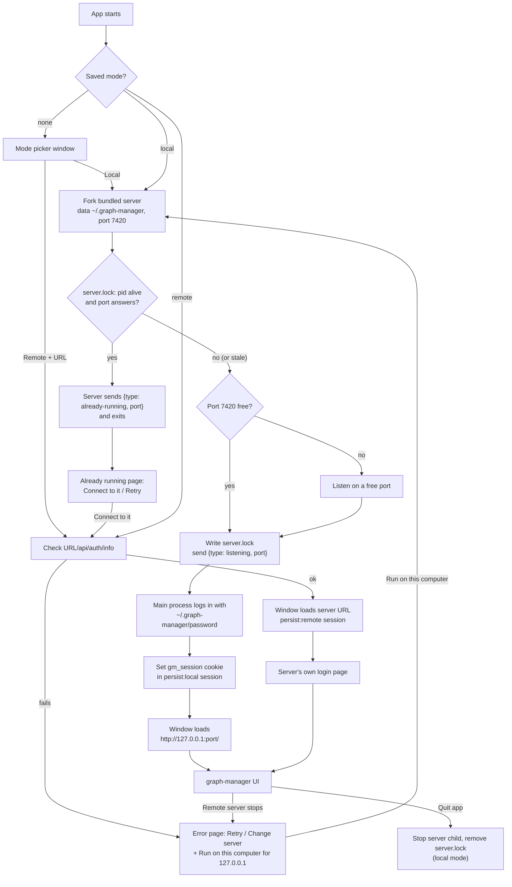

# graph-manager desktop app (KAN-86)

## Problem

graph-manager is a web service today. To use it on a laptop you need Node 20+, a clone of this repo, `npm ci`, a build,
a `GM_PASSWORD` and a terminal that keeps `npm start` running, or Docker. Then you open a browser tab and log in. There
is no app you can install and open, on macOS or Windows, and no single window that can also connect to a graph-manager
running on another machine.

## Goals

1. **KAN-86**: a desktop app, `apps/graph-manager-desktop`, built with Electron, for macOS and Windows.
2. **Local mode**: the app bundles graph-manager and graph-execution and starts the server itself on `127.0.0.1`,
   with the same data folder as a graph-manager started from the terminal (`~/.graph-manager`). It uses port 7420, or
   a free port when 7420 is taken. It logs in on its own: the user never sees a password or a login page.
3. **One server per data folder**: a graph-manager server, from the app or from `npm start`, refuses to start when
   another one is already running on the same `~/.graph-manager`. The app then offers to connect to the running one.
4. **Remote mode**: the user enters the URL of a graph-manager server, and the window loads that server's own UI.
   The login is the server's normal password login, as in a browser.
5. Installers: an unsigned `.dmg` for macOS (arm64 and x64) and an unsigned NSIS `.exe` for Windows (x64).
6. CI builds the packaged app on `macos-latest` and `windows-latest` and runs a smoke test that starts it and checks
   that the bundled server answers.

## Workflow



## Decisions

| Decision | Why |
| --- | --- |
| Local mode runs the bundled server in a child process forked with Electron's own binary and `ELECTRON_RUN_AS_NODE=1` | The user needs no Node install. A child process keeps a server crash out of the window's process, and graph-manager's `main.ts` runs unchanged as an entry point. |
| Remote mode loads the remote server's own UI in the window. No KAN-84 device tokens, no CORS changes | The page and its API share one origin, so the existing `sameSite: strict` cookie and the same-origin checks in `auth.ts` keep working. KAN-84 is only needed for the mobile app. |
| Local mode uses the server's default data folder, `~/.graph-manager`, and default workspaces folder | The user asked for it: the app and a graph-manager started from the terminal see the same workspaces, runs and settings. |
| Local mode logs in from the main process with the password in `~/.graph-manager/password`. The app does not pass `GM_PASSWORD` | The server already generates and keeps that password. Using it means one password per data folder, the same one `npm start` prints, and no second copy in `desktop.json`. |
| The local server binds `127.0.0.1` and tries port 7420 first. When 7420 is taken by something that isn't a graph-manager on this data folder, it listens on a free port (`GM_PORT_FALLBACK=1`) | Nothing outside the machine can reach it. The URL stays the same on most launches, and another program on 7420 doesn't stop the app. `npm start` keeps today's behaviour: it fails when its port is taken. |
| A lock file, `<dataDir>/server.lock`, written by graph-manager's `startManager` with its pid and port. A start refuses only when that pid is alive **and** that port answers `/api/auth/info` | Two servers on one data folder would overwrite each other's state. Checking the live process and the port, not the file alone, means a crash or a kill leaves no lock that blocks the next start. It's in the server, so it protects `npm start`, `graph-execution manager` and the app alike. |
| When a server is already running, the app shows "graph-manager is already running (port N)." with **Connect to it**, which switches to remote mode at `http://127.0.0.1:N` | The user keeps working with the running server instead of getting an error. Remote mode already handles a server the app didn't start. |
| When a remote server at `127.0.0.1` or `localhost` can't be reached, the error page also offers **Run on this computer** | That happens when the terminal server the user connected to stops. The port is now free, so the app can start its own server in one click. |
| Separate cookie sessions for the two modes: `persist:local` and `persist:remote` | Switching modes never mixes cookies, and each mode keeps its login after the app restarts. |
| Same-origin links that open a new tab (the run page "open ↗") open in a new app window. Every other `http(s)` link opens in the default browser | The run page needs the session cookie. GitHub and PR links belong in the user's browser. |
| Packaging stages a clean production install, then runs electron-builder on it | npm workspaces hoist and symlink packages, which electron-builder doesn't handle well. A staged folder from `npm pack` tarballs is predictable on both operating systems. |
| `node-pty` is not rebuilt (`npmRebuild: false`) and is kept outside the asar archive | node-pty 1.1 ships N-API prebuilds for macOS and Windows, which Electron loads without a rebuild. Its `.node` files and macOS `spawn-helper` must be real files on disk, and `spawn-helper` must be executable. The CI smoke test proves that a terminal works. |
| On macOS the app reads the login shell's `PATH` at startup | An app opened from Finder or the Dock gets `/usr/bin:/bin:/usr/sbin:/sbin`, so `git`, `claude`, `codex` and `docker` would not be found. |
| Unsigned builds, no auto-update | Agreed for v1. Signing needs an Apple Developer account and a Windows certificate. Both are follow-ups. |
| Full Windows support, checked by CI on `windows-latest` plus a manual checklist | Agents for this run work on macOS. CI is the judge for Windows, and the user runs the manual checklist on a Windows machine before release. |

## Non-goals

- KAN-84: device tokens, CORS allow-lists, login hardening for remote servers. Remote mode uses the server's existing login.
- Code signing, notarization, auto-update and publishing releases.
- Linux packages. The code must not break on Linux (CI runs ubuntu), but no AppImage or deb.
- A UI bundled inside the app for remote mode, offline mode, or several saved remote servers. One remote URL is saved at a time.
- Changes to graph-manager's web UI other than what's listed under Requirements.
- Installing `git`, `claude`, `codex` or Docker for the user.

## User stories

- As a developer on macOS or Windows, I install graph-manager from a `.dmg` or `.exe`, open it, choose **Run on this
  computer**, and get the graph-manager UI without a terminal, Node install or password.
- As a user with graph-manager on a VPS or home server, I choose **Connect to a server**, enter
  `https://gm.example.com`, log in with the server's password, and use it in a desktop window.
- As a user, I can switch between local and remote later from the app menu.
- As a user in local mode, when I quit the app the server stops and no `graph-manager` process stays behind.
- As a user in local mode on macOS, the terminals and runs find the same `git`, `claude` and `codex` as my shell does.
- As a user in local mode, a terminal in graph-manager has a working `graph-execution` command on macOS and Windows.
- As a user, when the remote server can't be reached, I see why and can retry or change the server.
- As a user who also runs `npm start`, the app shows the same workspaces, runs and password, and the two never run as
  two servers on one data folder: the app offers to connect to the running one instead.
- As a user, when port 7420 is taken by another program, local mode still starts.
- As a user connected to a graph-manager on this computer, when it stops I can start the app's own server in one click.
- As a user whose server crashed, the next start works: no leftover lock blocks it.

## Requirements

### Package layout

- New workspace `apps/graph-manager-desktop`, picked up by the root `workspaces: ["packages/*", "apps/*"]`.
- `package.json`: `"name": "graph-manager-desktop"`, `"private": true`, `"type": "module"`, `"main": "dist/main.js"`.
  Dev dependencies: `electron` and `electron-builder`, pinned to exact current stable versions. No other runtime
  dependencies unless needed.
- Scripts:
  - `build`: `tsc -p tsconfig.json` (main and preload to `dist/`) and copy `src/pages/*.html` to `dist/pages/`.
  - `typecheck`: `tsc -p tsconfig.json --noEmit`.
  - `test`: `vitest run` (unit tests only: no Electron binary needed).
  - `start`: build, then `electron .` (dev run against the workspace builds of graph-manager and graph-execution).
  - `stage`: `node scripts/stage.mjs` (see Packaging).
  - `dist`: `npm run stage && electron-builder --config electron-builder.yml --projectDir stage`.
  - `smoke`: `node scripts/smoke.mjs` (see CI).
- The root `npm run build`, `typecheck`, `lint` and `test` must still pass on ubuntu, macOS and Windows with the new
  workspace. `build` and `test` for the desktop package must not download or need an Electron binary beyond what
  `npm ci` installs.
- Source files:
  - `src/main.ts`: app lifecycle, windows, menu.
  - `src/settings.ts`: reads and writes `<userData>/desktop.json`.
  - `src/localServer.ts`: forks and stops the bundled server.
  - `src/shellEnv.ts`: macOS login-shell `PATH`.
  - `src/links.ts`: the rule for which links open where.
  - `src/preload.ts`: the bridge for the app's own pages only (`contextBridge`). It is never loaded into graph-manager's pages.
  - `src/pages/picker.html` and `src/pages/error.html`: plain HTML and inline script, no framework.

### Settings: `<userData>/desktop.json`

```json
{ "mode": "local", "remoteUrl": "https://gm.example.com" }
```

- `mode`: `"local" | "remote"`, or missing before the first choice.
- No password is kept here. Local mode reads the server's own password file (see Local mode).
- Written atomically: write a temp file, then rename. File mode `0o600` where the OS supports it.
- An unreadable or invalid file is treated as missing: the picker shows again. It is not a crash.

### Mode picker (`picker.html`)

- Title "graph-manager". Two choices:
  - **Run on this computer**: "Starts graph-manager here. Your workspaces live in <path>." Show the real
    workspaces path (`GM_WORKSPACES_DIR` from the app's environment, else `~/graph-manager-workspaces`).
  - **Connect to a server**: a URL field, placeholder `https://graph-manager.example.com`, and a **Connect** button.
- URL check before saving: it must parse as `http:` or `https:` and is normalized to its origin with no trailing
  slash. A plain `http:` URL to a host other than `localhost` or `127.0.0.1` shows the warning "This connection is not
  encrypted. Your password will be sent in plain text." with **Connect anyway** and **Cancel**.
- Then `GET <url>/api/auth/info` with a 10-second timeout. Any answer other than `200` with JSON `{ host: string }`
  shows "No graph-manager server answered at <url>." and doesn't save.
- The picker talks to the main process only through the preload bridge: `chooseLocal()`, `chooseRemote(url)` and
  `workspacesDir()`.

### Local mode (`localServer.ts`)

- Server entry: graph-manager's `dist/server/main.js`. In dev it's resolved from the `graph-manager` workspace
  package; in the packaged app, from `process.resourcesPath`, as laid out by Packaging.
- Fork it with `child_process.fork(entry, [], { execPath: process.execPath, env, stdio: ["ignore", "pipe", "pipe", "ipc"] })`. `env` is:
  - `process.env`, with `PATH` from `shellEnv.ts` on macOS
  - `ELECTRON_RUN_AS_NODE=1`
  - `GM_HOST=127.0.0.1`
  - `GM_PORT_FALLBACK=1`
  - `GM_GRAPH_EXECUTION_BIN=<bundled graph-execution>/dist/cli.js`
  - `GM_PASSWORD` and `GM_PORT` removed from the env. `GM_DATA_DIR` and `GM_WORKSPACES_DIR` are not set by the app, so
    the server's defaults apply: `~/.graph-manager` and `~/graph-manager-workspaces`, the same folders as `npm start`.
    When the app's own environment sets them (the smoke test, a developer), they pass through unchanged.
  - The data folder the app uses below, `dataDir`, is `GM_DATA_DIR` from the app's environment, else
    `~/.graph-manager`.
- Server stdout and stderr are appended to `<userData>/logs/server.log`, which is rotated to `server.log.1` when it
  passes 5 MB at startup.
- Wait at most 30 seconds for one of two IPC messages:
  - `{ type: "listening", port: number }`: the server started. Go on with the login.
  - `{ type: "already-running", port: number, pid: number }`: another graph-manager runs on this data folder, and the
    child exits. Show `error.html` with "graph-manager is already running on this computer (port N). Stop it, or connect
    to it.", plus **Connect to it** and **Retry**. **Connect to it** saves `mode: "remote"` and
    `remoteUrl: "http://127.0.0.1:N"`, then opens remote mode (no plain-`http` warning: it's loopback). **Retry** starts
    local mode again.
  - If the child exits with neither message, or the time runs out, show `error.html` with the last 20 lines of
    `server.log`, plus **Retry**, **Open log** and **Change server**.
- Login: read the password from `<dataDir>/password` (trimmed). The server created it if it was missing, before it
  sent `listening`. Then `POST http://127.0.0.1:<port>/api/auth/login` from the main process, using Node `fetch` with
  body `{ "password": <that password> }` and no `Origin` header. Take `gm_session` from `Set-Cookie` and set it with
  `session.fromPartition("persist:local").cookies.set({ url, name: "gm_session", value, httpOnly: true, sameSite: "strict" })`.
  The window then loads `http://127.0.0.1:<port>/`.
- When the server child exits unexpectedly while the app runs, the window shows `error.html` ("The local server
  stopped.") with **Restart server**. It does not restart in a loop on its own.
- On quit (`before-quit`), and when leaving local mode: send the IPC message `{ type: "shutdown" }`, on every OS. The
  server closes cleanly, which removes `server.lock`. After 5 seconds kill it: `SIGKILL` on macOS and Linux,
  `taskkill /pid <pid> /T /F` on Windows. IPC is used instead of `SIGTERM` because on Windows `child.kill()` ends the
  process at once, without running the server's handler. A killed server leaves its lock behind, which the next start
  treats as stale (dead pid).
- Only one app instance runs at a time: `app.requestSingleInstanceLock()`. A second launch focuses the existing window.

### Server changes in `apps/graph-manager` (small and backwards compatible)

- `src/server/main.ts`: after `listen`, if `process.send` exists, call `process.send({ type: "listening", port })`. The
  console line stays as it is.
- **Port fallback** in `startManager` (`src/server/main.ts:48-56`): a new variable `GM_PORT_FALLBACK` in `config.ts`
  (`"1"` → `portFallback: true`, default `false`). When `listen` fails with `EADDRINUSE` and `portFallback` is true, it
  listens again with `port: 0` and prints `port <n> is in use, using <m>` before the usual console line. Without the
  variable, the `ConfigError` "port N is already in use: pass --port or set GM_PORT" is unchanged.
- **Lock file**, a new module `src/server/lock.ts`:
  - File `<dataDir>/server.lock`, JSON `{ "pid": number, "port": number, "host": string, "startedAt": string }`.
  - `findRunning(dataDir, opts?)`: reads the lock. Returns the lock when the pid is alive (`process.kill(pid, 0)`
    succeeds or throws `EPERM`) **and** `GET http://<host>:<port>/api/auth/info` answers `200` within 2 seconds
    (use `127.0.0.1` for a wildcard host, as `browserUrl` does). Returns `null` otherwise: missing, unreadable or
    invalid file, dead pid, or a port that doesn't answer. The pid of the calling process never counts as running.
    The liveness and HTTP checks are injectable for tests.
  - `writeLock(dataDir, lock)`: atomic write (temp file, then `renameReplacing` from `graph-execution/api`, as
    `password.ts` does), mode `0o600`.
  - `removeLock(dataDir)`: deletes the file only when its `pid` is `process.pid`. Errors are ignored.
  - `startManager` calls `findRunning` after `mkdir` and before `buildApp`. When it finds a server it throws a new
    `AlreadyRunningError extends ConfigError` with the message
    `graph-manager is already running on this data folder (pid <pid>, http://127.0.0.1:<port>)` and fields `port` and
    `pid`. A stale lock is left in place: the new server's `writeLock` replaces it.
  - After `listen`, `startManager` calls `writeLock` with the real port. Its `close()` calls `removeLock` after
    `app.close()`.
  - The direct-run block in `main.ts` handles `AlreadyRunningError`: if `process.send` exists it sends
    `{ type: "already-running", port, pid }`, prints the message, and exits with code 3. Other errors keep exit code 1.
  - Because the lock lives in `startManager`, `npm start` and `graph-execution manager` get it too.
  - The direct-run block also stops on the IPC message `{ type: "shutdown" }` (when `process.send` exists), the same
    way it stops on `SIGTERM`: `close()`, then exit 0.
  - Windows: `process.kill(pid, 0)` works there too (it throws `ESRCH` for a dead pid). The HTTP check guards against
    a reused pid on both OSes.
- Node child processes under Electron: add a helper `nodeCommand()` in `src/server/node.ts`. It returns
  `{ file: process.execPath, env: {} }` under plain Node, and `{ file: process.execPath, env: { ELECTRON_RUN_AS_NODE: "1" } }`
  when `process.versions.electron` is set.
  - `engineCommand` in `src/server/routes/runs.ts:58` uses it. The run's spawn adds `env` to its environment.
  - At startup, `main.ts` deletes `ELECTRON_RUN_AS_NODE` from `process.env`. It only matters when a process launches,
    and it must not leak into terminals, agents or git hooks, where it would break the user's own Electron apps such as
    VS Code's `code` CLI.
- `writeGraphExecutionShim` in `src/server/terminals.ts:176`:
  - On macOS and Linux the shim runs the absolute `nodeCommand().file` with the env prefix. Under plain Node that's the
    absolute `process.execPath`, instead of `node` from `PATH`, so the app works without a system Node:
    `#!/bin/sh\nELECTRON_RUN_AS_NODE=1 exec "<execPath>" "<cli.js>" "$@"\n`, and without the prefix under plain Node.
  - On Windows, write `<binDir>\graph-execution.cmd` instead of returning `false`:
    `@echo off\r\nset ELECTRON_RUN_AS_NODE=1\r\n"<execPath>" "<cli.js>" %*\r\n`, again without the `set` line under
    plain Node. Paths must be quoted, because `C:\Program Files` and user folders contain spaces.
- `terminalEnv` (`src/server/terminals.ts:132`): add `ELECTRON_RUN_AS_NODE` to `STRIPPED_ENV`.
- Existing tests keep passing. New tests cover `nodeCommand()` under both runtimes (stub `process.versions.electron`),
  the shim content on POSIX and Windows (stub `process.platform`, as the existing tests do), and the `listening` IPC
  message (fork `main.js` from a test with `GM_PORT=0`). `lock.test.ts` covers: no file, invalid JSON, dead pid,
  alive pid with a port that doesn't answer (all `null`), alive pid with an answering port (found), own pid (`null`),
  and `removeLock` leaving another process's lock alone. `main.test.ts` covers: a second `startManager` on the same
  `GM_DATA_DIR` throws `AlreadyRunningError` with the first one's port; after the first `close()` the lock is gone and
  a new start works; a lock left by a dead pid doesn't block a start; with `GM_PORT_FALLBACK=1` and the port taken by a
  plain `net` server, the start succeeds on another port; without it, the old `ConfigError`.

### Remote mode

- The window uses partition `persist:remote` and loads `remoteUrl`.
- Before loading, `GET <remoteUrl>/api/auth/info` with a 10-second timeout. If it fails, show `error.html` ("Can't
  reach <url>.") with **Retry** and **Change server**.
- A load failure after that (`did-fail-load` on the main frame) shows the same error page. This is also what the user
  sees when a server they connected to stops while the window is open.
- When the URL's host is `127.0.0.1`, `localhost` or `[::1]`, the error page has a third button,
  **Run on this computer**. It saves `mode: "local"` and starts local mode, as the picker's choice does.
- TLS errors are not bypassed. `certificate-error` stays at Electron's default, which refuses the page.

### Windows and links (`main.ts`, `links.ts`)

- One main window, 1280×800, minimum 900×600. Its size and position are restored from `desktop.json` (`bounds`).
- `webPreferences` for graph-manager's pages: `contextIsolation: true`, `sandbox: true`, `nodeIntegration: false`, and
  no preload.
- `setWindowOpenHandler` and `will-navigate` use `links.ts`, `classifyLink(url, appOrigin)`, which returns
  `"same-window" | "new-window" | "external" | "deny"`:
  - Same origin as the app's server, from `window.open` or `target=_blank`: `"new-window"`, a child `BrowserWindow`
    with the same partition and the same `webPreferences`.
  - Same origin, from navigation: `"same-window"`.
  - Any other `http:`, `https:` or `mailto:` URL: `"external"`, opened with `shell.openExternal`.
  - Everything else (`file:`, `javascript:` and so on): `"deny"`.
- `links.ts` is a pure function with unit tests.

### App menu

- macOS has the standard app menu, Edit, View, Window and Help. Windows has a File menu instead of the app menu.
- Items:
  - **Switch to local** or **Switch to server…**, whichever doesn't match the current mode. It opens the picker.
    Leaving local mode stops the server.
  - **Change server URL…**, in remote mode only.
  - **Open server log**, in local mode only: `shell.openPath(server.log)`.
  - **Open workspaces folder**.
  - **Reload** (Cmd/Ctrl+R) and **Toggle Developer Tools** (Alt+Cmd+I / Ctrl+Shift+I).
- The window title follows the page title. In remote mode, ` — <host>` is appended.

### macOS PATH (`shellEnv.ts`)

- On macOS only, at startup: run `$SHELL -ilc 'printf "\n__GM_PATH__%s\n" "$PATH"'` (`/bin/zsh` when `SHELL` is unset)
  with a 5-second timeout. Read the marked line and set `process.env.PATH` to it.
- On timeout or failure, keep the current `PATH` and add `/opt/homebrew/bin`, `/usr/local/bin` and `~/.local/bin` if
  they're missing. Then log one line to `<userData>/logs/main.log`.
- Unit-tested with an injected exec function. No real shell in tests.

### Packaging

- `scripts/stage.mjs`:
  1. Builds `graph-execution`, `graph-manager` and `graph-manager-desktop`: `npm run build -w <each>`.
  2. Runs `npm pack` on `packages/graph-execution` and `apps/graph-manager` into a temp folder.
  3. Creates `apps/graph-manager-desktop/stage/` with:
     - a `package.json`: name `graph-manager-desktop`, version from the desktop package, `main: "dist/main.js"`, and
       dependencies on the two tarballs (`file:`)
     - the desktop `dist/`
  4. Runs `npm install --omit=dev --no-audit --no-fund` in `stage/`.
- `stage/` is git-ignored. graph-manager's `files`/`npm pack` output must include `dist/server` and `dist/web`. Add a
  `files` field to `apps/graph-manager/package.json` if it's missing.
- `apps/graph-manager-desktop/electron-builder.yml`:
  - `appId: dev.graph-execution.graph-manager`, `productName: graph-manager`
  - `asar: true`, with `asarUnpack: ["node_modules/node-pty/**", "node_modules/graph-execution/**", "node_modules/graph-manager/**"]`.
    graph-execution and graph-manager stay outside the asar because forked Node children and the shim read them as
    plain files.
  - `npmRebuild: false`, because node-pty's N-API prebuilds load in Electron as they are
  - `mac`: `target: dmg`, `arch: [arm64, x64]`, `identity: null` (unsigned)
  - `win`: `target: nsis`, `arch: [x64]`; `nsis`: `oneClick: false`, `perMachine: false`
  - output in `apps/graph-manager-desktop/release/`, which is git-ignored
- An `afterPack` hook (`scripts/after-pack.cjs`) makes `node-pty`'s `spawn-helper` files executable (`0o755`) on
  macOS, as graph-manager's own `postinstall` does.
- The packaged app resolves `main.js` and `cli.js` under `process.resourcesPath/app.asar.unpacked/node_modules/...`.
  `localServer.ts` has one function for this, `bundledPaths()`, with unit tests for dev and packaged layouts.

### CI

- New workflow `.github/workflows/desktop.yml`:
  - Triggers: `push` to `main`, `pull_request` that touch `apps/graph-manager-desktop/**`, `apps/graph-manager/**` or
    `packages/graph-execution/**`, and `workflow_dispatch`.
  - Matrix `[macos-latest, windows-latest]`, `fail-fast: false`. Steps: Node 22, `npm ci`,
    `npm run dist -w graph-manager-desktop`, `npm run smoke -w graph-manager-desktop`. Upload the `release/`
    installers as artifacts.
- `scripts/smoke.mjs`:
  1. Starts the packaged app binary from `release/` (`mac-arm64/graph-manager.app/Contents/MacOS/graph-manager` on
     an arm64 runner, `mac/…` on x64, `win-unpacked/graph-manager.exe` on Windows) with `GM_DESKTOP_SMOKE=1` and a temp
     `--user-data-dir`. It also sets `GM_DATA_DIR` and `GM_WORKSPACES_DIR` to temp folders, so it never touches the
     runner's `~/.graph-manager`.
  2. Under `GM_DESKTOP_SMOKE=1`, `main.ts` takes local mode without the picker. After the login it writes
     `{ "port": n, "ok": true }` to `<userData>/smoke.json`, or `{ "ok": false, "error": "..." }`. It then waits.
  3. The script waits up to 90 seconds for `smoke.json`. It checks `GET /healthz` returns `200` and `GET /api/health`
     with the cookie returns `200`. It creates a terminal through the API and reads output through its WebSocket, which
     proves `node-pty` works in the packaged app. It checks that `<GM_DATA_DIR>/server.lock` holds the server's port.
     Then it quits the app and checks that the server's process is gone within 10 seconds and `server.lock` is gone.
  4. Exit code 0 on success. Otherwise non-zero, and the script prints `server.log`.
- `qa.yml` gets one new step, `npm run build`, before `npm test`. Tests that fork the built server entry need `dist/`.
  The new workspace's typecheck, lint and unit tests run through the root scripts.

### Docs

- `apps/graph-manager-desktop/README.md`: build, `npm start` for dev, `npm run dist`, where settings and logs live, the
  unsigned-app first-launch steps (macOS: right-click → Open, or
  `xattr -dr com.apple.quarantine /Applications/graph-manager.app`; Windows SmartScreen: More info → Run anyway).
- A "Desktop app" section in `apps/graph-manager/README.md` linking to it.
- `docs/wiki/features/graph-manager-desktop.md` with the decision table and follow-ups (signing, auto-update, KAN-84,
  Linux), linked from `docs/wiki/index.md`.

### Manual Windows checklist (for the user, before release; it goes in the desktop README)

- [ ] The installer runs from a path with spaces and installs per user without admin rights.
- [ ] First launch shows the picker. Local mode opens the UI with no password prompt.
- [ ] A terminal opens PowerShell, `graph-execution --version` works in it, and so does `git --version`.
- [ ] A run with `--provider fake` on a small workspace finishes and its run page opens in a new app window.
- [ ] A PR link opens in the default browser.
- [ ] Quitting the app leaves no `graph-manager.exe` in Task Manager, and no `%USERPROFILE%\.graph-manager\server.lock`.
- [ ] With `npm start` already running in a terminal, local mode shows "graph-manager is already running". **Connect
      to it** opens it. Stopping `npm start` (Ctrl+C) then shows the error page with **Run on this computer**, which
      starts the app's own server.
- [ ] With another program on port 7420 (for example `python -m http.server 7420`), local mode starts on another port.
- [ ] Remote mode against a server over HTTPS logs in, and the login survives an app restart.
- [ ] A user folder with non-ASCII characters works (for example `C:\Users\Ünal`).

## Acceptance criteria

- [ ] `npm run typecheck && npm run lint && npm test` passes at the repo root on ubuntu, macOS and Windows (`qa.yml`).
- [ ] `npm run dist -w graph-manager-desktop` makes `release/*.dmg` on macOS and `release/*Setup*.exe` on Windows.
- [ ] `npm run smoke -w graph-manager-desktop` passes on `macos-latest` and `windows-latest` in `desktop.yml`: the
      server answers `/healthz`, `/api/health` with the session cookie answers `200`, a terminal gives output over its
      WebSocket, and the server process and `server.lock` are gone 10 seconds after quit.
- [ ] Local mode uses `~/.graph-manager` and `~/graph-manager-workspaces` when the app's environment doesn't set
      `GM_DATA_DIR`/`GM_WORKSPACES_DIR`, and logs in with `~/.graph-manager/password`: the same password `npm start`
      prints.
- [ ] Local mode uses port 7420 when it is free. With 7420 taken by a program that isn't graph-manager, it starts on
      another port and the UI loads.
- [ ] With a graph-manager already running on the same data folder (from `npm start`), local mode shows
      "graph-manager is already running on this computer (port N). Stop it, or connect to it." with **Connect to it**,
      and no second server process stays running. **Connect to it** loads `http://127.0.0.1:N` in remote mode.
- [ ] `npm start` while the app's local server runs exits with code 3 and prints
      `graph-manager is already running on this data folder (pid <pid>, http://127.0.0.1:<port>)`.
- [ ] A `server.lock` left by a killed server (dead pid, or a pid whose port doesn't answer) doesn't block the next
      start, from the app or from `npm start`.
- [ ] In remote mode at `http://127.0.0.1:N`, when that server stops, the error page shows **Retry**,
      **Change server** and **Run on this computer**. For a non-loopback URL, only **Retry** and **Change server**.
- [ ] With no `desktop.json`, the app opens the picker. **Run on this computer** loads the graph-manager UI with no
      login page.
- [ ] The local server listens only on `127.0.0.1`: `GET http://<LAN IP>:<port>/healthz` from the same machine fails
      to connect.
- [ ] Without the desktop cookie, the local server answers `401` to `GET /api/health`. A plain browser can't use it
      without the password.
- [ ] With `remoteUrl` set to a running graph-manager, the window shows that server's login page. After logging in,
      restarting the app shows the UI without logging in again.
- [ ] A remote URL that doesn't answer `/api/auth/info` shows "No graph-manager server answered at <url>." in the
      picker, or "Can't reach <url>." on start, with **Retry** and **Change server**.
- [ ] `classifyLink` unit tests: same-origin `window.open` → `new-window`, `https://github.com/...` → `external`,
      `file:///etc/passwd` → `deny`.
- [ ] `nodeCommand()` returns `ELECTRON_RUN_AS_NODE: "1"` only when `process.versions.electron` is set. After
      `main.ts` starts, `process.env.ELECTRON_RUN_AS_NODE` is undefined, and `terminalEnv` never contains it.
- [ ] The terminal shim is `graph-execution` (POSIX) or `graph-execution.cmd` (Windows), quotes its paths, and runs
      the absolute runtime path, not `node` from `PATH`.
- [ ] `apps/graph-manager` started with `npm start` behaves as before, apart from the lock: same console line, same
      port default 7420, the same error when the port is taken, and all existing tests pass.
- [ ] On macOS, `shellEnv.ts` tests: the marked line from the shell output becomes `PATH`. On timeout, the fallback
      directories are added.
- [ ] Two launches of the app give one window. The second launch focuses it.
