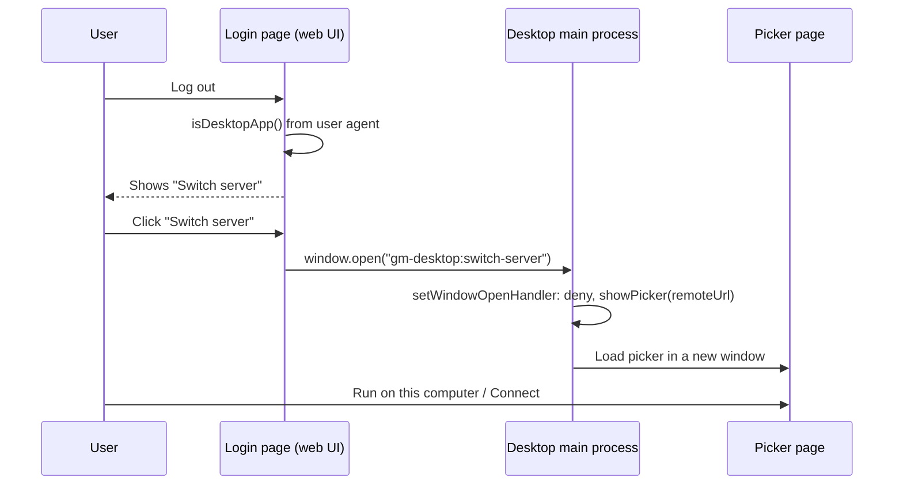

# Desktop: switch server from the login page

## Problem

In the graph-manager desktop app (`apps/graph-manager-desktop`), logging out shows graph-manager's login page. From there, the only way to reach another server, or to go back to local mode, is the menu bar (**File → Switch to local / Switch to server… / Change server URL…**), which people don't think to look in. A user who logged out in order to connect elsewhere gets stuck on the password field.

## Goals

1. When graph-manager runs in the desktop app, its login page shows a **Switch server** button. It opens the desktop's mode picker (`dist/pages/picker.html`), with the saved server URL filled in.
2. In a plain browser (the normal web UI, phones, the PWA), the login page doesn't change.
3. This works in both modes: local (the bundled server) and remote (a server URL).

## Decisions

| Decision | Why |
| --- | --- |
| The desktop marks itself with a user-agent token, `graph-manager-desktop/<version>`, set with `session.setUserAgent` on the `persist:local` and `persist:remote` partitions | Windows that show a server get no preload (a security rule in `main.ts`), so the page can't see a `window.gmDesktop`. A user-agent token reaches the web UI without exposing an IPC bridge to a remote origin. Child windows use the same partitions, so they get the token too. |
| The button sends its request as `window.open("gm-desktop:switch-server")`, which the desktop's `setWindowOpenHandler` catches and always denies | The window-open handler already sees every `window.open` (see `guardLinks` in `main.ts`). It is reliable for a custom scheme, where `will-navigate` may hand the URL to the OS instead. No preload or IPC is added to a server page. |
| Any page of the app origin may trigger it, including a remote server's page | All it does is open the picker, which the user then has to act on. That is no more than the menu item already does, so a hostile server gains nothing. |
| It opens the picker with `readSettings(userData).remoteUrl`, as the **Change server URL…** menu item does | One picker for everything: run locally, the same server, or another server. |
| The label is **Switch server**, a secondary (`btn`) full-width button under **Log in** | It's short and covers both local and remote. It is secondary so that logging in stays the main action. |
| The button is shown only on the login page | The user asked for the logged-out state. The signed-in app already has the menu. |

## Non-goals

- No change to the menu, the picker page, the error page or the logout API.
- No automatic login again after logging out in local mode.
- Nothing for plain browsers or the PWA: they never see the button.
- No new IPC channel or preload for windows that show a server.

## User stories

- As a desktop user, after I log out of one server, I click **Switch server** on the login page and connect to a different server.
- As a desktop user in local mode, after I log out, I click **Switch server** and either connect to a server or run locally again.
- As a browser user, my login page stays the same as before.

## Requirements

### Web UI (`apps/graph-manager`)

- Add `isDesktopApp(ua = navigator.userAgent): boolean` to `apps/graph-manager/src/web/ui/standalone.ts`. It returns true when `ua` matches `/\bgraph-manager-desktop\//`.
- Export `DESKTOP_SWITCH_SERVER_URL = "gm-desktop:switch-server"` from the same file.
- In `apps/graph-manager/src/web/pages/Login.tsx`, when `isDesktopApp()` is true, render this inside the form after the **Log in** button: `<button type="button" className="btn btn-block" data-testid="login-switch-server" onClick={() => window.open(DESKTOP_SWITCH_SERVER_URL)}>Switch server</button>`. Add a small icon only if a fitting one exists in `ui/Icon.tsx`, and don't add a new icon.
- Tests in `apps/graph-manager/src/web/Login.test.tsx`:
  - With a desktop user agent, the button is shown, and clicking it calls `window.open` with `"gm-desktop:switch-server"`. Mock the user agent with `vi.spyOn(navigator, "userAgent", "get")`, as `Settings.test.tsx` does.
  - With a plain browser user agent, there is no `login-switch-server`.
- Test `isDesktopApp` in `apps/graph-manager/src/web/ui/standalone.test.ts`.

### Desktop (`apps/graph-manager-desktop`)

- `src/links.ts`: add `"switch-server"` to `LinkAction`. `classifyLink` returns it for any URL whose protocol is `gm-desktop:` and whose pathname is `switch-server`, for both `open` and `navigate`. Every other `gm-desktop:` URL stays `"deny"`.
- `src/main.ts` `guardLinks`:
  - `setWindowOpenHandler`: on `"switch-server"`, call `void showPicker(readSettings(userData).remoteUrl)` and return `{ action: "deny" }`.
  - `will-navigate`: on `"switch-server"`, `preventDefault()` and do the same.
- `src/main.ts`: in `app.whenReady`, before any window opens, append ` graph-manager-desktop/${app.getVersion()}` to the user agent of both partitions: `session.fromPartition(p).setUserAgent(\`${session.fromPartition(p).getUserAgent()} graph-manager-desktop/${app.getVersion()}\`)` for `p` in `persist:local` and `persist:remote`.
- Put the user-agent string in a small pure helper, for example `desktopUserAgent(base, version)` in `src/links.ts` or a new `src/userAgent.ts`, with a unit test.
- Tests in `src/links.test.ts`: `gm-desktop:switch-server` gives `"switch-server"` for `open` and `navigate`, and `gm-desktop:other` gives `"deny"`.

### Docs

- `docs/wiki/features/graph-manager-desktop.md`: describe the button, the user-agent token and the `gm-desktop:switch-server` request, and add rows to the decision table.
- In the desktop section of the README: one line saying that the login page has **Switch server** in the desktop app.

## Acceptance criteria

- [ ] `isDesktopApp("Mozilla/5.0 … Electron/45.3.2 Safari/537.36 graph-manager-desktop/0.1.0")` is `true`, and `isDesktopApp` of a Chrome or Safari user agent is `false`.
- [ ] In the desktop app, the login page shows a **Switch server** button (`data-testid="login-switch-server"`) under **Log in**.
- [ ] In a browser, the login page has no **Switch server** button.
- [ ] Clicking it calls `window.open("gm-desktop:switch-server")`. In the desktop, this opens the picker with the saved server URL filled in, and no new window or external app opens.
- [ ] `classifyLink("gm-desktop:switch-server", origin, "open" | "navigate")` is `"switch-server"`, and `classifyLink("gm-desktop:other", …)` is `"deny"`.
- [ ] `npm run typecheck && npm run lint && npm test` pass.
- [ ] `npm run dist -w graph-manager-desktop && npm run check-layout -w graph-manager-desktop && npm run smoke -w graph-manager-desktop` still pass on macOS.
