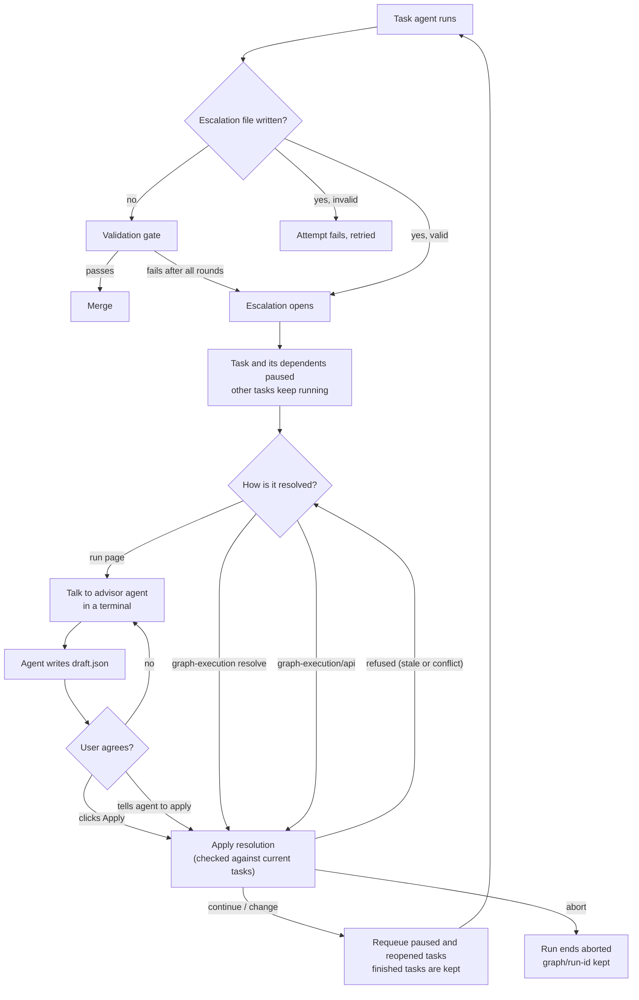

# Escalation: an agent can stop its branch of the graph and ask for a decision

Epic: [KAN-105](https://graph-execution.atlassian.net/browse/KAN-105). Stories: [KAN-106](https://graph-execution.atlassian.net/browse/KAN-106), [KAN-107](https://graph-execution.atlassian.net/browse/KAN-107), [KAN-108](https://graph-execution.atlassian.net/browse/KAN-108).

## Problem

A task agent that finds out mid-run that its task can't be done as designed (the task contradicts the spec or code another task built, or it needs a product decision nobody made) has two choices today: push through and build the wrong thing, or fail. A failed task stops the whole graph (the scheduler aborts every running agent), and the only ways forward are **Retry** (same task text, same problem) or editing the task files, which makes `--resume` refuse because the task hash changed. So the user starts the graph again from the beginning and loses the work of every finished task.

The same happens when a task's validation still fails after all its fix rounds, and in the review phase when the fixer meets a finding that needs a design change.

## Goals

1. A task agent (and the review-phase fixer) can **stop and escalate**: it writes an escalation file with the reason, the evidence and the questions that need a decision, and exits. (KAN-106)
2. A task whose validation is still failing after all its fix rounds **escalates** instead of failing. (KAN-106)
3. An escalation pauses **only its branch of the graph**: the escalated task and every task that depends on it, directly or indirectly. Independent tasks keep running. The run waits indefinitely for a decision and can be resumed after Ctrl+C. (KAN-106)
4. A paused branch is **resolved** with a resolution (continue with guidance; edit, add, remove or rewire not-started tasks; reopen done tasks; or abort), applied **without rerunning finished tasks**, through a CLI command, an HTTP route and an exported API function. (KAN-107)
5. On the run page, the user resolves an escalation by **talking to an advisor agent in a terminal** (the run provider's interactive CLI). It drafts the resolution, which the user applies with a click or asks the agent to apply. The terminal code is shared with graph-manager. (KAN-108)
6. Escalation is on by default and can be turned off; off means exactly today's behaviour.

## Flow



## Decisions

| Decision | Why |
| --- | --- |
| An escalation is a JSON file the agent writes at an absolute path the engine gives it in the prompt, outside its checkout: `<runDir>/escalations/inbox/<label>-a<attempt>.json`. | Works the same for every provider (claude, codex, opencode, qwen, fake), like the existing report files. Outside the worktree, so `commitLeftovers` never commits it. |
| Escalation file shape: `{ reason, evidence, questions: [{ id, question, context?, suggestedOptions? }] }`, with at least one question. | The questions are what a human or the closed harness answers. `suggestedOptions` lets the agent propose answers that a UI can show as choices. |
| A task agent or the fixer escalates only when (a) the work can't be done as written without contradicting the spec, the existing code or what another task built, or (b) it needs a product or design decision that the spec and task don't answer and that would be expensive to reverse. Evidence (file paths, lines, commands) is required. There is no cap on the number of escalations. | The user chose prompt rules only. |
| Only task agents and the review-phase fixer may escalate; the engine escalates for a task whose validation is exhausted. Reviewers, the tester, the merge resolver, the summarizer and the gate fixer keep today's behaviour. | The user chose task agents plus the fixer for v1. |
| An escalation pauses only the escalated task and its dependents (direct and indirect). Tasks already running, and tasks that don't depend on it, keep going. | The user chose to pause only the branch of the escalation. |
| A fixer escalation pauses the review phase, which is one line, so in effect the run at that point. | The review phase starts only after every task is merged. |
| The review phase starts only when every task is merged **and** no escalation is open. | It reviews the whole result. |
| Several escalations are independent: each blocks its own branch, and a task that depends on two escalated tasks waits for both. Resolutions are applied **one at a time** by the run process (the single writer of the state), each checked against the task set **at that moment**. A resolution that touches a task that started in the meantime, or an escalation that is no longer open, is refused (409) and has to be redrafted. One resolution may close several escalations (`escalationIds`). | The user agreed to this policy; escalations can arrive at different times. |
| A resolution may edit or remove only tasks that haven't started (`pending`) or that are escalated, and may reopen only merged tasks. Running, validating and merging tasks can't be touched. | Changing a task while its agent runs would make the result meaningless. |
| A reopened task runs again from the current integration head, with a fresh attempt budget; its earlier merged changes stay. Its prompt says the earlier work is already in the checkout and gives the escalation, the answers and the guidance. Tasks that depend on it and already merged are not rerun unless they are reopened too. | The user chose reopen with merged changes kept. Only what the resolution names reruns. |
| An escalated task's attempt is not merged: its commits stay on its task branch (the diff stays viewable) and its worktree is removed. After the resolution it starts a fresh attempt with a fresh attempt budget. | The agent said the design is wrong; its partial work must not land. |
| Changed tasks are kept in the run's own copy, `<runDir>/tasks/<id>.json`, and `--resume` uses that copy. The user's task folder is never written. The resume hash check still compares the user's task folder with the hash taken at the start. | The user chose the run's own copy. Without it, `--resume` would refuse after every task change. |
| Escalation waits indefinitely. Ctrl+C keeps every open escalation in the state; `--resume` and `open` return to the same wait. | The user chose to wait forever, resumable. |
| `escalation` config key (default `true`), `--escalation` / `--no-escalation`, saved in the run state (`--resume` rejects both flags, as for `--human-review`). Off: no escalation instructions in the prompts, an escalation file is ignored, and exhausted validation fails as today. | The user chose a config key, on by default. |
| Escalation is forced off in suite feature runs (`graph-execution suite`) in this version. | The suite page has no escalation screen; a paused feature would block the suite with no way to resolve it. |
| Without `--web`, the web server starts in-process anyway and the terminal prints the escalation URL. | Same as the human review round: resolving needs the run page. |
| One HTTP route applies resolutions for every client: the run page, the CLI and the closed harness. The CLI `resolve` command posts to the live run's web server; when the run isn't live, it applies the resolution to the state on disk under the run lock, and `--resume` continues from it. | One code path for the live case; the offline case covers a run stopped with Ctrl+C. |
| The resolve chat is a **terminal on the run page** running the run provider's **interactive** CLI (`claude`, `codex`, `opencode`, `qwen`) in a PTY, as the `advisor`. Its first message points it at a context file with the escalation, and it keeps its context for the whole conversation. It runs in its own worktree at the integration head and must not change the repository. | The user wanted a real chat with the agent, like graph-manager's terminals. |
| A resolution from the terminal is applied in either of two ways: the agent writes the draft file and the page shows it with **Apply resolution**, or, when the user tells it to, the agent runs `graph-execution resolve` itself (the command is in its context file). | The user chose both. |
| The terminal code is shared: one module in `packages/graph-execution/src/terminal/` (server: PTY session and WebSocket bridge; browser: xterm.js with fit and instant echo, without React), exported as `graph-execution/terminal`. graph-manager's Terminals page moves to it. | The user asked for the code in a common folder. Inside the engine it ships in the npm package with nothing extra to publish, and graph-manager already depends on graph-execution. |
| One advisor terminal per escalation, kept while the escalation is open. Reopening the page reattaches with the recent output (scrollback replay). It is killed and its worktree removed when the escalation is resolved; **Restart** starts a new session. Ctrl+C on the run ends it; after `--resume` a new session starts. | A conversation survives page reloads; the escalation itself survives restarts through the state. |
| graph-manager's run proxy passes WebSocket upgrades through to the run page (it drops the `upgrade` header today). | Otherwise the terminal can't work inside graph-manager and its sandboxes. |
| `abort` ends the whole run as `aborted` and keeps `graph/<run-id>`. | The user chose abort as "stop the run". |

## Non-goals

- The closed harness: the arbiter, the question form with options, the autonomous resolver agent, notifications, hosting. They use this feature through the API and the HTTP routes.
- Escalation from reviewers, the tester, the merge resolver, the summarizer or the gate fixer.
- Escalation in suite feature runs and an escalation screen on the suite page.
- A cap on escalations per run, or timeouts.
- Writing changed tasks back to the user's task folder.
- graph-manager changes other than the WebSocket pass-through in its run proxy and moving its Terminals page to the shared terminal module. Showing escalations in graph-manager's run list is a later change.
- A text-only chat fallback for the advisor.
- Editing a running task, or moving an agent's in-progress work into a resolution.

## User stories

1. As a user running a graph, when a task agent finds that its task contradicts what another task built, I want it to stop and explain why instead of building the wrong thing.
2. As a user, when one task escalates, I want the tasks that don't depend on it to keep running, so I lose no time.
3. As a user, I want to read the reason, the evidence and the questions of an escalation on the run page, and talk them through in a terminal with an agent (Claude Code, Codex…) that knows the spec, the tasks and the code and remembers the conversation.
4. As a user, I want the agent to draft the change (guidance, edited tasks, new tasks, reopened tasks), show it to me readably, and apply it only when I click Apply or tell the agent to.
5. As a user, after I resolve an escalation, I want the run to continue without rerunning the tasks that already finished.
6. As a user, when two tasks escalate at different times, I want to resolve each one separately, or both together when they are the same problem.
7. As a user who pressed Ctrl+C while an escalation was open, I want `--resume` to bring me back to it.
8. As the closed harness (or a script), I want to list open escalations and apply a resolution through an HTTP route, a CLI command or an API function.
9. As a user who doesn't want this, I want `--no-escalation` to give me exactly today's behaviour.

## Requirements

### Escalation file and record (`src/escalation/`, new)

- `src/escalation/schema.ts`: zod schemas.
  - `escalationFileSchema` (what an agent writes):
    ```json
    {
      "reason": "Task 4 asks for a REST endpoint, but task 2 already built the same data as a GraphQL resolver.",
      "evidence": "src/api/graphql/orders.ts:12-80 defines ordersResolver; task 4 says to add GET /orders.",
      "questions": [
        {
          "id": "q1",
          "question": "Should orders be exposed through REST, GraphQL or both?",
          "context": "The spec only says 'clients can list orders'.",
          "suggestedOptions": ["REST only, remove the resolver", "GraphQL only, drop task 4", "Both"]
        }
      ]
    }
    ```
    `reason`, `evidence`: non-empty strings. `questions`: at least one; `id` and `question` are non-empty strings, unique ids; `context` is optional; `suggestedOptions` is an optional array of non-empty strings.
  - `escalationRecordSchema` (what the engine stores at `<runDir>/escalations/E<n>.json`): the file's fields plus `id` (`E1`, `E2`, … in order of arrival), `source` (`"agent"` or `"validation"`), `node` (task id, or `"fixer"`), `attempt`, `createdAt` (ISO), `status` (`"open"` or `"resolved"`), `branch` (the task branch, when there is one), `resolvedAt` and `resolution` (the applied resolution) once resolved.
- `src/escalation/store.ts`: `inboxPath(runDir, label, attempt)`, `readInbox(file)` (returns the parsed file, `undefined` when there is none, or a validation error), `saveEscalation`, `loadEscalations(runDir)`, `openEscalations(runDir)`.
- The state (`src/state/state.ts`) gets:
  - `escalation: z.boolean().default(true)`, saved like `humanReview`;
  - `escalations: z.array(z.object({ id, node, status: z.enum(["open","resolved"]) })).default([])`, a summary for listings (details stay in the files);
  - `tasksSource: z.enum(["folder","run"]).default("folder")`: `"run"` once a resolution changed the task set;
  - a new task status `"escalated"` in `taskStatusSchema`.
- `src/ui/store.ts`: a new `NodeStatus` `"escalated"`, shown in the terminal view and the web graph (amber, label "needs decision").

### Prompts (`src/agents/task.ts`, `src/agents/fixer.ts`)

- `escalationInstruction(file: string): string`, added to `taskPrompt` and `fixerPrompt` when the run's `escalation` is on:
  > If this work can't be done as written without contradicting the spec, the existing code or what another task built, or if it needs a product or design decision that the spec and the task don't answer and that would be expensive to reverse, stop and escalate instead of finishing. Don't escalate for things you can find out yourself, for ordinary bugs, or for failures you can fix. To escalate, write this JSON to `<file>`: `{"reason": …, "evidence": …, "questions": [{"id": "q1", "question": …, "context": …, "suggestedOptions": […]}]}`. Give concrete evidence: file paths with lines, commands and their output. Then stop without committing.
- `AgentRunOptions` (`src/providers/types.ts`) gets `escalationFile?: string`. Real providers ignore it (the path is in the prompt); the fake provider writes to it.
- A resumed escalated or reopened task gets a `## Decision` section in its prompt: the escalation (reason, questions), the answers (`answers` of the resolution, if any), the guidance and, for a reopened task, "Your earlier work for this task is already merged into this checkout. Change it as the decision requires."

### Engine (`src/runner/run.ts`, `src/scheduler/scheduler.ts`)

- After a task agent's run (any exit code), the runner reads the inbox file:
  - none: today's check (`checkAgent`);
  - invalid: the attempt fails with class `bad_escalation` and message `escalation file is invalid: <zod message>`, retried like other failures;
  - valid: the runner removes the inbox file, saves `E<n>` (`source: "agent"`), sets the task to `escalated`, removes its worktree (keeping its branch), emits `escalation:open`, logs `task <id>: escalated (E<n>): <reason>` and throws an `EscalatedError` (new, in `src/state/errors.ts`).
- `validate()`: with escalation on, exhausted validation rounds create `E<n>` with `source: "validation"`, `reason: "validation still fails after <n> fix rounds"`, `evidence` = the failing commands and the output tail, and one question `{ id: "q1", question: "How should task <id> proceed?" }`, then throw `EscalatedError`. With escalation off it throws `AbortRunError` as today.
- `runGraph` gets an optional `escalation` option:
  ```ts
  escalation?: {
    isEscalation(err: unknown): boolean;
    /** Resolves with the next applied resolution's effect, or undefined when the run is aborted or interrupted. */
    next(): Promise<GraphUpdate | undefined>;
  };
  interface GraphUpdate { tasks: Task[]; requeue: string[]; removed: string[] }
  ```
  - A task whose `runTask` throws an escalation is neither merged nor failed: it doesn't abort the shared controller, and its dependents aren't ready.
  - While tasks run, `runGraph` races the running tasks with `next()`. On an update it replaces its task map, drops `removed`, moves `requeue` back to pending (a reopened merged task leaves the merged set) and launches what is ready.
  - When nothing runs, nothing is ready and an escalation is open, it waits on `next()` alone. `undefined` ends `runGraph` with an `InterruptedError` (Ctrl+C) or a run abort.
  - Other failures behave as today (the first failure aborts the rest).
- The review phase starts only when `runGraph` returns with every task merged.
- The fixer: when the fixer writes a valid escalation file, the review phase saves `E<n>` (`node: "fixer"`), the review state stays at step `fix` of the current round, and the run waits for a resolution. A `continue` resolution reruns the fixer with the guidance. A `change` resolution goes back to the tasks phase for the requeued tasks, then the review phase restarts at a new round from `validate` with a fresh `fixPasses` budget (`budgetBase` = the new round, as in the human review round).
- `RetryHub` (`src/runner/retry-hub.ts`) gets the escalation wait: `waitResolution(): Promise<Resolution | undefined>`, `submitResolution(r): Promise<ResolveResult>` (resolves after the run process applied or refused it) and `escalationWaiting`. `quit()` resolves pending waits with `undefined`.
- Events (`src/runner/events.ts`): `escalation:open` `{ id, node, source }`, `escalation:resolved` `{ ids, action }`, `escalation:draft` `{ id }`, `escalation:advisor` `{ id, status: "running" | "exited" }`.
- Ctrl+C while waiting: exit code 2; the state keeps the open escalations and the escalated tasks. `--resume` and `open` return to the wait; `reconcile` (`src/state/resume.ts`) leaves `escalated` tasks escalated.
- `--resume` loads tasks from `<runDir>/tasks/` when `tasksSource` is `"run"`, and the "Task files" reference copy given to agents is the effective set.

### Resolution (`src/escalation/resolve.ts`, new)

- `resolutionSchema`:
  ```json
  {
    "escalationIds": ["E1"],
    "action": "change",
    "guidance": "Keep GraphQL. Drop the REST endpoint; expose orders only through the resolver.",
    "answers": [{ "escalationId": "E1", "questionId": "q1", "answer": "GraphQL only, drop task 4" }],
    "editTasks": [{ "id": "5", "content": "…", "dependencies": ["2"] }],
    "addTasks": [{ "id": "7", "content": "…", "dependencies": ["2"] }],
    "removeTasks": ["4"],
    "reopen": ["2"]
  }
  ```
  - `action`: `"continue"` (rerun the escalated nodes with `guidance`; task fields not allowed), `"change"` (apply the task fields, then rerun the escalated nodes that weren't removed, with `guidance`), `"abort"` (end the run).
  - `editTasks` entries take `id` plus any of `content`, `dependencies`, `validate` (same types as `taskSchema` in `src/graph/task.ts`). `addTasks` entries are full tasks.
- `checkResolution(state, tasks, escalations, resolution)` returns the new task set or a `ResolutionError` with `code` and message:
  - `400 invalid`: schema errors; task fields with `continue`;
  - `409 not_open`: an id isn't an open escalation;
  - `409 task_started`: an edited or removed task isn't `pending` or `escalated`;
  - `409 not_merged`: a reopened task isn't `merged`;
  - `400 duplicate_id`: an added id exists or existed in this run;
  - `400 graph`: unknown dependency, a cycle (reuse `src/graph/validate.ts`), or a removed task that a kept task still depends on.
- `applyResolution(runDir, resolution)`: checks, writes `<runDir>/tasks/` (all effective tasks) and `tasksSource: "run"` when tasks changed, marks the escalations resolved with the resolution and `resolvedAt`, sets requeued tasks to `pending` with `attempts: 0`, and returns the `GraphUpdate`. The live run calls it inside the hub, one resolution at a time; the offline CLI calls it under the run lock.
- Exported from `src/api.ts`: `resolutionSchema`, `escalationRecordSchema`, `loadEscalations`, `applyResolution`, `type Resolution`, `type EscalationRecord`.

### HTTP routes (`src/web/server.ts`)

- `GET /escalations` → `200 { escalations: EscalationRecord[] }`.
- `POST /escalations/resolve`, body a resolution → `200 { ok: true, requeued: string[] }`, `400`/`409 { error: { code, message } }`, `409 { error: { code: "not_waiting" } }` when the run isn't live.
- `POST /escalations/<id>/advisor` → starts the advisor terminal if none runs (`200 { running: true }`); `POST /escalations/<id>/advisor/restart` kills and starts a new one; `404` unknown id; `409 not_open` for a resolved one.
- `GET /escalations/<id>/advisor/terminal`: WebSocket upgrade to the advisor's PTY (the shared protocol of `src/terminal/`); the first frames replay the recent output.
- `GET /escalations/<id>/draft` → `200 { draft: Resolution | null, error?: string }`; the run emits `escalation:draft` `{ id }` when the draft file appears or changes (an invalid draft gives `error`).
- The routes, the WebSocket included, follow the existing token and Origin rules of the run page server; the WebSocket uses the `ws` package (added as a dependency of `graph-execution`).

### Shared terminal module (`src/terminal/`, new; `graph-execution/terminal` export)

- Server side, `src/terminal/server.ts`: `createPtySession({ file, args, cwd, env, cols, rows })` on `node-pty` (already a dependency), with a scrollback ring buffer (256 KB) and `attach(ws)` that replays the buffer, then streams output, takes input and resize messages, and answers `ping` with `pong`. Output is batched as graph-manager does it today (`apps/graph-manager/src/server/output-batch.ts`).
- Browser side, `src/terminal/client.js` (served as a run page asset and imported by graph-manager's web build): `mountTerminal(element, { url })` with xterm.js, the fit addon, the WebGL addon when available and the instant echo of `xterm-zerolag-input` (`apps/graph-manager/src/web/components/predictiveEcho.ts`), plus the round-trip display. `@xterm/xterm`, `@xterm/addon-fit`, `@xterm/addon-webgl` and `xterm-zerolag-input` move to the engine's dependencies; the postbuild copies their browser files into `dist/web/assets/vendor/`.
- `package.json` `exports` gets `"./terminal": { "types": "./dist/terminal/index.d.ts", "import": "./dist/terminal/index.js" }` and `"./terminal/client"` for the browser module.
- graph-manager (`apps/graph-manager/src/server/terminals.ts`, `src/web/components/TerminalView.tsx`) uses the shared module instead of its own copies; its terminal behaviour (instant echo, extra keys, touch, the agent buttons) stays the same, and its tests keep passing.
- graph-manager's run proxy (`apps/graph-manager/src/server/proxy.ts`) passes WebSocket upgrades on `/runs/<id>/view/*` to the run page, with the same auth, Origin check and `x-graph-execution-token` header as its HTTP requests.

### Advisor (`src/agents/advisor.ts`, new)

- Role `advisor` is added to `AgentRole`. `Provider` gets `interactive(opts: { cwd: string; firstMessage: string; model?: string }): { file: string; args: string[]; env?: Record<string, string> }`, the command line of its interactive CLI with a first message: `claude <message>`, `codex <message>`; the opencode and qwen equivalents are checked against their `--help` (a provider without one throws, and the page says the advisor is not available for it).
- It runs in its own worktree `<runDir>/worktrees/advisor-<id>`, cut from the integration head when the advisor starts and removed when the escalation is resolved.
- The first message is `Read <runDir>/escalations/<id>/advisor.md and follow it.` That file has: the escalation record(s) (this one and every other open one, marked as such), the spec path, the effective tasks with their status, the escalated task's branch and base (`git diff <base>..<branch>` shows its partial work), the resolution schema with an example, and the rules: talk the decision through with the user; don't change the repository; when the user agrees, write the resolution to `<runDir>/escalations/<id>/draft.json`; when the user asks you to apply it, run `<node> <CLI_PATH> resolve --run <run-id> --file <draft>` and report what it printed.
- The run watches `draft.json` and validates it with `resolutionSchema` (and `checkResolution` for a preview of refusals).

### Run page (`src/web/page.html`)

- An escalated node shows as "needs decision". Clicking it, or the banner "N decisions needed", opens the escalation screen.
- The screen shows the reason, the evidence, the questions (with suggested options), the other open escalations, and **Talk to an agent**, which starts the advisor and shows its terminal (the shared client) with **Restart**.
- When a draft exists it shows as a readable summary next to the terminal: the action, the guidance, each edited task with a before/after diff of its content, added, removed and reopened tasks, with **Apply resolution**. An invalid draft shows its error. A refused resolution shows the error message; the terminal stays open.
- When the agent applies the resolution itself, the screen closes on `escalation:resolved` like after **Apply resolution**.
- **Abort run** (confirm) posts `{ action: "abort" }`.
- Without `--web` the terminal view prints `waiting for your decision on E<n> (task <id>): <url>`.

### CLI (`src/cli.ts`, `src/launch/preflight.ts`)

- `--escalation` / `--no-escalation` on a run; `--resume` rejects them (exit 2), as for `--human-review`.
- `graph-execution resolve [--run <id>] --file <resolution.json>`:
  - live run (its lock holder is alive and `web.json` exists): posts to `POST /escalations/resolve` as `open` reaches the page; prints `resolved E1: task 3 requeued` or the refusal;
  - not live: applies it offline under the run lock; prints `resolved E1; continue with graph-execution --resume --run <id>`;
  - exit codes: 0 applied, 1 refused (message), 2 usage error or unknown run.
- `graph-execution escalations [--run <id>]`: lists the escalations (id, node, status, reason).
- `graph-execution suite` forces escalation off for its feature runs.
- Config (`src/config/config.ts`): `escalation: z.boolean().default(true)`, plus the `overridesSchema` entry and flag name.

### Fake provider (`src/providers/fake.ts`) and fixtures

- New attempt fields:
  - `escalate`: an escalation file object; written to `escalationFile`, then the agent exits 0 without committing (`{ "escalate": "invalid" }` writes `{}`, an invalid file).
- The fake provider's `interactive()` starts `dist/providers/fake-advisor.js`, a small line-based program: it prints `advisor ready (<id>)`; on each line it reads, it prints `you said: <line>`; on the line `draft` it writes the `draft` of the script key `advisor:<id>` to the draft path; on the line `apply` it runs the resolve command from the context file. Tests drive it through the WebSocket.
- Document the fields in `TESTING.md` under a new "Escalation" section with the commands to see the screen.

### Docs

- README: an "Escalation" section (what agents escalate for, the screen, `resolve`, `escalations`, `--no-escalation`).
- `docs/wiki/features/escalation.md` with the decision table, follow-ups and code references, linked from `docs/wiki/index.md`.

## Acceptance criteria

- [ ] With the `diamond` fixture and a fake script `{"task:2":{"attempts":[{"escalate":{…}}]}}`, task 2 and its dependents show "needs decision", every task that doesn't depend on task 2 merges, `state.json` has `escalations: [{ "id": "E1", "node": "2", "status": "open" }]` and task 2 is `escalated`, and `<runDir>/escalations/E1.json` matches the record schema.
- [ ] An invalid escalation file fails the attempt with `escalation file is invalid` and the next attempt runs.
- [ ] A task whose validation fails every round creates `E<n>` with `source: "validation"` instead of failing the run.
- [ ] `POST /escalations/resolve` with `action: "continue"` reruns task 2 with the guidance in its prompt (checked with `GRAPH_EXECUTION_FAKE_PROMPTS`), and the tasks merged before are not rerun (their merge commits are unchanged).
- [ ] A `change` resolution that edits a pending dependent, adds a task and reopens a merged task: the edited content and the new task run, the reopened task runs again from the current head with the `## Decision` section, `<runDir>/tasks/` holds the effective set, the user's task folder is unchanged, and the run ends `applied`.
- [ ] Two escalations at different times: resolving E1 doesn't unblock E2's branch; a task depending on both waits for both; one resolution with `escalationIds: ["E1","E2"]` closes both.
- [ ] Editing a task that is running, or resolving a closed escalation, returns 409 with `task_started` / `not_open`; a cycle returns 400 `graph`.
- [ ] `action: "abort"` ends the run with status `aborted`, exit code 2, and `graph/<run-id>` kept.
- [ ] Ctrl+C while waiting exits 2; `--resume` returns to the wait with E1 open and the escalated task still escalated; resolving then finishes the run.
- [ ] `graph-execution resolve --run <id> --file r.json` works on a live run (through the web server) and on a stopped run (offline, then `--resume` continues); a refused resolution exits 1 with the message.
- [ ] The fixer escalates with a fake `escalate` attempt: the review phase waits; `continue` reruns the fixer with the guidance; `change` with a reopened task runs that task, then the review starts a new round with a fresh `fixPasses` budget.
- [ ] Run page (checked with agent-browser and a screenshot): the escalation screen shows the reason, evidence and questions; **Talk to an agent** shows a terminal with `advisor ready (E1)`; typing `draft` shows the draft summary with the task diff; **Apply resolution** resumes the run. Reloading the page reattaches the terminal with its earlier output.
- [ ] Typing `apply` in the advisor terminal applies the draft through `graph-execution resolve`, and the screen closes.
- [ ] The advisor terminal works through graph-manager's run proxy (WebSocket pass-through), and graph-manager's Terminals page still works on the shared module (its existing tests pass).
- [ ] `--no-escalation`: no escalation text in the task prompt, a written escalation file is ignored, and exhausted validation fails as today. `--resume --escalation` exits 2.
- [ ] A suite run's feature prompts contain no escalation text.
- [ ] `npm run typecheck && npm run lint && npm test` pass.
