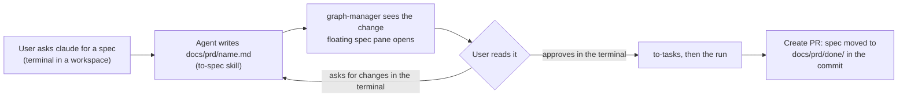

# PRD: See the spec while it is being created (graph-manager)

Ticket: [KAN-82](https://graph-execution.atlassian.net/browse/KAN-82)

## Problem

In graph-manager you plan work by talking to `claude` in a terminal. The agent writes a spec (PRD) into the workspace, and then `to-tasks` and a run build from it. Today the spec is invisible in graph-manager: to read it you `cat` it in a terminal or open the file elsewhere. Nothing tells the agent how a spec should look or where it goes. And finished specs stay in `docs/prd/` next to the ones still being planned.

## Goals (KAN-82)

1. **A skill that writes the spec.** A new bundled engine skill, `to-spec`, tells the agent how to write a spec for graph-execution and where to put it (`docs/prd/<name>.md`). It includes a Mermaid diagram of the workflow. When the spec is finished, the agent asks the user to read it and to approve it or ask for changes, in the chat.
2. **The UI watches for the spec.** graph-manager watches each workspace's `docs/prd/*.md` (not `docs/prd/done/`). When a spec is created or changes in the workspace of the focused terminal, a floating pane opens over the Terminals page and shows it live.
3. **The spec is visualized.** The pane renders the Markdown and draws ```` ```mermaid ```` blocks as diagrams.
4. **Review.** The user reads the spec in the pane and answers the agent in the terminal: changes, or approval. There is no status, no gate and no Approve button.
5. **Finished specs move.** Create PR moves the run's spec to `docs/prd/done/` in its commit, so the move is part of the PR.



## Decisions

| Decision | Why |
| --- | --- |
| The spec view lives in graph-manager, as a floating pane on the Terminals page. | The ticket is a graph-manager ticket. The spec is written while the user talks to the agent in a terminal, so it belongs next to it. |
| No status, no approval gate, no Approve button. | The user asked for it. The agent asks for approval in the chat when the spec is finished. |
| A spec is any `docs/prd/*.md` directly in that folder. `docs/prd/done/` and other subfolders are ignored. | Simple and matches where `to-spec` writes. |
| The pane opens by itself when a spec in the focused terminal's workspace is created or changes after the page loaded, and follows the most recently changed spec. A chip on the terminal's pane head reopens it. | The user chose auto-open plus a chip. Specs that were already there when the page loaded do not pop up. |
| Watching is by polling every 2 s (`POLL_MS`), like the rest of the app. | Every graph-manager screen polls. No file watcher to manage. |
| Mermaid 12.2.0 and marked 18.1.1 are dependencies of graph-manager (already in `package.json` and the lockfile). Mermaid is loaded with a dynamic `import()` so it lands in its own chunk. | Vite bundles them. The image works offline. The main bundle stays small. |
| Raw HTML in a spec is shown as text, and only `http(s)`, relative and `#` links are kept. | The spec comes from an agent. Nothing in it may run in graph-manager's origin, which holds the session cookie. |
| The move to `done/` happens in Create PR's commit step, not in the engine. | The user chose it. The move is then literally part of the PR. |

## Non-goals

- Editing the spec in graph-manager.
- Comments on the spec, a spec status, or a gate before the run.
- A Specs page in the nav, or a list of all specs across workspaces.
- Moving specs for runs that are not turned into a PR in graph-manager.
- Installing the skills into the Docker image's home folder.

## User stories

1. As a user, I ask `claude` in a workspace terminal for a spec. As soon as it writes `docs/prd/<name>.md`, a floating pane opens over my terminals and shows the spec, with its workflow diagram drawn.
2. As a user, I ask the agent for changes in the terminal and see them appear in the pane within a few seconds.
3. As a user, I move, resize or close the pane. When I close it, the **spec** chip on the terminal's pane head opens it again.
4. As a user, when I create the PR for the run, the spec moves to `docs/prd/done/` in that commit.
5. As an agent, I have a `to-spec` skill that tells me the sections, the diagram, the path, and to ask the user for approval at the end.

## Requirements

### Server: specs API (`apps/graph-manager/src/server/routes/specs.ts`)

- `GET /api/workspaces/:id/specs` returns `{ specs: [{ path, name, title, mtimeMs, size }] }`. It lists the regular `.md` files directly in `<workspace>/docs/prd/`, newest `mtimeMs` first. `path` is relative to the workspace with `/` (`docs/prd/x.md`), `name` is the file name, `title` is the first `# ` heading or the name without `.md`. A missing `docs/prd/` gives `{ specs: [] }`. An unknown workspace gives 404.
- `GET /api/workspaces/:id/specs/file?path=docs/prd/x.md` returns `{ path, text, mtimeMs }`. The path must be a `.md` file directly in `docs/prd/` and inside the workspace after resolving symlinks, else 400. A missing file gives 404. Files over 1 MiB give 413.
- Both need login, like every `/api/` route.

### Web: the spec view (`apps/graph-manager/src/web/components/SpecView.tsx`)

- `<SpecView text={…} theme={"light" | "dark"} />` renders Markdown with marked (GFM: headings, lists, tables, code, links). Raw HTML is escaped. Links keep `href` only for `http(s):`, `#…` and relative paths, and open `http(s)` links in a new tab.
- ```` ```mermaid ```` blocks become diagrams: `mermaid` is imported lazily, initialized with `startOnLoad: false`, `securityLevel: "strict"` and `theme: "dark"` or `"default"` from the app theme. Each block renders on its own. A block that fails shows `Diagram error: <message>` and its source, and the rest still renders.

### Web: floating spec pane on the Terminals page

- The focused pane's workspace is the workspace of the focused terminal, or of the focused run pane. With no workspace there is no spec pane.
- The page polls `GET /api/workspaces/:id/specs` for that workspace every `POLL_MS` while the tab is visible. On the first answer it only records the newest `mtimeMs`. When a later answer has a spec with a newer `mtimeMs`, the pane opens on that spec (or switches to it if open).
- The pane polls the file every `POLL_MS` while open and re-renders when `mtimeMs` changes, keeping its scroll position.
- The pane floats over the pane grid. Its head has the spec path, a select to switch between the workspace's specs, and a close button. It can be dragged by its head and resized from its corner. Position and size are saved in `localStorage` (`gm.specPane`), clamped to the window. `Escape` closes it while it has focus.
- A terminal's pane head shows a `spec <name>` chip when its workspace has at least one spec. The chip opens the pane on the newest one.
- On narrow screens (under 900 px) the pane fills the main area instead of floating.

### Create PR moves the spec (`apps/graph-manager/src/server/pr.ts`)

- In `runPrJob`, after `checkout -b <branch>` and before `git add -A`, the run's spec (`state.specPath`) moves to `<spec dir>/done/<name>` when it is inside the workspace, exists, is not already in a folder named `done`, and the destination does not exist. A tracked spec moves with `git mv`, an untracked one with a rename. Otherwise nothing moves and the PR goes on.
- The commit step's detail says `… · spec → docs/prd/done/x.md` when it moved.
- The PR title still comes from the spec's first heading (read before the move).

### Skill and docs

- `packages/graph-execution/skills/to-spec/SKILL.md` is bundled and installed by `graph-execution install skills` next to `to-tasks` and `run-graph`. A copy is in `.claude/skills/to-spec/`.
- `to-tasks` says that without a spec it should start with `to-spec`.
- The engine README's Skills section and graph-manager's README (First steps and The app → Terminals) describe the skill and the spec pane. CLAUDE.md step 2 points to `to-spec`.

## Acceptance criteria

- [ ] With graph-manager open on Terminals and a terminal focused in a workspace, writing `docs/prd/new.md` opens the floating pane within about 4 s and shows the rendered spec with its Mermaid diagram drawn as SVG.
- [ ] Editing the file updates the pane. Closing the pane and pressing the `spec new.md` chip reopens it.
- [ ] Specs that existed before the page loaded do not open the pane until they change.
- [ ] `<script>` and `` in a spec are shown as text.
- [ ] `GET …/specs/file?path=../../etc/passwd` and `?path=docs/prd/done/x.md` give 400.
- [ ] Create PR on an applied run whose spec is `docs/prd/x.md` makes a commit where it is renamed to `docs/prd/done/x.md`.
- [ ] `graph-execution install skills` installs `run-graph`, `to-spec` and `to-tasks`.
- [ ] `npm run typecheck && npm run lint && npm test` pass.
