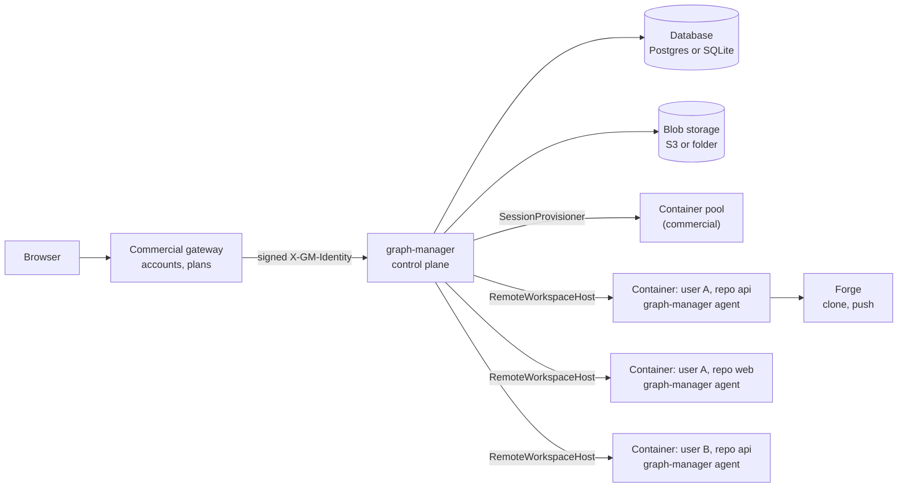
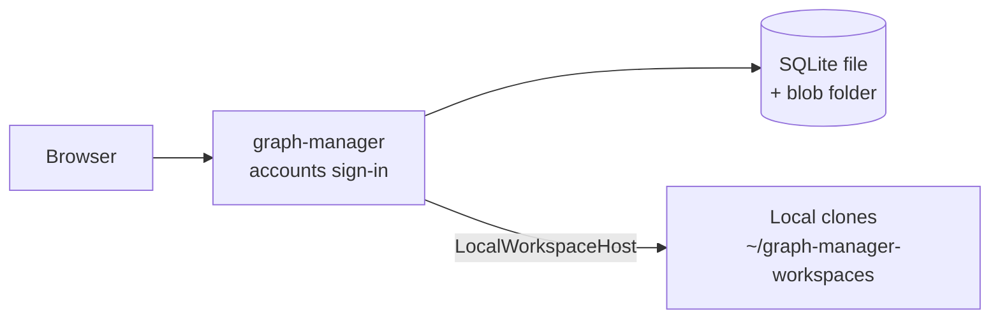
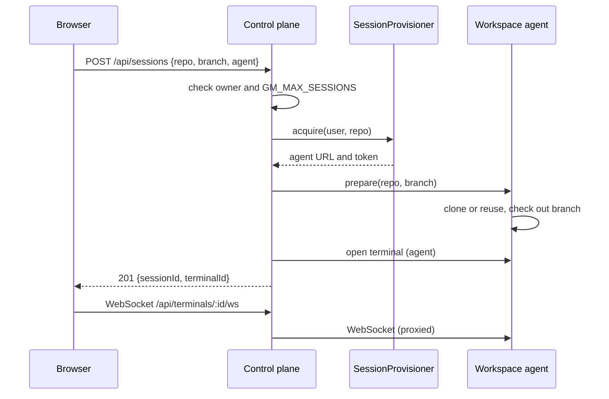
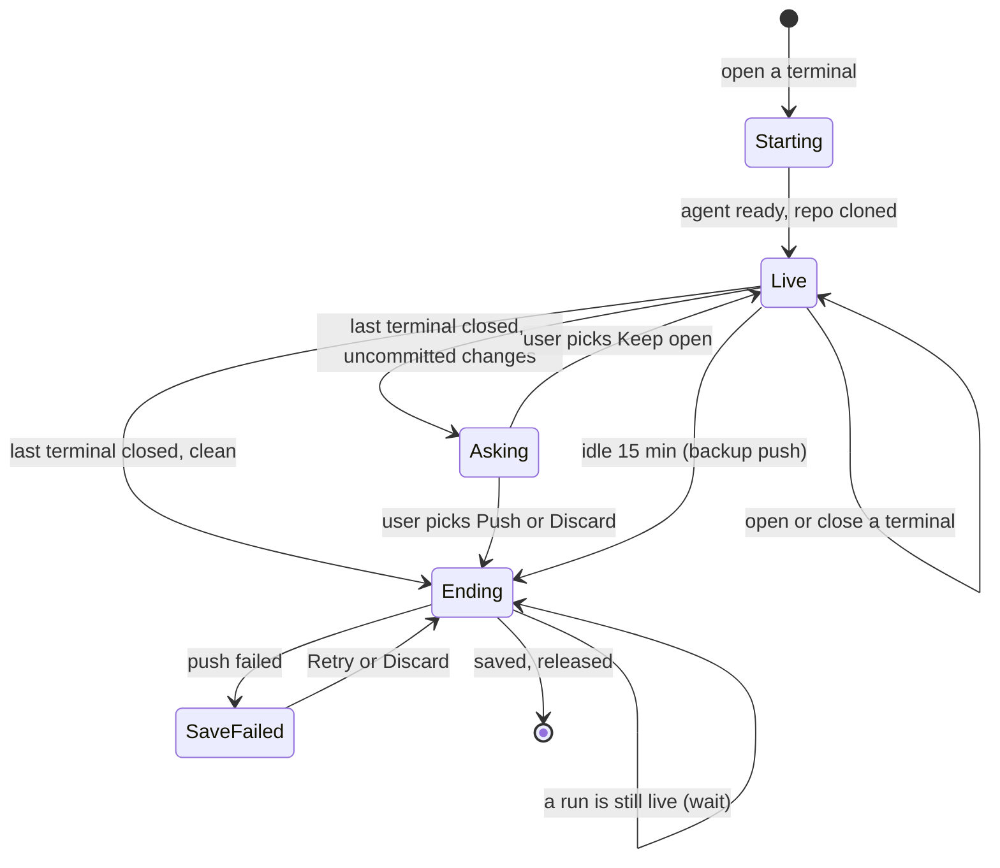

# Hosted sessions: repo sessions, a workspace agent, gateway sign-in and session limits

## Problem

A hosted, commercial graph-execution is planned in a separate private repository (`romm0109/graph-execution-commercial`). Anyone can register there, and paid features (for example the Jira service, KAN-96) live there. The chosen hosting design is **one shared control plane, and one sandbox container per open repository**.

graph-manager cannot serve that design today:

- **It works only on local folders.** Every route reads and writes workspace files and runs git, PTYs and the engine on the machine it runs on (`ws.path` in `routes/specs.ts`, `routes/inspect.ts`, `routes/runs.ts`, `routes/resume.ts`, `routes/pr.ts`, `runs.ts`, `pr.ts`, `terminals.ts`). In the hosted design the files are in a container, not next to the control plane.
- **It has one user.** Sign-in is one shared password (`GM_PASSWORD`, `src/server/auth.ts`), and all state is one JSON file with nothing per user (`src/server/store.ts`).
- **Workspaces are managed by hand.** A user clones on the Workspaces page, then opens terminals in a clone. In the hosted design a repository is opened by opening a terminal on it, and closing its last terminal frees it.
- **Nothing limits how much one user opens.**

The open-source app must keep working on one machine exactly as it does now, with the simpler UI as a bonus.

## Goals

1. **Repo sessions replace the Workspaces page.** A user opens a terminal by choosing a repository, a branch and an agent. A repository with at least one open terminal is a *live session*. Closing the last terminal of a repository ends its session.
2. **A `WorkspaceHost` seam.** Every operation on a repository's files, git, terminals and engine goes through a `WorkspaceHost`. The open-source default, `LocalWorkspaceHost`, does exactly what the code does today.
3. **A workspace agent.** `graph-manager agent` serves the `WorkspaceHost` operations over HTTP and WebSocket from inside a container, and `RemoteWorkspaceHost` is its client. A `SessionProvisioner` interface lets the commercial repo create and remove the containers.
4. **Configurable caps.** `GM_MAX_SESSIONS` caps live sessions per user and `GM_MAX_RUN_CONTAINERS` caps live sandboxed runs per user. Unset = no cap (the default). The commercial service sets both to 3.
5. **Gateway sign-in and per-user state in a database.** With `GM_AUTH=gateway`, graph-manager trusts a signed identity header. State moves from `graph-manager.json` to a database: SQLite by default (a file, nothing to set up), Postgres as an option (`GM_DATABASE_URL`). Every route reads and writes state only through `store.forUser(user)`.
6. **Run history survives the session.** Each run's record is kept in the database and its whole run folder in blob storage (`RunArchive`), so the Runs page still shows a run, with its logs and notes, after its container is gone.
7. **UI plugin slots.** A small way for the commercial repo to add UI (nav items, pages, a top-bar item, a settings section) without forking.
8. **Project sessions.** A multi-repo project (KAN-95) opens as one session: one container (or local project folder) with all of its repositories, counting as one session. Projects are created from forge repositories, not from workspaces.
9. **Sandboxed runs in hosted mode.** Every hosted run gets its own container from the provisioner, as KAN-88 does with Docker locally.
10. **Built-in accounts in open source.** Username and password sign-in, optional open sign-up, a `graph-manager users` command, and each user with their own data. No admin role.
11. **Docker sessions in open source.** Once an install has more than one account, each session runs in its own Docker container, so users cannot read each other's files from a terminal.

## The design

### Hosted: one control plane, one container per open repository



### Open source: the same code on one machine



### Opening a terminal



### Session lifecycle



In open-source mode the flow is the same, including the question on close. Release keeps the clone on disk (no container to remove), so the next session on that repository starts from a clean clone and can switch branch.

## Decisions

| Decision | Why |
|---|---|
| One container per (user, repository). More terminals on the same repository open as more shells in the same container | A shell costs a few MB; a container costs real money. The user asked for a container per repo. |
| The branch is chosen when the session starts and is fixed while it is live. A new terminal on a live repository shows its branch and does not ask again | One checkout per container; no surprise branch switches under a running agent. |
| `GM_MAX_SESSIONS` (integer ≥ 1, unset = unlimited) caps live sessions per user. Above the limit `POST /api/sessions` answers 409 `{"error":"You have 3 open repositories. Close all terminals of one to open another."}` (the number is the limit) | Everyone gets 3 at the start (the commercial deployment sets `GM_MAX_SESSIONS=3`). Per-plan limits can come later from the gateway. |
| Every cap is an environment variable and is off by default: `GM_MAX_SESSIONS`, `GM_MAX_RUN_CONTAINERS`, `GM_SESSION_IDLE_MINUTES` | The user's rule: all caps configurable, none by default. Open-source installs never hit one. |
| A project session counts as one session. It clones every repository of the project into one container (hosted) or reuses the local clones and the project folder (local), all on the same new or existing branch name | One change across repos is one unit of work, like KAN-95's suite. |
| Projects are created and edited from forge repositories (the same search as the New terminal dialog); a repository is cloned when a project session starts. The Projects page stays | The Workspaces tab is gone, so projects can no longer be built from existing clones. |
| Hosted runs end in a PR. Before a run starts, the session pushes its branch; the provisioner starts a run container (`acquireRun`) running `graph-manager agent`, which clones the session branch at its last commit. Uncommitted changes in the session are not part of the run, and the Start run drawer warns "Uncommitted changes in acme/api are not part of the run." When the run is applied, the run container commits the result to `gm/<runId>`, moves the spec to `docs/prd/done/`, pushes, and opens the PR into the session branch with the existing Create PR code (`pr.ts`; for a project, one linked PR per repository as in KAN-95). Then the run container is released. Nothing is applied back into the session's files. `GM_MAX_RUN_CONTAINERS` caps run containers; above it `POST /api/runs/:ws` answers 409 `{"error":"You have 3 sandboxed runs. Wait for one to finish or stop it."}` | Every hosted run ends with a PR (the user's rule), and since the session's files are never touched, there are no conflicts. The engine already needs committed spec and task files. |
| Local sandboxed runs are unchanged (Docker, KAN-88). `LocalProvisioner.acquireRun` is not used locally | No behaviour change for open-source users. |
| The plain CLI flow (`graph-execution …` without graph-manager) stays exactly as it is today: no change under `packages/graph-execution/src`, and its tests pass unchanged. Its `package.json` only gains the dependencies graph-manager needs (`better-sqlite3`, `pg`), because graph-manager ships inside that package | The user's rule: only graph-manager changes. |
| If opening the PR fails, the run keeps its pushed `gm/<runId>` branch and shows the error with **Create PR** to retry; the run container is released anyway | The work is safe on the forge; no container is held. |
| Each user connects their own GitHub or GitLab token in Settings, stored in their own store data. An install with one account behaves as today | The user's choice; a GitHub App can come later in the commercial repo. |
| Closing the last terminal of a repository ends the session. If a run of that repository is live, the session ends when the run ends. A session counts toward the limit until it is fully released | Frees the slot so the user can open another repository; never kills a running run. |
| **Ask before closing**: when the last terminal closes and the clone has uncommitted changes (`git status --porcelain` not empty), the UI asks "acme/api has uncommitted changes." with three choices: **Push to branch** (commit and push to the session branch), **Keep open** (the session stays live with no terminal and still counts toward the limit) and **Discard** (drop the changes). A clean clone ends without a question | The user decides what happens to half-done work; nothing lands on the forge without consent. |
| The same question is asked in open-source mode. There, release keeps the clone on disk; after Push or Discard the clone is clean, so the next session can switch branch | Local and hosted behave the same. Clones and settings that already exist keep working. |
| Commits made by graph-manager (`Push to branch`, idle backup) stage every change git does not ignore; `.gitignore` (and `.git/info/exclude`) is the only rule. Message: `graph-manager: save session <id>` | The repository's own ignore rules decide (changed after the run: a fixed list of secret names also skipped files repos commit on purpose). |
| **Idle**: with `GM_SESSION_IDLE_MINUTES` set, a session with no terminal input or output and no live run for that long ends without asking. Uncommitted changes are committed and pushed to `gm/backup/<session-id>`, then the session is released. Next time the user opens the app, a notice says "Your session on acme/api was closed after 15 minutes idle. Changes were saved to branch gm/backup/<id>." Unset (the open-source default) = never | Nobody is there to ask; the backup branch keeps the work without touching the working branch. The commercial deployment sets 15. |
| If a push fails, the session goes to `save-failed`, the container is kept, and the UI shows the error with **Retry** and **Discard** | Never delete unsaved work silently. |
| **Agent logins**: each agent keeps its own login method. graph-manager reuses the per-provider tables `LOGIN_FILES` and `LOGIN_KEYS` (`sandbox-run.ts` lines 37–50). (1) Login files: after a session ends, the agent's login files from the container's home are saved to the user's store and copied into every new container for that user. (2) API keys: Settings → Agents lets a user save a key per provider (the variables in `LOGIN_KEYS`, for example `ANTHROPIC_API_KEY`), injected into that user's terminals and runs. A key wins over saved login files | A user logs in once per agent, whatever way that agent logs in, or uses an API key instead. |
| New branches default to `gm/<user-id>-<yyyymmdd>-<4 random chars>`. The user can pick an existing branch instead | A predictable, unique branch the session can push to. |
| The control plane talks to an agent with a per-container random token (header `Authorization: Bearer <token>`), given by the provisioner. The agent rejects any other request with 401 | One container's token cannot drive another container. |
| Security is kept to what matters: (1) every store access is `store.forUser(req.user)`, (2) every session, terminal and run route checks that the session's owner is `req.user` and answers 404 otherwise, (3) per-container agent tokens, (4) containers are never reused for another user, (5) gateway and agent secrets are stripped from terminal and run environments | The user asked not to overdo security. These five close the real cross-user paths. Sandbox hardening of the containers is the commercial repo's job (non-privileged, no service-account token, containers cannot reach each other). |
| The identity is an HS256 JWT in `X-GM-Identity`, signed with `GM_GATEWAY_SECRET` (≥ 32 characters), verified with Node's `crypto`. Only `alg: HS256` is accepted. Claims `sub`, `name` required, `email` optional, `iat`/`exp` required, lifetime ≤ 10 minutes, 30 s clock skew | Standard for any gateway; short-lived; no new dependency. |
| In gateway mode the password login and logout answer 404 and session cookies are not accepted. The Origin check stays on | One way in per mode; CSRF protection still applies. |
| **Built-in accounts** (`GM_AUTH=users`, the new default) replace the single password. A `users` table: `id`, `username` (unique, 3–32 of `[a-z0-9_-]`), `display_name`, `password_hash` (scrypt from `node:crypto`, random salt), `created_at`, `disabled`. Passwords are at least 10 characters | The user's choice: several people can use one open-source install, each with their own data. No new dependency. |
| An existing install becomes the account `admin`, with the password it has today (`GM_PASSWORD`, or `<dataDir>/password`). While `GM_PASSWORD` is set, it keeps setting `admin`'s password at startup, as today | Upgrading changes nothing for a single user except typing `admin` as the username (the login form remembers it). |
| `GM_AUTH=password` is accepted as an alias of `users`, so old configs keep working | No breaking config change. |
| **Sign-up**: `GM_SIGNUP=closed` (default) or `open`. Open shows **Create account** on the login page (username, display name, password twice). Closed: accounts are added on the server with `graph-manager users add <username>`, which prints a one-time link `<url>/set-password?token=…` valid 7 days. `graph-manager users list`, `reset <username>` (prints a new link) and `disable <username>` also exist | The user's choice: open sign-up as an option. With no admin role, the server's command line is where accounts are managed. |
| **No admin role.** Everything that is global today becomes per user: reviewers, sandbox recipe and limits, repository settings, run defaults, forge tokens, agent keys. Caps stay environment variables | The user's choice. The store already keeps `Data` per user, so this is mostly free. |
| Each user can change their own password and display name in **Settings → Account**. A changed password ends the user's other sign-in sessions | Basic account hygiene. |
| The session cookie carries the user id: `<expiresMs>.<nonceHex>.<userId>.<hmac>`; a disabled user's cookies stop working at once. The failed-login limit counts per IP and per username (10 in 15 minutes each) | Extends today's cookie and rate limit (`auth.ts`) to many users. |
| In gateway mode a user row is created on the first request of a new `sub` (no password); gateway users and built-in users never mix in one install | One `users` table for both modes. |
| Gateway-only user management: `POST /api/gateway/users/:id/disable` (blocks the user, ends their sessions and releases their containers) and `DELETE /api/gateway/users/:id` (deletes the user's row, data, run rows and blobs). They require `Authorization: Bearer <GM_GATEWAY_SECRET>`, exist only in gateway mode (404 otherwise) and answer 204 | The gateway owns accounts, but needs a way to stop a user and to delete their data when they close their account. |
| **Docker sessions in open source.** `GM_SESSION_RUNTIME`: `auto` (default), `local` or `docker`. `auto` is `local` while the install has one account and `docker` once it has two or more. In `docker`, a `DockerProvisioner` (in this repo, reusing the KAN-88 code in `sandbox.ts` and `docker.ts`) starts one container per session from the user's sandbox image, running `graph-manager agent`, with the user's own Docker volume `gm-user-<userId>` mounted at `/workspaces` (clones persist between sessions). Runs get their own container from `acquireRun`, as in hosted mode | Real isolation between users on one server, and the same code path as hosted, so the commercial repo only adds a Kubernetes provisioner. |
| In `docker` mode, if Docker is not reachable, opening a session answers 503 `{"error":"Sessions need Docker when this graph-manager has more than one account. Start Docker, or set GM_SESSION_RUNTIME=local if everyone here trusts each other."}` | Clear failure instead of silently falling back to shared terminals. |
| When `auto` switches to `docker` (a second account is created), live local sessions keep running; new sessions start in containers | No surprise interruption. |
| Session containers are not privileged, do not get the Docker socket, and reach the control plane only through their agent port | Minimal container hygiene that matters. |
| **Database: SQLite by default, Postgres optional.** With no `GM_DATABASE_URL`, graph-manager uses SQLite at `<dataDir>/graph-manager.db` (`better-sqlite3`, prebuilt for Linux, macOS and Windows; shipped like `node-pty`). With `GM_DATABASE_URL=postgres://…` it uses Postgres (`pg`). Both implement the same `Store` and `RunArchive` and pass the same contract tests | The user's rule: a database, but nobody is forced to run Postgres. SQLite needs no setup; Postgres is there for hosted and team installs. |
| Tables are kept simple: `instance(key, value)` for instance data (`sessionSecret`, `instanceId`); `user_data(user_id PRIMARY KEY, data JSON, updated_at)` holding today's `Data` document per user; `runs(user_id, workspace_id, run_id, status, started_at, ended_at, pr_url, state JSON, summary TEXT, blob_key, PRIMARY KEY(user_id, workspace_id, run_id))`; `schema_version(version)`. Migrations are numbered SQL files run at startup in one transaction | One JSON document per user keeps the store code almost unchanged (`get`/`update` as today), while runs get real columns for listing and filtering. |
| On first start with a database, an existing `graph-manager.json` is imported into the `admin` user and renamed `graph-manager.json.imported` | Existing installs keep all their data with no manual step; the old file stays as a backup. |
| **Blob storage: a folder by default, S3 optional.** `BlobStore { put(key, stream), get(key), delete(key) }`. Default: `<dataDir>/blobs/`. With `GM_BLOB_URL=s3://bucket/prefix` it uses any S3-compatible store with the standard AWS environment credentials (`AWS_ACCESS_KEY_ID`, `AWS_SECRET_ACCESS_KEY`, `AWS_REGION`, optional `AWS_ENDPOINT_URL`). `@aws-sdk/client-s3` is an optional dependency loaded only then; if it is missing, startup stops with `GM_BLOB_URL needs @aws-sdk/client-s3: npm install @aws-sdk/client-s3` | Logs and run folders are too big for database rows. Same rule as the database: works with nothing set up, scales when configured. |
| The archive keeps the **whole run folder** `.graph-execution/<run-id>/` without git worktrees, as a `.tar.gz` blob (key `runs/<user>/<workspace>/<runId>.tar.gz`), plus the `runs` row. It is written when the run ends and updated if it is resumed | Task logs, review notes and tester notes are what people read when a run goes wrong. |
| One control-plane process at a time. Running several behind a load balancer is a follow-up | Terminals and the in-memory session state live in one process; scaling out is not needed at launch. |
| The open-source repo ships the agent (`graph-manager agent`), `RemoteWorkspaceHost` and the `SessionProvisioner` interface. Only the provisioner implementation (Kubernetes, warm pool) is commercial | The split can be tested end to end here (an agent as a local process); the commercial repo only manages containers. |
| `RunArchive` writes the `runs` row when a run's status changes and the run-folder blob when it ends (and when its session ends) | History outlives the container, with everything in it. The existing view cache (`viewcache.ts`) still snapshots live run pages. |
| Repository settings (sandbox image or recipe, run defaults, "Run in sandbox") move to **Settings → Repositories**, keyed by repository id as today (`workspaceSettings`, `runDefaults`) | The Workspaces page goes away; today's keys are already per repository. |
| UI plugins: `GM_UI_PLUGINS` lists ES module URLs. Each default-exports `(api) => void`; `api` gives `React`, `registerNav({ label, path })`, `registerRoute({ path, element })`, `registerTopbar(element)` and `registerSettingsSection({ title, element })` | Commercial-only UI without a build tie between repos; graph-manager's own React is passed in, so there is no second copy. Plugin URLs are trusted config, like `GM_EXTENSIONS`. |
| This work builds on today's `main` (multi-repo, KAN-95, merged). `feat/automation-api` (KAN-96) is not merged yet; it is rebased onto this work later and its conflicts are fixed then | The user's choice: start now. |
| The Projects tab stays, for creating, editing and deleting projects; a project also opens from the New terminal dialog | Projects need a place to be managed. |
| In hosted mode every run is sandboxed: the "Run in sandbox" toggle is hidden and every run gets its own run container, counting toward `GM_MAX_RUN_CONTAINERS`. Local mode keeps the toggle | The user's choice: runs never execute inside the session container in hosted mode. |
| The whole spec is built in one graph-execution run | The user's choice. Tasks are chained with dependencies so the `WorkspaceHost` seam lands first. |

## Non-goals

- The Kubernetes provisioner, the warm pool of containers, container hardening, billing, accounts and per-plan limits (all in the commercial repo).
- Row-level security, a GitHub App instead of PATs, penetration tests, OIDC inside graph-manager, asymmetric identity tokens.
- Changing the engine (`packages/graph-execution`) or how local Docker run sandboxes work.
- A GitHub App or "Sign in with GitHub" (commercial, later).

## User stories

- As a user, I click **New terminal**, pick `acme/api`, keep "New branch", pick Claude, and get a terminal in that repository without visiting any other page.
- As a user, I open a second terminal on `acme/api` and it opens at once in the same session, on the same branch.
- As a hosted user with 3 open repositories, I try a fourth and see "You have 3 open repositories. Close all terminals of one to open another."
- As a hosted user, I close the last terminal of `acme/web`; my changes are pushed to its session branch and I can open a different repository.
- As a hosted user, I close the last terminal while a run is live; the session ends after the run ends, and the run still shows on the Runs page afterwards.
- As a self-hoster, I upgrade and sign in as `admin` with my old password, and keep my clones and my runs. The Workspaces page is gone; I open terminals from the new dialog and change repository settings in Settings → Repositories.
- As the commercial developer, I implement `SessionProvisioner` to start a container running `graph-manager agent`, set `GM_AUTH=gateway`, `GM_MAX_SESSIONS=3`, `GM_MAX_RUN_CONTAINERS=3` and `GM_SESSION_IDLE_MINUTES=15`, and add my UI with `GM_UI_PLUGINS`.
- As a user, I open the project "checkout-flow" from the New terminal dialog and get one terminal in a session with both of its repositories, counting as one of my sessions.
- As a self-hoster, I set `GM_SIGNUP=open`; my teammate creates an account on the login page, and from then on every session runs in its own Docker container. Neither of us can see the other's repositories, runs or tokens.
- As a self-hoster with closed sign-up, I run `graph-manager users add dana` and send Dana the printed link.
- As a hosted user, I start a run; it runs in its own container, and when it is done I get a PR into my session branch.
- As a CLI user, I run `graph-execution` without graph-manager exactly as before.

## Requirements

### Config (`apps/graph-manager/src/server/config.ts`)

- `GM_AUTH`: `users` (default; `password` is an alias) or `gateway`; other values: `ConfigError` `GM_AUTH must be "users" or "gateway"`.
- `GM_SIGNUP`: `closed` (default) or `open`.
- `GM_SESSION_RUNTIME`: `auto` (default), `local` or `docker`.
- `GM_GATEWAY_SECRET`: required in gateway mode, ≥ 32 characters (`GM_GATEWAY_SECRET is required when GM_AUTH=gateway` / `GM_GATEWAY_SECRET must be at least 32 characters`).
- `GM_GATEWAY_LOGOUT_URL`: optional absolute `http(s)` URL.
- `GM_MAX_SESSIONS`: optional integer ≥ 1.
- `GM_MAX_RUN_CONTAINERS`: optional integer ≥ 1.
- `GM_SESSION_IDLE_MINUTES`: optional integer ≥ 1.
- `GM_UI_PLUGINS`: optional comma-separated list of URLs (absolute `https://` or a path starting with `/`).
- In gateway mode `GM_PASSWORD` is not required or read. `GM_GATEWAY_SECRET` joins `STRIPPED_ENV` (`terminals.ts` line 99) and is deleted from engine run environments like `GM_PASSWORD` (`routes/runs.ts`).

### Identity and auth (`src/server/identity.ts` new, `src/server/auth.ts`)

- `User { id; name; email? }`, `verifyIdentity(header, secret, now)`, `signIdentity(user, secret, now, ttl = 300)` as in the decisions. `req.user` is set by the auth hook in both modes.
- Gateway mode: `needsAuth` paths (including WebSocket upgrades and the run-page proxy) require a valid `X-GM-Identity`, else 401 `{"error":"gateway identity required"}`. Login/logout answer 404 `{"error":"not available in gateway mode"}`.
- `GET /api/auth/me` → `{ user, mode, logoutUrl? }`. `GET /api/auth/info` also returns `mode`.

### Accounts (`src/server/accounts.ts`, `src/server/routes/accounts.ts`, `src/server/cli/users.ts`)

- `POST /api/auth/login { username, password }` (204 + cookie; 401 `{"error":"wrong username or password"}`; 429 as today).
- `POST /api/auth/signup { username, displayName, password }`: only with `GM_SIGNUP=open` (else 404); 409 `{"error":"username taken"}`; 400 for a bad username or a password under 10 characters.
- `POST /api/auth/set-password { token, password }` for invite and reset links (single use, 7 days; 400 `{"error":"link expired or used"}`).
- `PATCH /api/account { displayName?, currentPassword?, newPassword? }`.
- `graph-manager users add|list|reset|disable` (`src/server/cli/users.ts`, wired into the `graph-manager` bin) talks to the same database as the server.
- The login page asks for username and password, remembers the last username, and shows **Create account** only with open sign-up. New pages: `/signup`, `/set-password`.

### Gateway user management (`src/server/routes/gateway.ts`)

- `POST /api/gateway/users/:id/disable` and `DELETE /api/gateway/users/:id` as in the decisions. Both are outside `needsAuth`'s identity check and compare the bearer token with `GM_GATEWAY_SECRET` in constant time; a wrong token answers 401. A disabled user's identity tokens answer 403 `{"error":"account disabled"}`.

### Docker sessions (`src/server/sessions/docker-provisioner.ts`)

- `DockerProvisioner implements SessionProvisioner` using the existing Docker client (`docker.ts`) and image logic (`sandbox.ts`, `sandbox-image.ts`): `acquire` creates and starts a container `gm-s-<sessionId>` from the user's image with the volume `gm-user-<userId>` at `/workspaces`, the tools mount as KAN-88 does, the env `GM_AGENT_TOKEN=<random>`, and the command `graph-manager agent --port 7700 --workspaces /workspaces`; it waits for `/agent/v1/healthz` and returns a `RemoteWorkspaceHost`. `release` removes the container (not the volume). `acquireRun`/`releaseRun` do the same for run containers (`gm-r-<runId>`), with the sandbox limits of `sandboxLimits`.
- The provisioner is chosen per `GM_SESSION_RUNTIME` and the account count, each time a session is opened.

### Per-user store (`src/server/store.ts`)

- `interface Store { instance(): InstanceData; forUser(user: User): Promise<UserStore> }` and `interface UserStore { get(): Data; update(fn): Promise<void>; reviewers(): Reviewer[] }`. `forUser` loads the user's row (created on first use with a new reviewer seed) and keeps it cached in memory; `update` writes through, one at a time per user, as `DataStore.update` does today.
- `SqlStore implements Store` over a small `Db` interface with two drivers: `SqliteDb` (`better-sqlite3`, default) and `PostgresDb` (`pg`, when `GM_DATABASE_URL` is set). Migrations live in `src/server/db/migrations/NNN-*.sql`.
- `JsonFileStore` remains only as the importer for an existing `graph-manager.json` (see decisions).
- Config: `GM_DATABASE_URL` (optional, must start with `postgres://` or `postgresql://`), `GM_BLOB_URL` (optional, must start with `s3://`). A database that cannot be reached at startup stops graph-manager with `Cannot connect to the database: <reason>`.
- Every route uses `ctx.store.forUser(req.user)`. A test fails the build if a route module imports `DataStore`/`JsonFileStore` or calls `ctx.store.get` directly.

### `WorkspaceHost` (`src/server/host/`)

```ts
export interface WorkspaceHost {
  prepare(p: { repo: RepoRef; branch: { new: string } | { existing: string } }): Promise<{ workspaceId: string; branch: string }>;
  spawnPty(p: { workspaceId: string; argv: string[]; env: Record<string, string>; cols: number; rows: number }): Promise<PtyProcess>;
  startEngine(p: { workspaceId: string; args: string[]; env: Record<string, string>; timeoutMs: number }): Promise<EngineStart>;
  readFile(workspaceId: string, rel: string): Promise<string | undefined>;
  listFiles(workspaceId: string, rel: string, opts?: { glob?: string }): Promise<string[]>;
  listRuns(workspaceId: string): Promise<RunSummary[]>;
  runDetail(workspaceId: string, runId: string): Promise<RunDetail | undefined>;
  git(workspaceId: string, args: string[]): Promise<{ exitCode: number; stdout: string; stderr: string }>;
  activity(): Promise<{ terminals: number; liveRuns: number; lastInputAt: string | null; lastOutputAt: string | null }>;
  /** Uncommitted changes in the clone (`git status --porcelain`), empty when clean. */
  changes(workspaceId: string): Promise<string[]>;
  /** Commits allowed files and pushes to `branch` (the session branch, or `gm/backup/<id>`). */
  save(p: { workspaceId: string; branch: string; message: string }): Promise<{ pushed: boolean; skipped: string[]; error?: string }>;
  /** Drops uncommitted changes (`git reset --hard` and `git clean -fd`, git-ignored files kept). */
  discard(workspaceId: string): Promise<void>;
  /** Reads (`get`) or writes (`put`) the agents' login files in the home folder, as `{ relPath: base64 }`. */
  loginFiles(op: "get" | "put", providers: string[], files?: Record<string, string>): Promise<Record<string, string>>;
}
```

- `LocalWorkspaceHost`: today's code moved behind the interface (`pty.spawn` from `terminals.ts` lines 255–270, the `execa` engine start from `routes/runs.ts` lines 131–145, `listWorkspaceRuns`/`runDetail` from `runs.ts`, the git calls in `pr.ts`, the file reads in `routes/specs.ts` and `routes/inspect.ts`). `prepare` clones into the workspaces folder if missing (reusing `routes/workspaces.ts` clone code), else fetches and checks out the branch; it refuses with 409 `{"error":"acme/api has uncommitted changes. Close its session with Push or Discard first."}` when the clone is not clean and the branch differs. Paths are checked with the existing `insideWorkspaces` / `realpath` rules. In local mode `loginFiles` is a no-op (the user's own home is used).
- `RemoteWorkspaceHost(url, token)`: the same operations over the agent API.
- The routes `specs.ts`, `inspect.ts`, `runs.ts`, `resume.ts`, `pr.ts` and `terminals.ts` call the session's host instead of touching `ws.path`. With `LocalWorkspaceHost`, sandboxed runs use Docker (`sandbox.ts`) as today. With `RemoteWorkspaceHost`, they use `provisioner.acquireRun` (below).
- Hosted runs need one more host operation: `pushBranch(workspaceId): Promise<{ ok: boolean; error?: string }>` (pushes the session branch before a run starts; for a project, every repository's branch).
- Project sessions: `prepare` takes `{ project: { id, repos: RepoRef[] } }` instead of `repo`, clones every repository and writes the project folder the same way `routes/projects.ts` does today (`project.json`, `repos/<name>` links, its own git repo). `changes`, `save` and `discard` act on every repository of the project.

### Workspace agent (`src/server/agent/`, CLI `graph-manager agent`)

- Started as `graph-manager agent --port <p> --workspaces <dir>` with `GM_AGENT_TOKEN` in the environment (required, ≥ 32 characters).
- Serves every `WorkspaceHost` operation under `/agent/v1/*` (JSON), and PTYs as WebSocket `/agent/v1/pty/:id`, all behind `Authorization: Bearer <GM_AGENT_TOKEN>`; anything else answers 401.
- Uses `LocalWorkspaceHost` internally, so the behaviour is identical.
- `GET /agent/v1/healthz` (no token) answers `{"ok":true}`.

### `SessionProvisioner` (`src/server/sessions/provisioner.ts`)

```ts
export interface SessionProvisioner {
  /** A session container for one repository or one project. */
  acquire(p: { user: User; sessionId: string }): Promise<WorkspaceHost>;
  release(p: { user: User; sessionId: string }): Promise<void>;
  /** A run container for a sandboxed run (hosted only). */
  acquireRun(p: { user: User; sessionId: string; runId: string }): Promise<WorkspaceHost>;
  releaseRun(p: { user: User; runId: string }): Promise<void>;
}
```

- Default `LocalProvisioner`: `acquire` returns the one shared `LocalWorkspaceHost`; `release` does nothing; `acquireRun` throws (local sandboxed runs use Docker).
- Hosted run: check `GM_MAX_RUN_CONTAINERS` (live run containers of the user) → `host.pushBranch` on the session → `acquireRun` → the run container clones the session branch (`prepare` with `{ existing: <session branch> }`) → start the engine there (the run page is proxied from the run container) → when the run is `applied`, run Create PR inside the run container into the session branch → archive the run's state with the PR link → `releaseRun`. A run that ends without applying (failed, aborted) is archived and its container released.
- `buildApp` accepts `provisioner?: SessionProvisioner`, `store?: Store`, `runArchive?: RunArchive`.

### Sessions (`src/server/sessions/`, `src/server/routes/sessions.ts`)

- Session record (in the user's store, `sessions: Record<id, { id, repo: RepoRef, workspaceId, branch, state: "starting" | "live" | "asking" | "ending" | "save-failed", startedAt, error? }>`).
- `GET /api/sessions` → the user's sessions with their terminal ids.
- `GET /api/repos?q=` → repositories from the user's connected forge (reuse `forges.ts` listing), for the dialog.
- `POST /api/sessions` `{ repo } | { projectId }, plus { branch: { new?: string } | { existing: string }, agent?: string, cols?, rows? }`:
  - when the repository already has a live session: opens a new terminal in it (branch ignored) → 201 `{ sessionId, terminalId, branch }`;
  - else checks `GM_MAX_SESSIONS` (409 with the message above), calls `provisioner.acquire`, `host.prepare`, opens the terminal → 201.
- `POST /api/sessions/:id/terminals` `{ agent? }` → a new terminal in a live session.
- Closing a terminal (`DELETE /api/terminals/:id`) when it is the session's last: if `host.changes()` is empty → `ending`; else → `asking`, and the response is `200 { sessionId, ask: { changes: string[] } }` so the UI shows the question.
- `POST /api/sessions/:id/close` `{ action: "push" | "keep" | "discard" }`: `push` → `host.save` to the session branch; `discard` → `host.discard`; `keep` → back to `live` with no terminals. Push and discard then go to `ending`.
- `ending`: waits while a run of the session is live; then saves the agents' login files (`host.loginFiles("get", ...)`) into the user's store, calls `provisioner.release`, and removes the session. A failed push → `save-failed` with `error`; `POST /api/sessions/:id/close` with `push` retries and with `discard` drops the changes.
- New sessions: after `prepare`, the control plane writes the user's saved login files (`host.loginFiles("put", ...)`) and adds the user's saved API keys (Settings → Agents, stored per user as `agentKeys: Record<envName, string>`, only names from `LOGIN_KEYS`) to the terminal and engine environments.
- Idle: with `GM_SESSION_IDLE_MINUTES` set, a loop every 60 s ends live and `asking` sessions whose host `activity()` shows no terminal input or output and no live run for that long: changes are saved to `gm/backup/<session-id>`, then `ending`. The user's store keeps a notice that `GET /api/notices` returns once and the UI shows as a banner.
- Every `/api/sessions/:id/*`, `/api/terminals/:id/*` and `/api/runs/:ws/*` route answers 404 when the session or workspace does not belong to `req.user`.

### Run archive (`src/server/runarchive.ts`, `src/server/blobs.ts`)

- `interface RunArchive { record(user, workspaceId, runId, row): Promise<void>; saveFolder(user, workspaceId, runId, tarGz: Readable): Promise<void>; list(user, filter?): Promise<RunSummary[]>; get(user, workspaceId, runId): Promise<ArchivedRun | undefined>; openFile(user, workspaceId, runId, rel): Promise<Readable | undefined> }`.
- `SqlRunArchive` stores rows in `runs` and folders through `BlobStore` (`FolderBlobStore` default under `<dataDir>/blobs/`, files mode 600; `S3BlobStore` with `GM_BLOB_URL`).
- In local mode a live or recent run is still read from the repository's `.graph-execution/<run-id>/` as today; the archive is written as well, so history survives deleting a clone.
- The Runs page lists live runs from hosts plus archived runs; an archived run opens a read-only detail (graph, tasks, summary, log tail) with the note "This session has ended. The run page is no longer live."

### UI (`apps/graph-manager/src/web`)

- **Remove the Workspaces tab everywhere**, in both local and hosted mode:
  - the route and pages: `App.tsx` line 74, `pages/Workspaces.tsx`, `pages/Workspaces.css`, `pages/CloneDrawer.tsx` and their tests; `/workspaces` redirects to `/terminals`;
  - the nav item and its badge (`Shell.tsx` line 176) and the `g w` chord (`Shell.tsx` line 28);
  - the command palette (`CommandPalette.tsx` lines 52, 56, 79–80): the Workspaces page, "Clone repository" and the workspace entries are replaced by a **New terminal** action and a **Sessions** group (repository and branch; selecting one focuses its terminals);
  - the overview poll (`overview.tsx` line 70) reads `/api/sessions` instead of `/api/workspaces`;
  - the workspace picker in the Terminals page's new-terminal form (`Terminals.tsx` lines 472 and 678–704) is replaced by the New terminal dialog below;
  - the old routes `POST /api/workspaces` (clone) and `DELETE /api/workspaces/:id` are removed; `GET /api/workspaces` stays only as the list `/api/v1` and the agents' tools use;
  - docs: README lines 102, 137, 203, 259, 265 and 306 (and the keyboard table) describe the New terminal dialog, Sessions and Settings → Repositories instead.
- `WorkspaceSettingsDrawer.tsx` moves into **Settings → Repositories** (below).
- `/api/v1` (KAN-96) keeps its `workspaces` paths and scopes: it is an API, not the tab.
- **Projects page** (`pages/Projects.tsx`, `pages/ProjectDialog.tsx`): New project and Edit repos pick repositories from the forge search (`/api/repos`) instead of workspaces; **Open terminal** opens a project session. `routes/projects.ts` stores `repos: RepoRef[]` instead of workspace ids (existing projects are migrated from their workspace ids on read).
- **New terminal** dialog (`pages/Terminals.tsx` / `TerminalSidebar.tsx`): repository or project search (repositories from `/api/repos`, projects from `/api/projects`, live sessions listed first with a "live" badge), branch (**New branch** with the default name editable, or an existing branch from the forge), agent (as today). For a live repository, the branch row shows the session branch read-only.
- The terminal sidebar groups terminals by session: repository, branch, state (`starting`, `live`, `saving`, `save-failed`), and the count "2 of 3 repositories open" when a limit is set.
- Closing the last terminal of a session with changes opens a dialog: title "acme/api has uncommitted changes.", the changed files (first 20), and the buttons **Push to branch**, **Keep open**, **Discard**. Discard asks once more: "Discard all uncommitted changes in acme/api?".
- `save-failed` shows the error with **Retry** and **Discard**.
- **Settings → Agents**: one field per variable in `LOGIN_KEYS` (password input, saved per user, shown as "saved" afterwards, with **Remove**).
- The idle notice from `/api/notices` shows as a dismissible banner.
- **Settings → Repositories**: a table of repositories that have settings, with the existing `WorkspaceSettingsDrawer` contents (sandbox image or recipe, run in sandbox) and the saved run defaults.
- The top bar shows the user's name; log out as in the gateway decisions.
- **Plugins** (`src/web/plugins.ts`): at start the UI reads `/api/ui/plugins` (the `GM_UI_PLUGINS` list) and `import()`s each module, passing the `api` from the decisions. A plugin that fails to load is logged and skipped. With no plugins nothing changes.

### Docs

- `docs/wiki/features/hosted-sessions.md`: the decision table, the diagrams, the agent API, the provisioner contract, the new variables, and how to run the control plane against a local agent for testing. Link it from `docs/wiki/index.md`.
- README graph-manager section: Workspaces page replaced by the New terminal dialog; the new variables.

### Tests

- `identity.test.ts`: valid token, wrong signature, `alg: none`, `alg: HS512`, expired, lifetime over 600 s, missing claims, malformed input, round trip.
- `auth.test.ts`: gateway mode on a route, a WebSocket upgrade and the run-page proxy; login/logout 404 in gateway mode; built-in login with username and password; a disabled user's cookie stops working; the per-username failed-login limit.
- `accounts.test.ts`: sign-up open and closed; username taken; short password; invite link single use and expiry; `graph-manager users add` prints a working link; changing the password ends other cookies; upgrading an install creates `admin` with the old password.
- `docker-provisioner.test.ts` (with a fake Docker client): container name, volume, env and command; `release` keeps the volume; `auto` picks local with one account and docker with two; Docker down gives the exact 503. A real-Docker end-to-end test runs only where Docker is available, like `sandbox.e2e.test.ts`.
- `store.test.ts`: two users (built-in and gateway) see only their own data.
- `sessions.test.ts` (with `LocalProvisioner` and a temp git remote): open a session on a new branch; a second terminal joins it; the limit answers 409 with the exact message; closing the last terminal of a clean clone releases it; with changes it asks, and push / keep / discard each do what they say; a live run delays the release; idle with changes pushes to `gm/backup/<id>` and leaves a notice; switching branch on a dirty clone answers 409; another user's session id answers 404.
- `agent.test.ts`: the agent rejects a missing or wrong token; `RemoteWorkspaceHost` against a local agent process passes the same host contract tests as `LocalWorkspaceHost` (one shared contract suite run against both); `save` pushes to a temp bare remote and skips `.env` and git-ignored files; a failing push returns `pushed: false`; `loginFiles` round-trips the files of `LOGIN_FILES.claude`.
- Agent keys: a saved `ANTHROPIC_API_KEY` reaches a new terminal's environment; a name not in `LOGIN_KEYS` is rejected with 400.
- `runarchive.test.ts`: a run archived at session end is listed and opens read-only, including a task log and the review notes from the folder blob.
- `db.contract.test.ts`: one suite for `Store` and `RunArchive` run against SQLite always, and against Postgres when `GM_TEST_DATABASE_URL` is set (the ubuntu CI job gets a `postgres` service; macOS and Windows run SQLite only). Migrations run twice without error.
- `import.test.ts`: an existing `graph-manager.json` (copied from today's tests' fixtures) is imported into `admin`, renamed `.imported`, and every setting, PR record and reviewer survives.
- `blobs.test.ts`: `FolderBlobStore` round trip; `S3BlobStore` against a fake S3 client; `GM_BLOB_URL` without the SDK gives the exact error.
- Web: the New terminal dialog (search, branch default, live badge), the limit message, Settings → Repositories, a plugin registering a nav item and a route.

### Validation commands

```bash
npm run typecheck && npm run lint && npm test
```

## Acceptance criteria

- [ ] There is no Workspaces tab anywhere: not in the nav, the command palette, the `g w` shortcut or the README; `/workspaces` redirects to `/terminals`.
- [ ] **New terminal** lets the user pick a repository, a branch (new by default) and an agent, and opens a terminal in that repository; a missing clone is cloned first.
- [ ] A second terminal on a live repository opens in the same session on the same branch.
- [ ] With `GM_MAX_SESSIONS=3` and 3 live sessions, opening a fourth repository answers 409 `{"error":"You have 3 open repositories. Close all terminals of one to open another."}` and the UI shows that message.
- [ ] Closing the last terminal of a clean repository ends its session and frees a slot; with a live run, it ends only after the run ends.
- [ ] Closing the last terminal of a repository with uncommitted changes shows "acme/api has uncommitted changes." with Push to branch, Keep open and Discard, in both hosted and local mode; each choice does what it says, and Keep open still counts toward the limit.
- [ ] Push to branch never commits git-ignored files; a failed push shows `save-failed` with Retry and Discard.
- [ ] With `GM_SESSION_IDLE_MINUTES=15`, an idle session with changes is pushed to `gm/backup/<id>` and released, and the next visit shows the notice; without the variable, sessions never end by themselves.
- [ ] A user who logged in to an agent in one session is logged in in the next session's container; an API key saved in Settings → Agents reaches new terminals.
- [ ] `graph-manager agent` answers 401 without the right bearer token, and the shared host contract tests pass for both `LocalWorkspaceHost` and `RemoteWorkspaceHost`.
- [ ] In gateway mode, requests without a valid `X-GM-Identity` answer 401 `{"error":"gateway identity required"}`; two users never see each other's sessions, terminals, runs or settings (404).
- [ ] An existing install signs in as `admin` with its old password and keeps its clones, runs and settings.
- [ ] In gateway mode, `POST /api/gateway/users/:id/disable` makes that user's requests answer 403 and releases their sessions; `DELETE /api/gateway/users/:id` removes their data, runs and blobs; both answer 401 without the gateway secret.
- [ ] With `GM_SIGNUP=open`, the login page shows Create account and a new user can sign up; with the default, it does not, and `graph-manager users add <name>` prints a one-time link that sets the password.
- [ ] Two accounts never see each other's sessions, terminals, runs, repository settings, reviewers, forge tokens or agent keys (404 or absent).
- [ ] With two or more accounts (and `GM_SESSION_RUNTIME=auto`), a new session runs in its own Docker container with the user's own volume; without Docker it answers the exact 503 message; with one account sessions are local as today.
- [ ] A run from an ended session still shows on the Runs page and opens read-only.
- [ ] Settings → Repositories shows and edits the per-repository sandbox settings and run defaults.
- [ ] With no cap variables set, there are no caps. With `GM_MAX_RUN_CONTAINERS=3` and 3 live sandboxed runs, a fourth answers 409 `{"error":"You have 3 sandboxed runs. Wait for one to finish or stop it."}`.
- [ ] A project opens from the New terminal dialog as one session with all its repositories and counts as one session; New project picks repositories from the forge.
- [ ] With a remote host, every run runs in its own container (the toggle is hidden), starts from the session branch's last commit, ends with a PR into the session branch, and its container is released; the session's files are not changed.
- [ ] Starting a hosted run with uncommitted changes shows "Uncommitted changes in acme/api are not part of the run."
- [ ] The `graph-execution` CLI behaves exactly as before; nothing under `packages/graph-execution/src` changes and its tests pass.
- [ ] A plugin listed in `GM_UI_PLUGINS` adds a nav item and a page; with no plugins the UI is unchanged.
- [ ] `GM_GATEWAY_SECRET`, `GM_AGENT_TOKEN` and `GM_PASSWORD` are not in a terminal's environment.
- [ ] With no database settings, graph-manager creates `<dataDir>/graph-manager.db` and works with nothing else installed; an existing `graph-manager.json` is imported and renamed `graph-manager.json.imported`.
- [ ] With `GM_DATABASE_URL=postgres://…`, graph-manager uses Postgres; the contract tests pass on both databases.
- [ ] An ended run's page shows its task logs and review and tester notes from the archive; with `GM_BLOB_URL=s3://…` the folder is stored in S3.
- [ ] `docs/wiki/features/hosted-sessions.md` exists and is linked from `docs/wiki/index.md`.
- [ ] `npm run typecheck && npm run lint && npm test` pass.
