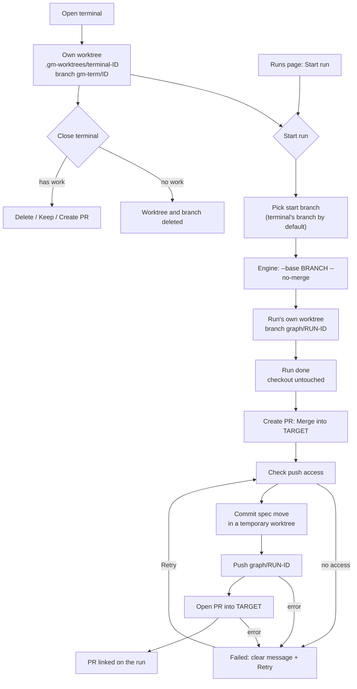

# Isolated runs and terminals, and a Create PR that can recover

## Problem

graph-manager works in one shared checkout per workspace, and that doesn't scale:

- **Runs mix.** Every run started from graph-manager applies its result to the workspace checkout as uncommitted changes. Two runs on one workspace land on top of each other, and a run's result lands on top of whatever a terminal was doing (KAN-98).
- **Terminals share one folder.** Every terminal and agent of a workspace works in the same folder, so their changes mix with each other and with runs (KAN-100). The spec pane belongs to the workspace, so a spec written in one terminal pops up in all of them (KAN-99).
- **Create PR can't recover.** Create PR commits the checkout's uncommitted changes to a new branch, then pushes. When the push fails (for example a token without write access answers HTTP 403), the commit is already made, the checkout is clean and stays on the PR branch, and the run then shows "no changes to open a PR": there is no Retry, and starting again fails with "branch already exists". The PR always targets the run's starting branch (KAN-103).
- **The run page hides what happened.** After a resume, a task that kept its earlier result looks exactly like one that ran again (KAN-97). During validation the run page shows "revalidate N/M" over the validation fixer's label, and it is hard to tell whether the gate is re-checking or the agent is fixing (KAN-102).
- **Sandboxes need Docker 26** (API 1.45) even where nothing needs it (KAN-101).
- **The spec pane reopens on every save.** It opens whenever the newest spec's mtime changes, so an agent editing the spec reopens a pane the user just closed (KAN-99).

## Goals

1. Runs started from graph-manager never touch the workspace checkout or any terminal's folder. Each run works only in its own worktree, cut from the committed state of a branch you pick, and ends on its own `graph/<run-id>` branch, so two runs never mix (KAN-98, KAN-104).
2. Create PR opens a PR from the run's branch into the branch picked under **Merge into**, which may differ from the branch the run started from (KAN-103).
3. Create PR checks push access first, says clearly when the token can't push, and has **Retry** after any failure. A failed Create PR never leaves the workspace in a stuck state (GitHub push bug).
4. Every terminal opened on a workspace gets its own git worktree and branch. Closing an empty one deletes it. Closing one with work asks **Delete / Keep / Create PR**, and kept worktrees stay until you delete them (KAN-100).
5. A run can start from a terminal's branch. Agents in terminals keep their MCP tools (`open_start_run`), and a run they start is just as separate from their terminal as any other run (KAN-104).
6. The spec pane belongs to the terminal (worktree) its spec was written in. It opens automatically only when a spec file is **created**, updates live while open, and a **Spec** chip in that terminal reopens it (KAN-99).
7. After a resume, every task and every review/test report shows **reused** or **ran again**, in the task table, the task graph and the phase cards, and the marker is saved with the run (KAN-97).
8. Validation shows **fixing N/M** while the validation fixer works and **checking fix N/M** while the gate re-checks its fix, and the labels never overlap (KAN-102).
9. Sandboxes work on Docker 20.10 and newer (KAN-101).

## Flow

## Decisions

| Decision | Why |
| --- | --- |
| Runs and terminals use git worktrees, never clones or containers of their own. | The user chose worktrees: fast and cheap. A sandboxed run is still a container, and its worktrees live inside the mounted workspace. |
| The engine gets `--base <ref>`: the run starts from that commit instead of HEAD. graph-manager always passes `--base` and `--no-merge`. | The engine already makes `graph/<run-id>` and its own integration worktree from the starting commit. With `--base` it never needs the checkout's HEAD, and with `--no-merge` it never applies anything to the checkout. No second worktree per run. |
| The run's start branch defaults to the workspace's current branch, or to the terminal's branch when the run comes from a terminal (`open_start_run`). | That's the branch the user is looking at. Any other local or remote branch can be picked. |
| A run reads only the committed state of its start branch. Uncommitted changes in that terminal or checkout show a warning in Start run, and the run starts anyway. | Full separation: the run never reads or writes another folder's work in progress. Committing for the user would put commits on their branch that they didn't make. |
| Spec and tasks paths are read from the folder the run was started from (the workspace, or the terminal's worktree). | That's where the agent wrote them. Agents in the run still see only committed code. |
| **Merge into** is the PR target and is picked in the Create PR form. It defaults to the run's start branch. | KAN-103: a PR can go to any branch. |
| Create PR pushes `graph/<run-id>` as it is, plus at most one commit that moves the spec to `docs/prd/done/`. That commit is made in a temporary worktree under `.gm-worktrees/`, never in the checkout. | Nothing in the checkout changes, so a failure can't leave it stuck, and Retry always has what it needs. |
| Push access is checked with `git push --dry-run` before anything else. A 403/401 from the forge becomes "the <Forge> token can't push to <repo>…". | The user found out about a read-only token only after the commit was made. A dry run checks the real thing (token, repo, branch rules) and changes nothing. |
| A failed Create PR shows **Retry**. Retry starts again at the first step that isn't done, and the commit and push steps are idempotent. | The run with the 403 had no way forward. |
| Terminal worktrees live in `<workspace>/.gm-worktrees/<worktree-id>` on branch `gm-term/<worktree-id>` (a random id, `w` + 8 hex digits: terminal ids restart with the server), cut from the workspace's current HEAD. `.gm-worktrees/` goes into `.git/info/exclude`. | Inside the workspace, so the workspace's sandbox mount sees them. Never inside `.graph-execution/`, which the engine refuses to run in. `gm-term/` can't clash with `graph/` or `graph-task/`. |
| Closing a terminal whose worktree has no uncommitted changes and no commits beyond its base deletes the worktree and branch. Otherwise the user picks **Delete** (worktree and branch go), **Keep** (both stay, listed under the workspace until deleted) or **Create PR** (commit, push, PR; then the worktree is removed and the branch kept). | What the user asked for. Kept worktrees stay forever until deleted. |
| Kept terminal worktrees are saved in graph-manager's store (`terminalWorktrees`). On the Terminals page they show under their workspace with **Open terminal**, **Create PR** and **Delete**. | Terminals live in memory; worktrees have to survive a restart. |
| Terminals opened on a project, or without a workspace, keep today's behaviour (no worktree). | A project folder isn't a workspace repo. Out of scope. |
| The spec pane watches the specs of the focused terminal's worktree. It opens automatically only for a spec path it hasn't seen before (a new file). An open pane re-reads its file when the mtime changes. | KAN-99. Edits no longer reopen a pane the user closed. |
| The reused / ran-again marker is computed by the engine at resume and saved in `state.json`: `tasks[id].resumed: "reused" \| "reran"` and a run-level `reportsResumed[reviewerId]` (the review phase rewrites `review` at every step). A fresh run has no marker. | It has to survive reloads and show on finished runs in graph-manager. |
| Validation labels: fixer node "fixing N/M", gate node while re-checking a fix "checking fix N/M". The gate's label doesn't show while the fixer is working. | KAN-102. |
| Sandboxes ask the daemon for its API version and use `min(1.45, daemon)`, with Docker 20.10 (API 1.41) as the floor. Bind mounts work at any version. A named-volume workspace mount (`VolumeOptions.Subpath`) needs 1.45: on older daemons that one setup fails with a message that names `GM_SANDBOX_WORKSPACES_SOURCE`. | KAN-101. Only the Subpath feature needs 1.45, and it's only used when graph-manager itself runs in a container on a named volume. |

## Non-goals

- Project (multi-repo) runs and their Create PR: unchanged.
- A run started by typing `graph-execution` in a terminal: it runs in that terminal's worktree with the engine's own defaults, as today. Only runs started through graph-manager get `--base` and `--no-merge`.
- Full clones per run, or a container per terminal.
- Moving existing runs, or uncommitted changes already in a checkout, into worktrees.
- Changing the `open_start_run` tool's input schema, except that the request remembers its terminal.
- Cleaning up kept worktrees automatically.
- A Windows-only worktree check beyond what CI covers.

## User stories

- As a user, I start two runs on the same workspace and each ends on its own `graph/<run-id>` branch. My checkout doesn't change.
- As a user, I open two Claude terminals on one workspace, and each works in its own folder and branch without seeing the other's edits.
- As a user, I close a terminal where nothing changed, and its worktree and branch disappear.
- As a user, I close a terminal with work, and I choose Delete, Keep or Create PR.
- As a user, I find my kept terminal worktrees under their workspace and reopen, PR or delete them later.
- As an agent in a terminal, I call `open_start_run` and the Start run form opens with my terminal's branch as the start branch and my spec and tasks paths.
- As a user with a read-only token, I click Create PR and am told right away that the token can't push, and nothing changes. After fixing the token I click Retry and get the PR.
- As a user, I open a PR from a run into `develop` even though the run started from `main`.
- As a user, I close the spec pane while the agent keeps editing the spec, and it stays closed until I click the Spec chip.
- As a user reviewing a resumed run, I see which tasks and reports were reused and which ran again.
- As a user watching validation, I can tell whether the agent is fixing or the gate is re-checking.
- As a user on Docker 24, I can use sandboxes.

## Requirements

### Engine (`packages/graph-execution`)

- **`--base <ref>`** on the run command (`cli.ts`, next to `--no-merge`), added to `RUN_VALUE_OPTIONS` in `state/paths.ts`.
  - `checkEnvironment` (`launch/preflight.ts`) takes an optional `base`. When set, `startingCommit = git rev-parse --verify <base>^{commit}`, and `startBranch` is the branch name when `<base>` is a local branch (`refs/heads/<base>`), else undefined. An unknown ref is a `UsageError`: `unknown base: <ref>`.
  - With `--base`, the uncommitted-changes warning in `runner/startup.ts` is printed only when `<base>` is the branch checked out in the cwd.
  - `--base` together with the merge (no `--no-merge`) still applies to the starting branch only when it's the checked-out branch; otherwise the run behaves as `--no-merge` and logs `not applying: <base> is not checked out here`.
  - Resume ignores `--base` (it uses `state.startingCommit`, as today).
- **Resume markers (KAN-97).** `state/resume.ts` `reconcile`: every task that stays `merged` gets `resumed: "reused"`. Every task reset to pending, and every task not merged before the resume, gets `resumed: "reran"` once it runs. Review/tester reports kept by the review phase (`review/phase.ts`, the "reusing the existing report" path) set `review.reportsResumed[id] = "reused"`; reports written again set `"reran"`. The fields are added to the state schema (`state/state.ts`) as optional, and a fresh run never sets them. `runpage.js` shows the marker as a small chip next to the task status and in the review card.
- **Validation labels (KAN-102).** `web/assets/runpage.js` `statusText`: fixer node → `fixing N/M`; gate node in a re-check round → `checking fix N/M`, replacing `revalidate N/M`. The gate's label is hidden while the validation fixer node is `running`/`fixing`, and the two node labels never share a position in the graph.

### graph-manager server (`apps/graph-manager/src/server`)

- **Worktrees module** (new `worktrees.ts`): `WORKTREES_DIR = ".gm-worktrees"`, `ensureExcluded(ws)`, `addTerminalWorktree(ws, id)` → `{ path, branch: "gm-term/<id>", base: <HEAD commit>, baseBranch?: <current branch> }`, `worktreeState(path, base)` → `{ dirty: boolean; ahead: number }`, `removeWorktree(ws, path, { deleteBranch })`, and `tempWorktree(ws, ref)` for Create PR. All git calls use `GIT_TERMINAL_PROMPT=0`.
- **Store** (`store.ts`): `terminalWorktrees: Record<string, { workspaceId: string; path: string; branch: string; base: string; baseBranch?: string; title: string; createdAt: string; kept?: boolean }>` keyed by terminal id. `runBases: Record<"<ws>/<runId>", { base: string; terminalId?: string }>`. Both default to `{}` for old store files.
- **Terminals** (`routes/terminals.ts`):
  - `POST /api/terminals` with a `workspaceId` creates the worktree, stores it, and spawns the PTY with `cwd` = the worktree. `TerminalInfo` gets `worktree?: { path: string; branch: string }`. Projects and plain `cwd` terminals are unchanged.
  - `DELETE /api/terminals/:id` with no `worktree` query: if the terminal has a worktree with changes (`dirty` or `ahead > 0`), answer **409** `{ error: "the terminal has work", needsChoice: true, dirty, ahead, branch }` and don't close it. Without changes: close it, remove the worktree and branch, 204.
  - `DELETE /api/terminals/:id?worktree=delete|keep`: `delete` removes the worktree and branch (`git worktree remove --force`, `git branch -D`). `keep` marks the record `kept: true` and leaves both. Either way the terminal closes, 204.
  - `GET /api/workspaces/:id/worktrees`: the kept worktrees of a workspace, `{ worktrees: [{ id, path, branch, title, createdAt, dirty, ahead }] }`.
  - `POST /api/terminals { workspaceId, worktreeId }` (with or without `agent`): opens a new terminal in a kept worktree (the record moves to the new terminal id, `kept` cleared). `GET /api/worktrees` lists every kept worktree, for the sidebar.
  - `DELETE /api/workspaces/:id/worktrees/:wid`: removes a kept worktree and its branch, 204.
- **Specs per terminal (KAN-99)**: `GET /api/terminals/:id/specs` and `GET /api/terminals/:id/specs/file?path=` work like the workspace routes (`routes/specs.ts`) but on the terminal's worktree. Refactor `listSpecs`/the file read to take a root folder.
- **Start run** (`routes/runs.ts`, workspace runs only):
  - The body gets `base?: string` and `terminalId?: string`. With `terminalId`, the terminal must have a worktree in this workspace; `tasksDir` and `spec` are resolved inside that worktree (absolute paths are passed to the engine), and `base` defaults to its branch. Without it, `base` defaults to the workspace's current branch.
  - `base` must resolve (`git rev-parse --verify <base>^{commit}` in the workspace), else 400 `base: unknown branch <base>`.
  - The engine always gets `--base <base> --no-merge` (sandboxed runs too). `runBases["<ws>/<runId>"]` is saved.
  - `GET /api/workspaces/:id/run-defaults` also returns `branches: string[]` (local branches, then `origin/…` remote ones) and `currentBranch`. With `?terminal=<id>` it returns `base` = that terminal's branch and `uncommitted: string[]`, the terminal worktree's changed files outside the chosen spec/tasks paths.
  - `open_start_run` (`tools/open-start-run.ts`, `agent-requests.ts`): the request already carries `terminalId`. The browser passes it to the Start run form, which sends it as `terminalId`.
- **Create PR** (`pr.ts`, `routes/pr.ts`), workspace runs:
  - Eligible when there's no stored PR, the run is `done` or `applied`, and `graph/<run-id>` exists with at least one commit not on the chosen base. The "no uncommitted changes in the workspace" check is removed. When `graph/<run-id>` has no commits beyond its base: `{ eligible: false, reason: "the run made no changes" }`.
  - `PrSuggestion.branch` is `graph/<run-id>` and isn't editable. `base` defaults to `runBases[...]?.base`, then `state.targetBranch`, then the current branch, then the forge's default branch. `bases` lists the remote's branches.
  - Steps: `access` → `commit` → `push` → `create`. `PrStep` and the UI's step list change to match.
    - `access`: `git push --dry-run --porcelain origin graph/<run-id>:refs/heads/graph/<run-id>` with `gitAuthArgs`. On failure, if the output has `403`, `401`, `Permission` or `denied`, the error is `the <GitHub|GitLab> token can't push to <owner/repo>: give it write access to the repository's contents (GitHub: "Contents: Read and write"), then Retry`. Otherwise it's the usual last line.
    - `commit`: only when the run's spec is in `docs/prd/` (not `done/`) on `graph/<run-id>`. Add a temporary worktree of `graph/<run-id>` under `.gm-worktrees/pr-<run-id>`, move the spec with `moveSpecToDone`, commit, and always remove the worktree. Skipped when the spec is already in `done/` on the branch (so Retry doesn't make a second commit). The commit uses graph-manager's fallback identity when none is set.
    - `push`: `git push --progress -u origin graph/<run-id>`, idempotent.
    - `create`: as today. A "pull request already exists" answer from the forge for the same head is turned into success by looking up that PR (`clientFor(...).findPullRequest` on the head branch, added to both forge clients).
  - Nothing runs `git checkout` in the workspace any more.
  - **Retry**: `POST /api/runs/:ws/:runId/pr` with `{ retry: true }` (title, body and base optional, defaulting to the failed job's) starts a new job that marks the steps the last job finished as `done` and runs the rest. 409 when no failed job exists for the run.
- **Create PR from a terminal worktree** (`POST /api/terminals/:id/pr` and `POST /api/workspaces/:id/worktrees/:wid/pr`, body `{ title, body, base?, retry? }`; `GET /api/workspaces/:id/worktrees/:wid/pr` gives the job): the same job with the steps `access` → `commit` (`git add -A` and commit in the worktree, when dirty) → `push` (`gm-term/<id>`) → `create`. On success the terminal closes (when open), the worktree is removed, the branch is kept, and the PR is stored under `prs["<ws>/term-<worktree-id>"]`. `base` defaults to the worktree's `baseBranch`.
- **Docker (KAN-101)** (`docker.ts`, `sandbox.ts`, `sandbox-run.ts`): `DOCKER_API` becomes a negotiated prefix. Call unversioned `GET /version` first, and use `/v<min(1.45, ApiVersion)>`. Below 1.41: unavailable with `Docker 20.10 or newer is needed (API 1.41), this daemon has <v>`. When the workspace mount would be a `volume` with `Subpath` and the API is below 1.45: `SandboxError(400, "this Docker (API <v>) can't mount part of a volume: set GM_SANDBOX_WORKSPACES_SOURCE to the host folder of the workspaces volume, or use Docker 26+")`. Remove the "Docker 26 or newer is needed" message.

### graph-manager web (`apps/graph-manager/src/web`)

- **Terminals page** (`pages/Terminals.tsx`, `pages/TerminalPane.tsx`):
  - The pane header shows the worktree's branch.
  - Closing a terminal that answers 409 `needsChoice` opens a dialog: "<branch> has <N uncommitted files / M commits>." with **Delete**, **Keep**, **Create PR** and **Cancel**. **Create PR** opens a small form (title, body, Merge into) and shows the job's steps like the run PR panel.
  - Each workspace section lists its kept worktrees with **Open terminal**, **Create PR** and **Delete** (Delete asks for confirmation).
- **Spec pane (KAN-99)** (`pages/specPane.ts`, `pages/SpecFloat.tsx`): the watch is per terminal. `useWorkspaceSpecs` becomes `useTerminalSpecs(terminalId)` on the new routes. `nextWatch` returns `open` only for a path not in the set of paths seen since the watch began (the first answer seeds the set). An mtime change of a known path only updates `latest`. `SpecFloat` re-fetches the file when its entry's `mtimeMs` changes. The existing `pane-spec-chip` reopens the pane for that terminal's newest spec.
- **Start run drawer** (`pages/StartRunDrawer.tsx`): a **Start from** branch picker (from `run-defaults.branches`, default `run-defaults.base ?? currentBranch`). When opened from an agent request, it passes `terminalId`. When `uncommitted` isn't empty, a warning: "N uncommitted change(s) in this terminal won't be in the run: commit them first to include them." The **Merge into my branch** option is removed from the run options (`RunOptionsFields.tsx`), because runs always end on their branch.
- **PR panel** (`pages/PrPanel.tsx`): branch shown read-only as `graph/<run-id>`; **Merge into** picker = base; steps `access`, `commit`, `push`, `create`; on a failed job, the error plus a **Retry** button (`data-testid="pr-retry"`) that posts `{ retry: true }`.
- **Runs list** (`pages/Runs.tsx` `hasChanges`/PR cell): a `done`/`applied` run with no PR shows "ready for PR". A run whose last Create PR failed shows "PR failed: retry". "the run made no changes" replaces "no changes to open a PR".
- **Run detail (KAN-97, KAN-102)**: `RunDetail.tsx`, `TaskGraph.tsx`, `PhaseCards.tsx` and `ui/status.ts` show a `reused` / `ran again` chip (`data-testid="resume-marker"`) from `tasks[id].resumed` and `review.reportsResumed`. Status text uses "fixing N/M" / "checking fix N/M" as in the engine.

### Docs

- README: runs end on `graph/<run-id>` and never touch the checkout, terminals get worktrees, Create PR's Merge into and Retry, Docker 20.10+.
- `docs/wiki/features/isolated-workspaces.md` with the decision table, ticket keys, follow-ups and code references, linked from `docs/wiki/index.md`.

## Acceptance criteria

- [ ] `graph-execution <tasks> --spec <spec> --provider fake --base other --no-merge` in a repo on `main` creates `graph/<run-id>` from `other`'s commit, and `git status` in the repo is unchanged afterwards.
- [ ] `--base nope` exits 2 with `unknown base: nope`.
- [ ] Two runs started through `POST /api/runs/:ws` on the same workspace both end with status `done`, each with its own `graph/<run-id>`, and the workspace's `git status --porcelain` is empty.
- [ ] `POST /api/terminals { workspaceId }` answers with `worktree.branch` = `gm-term/<worktree-id>`, and the PTY's cwd is `<workspace>/.gm-worktrees/<worktree-id>`.
- [ ] `DELETE /api/terminals/:id` on an untouched terminal answers 204 and removes the folder and the branch. On one with a changed file it answers 409 with `needsChoice: true`. `?worktree=keep` then answers 204 and the worktree is listed by `GET /api/workspaces/:id/worktrees`. `DELETE /api/workspaces/:id/worktrees/:wid` removes it.
- [ ] Create PR on a done run with a token that the forge rejects (403) fails at step `access`, the error contains "token can't push", and the workspace's HEAD, branch and `git status` are unchanged. `POST …/pr { retry: true }` after fixing the token completes `push` and `create`.
- [ ] A retried Create PR makes at most one spec-move commit on `graph/<run-id>`.
- [ ] The PR is opened with head `graph/<run-id>` and base = the picked Merge into branch, which can differ from the start branch.
- [ ] `prStatus` never returns "no uncommitted changes in the workspace". A run without commits beyond its base returns "the run made no changes".
- [ ] `nextWatch`: an mtime change of a known spec returns no `open`, and a new spec path returns `open` once.
- [ ] Spec routes on a terminal list only that terminal worktree's `docs/prd/*.md`.
- [ ] After a resume, `state.json` has `resumed` on every task and every kept/rewritten report, and the run page and graph-manager show `reused` / `ran again`. A fresh run has none.
- [ ] The run page shows `fixing 1/3` on the fixer node and `checking fix 1/3` on the gate node, and never `revalidate`.
- [ ] With a daemon reporting API 1.41, sandboxes are available, and requests go to `/v1.41/…`. With API 1.40 the reason says Docker 20.10 or newer.
- [ ] `npm run typecheck && npm run lint && npm test` pass.
