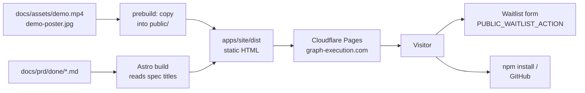

# PRD: Landing site at graph-execution.com

## Problem

graph-execution has no website. The only places to learn about it are the GitHub README and the npm page, which read as reference docs, not as a pitch. Posts that link to it have nowhere to send people, and there is no way to find out whether anyone wants a hosted version.

The message today ("runs coding agents in parallel in git worktrees") sounds like every other agent orchestrator. The thing that sets graph-execution apart is what happens after the agents write code: a gate on every task, one code reviewer and a live tester on the merged result, a fixer, then a pull request. The site has to lead with that.

## Goals

1. **A static landing site in `apps/site`**, built with Astro, that explains graph-execution in one page and works without JavaScript.
2. **Lead with the promise "Turn a spec into a reviewed, tested pull request"**, the demo video and the install command.
3. **Show proof:** a "Built by itself" section listing every shipped spec in `docs/prd/done/`, generated at build time, so it grows with the repo.
4. **Measure demand for a hosted version** with a waitlist form.
5. **Deployable to Cloudflare Pages** from this repo with no GitHub Actions secrets: Cloudflare builds it from the repo.

## Decisions

| Decision | Why |
| --- | --- |
| The site lives in this monorepo as the `apps/site` workspace, package name `site`, `private: true`. | Stars, issues and content stay in one repo. A feature PR can update the site in the same change. |
| Astro, static output (`output: "static"`), no UI framework, no client-side JS except one small inline script for the copy button. | Fast, cheap to host, nothing to break. Easy to add pages later (blog, docs). |
| Cloudflare Pages builds from the repo root: build command `npm ci && npm run build -w site`, output directory `apps/site/dist`. | Free hosting with the custom domain. No deploy workflow or API token in GitHub. |
| The video and poster are copied from `docs/assets/` into `apps/site/public/` by a `prebuild` script, and the copies are gitignored. | One copy of the 4 MB video in git. Plain Node `fs.copyFileSync` works on Windows, unlike symlinks. |
| The waitlist form posts to the URL in the build-time env var `PUBLIC_WAITLIST_ACTION` (for example a Formspree endpoint). When it is unset, the section shows a "Watch the repo on GitHub for the hosted launch" link instead of the form. | No backend and no account is needed to build or test the site. The owner sets the variable in Cloudflare later. |
| "Built by itself" is generated from `docs/prd/done/*.md`: the first `# ` heading of each file, with a leading `PRD: ` removed, linked to the file on GitHub (`https://github.com/romm0109/graph-execution/blob/main/docs/prd/done/<file>`). | Real, checkable proof that grows on its own. |
| Dark theme only, matching the demo video (near-black navy background, cyan accent). System font stack, no web fonts. | One look, consistent with the video. No external requests. |
| The site is not added to the root `build` script. It is covered by `npm test` through its own `test` script. | The npm package build stays unchanged. CI still builds and checks the site on every OS. |
| No analytics script. | Cloudflare Web Analytics can be turned on in the dashboard without code. |

## Non-goals

- Sign-in, accounts, billing or the hosted product itself.
- A docs site. The site links to the READMEs on GitHub.
- A blog (a later page).
- A light theme.
- A GitHub Actions deploy workflow.
- Buying the domain or configuring Cloudflare (done by the owner by hand).

## User stories

1. As a developer who clicked a link in a post, I understand in five seconds what graph-execution does and how it differs from other agent tools.
2. As a developer, I copy the install command with one click and start it.
3. As a skeptic, I scroll to "Built by itself" and open the real specs this tool shipped.
4. As a team lead, I leave my email to hear when the hosted version is ready.
5. As the owner, I deploy the site by connecting the repo in Cloudflare Pages, with no code change.

## Requirements

### Workspace (`apps/site/`)

- `apps/site/package.json`: `name: "site"`, `private: true`, `type: "module"`, scripts:
  - `"prebuild": "node scripts/copy-assets.mjs"`
  - `"build": "astro build"` (npm runs `prebuild` first)
  - `"dev": "node scripts/copy-assets.mjs && astro dev"`
  - `"test": "npm run build && vitest run"`
  - Dependency: `astro` (latest 5.x). Dev dependency: `vitest` is already at the root.
- `apps/site/astro.config.mjs`: `site: "https://graph-execution.com"`, `output: "static"`.
- `apps/site/tsconfig.json` extending `astro/tsconfigs/strict`.
- `apps/site/scripts/copy-assets.mjs`: copies `docs/assets/demo.mp4` and `docs/assets/demo-poster.jpg` (paths resolved from the script file with `import.meta.url`, not the cwd) to `apps/site/public/demo.mp4` and `apps/site/public/demo-poster.jpg`, creating `public/` if missing.
- `apps/site/.gitignore`: `public/demo.mp4`, `public/demo-poster.jpg`, `.astro/`.
- Root `eslint.config.js`: add `"**/.astro/"` to `ignores`, and give `apps/*/scripts/**/*.mjs` its Node globals (already listed).
- `npm install` from the root updates `package-lock.json`. Commit it.

### Content (`apps/site/src/pages/index.astro`, components in `src/components/`)

All copy below is exact unless marked as guidance.

1. **Header**: the name `graph-execution` on the left. Links on the right: `How it works` (#how), `Built by itself` (#proof), `Docs` (`https://github.com/romm0109/graph-execution/blob/main/packages/graph-execution/README.md`), `GitHub` (`https://github.com/romm0109/graph-execution`).
2. **Hero**:
   - `<h1>`: `Turn a spec into a reviewed, tested pull request.`
   - Subhead: `graph-execution plans a task graph from your PRD, runs coding agents in parallel in their own git worktrees, gates every task, then has a code reviewer and a live tester check the merged result before it opens the PR.`
   - Install block with a copy button: `npm install -g graph-execution && graph-execution manager`. The button label is `Copy`, and `Copied` for 2 seconds after a click. Without JS the command is still selectable text.
   - Buttons: `Get started` → the CLI README quick start (`https://github.com/romm0109/graph-execution/blob/main/packages/graph-execution/README.md#quick-start`), `Star on GitHub` → the repo.
   - A line: `Works with Claude Code, Codex, OpenCode and Qwen Code. MIT licensed. Runs on your machine.`
   - The video: `<video src="/demo.mp4" poster="/demo-poster.jpg" autoplay muted loop playsinline controls preload="metadata">` with a fallback link to `/demo.mp4`, inside a framed box, full width up to 1100px.
3. **How it works** (`id="how"`): five numbered steps:
   1. `Write a spec.` `Describe the change in a PRD, or start from Jira tickets.`
   2. `Plan the graph.` `The spec becomes tasks with dependencies. A task starts only after the tasks it needs have merged.`
   3. `Run agents in parallel.` `Each task runs in its own git worktree, with the agent you choose.`
   4. `Gate every task.` `Your build, lint and tests run on each task before it merges.`
   5. `Review the whole result.` `A code reviewer and a live tester check the merged graph against the spec. A fixer handles blockers and majors. Then you open the PR.`
   Plus an inline SVG (no image file) of the flow: `Spec → Tasks → Agents (3 parallel boxes) → Gate → Review + Live test → Fix → PR`, readable at 360px wide (it may scroll horizontally inside its own box, never the page).
4. **Why graph-execution** (feature grid, 6 cards, guidance on body text, keep each under 30 words):
   - `Verified, not just generated` — gates, review and live testing before anything reaches you.
   - `Any agent` — Claude Code, Codex, OpenCode or Qwen Code, per run.
   - `Parallel by default` — independent tasks run at once, one worktree each.
   - `A web app for the whole loop` — graph-manager: clone repos, open agent terminals, watch runs live, create the PR.
   - `Multi-repo runs` — one suite across several repos, verified together.
   - `Sandboxes` — run agents in their own Docker container.
5. **Built by itself** (`id="proof"`):
   - Heading `Built by itself`. Text: `graph-execution is developed with graph-execution. Every feature below started as a spec and shipped as a run.`
   - Then `<N> specs shipped`, where N is the number of `.md` files in `docs/prd/done/`.
   - A list of every spec title (from the first `# ` heading, `PRD: ` prefix removed, backticks removed), each linking to the file on GitHub, sorted by file name.
   - Implemented in `src/lib/specs.ts` exporting `loadShippedSpecs(dir: string): { file: string; title: string; url: string }[]`, called at build time with the path resolved from `import.meta.url`. A file with no `# ` heading uses its file name without `.md`.
6. **Hosted for teams** (`id="waitlist"`):
   - Heading `Hosted for teams is coming.` Text: `Run graph-execution without your own server: sign in, connect your repos and Jira, and let your team turn tickets into reviewed PRs.`
   - If `import.meta.env.PUBLIC_WAITLIST_ACTION` is set: `<form method="POST" action="{value}">` with `<input type="email" name="email" required>` labelled `Work email` and a button `Join the waitlist`.
   - If it is not set: no form, and a link `Watch the repo on GitHub for the launch` to `https://github.com/romm0109/graph-execution`.
7. **Footer**: `MIT licensed`, links to GitHub, npm (`https://www.npmjs.com/package/graph-execution`), and the docs. No year that needs updating.

### Head and SEO (a `src/layouts/Base.astro` layout)

- `<html lang="en">`, `<meta charset>`, `<meta name="viewport" content="width=device-width, initial-scale=1">`.
- `<title>graph-execution: turn a spec into a reviewed, tested PR</title>`.
- `<meta name="description" content="Plan a task graph from your PRD, run coding agents in parallel, and get a pull request that was gated, reviewed and live-tested. Works with Claude Code, Codex, OpenCode and Qwen Code.">`
- `<link rel="canonical" href="https://graph-execution.com/">`.
- Open Graph and Twitter card tags: `og:title`, `og:description`, `og:url`, `og:type=website`, `og:image=https://graph-execution.com/demo-poster.jpg`, `twitter:card=summary_large_image`.
- `public/favicon.svg`: a simple three-node graph mark in the accent color. Linked with `<link rel="icon" type="image/svg+xml" href="/favicon.svg">`.
- `public/robots.txt`: `User-agent: *`, `Allow: /`.
- `src/pages/404.astro`: heading `Page not found` and a link back to `/`.

### Style

- CSS in the layout or `src/styles/global.css`, as custom properties on `:root`: background `#0a0d1a`, surface `#11162a`, border `#1f2742`, text `#e6e9f5`, muted `#9aa3c0`, accent `#4fd1ff`.
- Content max width 1100px, 16px side padding on phones. No horizontal page scroll at 360px width.
- Visible focus outlines on links and buttons. Text contrast at least 4.5:1.
- `prefers-reduced-motion: reduce`: the video does not autoplay (remove `autoplay` with the inline script; without JS it keeps the poster since the user can press play).

### Tests (`apps/site/test/site.test.ts`, vitest, run after the build)

- `loadShippedSpecs` on a temp dir with `a.md` (`# PRD: Foo \`bar\``) and `b.md` (no heading) returns titles `Foo bar` and `b`, sorted, with the right GitHub URLs.
- `dist/index.html` exists and contains the `<h1>` text, the install command, `/demo.mp4`, `id="how"`, `id="proof"` and the canonical URL.
- `dist/index.html` contains `<N> specs shipped` where N equals the count of `.md` files in `docs/prd/done/`, and a link to one known spec (`multi-repo.md`).
- With `PUBLIC_WAITLIST_ACTION` unset (the default in tests), `dist/index.html` has no `<form` and has the GitHub watch link.
- `dist/404.html`, `dist/robots.txt`, `dist/favicon.svg`, `dist/demo.mp4` and `dist/demo-poster.jpg` exist.

### Docs

- Root `README.md`: under the title paragraph, add a line `Website: [graph-execution.com](https://graph-execution.com)`.
- `apps/site/README.md`: how to run it (`npm run dev -w site`), build it, the `PUBLIC_WAITLIST_ACTION` variable, and the Cloudflare Pages settings (build command, output directory, Node version 22 via `NODE_VERSION=22`).
- Add `apps/site` to the workspace table in the root README's Development section.

## Acceptance criteria

- [ ] `npm ci && npm run build -w site` from the root succeeds and writes `apps/site/dist/index.html`.
- [ ] `npm test -w site` passes, and `npm run typecheck && npm run lint && npm test` from the root passes (apart from the known `cli.test.ts` claude-on-PATH environment failure).
- [ ] The built page has the exact `<h1>`, subhead and install command above, and the copy button copies the command.
- [ ] The video plays muted and looped from `/demo.mp4` with the poster shown first.
- [ ] "Built by itself" shows the right count of shipped specs and each links to its file on GitHub.
- [ ] With `PUBLIC_WAITLIST_ACTION=https://example.com/f` set at build time, the page has a POST form to that URL with a required email field. Without it, there is no form and the GitHub link shows.
- [ ] At 360px wide the page has no horizontal scroll, and at 1440px the content is centered with a max width of 1100px.
- [ ] `dist/` has `404.html`, `robots.txt`, `favicon.svg`, `demo.mp4` and `demo-poster.jpg`.
- [ ] `<title>`, meta description, canonical and Open Graph tags are present with the values above.
- [ ] `apps/site/public/demo.mp4` and `demo-poster.jpg` are not committed.
