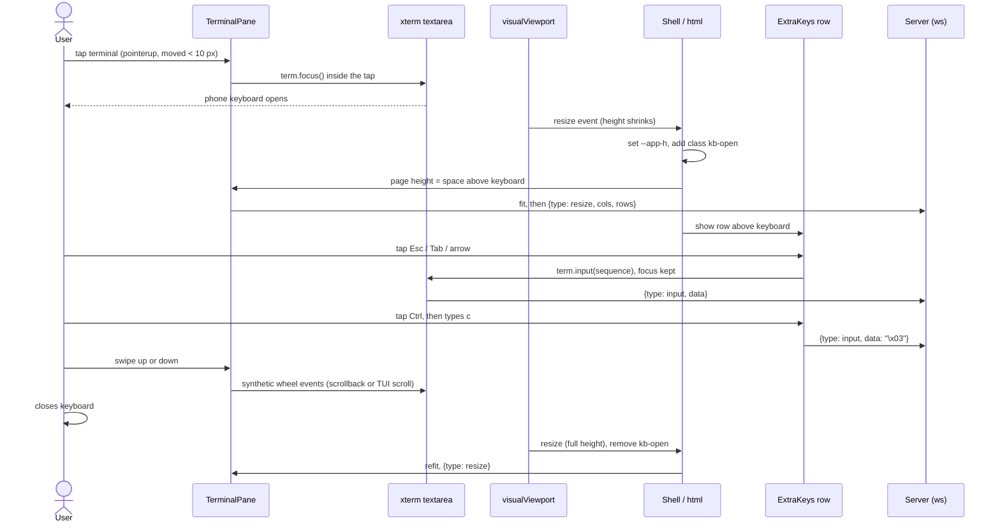

# graph-execution on phones

## Problem

graph-manager's web UI (`apps/graph-manager/src/web`) is built for a laptop. On a phone (about 360–430 px wide):

- The left nav never goes away. Below 1100 px it shrinks to a 56 px icon rail (`Shell.css:75-87`), which leaves about
  319 px for the page on a 375 px phone.
- Several pages have fixed-width tables and grids that are wider than the screen. Examples: the run task table
  (`min-width: 600px`, `RunDetail.css:83-85`), the Runs rows above the 820 px container break (`Runs.css:45`), the
  PR form row (`PrPanel.css:18`) and the task graph (`TaskGraph.tsx:19-20`).
- Tap targets are 18–26 px (tab close 18 px, pane header icons 22 px, exit bar buttons 26 px).
- The app ignores the iPhone notch and home bar: there is no `viewport-fit=cover` and no `safe-area-inset`.
- iOS zooms the page when an input with a font size under 16 px gets focus.
- **Terminals are close to unusable.**
  - A tap on the terminal does not reliably open the on-screen keyboard. xterm.js types through a hidden textarea,
    the panes only listen to `mousedown` and `focus` (`TerminalPane.tsx:177-178`), and there are no touch or pointer
    handlers at all.
  - When the keyboard opens, the page keeps its full height, so the prompt is hidden behind the keyboard. Nothing
    listens to `visualViewport` (`TerminalView.tsx:132-140`, `:201-202`).
  - A phone keyboard has no Esc, Tab, Ctrl or arrow keys, and agent CLIs such as Claude Code need them all the time.
    The `Ctrl Space` prefix (`Terminals.tsx:86`, `:378-397`) can't be typed either.
  - A swipe on the terminal doesn't scroll back through the output.
- The engine's live run page (`packages/graph-execution/src/web`), which graph-manager shows in an iframe while a run
  is live (`RunDetail.tsx:111`), has a full-screen panel under 900 px (`panel.css:29-34`). But it has no pinch zoom
  on the graph (only the mouse wheel, `graph.js:345`), and its top bar is one line that doesn't wrap (`shell.css:5`).

- **The app can't be installed on a phone.** It has no web app manifest, no home-screen icon (only
  `public/favicon.svg`) and no service worker. "Add to Home Screen" gives a bookmark that opens with the browser bar,
  and Chrome never offers to install it.
- **The server only speaks plain HTTP** (`main.ts:49`, `app.ts:104`). Browsers install a PWA and run a service worker
  only on a secure origin (HTTPS, or `localhost`). A phone on the local network reaches graph-manager as
  `http://192.168.x.x:7420`, which is not secure. The session cookie (`auth.ts:10`) is never `secure`, even behind an
  HTTPS proxy.

The user of graph-manager wants to check runs, review results and drive agent terminals from an iPhone or an Android
phone as comfortably as from a laptop. The user also wants to open it from a home-screen icon, full screen, like an
app.

## Goals

No Jira ticket yet (create one in `KAN` before the run if a key is wanted in the PR).

1. **Phone navigation.** Below 900 px the left nav is replaced by a top bar with a menu button (☰) that opens the nav
   as a drawer from the left.
2. **Every page fits a 360 px wide screen** with no horizontal page scroll: Runs, run detail (finished and live),
   Terminals, Workspaces, Projects, Reviewers, Settings, Login, and all drawers and dialogs.
3. **Touch-friendly controls.** On touch screens (`pointer: coarse`), every control is at least 40 × 40 px, inputs are
   16 px so iOS doesn't zoom, and the notch and home bar areas are respected.
4. **Terminal keyboard.** A tap on a terminal opens the phone keyboard on iPhone Safari and Android Chrome.
5. **Terminal above the keyboard.** While the keyboard is open, the terminal shrinks to the space above it, and xterm
   refits and sends the new `cols`/`rows` to the server. The prompt and cursor stay visible.
6. **Extra-keys row.** While a terminal has focus on a touch screen, a row of keys sits just above the phone keyboard:
   `Esc`, `Tab`, `Ctrl` (sticky), `↑`, `↓`, `←`, `→`, and the `Ctrl Space` prefix.
7. **Touch scrolling** of the terminal's output with one finger.
8. **One terminal pane on phones.** Below 900 px, one pane fills the page (as today), and the 1/2/4 layout buttons stay
   hidden.
9. **The engine's live run page works on a phone**: a top bar that fits, pan and pinch zoom on the graph, and a
   readable panel and diff.
10. **Installable app (PWA).**
    - A web app manifest, home-screen icons and Apple standalone meta tags, so graph-manager opens full screen from
      the home screen on iPhone and Android.
    - A small service worker that caches nothing but shows a "not reachable" page when the server can't be reached.
    - An **Install app** section in Settings.
11. **Optional HTTPS.**
    - graph-manager can serve HTTPS itself with a certificate and key (`GM_TLS_CERT`, `GM_TLS_KEY`).
    - Behind an HTTPS proxy (`tailscale serve`, Caddy, a Cloudflare tunnel) it trusts `X-Forwarded-Proto` when
      `GM_TRUST_PROXY` is set.
    - On HTTPS the session cookie is `secure`.
    - The README explains the three ways to set it up. Plain HTTP stays the default.

## Workflow

The main new flow: typing in a terminal on a phone.



## Decisions

| Decision | Why |
| --- | --- |
| One "narrow" breakpoint for the whole app: `(max-width: 899.98px)`, defined once in a new `ui/media.ts` (with a `useMedia(query)` hook) and reused by Shell and Terminals | The Terminals page, drawers, `.page` padding and the engine panel already switch at 900 px. One value keeps the nav, the terminal drawer and the pages in step. |
| "Touch screen" means `(pointer: coarse)`, also in `ui/media.ts`, not the screen width | An iPad or a phone in landscape can be wider than 900 px and still needs big targets, the extra-keys row and the tap-to-focus handling. A narrow desktop window must not get the extra-keys row. |
| Below 900 px the nav becomes a 48 px top bar with ☰, the brand and the page title, and ☰ opens the full nav (labels, badges, status rows, footer) as a drawer from the left. The 56 px rail stays for 900–1099 px | The user chose a menu button over a bottom bar. The drawer reuses today's nav markup, so every nav item, badge and status row stays the same. |
| The nav drawer closes on a route change, on a scrim tap and on Escape, and it traps focus like `ui/Drawer.tsx` (`ui/focus.ts`) | This is how the Terminals sidebar drawer already behaves (`Terminals.tsx:450-477`). |
| The app height comes from `visualViewport`. A hook in Shell sets `--app-h` on `<html>` to `visualViewport.height` px, and `.gm-shell` uses `height: var(--app-h, 100dvh)` | iOS Safari doesn't resize the layout viewport when the keyboard opens. Only `visualViewport` reports the space that is left. |
| The viewport meta becomes `width=device-width, initial-scale=1, viewport-fit=cover, interactive-widget=resizes-content` | `viewport-fit=cover` lets the app paint behind the notch, and `env(safe-area-inset-*)` is padded back in. `interactive-widget=resizes-content` makes Android Chrome resize the page for the keyboard. User zoom stays allowed (no `maximum-scale`), for accessibility. |
| "Keyboard open" means `visualViewport.height < window.innerHeight - 120` while an editable element has focus. Shell then sets the class `kb-open` on `<html>` | No browser has an API that says "the keyboard is open". 120 px is more than any browser bar and less than any phone keyboard. |
| While `kb-open` is set on a narrow screen, the Shell top bar and the Terminals top bar and tab bar are hidden. Only the pane header, the terminal and the extra-keys row stay | With the keyboard open, a phone has about 300–400 px of height left. Every row of chrome is a terminal row lost. |
| A tap is a `pointerup` from a touch pointer that moved less than 10 px since `pointerdown`. It calls `term.focus()` synchronously in that handler | iOS only opens the keyboard when `focus()` is called inside the user gesture. A swipe that scrolls must not open the keyboard. |
| xterm's helper textarea gets `autocapitalize="off"`, `autocorrect="off"`, `autocomplete="off"`, `spellcheck="false"`, `enterkeyhint="send"` and `font-size: 16px` | Without these, the phone capitalises the first letter, autocorrects shell commands, and iOS zooms the page in on focus. |
| A one-finger vertical swipe on a terminal is turned into synthetic `WheelEvent`s on the xterm element (`deltaMode: 0`, `deltaY` = finger movement), with `touch-action: none` on the terminal | xterm already does the right thing with the wheel in both cases: it scrolls the scrollback in the normal buffer and sends mouse-wheel reports to full-screen TUIs that enable mouse mode (Claude Code). Native scrolling of `.xterm-viewport` only covers the first case. |
| The extra keys send input with xterm's `term.input(data, true)` | This goes through `onData`, so predictive echo, `onInput`, `onSubmit` and the WebSocket send all see it exactly like typed input. |
| The arrows follow the cursor mode: `\x1bOA`–`\x1bOD` when `term.modes.applicationCursorKeysMode` is on, otherwise `\x1b[A`–`\x1b[D`. `Esc` is `\x1b` and `Tab` is `\t` | This matches what xterm sends for the real keys, so vim, less and the agent TUIs behave the same. |
| `Ctrl` is sticky for one key. The next single character typed on the phone keyboard is sent as its control code (`a`–`z` and `@[\]^_` become `code & 0x1f`, so `c` → `\x03`). A second tap on `Ctrl` turns it off | You can't hold two keys on a touch screen. Termux's extra-keys row works the same way. |
| The `Ctrl Space` key on the row calls the page's existing `arm(true)` (`Terminals.tsx`), so the next key goes to the prefix actions (`n`, `x`, `1`–`4`, `|`) | The prefix actions stay in one place and the hint (`.prefix-hint`) works the same. |
| Extra-key buttons call `preventDefault()` on `pointerdown` | The xterm textarea keeps focus, so the phone keyboard stays open while you tap the row. |
| The extra-keys row shows when `(pointer: coarse)` matches and a terminal on the page has focus. It sits at the bottom of the Terminals page, inside the `--app-h` height | With the page sized to the visual viewport, the bottom of the page is the top of the keyboard on both iOS and Android. |
| Instant echo (`predictiveEcho.ts`) defaults to off on touch screens. The footer chip still turns it on | Phone keyboards send composition and autocorrect input (long commits, backspace-and-replace) that the predictor was not built for. Off by default avoids wrong characters on the screen. |
| Tables become stacked cards below 600 px (`(max-width: 599.98px)`) where a 2-row grid is still too wide: the run task table, the Runs rows, the Workspaces and Projects rows, and the PR project repos table. Wide content that can't stack (the task graph, the diff) scrolls inside its own box | A phone can't show 6 columns. Cards keep every value without a sideways page scroll. A graph and a diff only make sense at their real size. |
| Touch targets: inside `@media (pointer: coarse)`, buttons, icon buttons, tabs, chips, list rows and the tab and pane close buttons get `min-width`/`min-height: 40px` (hit area, with padding; the icons stay the same size) | Apple asks for 44 pt and Material for 48 dp. 40 px is the most that fits in the pane header and tab bar. Desktop sizes don't change. |
| The engine's live run page gets its own phone pass in `packages/graph-execution/src/web/assets`: a wrapping top bar, a horizontally scrolling phase row, two-finger pinch zoom and one-finger pan on the graph | It is what a phone shows during a live run, so "all the app" includes it. Its panel is already a full-screen sheet below 900 px. |
| The PWA is a manifest plus a service worker with no cache. It only answers a failed page navigation with a built-in "graph-manager is not reachable" page | graph-manager is useless offline: runs and terminals are live. A cache would serve an old `index.html` after an upgrade. The fallback replaces the browser's error page, which in standalone mode has no address bar or reload button. |
| The service worker is registered only in a production build, only when `window.isSecureContext` is true, and only when `"serviceWorker" in navigator` | Browsers refuse it on plain HTTP anyway. Leaving it out of the Vite dev server avoids stale-worker surprises while developing. |
| Icons are PNGs at 180 (apple-touch-icon), 192 and 512 px, plus a 512 px maskable icon, made from `public/favicon.svg` by `scripts/make-icons.mjs` and committed. The script uses agent-browser (headless Chrome) to render the SVG | iOS needs a PNG `apple-touch-icon`, and Chrome's install check wants 192 and 512 px icons. Committed files keep the build free of an image dependency. |
| In standalone mode (`(display-mode: standalone)` or `navigator.standalone`), same-origin links with `target="_blank"` (the run page "open ↗") open in the same window. Links to other sites still open in the browser | An iPhone home-screen app has its own cookies. A same-origin link opened in Safari would land on the login page. |
| iOS status bar style is `black-translucent`, together with `viewport-fit=cover` and the safe-area padding | The app paints under the status bar like a native app, and the padding keeps the content clear of it. |
| HTTPS is optional and off by default. graph-manager serves TLS itself when both `GM_TLS_CERT` and `GM_TLS_KEY` (or `--tls-cert`/`--tls-key`) are set, and passes them to Fastify's `https` option. Only one of the two is a startup error, exit code 2 | Laptop use on `127.0.0.1` needs no certificate. A user who has a certificate (`tailscale cert`, mkcert, Let's Encrypt) can point at it without a proxy. |
| Behind a proxy, `GM_TRUST_PROXY=1` turns on Fastify's `trustProxy`, so `req.protocol` follows `X-Forwarded-Proto` and `req.ip` is the client's address | Without it, every request seems to come from the proxy. All logins would then share one rate-limit bucket (`auth.ts`, `failures` by `req.ip`), and the cookie could not tell that the page is on HTTPS. Trusting forwarded headers must be opt-in, because a direct client could forge them. |
| The session cookie gets `secure: true` when `req.protocol === "https"`. `/api/auth/logout` clears it with the same options | A secure cookie is never sent over plain HTTP. Plain-HTTP setups keep working because they never get the flag. |
| The README documents three setups: `tailscale serve --bg 7420` (recommended for phones, no certificate work), native TLS with `tailscale cert` or mkcert files, and a reverse proxy (Caddy example) with `GM_TRUST_PROXY=1` | Tailscale gives a valid `https://<machine>.<tailnet>.ts.net` address that a phone trusts with nothing installed on it. The other two cover users without Tailscale. |
| With TLS on, the terminals' internal API (`/api/internal/*`, used by `shim.ts` and `mcp.ts` through `GM_INTERNAL_URL`) gets a second plain-HTTP listener on loopback only. The URL printed after `graph-execution --sandbox` stays the browser-facing `https://` one | Node's `fetch` in the shims can't skip certificate checks on a self-signed or mkcert certificate. Loopback HTTP never leaves the machine, and the bearer token still guards it. |
| A half-set `GM_TLS_CERT`/`GM_TLS_KEY` pair exits with code 2 (checked first in `runManager`). With TLS on, the Docker `HEALTHCHECK` (plain `http`) needs a `--health-cmd` override, which the README gives | Exit code 2 is the usage-error code. The Dockerfile stays unchanged, as decided. |
| The key typed after the `⌃␣` extra key is caught in `onData` (`onPrefixData`), not only in `keydown` | Android keyboards send `keydown` with `key: "Unidentified"`, so the existing keydown listener would miss the key and pass it on to the shell. |
| The certificate is read once at startup. A renewed certificate needs a restart | Hot reload of TLS files is more code than a home server needs. `tailscale serve` and Caddy renew on their own. |
| Checks: unit tests in jsdom for the logic, plus a new `scripts/ui-mobile.sh` that uses agent-browser at a 390 × 844 viewport. A manual checklist on a real iPhone and a real Android phone covers the keyboard | jsdom computes no layout and opens no keyboard. agent-browser can measure overflow and drive taps. Only a real phone shows a real keyboard. |

## Non-goals

- A native app, an offline mode, a cache of pages or data, and push notifications. KAN-84 (device tokens) is not
  touched.
- Getting or renewing certificates. graph-manager only reads the files it is given. Built-in Let's Encrypt (ACME) and
  hot reload of renewed certificates are out of scope.
- Making HTTPS the default, or redirecting HTTP to HTTPS.
- Changing the desktop layout at 900 px and wider, apart from the touch-target sizes on `pointer: coarse` devices.
- A split terminal grid on phones. Below 900 px there is always one pane.
- Pinch zoom to change the terminal font size, and copying text by long-press selection in the terminal. Paste works
  through the phone keyboard's own paste.
- Extra keys beyond the standard set (Alt, Home/End, PgUp/PgDn, symbol keys).
- A custom on-screen keyboard. The phone's own keyboard is used.
- Landscape-specific layouts. Landscape uses the same rules, decided by width and `pointer: coarse`.
- Dragging and resizing SpecFloat on phones. It is already turned off when narrow (`SpecFloat.tsx:169`).
- Server or API changes. The terminal WebSocket protocol (`input`, `resize`, `ping`) stays the same.

## User stories

- As a user on my phone, I tap ☰, pick Terminals, tap the Claude terminal, and my keyboard opens.
- As a user typing in a terminal, I always see the line I'm typing on, right above my keyboard.
- As a user talking to Claude Code on my phone, I tap `Esc` to interrupt, `↑` to pick an earlier prompt, `Tab` to
  complete, and `Ctrl` then `c` to stop a command.
- As a user, I tap the prefix key and then `n` to open a new terminal, as `Ctrl Space n` does on a laptop.
- As a user, I swipe up on a terminal to read the earlier output, and the keyboard doesn't pop up while I swipe.
- As a user, I close the keyboard and the terminal grows back to full height without a garbled screen.
- As a user, I open Runs on my phone, see every run as a card, tap one, and read its tasks, phases and PR panel without
  scrolling sideways.
- As a user, I watch a live run on my phone, pinch to zoom into the task graph, and tap a task to read its log.
- As a user, I clone a repo, create a project, change a reviewer and change settings from my phone. Every drawer and
  dialog fits the screen and every button is easy to hit.
- As a user on an iPhone with a notch, nothing hides under the notch or the home bar.
- As a user, I run `tailscale serve --bg 7420` on my server, open `https://<machine>.<tailnet>.ts.net` on my phone,
  tap **Install app** (Android) or Share → **Add to Home Screen** (iPhone), and from then on graph-manager opens full
  screen from its icon.
- As a user with my own certificate, I start graph-manager with `GM_TLS_CERT` and `GM_TLS_KEY` and reach it over
  `https://` with no proxy.
- As a user, I open the home-screen app while my server is off and see "graph-manager is not reachable" with a
  **Retry** button, not a browser error page.
- As a user on plain HTTP, I see in Settings why the app can't be installed and a link to the HTTPS setup.

## Requirements

### Shared: `apps/graph-manager/src/web/ui/media.ts` (new)

- `export const NARROW = "(max-width: 899.98px)"`, `export const PHONE = "(max-width: 599.98px)"`,
  `export const COARSE = "(pointer: coarse)"`.
- `export function useMedia(query: string): boolean`: `matchMedia` with a `change` listener. It returns `false` when
  `window.matchMedia` is missing (jsdom).
- `Terminals.tsx` `useNarrow()` (`:46-59`) is replaced by `useMedia(NARROW)`. The current behaviour is kept.

### Shared: viewport and keyboard (`index.html`, `Shell.tsx`, new `ui/viewport.ts`)

- `index.html` viewport meta:
  `width=device-width, initial-scale=1, viewport-fit=cover, interactive-widget=resizes-content`. Also add
  `<meta name="theme-color">` for light and dark, using the `--sf` token values.
- `ui/viewport.ts` exports `useVisualViewport()`, called once in `Shell.tsx`:
  - On `visualViewport` `resize` and `scroll` (or `window` `resize` when `visualViewport` is missing), it sets
    `document.documentElement.style.setProperty("--app-h", h + "px")`, with `h = visualViewport.height`.
  - It toggles `kb-open` on `<html>` when `visualViewport.height < window.innerHeight - 120` and
    `document.activeElement` is an input, a textarea or a contenteditable element (this includes xterm's helper
    textarea).
  - On iOS, when `visualViewport.offsetTop > 0`, it calls `window.scrollTo(0, 0)` so the page doesn't drift up under
    the top bar.
  - It cleans up on unmount.
  - Export the pure function `isKeyboardOpen(vvHeight, innerHeight, activeIsEditable)` for tests.
- `Shell.css`: `.gm-shell`, `.gm-nav` and `.gate` use `var(--app-h, 100dvh)` instead of `100dvh` (`Shell.css:3,4,9,139`).
- Safe areas:
  - `.gm-shell` gets `padding: env(safe-area-inset-top) env(safe-area-inset-right) 0 env(safe-area-inset-left)`.
  - Bottom-anchored items get `env(safe-area-inset-bottom)`: toasts, drawer and dialog footers, the extra-keys row,
    and the Terminals page bottom when `kb-open` is not set.

### Shared: touch targets and inputs (`ui/base.css`, `styles.css`, page CSS)

- `@media (pointer: coarse)`: `.btn`, icon buttons (`.nav-icon-btn`, `.tp-icon`, `.terms-tab-close`, `.tp-foot-chip`,
  `.panel-close`-like buttons in this app), `.tsb-item`, `.terms-tab`, segmented controls and list rows get a hit area
  of at least 40 × 40 px. Visual icons keep their size.
- `@media (pointer: coarse)`: `input`, `select` and `textarea` get `font-size: 16px`.
- `:hover` styles that only change colour are fine. No control may be visible only on hover on a touch screen.

### Shell navigation (`Shell.tsx`, `Shell.css`)

- Below `NARROW`:
  - `.gm-nav` is not shown in the flow.
  - A new `<header className="gm-topbar" data-testid="gm-topbar">`, 48 px tall, holds:
    - a menu button (`aria-label="Open navigation"`, `aria-expanded`, `data-testid="nav-menu"`);
    - the brand mark;
    - the current page title (Runs, Terminals, Workspaces, Projects, Reviewers, Settings, or the run id on a run page);
    - a live-runs dot when runs are live.
- ☰ opens the existing nav (full labels, badges, status rows, Jump to, theme, Log out) as `.gm-nav.drawer`. It is
  fixed on the left, `width: min(300px, 86vw)`, above a scrim `.gm-nav-scrim` (`data-testid="nav-scrim"`).
  - It closes on a nav item tap (route change), a scrim tap and Escape.
  - Focus moves into the drawer on open and back to ☰ on close (`ui/focus.ts`).
- 900–1099 px keeps today's rail. `.gm-shell.rail` (live run detail) keeps the rail at 900 px and up only. Below
  900 px, the live run page also uses the top bar.
- `html.kb-open` below `NARROW` hides `.gm-topbar`.
- `CommandPalette.tsx`:
  - Each item can be tapped (`onClick`).
  - Below `NARROW` the panel is `width: calc(100% - 16px)` and `max-height: calc(var(--app-h, 100dvh) - 96px)`.
  - Keyboard behaviour is unchanged.

### Pages (all at a 360 px viewport: `document.documentElement.scrollWidth <= window.innerWidth`)

- **Runs** (`Runs.tsx`, `Runs.css`):
  - Below `PHONE`, each run row is a card: status badge and run name on the first line; type, provider, task count
    and created time on the second; the row action on the right.
  - The filter bar wraps, and the workspace select is full width.
- **Run detail** (`RunDetail.tsx`, `RunDetail.css`, `PhaseCards.tsx`, `TaskGraph.tsx`, `PrPanel.tsx`):
  - Task table (`min-width: 600px`): below `PHONE`, `min-width: 0`, and each task is a card (status, title, duration,
    agent).
  - Phase cards: 1 column below 400 px.
  - TaskGraph: inside a box with `overflow: auto` and `-webkit-overflow-scrolling: touch`. The page itself never
    scrolls sideways.
  - PrPanel: `.pr-form-row` is 1 column below `PHONE`. `.pr-project-repos` stacks as cards below `PHONE`.
  - The live run iframe fills `var(--app-h)` minus the top bar.
- **Terminals**: see the next section.
- **Workspaces, Projects, Reviewers**:
  - Below `PHONE`, rows are cards; the action buttons wrap onto their own line, full width or in a 2-column grid.
  - Filters are full width.
- **Settings**: `.settings-appearance-text` `min-width: 0` below `PHONE`. `.sandbox-fields` 1 column below `PHONE`.
  - `RecipeEditor` and `SandboxCard` fit at 360 px.
- **Login**: fits at 360 px. The card padding is `--space-5` below `PHONE`.
- **Drawers** (`ui/Drawer.tsx`, StartRun, Clone, Reviewer, WorkspaceSettings):
  - Full width below `NARROW` (as today).
  - The header and footer stay visible. The body scrolls within `var(--app-h)`.
  - The footer is padded by `env(safe-area-inset-bottom)`.
  - The Clone forge choice is 1 column below `PHONE`.
- **Dialogs** (`ui/Dialog.tsx`, ProjectDialog, close-terminal dialog):
  - `width: calc(100% - 32px)`.
  - `max-height: calc(var(--app-h, 100dvh) - 32px)` with a scrolling body.
- **Toasts**: above `env(safe-area-inset-bottom)`, and above the extra-keys row when it is shown.

### Terminals (`TerminalView.tsx`, `TerminalPane.tsx`, `Terminals.tsx`, `Terminals.css`, new `components/ExtraKeys.tsx`, new `components/touch.ts`)

- **Tap to focus** (`components/touch.ts`, used by `TerminalView`):
  - `attachTouch(host, term, { onTap })` listens to `pointerdown`, `pointermove`, `pointerup` and `pointercancel`
    for `pointerType === "touch"` only.
  - A `pointerup` that moved less than 10 px calls `term.focus()` synchronously, then `onTap()`. `TerminalPane` uses
    `onTap` to focus the pane, as `onMouseDown` does today.
- **Touch scroll** (same file):
  - A one-finger vertical move of 10 px or more is a swipe and never focuses the terminal.
  - Each `pointermove` of a swipe dispatches `new WheelEvent("wheel", { deltaY: -dy, deltaMode: 0, bubbles: true,
    cancelable: true })` on `term.element`. A finger moving up scrolls towards newer output, like a native scroll.
  - Momentum is not required.
  - `.terminal-view` gets `touch-action: none` when `COARSE` matches.
- **Textarea attributes**: after `term.open(host)`, set on `term.textarea`: `autocapitalize="off"`,
  `autocorrect="off"`, `autocomplete="off"`, `spellcheck=false` and `enterkeyhint="send"`. `Terminals.css` gives
  `.terminal-view .xterm-helper-textarea` `font-size: 16px`.
- **Refit on keyboard**: the `ResizeObserver` on the host (`TerminalView.tsx:201-202`) already refits when the page
  height changes with `--app-h`. Add a `visualViewport` `resize` listener that calls `doFit()` in a
  `requestAnimationFrame`, so iOS refits too. After the fit, `term.scrollToBottom()` if the terminal was at the bottom
  before.
- **Imperative handle**: `TerminalView` takes an optional `handleRef` prop of type
  `React.MutableRefObject<TerminalHandle | null>`, with
  `TerminalHandle = { input(data: string): void; focus(): void; appCursor(): boolean }`. They call
  `term.input(data, true)`, `term.focus()` and `term.modes.applicationCursorKeysMode`.
- **Ctrl sticky**: `TerminalView` takes `ctrlArmed?: () => boolean` and `onCtrlUsed?: () => void`. In `onData`, when
  `ctrlArmed()` is true and `data` is one character matching `/[a-z@\[\\\]^_]/i`, it sends
  `String.fromCharCode(data.toUpperCase().charCodeAt(0) & 0x1f)` instead and calls `onCtrlUsed()`. Export the pure
  function `toCtrl(ch: string): string | null` for tests.
- **ExtraKeys** (`components/ExtraKeys.tsx`):
  - Props: `{ handle: TerminalHandle | null; ctrl: boolean; onCtrl(on: boolean): void; onPrefix(): void }`.
  - It renders `<div className="extra-keys" role="toolbar" aria-label="Terminal keys" data-testid="extra-keys">`.
    The buttons have the `aria-label`s and `data-testid`s `xk-esc`, `xk-tab`, `xk-ctrl` (`aria-pressed`), `xk-up`,
    `xk-down`, `xk-left`, `xk-right` and `xk-prefix` (label `Ctrl Space`, shown as `⌃␣`).
  - Each button calls `preventDefault()` on `pointerdown` and acts on `click`:
    - `Esc` → `"\x1b"`.
    - `Tab` → `"\t"`.
    - arrows → `"\x1b[A" "\x1b[B" "\x1b[D" "\x1b[C"`, or `"\x1bOA" "\x1bOB" "\x1bOD" "\x1bOC"` when `appCursor()`.
    - `Ctrl` toggles sticky Ctrl.
    - `Ctrl Space` calls `onPrefix()`.
  - Export the pure function `keySequence(key, appCursor)` for tests.
  - Style: one row, 44 px tall, the buttons share the width equally, `--term` background and `--termfg` text. `Ctrl`
    is highlighted with `--ac` while armed.
- **Terminals.tsx wiring**:
  - It renders `<ExtraKeys>` at the bottom of `.terms-main` when `useMedia(COARSE)` is true and a terminal on the
    page has focus. Track this with `focusin`/`focusout` on `.terms-grid`, and keep the row while focus is on the row
    itself.
  - `onPrefix` calls `arm(true)`.
  - Sticky Ctrl state lives in the page, is passed to the focused pane's `TerminalView`, and is cleared after one use
    or when the focused pane changes.
- **Chrome while typing**: `html.kb-open .terms-page.narrow` hides `.terms-topbar` and `.terms-tabbar`.
- **One pane on phones**: below `NARROW`, keep today's rule (`Terminals.tsx:155`): only the focused pane shows and the
  layout buttons are hidden.
- **Instant echo default**: when `COARSE` matches and the user has never set the toggle, `instantEcho` starts `false`.
  The footer chip keeps working and its choice is saved as today.
- **Pane header**: below `NARROW`, `.tp-path` is hidden (the title stays), and the maximize button is hidden (one pane
  is already full size).

### Engine live run page (`packages/graph-execution/src/web/assets`)

- `shell.css`:
  - Below 600 px, `#topbar` wraps to two lines: title and status on the first; progress and buttons (Abort and the
    rest) on the second. `body` rows become `auto minmax(0, 1fr) auto`.
  - `#topbar .meta` is hidden below 600 px.
  - `#phases` becomes one row that scrolls sideways (`flex-wrap: nowrap; overflow-x: auto; pointer-events: auto`)
    below 600 px.
- `graph.js` (`:316-345`):
  - The canvas gets `touch-action: none`.
  - One touch pointer pans, as the mouse drag does today.
  - Two touch pointers pinch-zoom around their midpoint, using the same zoom limits as the wheel handler.
  - A tap (moved < 10 px) on a node selects it, as a click does.
- `panel.css`: the full-screen panel below 900 px (`:29-34`) gets `padding-top: env(safe-area-inset-top)` and a
  footer padded with `env(safe-area-inset-bottom)`.
- `diffview.css` / `diff.css`:
  - The diff scrolls sideways inside its own box and the page never does.
  - Comment boxes (`comments.js`) are `max-width: calc(100vw - 32px)` below 600 px.
- `page.html` viewport meta: add `viewport-fit=cover`.
- Under `@media (pointer: coarse)`, the buttons get the 40 px hit area.

### PWA (`apps/graph-manager/src/web/public`, `index.html`, `main.tsx`, `Settings.tsx`, new `ui/standalone.ts`)

- `public/manifest.webmanifest`:
  ```json
  {
    "name": "graph-manager",
    "short_name": "graph-manager",
    "id": "/",
    "start_url": "/",
    "scope": "/",
    "display": "standalone",
    "background_color": "<--bg dark value>",
    "theme_color": "<--sf dark value>",
    "icons": [
      { "src": "/icons/icon-192.png", "sizes": "192x192", "type": "image/png" },
      { "src": "/icons/icon-512.png", "sizes": "512x512", "type": "image/png" },
      { "src": "/icons/icon-maskable-512.png", "sizes": "512x512", "type": "image/png", "purpose": "maskable" }
    ]
  }
  ```
  The colours are the literal hex values of the dark-theme tokens in `ui/tokens.css`.
- `public/icons/`: `apple-touch-icon.png` (180 px), `icon-192.png`, `icon-512.png` and `icon-maskable-512.png` (the
  mark at 80 % size on the `--sf` background, so Android's mask doesn't crop it). They are made by
  `apps/graph-manager/scripts/make-icons.mjs` from `public/favicon.svg` with agent-browser, and committed.
- `index.html` `<head>` adds:
  - `<link rel="manifest" href="/manifest.webmanifest">`
  - `<link rel="apple-touch-icon" href="/icons/apple-touch-icon.png">`
  - `<meta name="mobile-web-app-capable" content="yes">`
  - `<meta name="apple-mobile-web-app-capable" content="yes">`
  - `<meta name="apple-mobile-web-app-title" content="graph-manager">`
  - `<meta name="apple-mobile-web-app-status-bar-style" content="black-translucent">`
- `public/sw.js`:
  - `install`: `skipWaiting()`. `activate`: `clients.claim()`.
  - `fetch`: only for `request.mode === "navigate"`, it does `fetch(request)` and, on a network error, answers a
    built-in HTML page (inline in `sw.js`, no other file).
  - The page has the title "graph-manager is not reachable", the text "Check that the server is running and that this
    device can reach it.", a **Retry** button that calls `location.reload()`, dark `--term` colours and safe-area
    padding.
  - Every other request is not handled (no `respondWith`), so it goes to the network as usual.
- `main.tsx`: `if (import.meta.env.PROD && window.isSecureContext && "serviceWorker" in navigator)
  navigator.serviceWorker.register("/sw.js")`. The function is exported from `ui/standalone.ts` as `registerSw()` for
  tests.
- Server (`app.ts`, static files):
  - `/sw.js` is served with `Cache-Control: no-cache`.
  - `/manifest.webmanifest` is served with `Content-Type: application/manifest+json`.
  - Neither needs a session (`needsAuth` already exempts non-`/api` paths; add a test that proves it).
- `ui/standalone.ts`:
  - `isStandalone()`: `matchMedia("(display-mode: standalone)").matches || navigator.standalone === true`.
  - `useStandaloneLinks()`, called in Shell: when standalone, a capture `click` listener on `document` turns a click
    on `a[target="_blank"]` whose `href` is same-origin into `location.assign(href)` (with `preventDefault`).
- **Settings → Install app** (a new section in `Settings.tsx`):
  - When standalone: "Installed."
  - When a `beforeinstallprompt` event was captured (Chrome, Edge, Android): an **Install app** button that calls
    `prompt()`.
  - On iOS Safari (`/iPad|iPhone|iPod/` or `MacIntel` with touch, and not standalone): "In Safari, tap Share, then Add
    to Home Screen."
  - When `!window.isSecureContext`: "Installing needs HTTPS. See HTTPS setup in the README." The text links to the
    README section on GitHub.
  - `Shell` captures `beforeinstallprompt` early (`preventDefault`, kept in a module-level variable), so the event
    isn't lost before Settings mounts.

### HTTPS (`apps/graph-manager/src/server/config.ts`, `main.ts`, `app.ts`, `auth.ts`, the CLI flags, README)

- `config.ts` `envSchema` adds `GM_TLS_CERT`, `GM_TLS_KEY` and `GM_TRUST_PROXY` (all `optional`).
  - `BaseConfig` gets `tls?: { certFile: string; keyFile: string }` (resolved paths) and `trustProxy: boolean`.
    `trustProxy` is true for `1`, `true` or `yes`, case-insensitive.
  - Only one of `GM_TLS_CERT` and `GM_TLS_KEY` set: throw
    `ConfigError("set both GM_TLS_CERT and GM_TLS_KEY, or neither")`.
- The CLI flags `--tls-cert <file>` and `--tls-key <file>` go on `graph-execution manager`:
  - Define them next to `--workspaces-dir` (`packages/graph-execution/src/cli.ts:365`).
  - `packages/graph-execution/src/manager/start.ts:49` turns them into `GM_TLS_CERT`/`GM_TLS_KEY`, in the same way as
    the other flags, so they override the env values.
  - Add them to the flags table in `apps/graph-manager/README.md`.
- `main.ts` reads both files at startup.
  - A file that can't be read exits 1 with `cannot read TLS certificate <path>: <reason>` (or `TLS key`).
  - It passes `{ https: { cert, key } }` and `trustProxy` to the app factory, and `app.ts:104` hands them to
    `Fastify(...)`.
- Startup output: the printed URL starts with `https://` when TLS is on. The line format is otherwise unchanged.
- `auth.ts`: `setCookie(SESSION_COOKIE, …, { ...COOKIE_OPTIONS, secure: req.protocol === "https", maxAge })`.
  `/api/auth/logout` clears the cookie with the same `secure` value.
- Nothing changes in `originAllowed`. It already compares the `Origin` host with `Host` and `X-Forwarded-Host`.
- WebSockets: `terminalSocketUrl` already picks `wss:` on `https:` (`TerminalView.tsx:27`). The run-view proxy works
  unchanged on the same origin.
- The Docker image and compose file: document `GM_TLS_CERT`/`GM_TLS_KEY` with a mounted `/certs` folder in the README.
  No change to the Dockerfile.
- README:
  - Add the new variables to the configuration table.
  - Add a section **HTTPS setup (phones and installing the app)** with three recipes:
    1. **Tailscale (recommended):** `tailscale serve --bg 7420`, then open `https://<machine>.<tailnet>.ts.net`.
       Set `GM_TRUST_PROXY=1`.
    2. **Your own certificate:** `tailscale cert <machine>.<tailnet>.ts.net` or `mkcert`, then
       `GM_HOST=0.0.0.0 GM_TLS_CERT=… GM_TLS_KEY=… graph-execution manager`. With mkcert, the phone must trust the
       mkcert root CA.
    3. **Reverse proxy:** a 4-line Caddyfile (`<domain> { reverse_proxy 127.0.0.1:7420 }`) and `GM_TRUST_PROXY=1`.
  - A short **Install on a phone** paragraph (Android: Install app; iPhone: Share → Add to Home Screen, then log in
    once inside the app).

### Tests

- `src/server/config.test.ts`:
  - `GM_TLS_CERT` plus `GM_TLS_KEY` gives `tls` with resolved paths. Only one of them throws the error above.
  - `GM_TRUST_PROXY` values `1`, `true`, `YES` → true; unset or `0` → false.
- `src/server/auth.test.ts`:
  - With `trustProxy` on and `X-Forwarded-Proto: https`, the login sets a `Secure` cookie. Without the header, or
    with `trustProxy` off, it doesn't. Logout clears it with the same flag.
  - With `trustProxy` on, two clients with different `X-Forwarded-For` values get separate rate-limit buckets.
- An HTTPS test in `src/server` (a self-signed certificate made in the test with `node:crypto` `generateKeyPairSync`
  plus a fixed test certificate in a fixture, or `selfsigned` if it is already a dependency): the app with
  `https: { cert, key }` answers `GET /healthz` over `https` (`rejectUnauthorized: false`).
- Static files: `GET /manifest.webmanifest` (no cookie) is 200 with `application/manifest+json`, and `GET /sw.js` (no
  cookie) is 200 with `cache-control: no-cache`.
- `ui/standalone.test.ts`:
  - `isStandalone` with a stubbed `matchMedia` and `navigator.standalone`.
  - The link handler turns a same-origin `target=_blank` click into `location.assign` and leaves an
    `https://github.com/...` link alone.
  - `registerSw` registers only when secure and in production.
- `Settings.test.tsx`: the Install section shows the HTTPS note when `isSecureContext` is false, the iOS text with an
  iPhone user agent, and the **Install app** button after a fake `beforeinstallprompt`.
- `public/sw.js`: a unit test that loads it with a fake `self` and checks that a failed navigation `fetch` answers
  the fallback HTML (text includes "graph-manager is not reachable"), and that a non-navigation request is not handled.

- `ui/media.test.ts`: `useMedia` with a stubbed `matchMedia` (true, false, change event), and `false` without
  `matchMedia`.
- `ui/viewport.test.ts`: `isKeyboardOpen` cases. `useVisualViewport` with a stubbed `visualViewport` sets `--app-h`
  and toggles `kb-open`.
- `components/ExtraKeys.test.tsx`:
  - `keySequence` for every key in both cursor modes.
  - A click on each button calls `handle.input` with the right data.
  - `pointerdown` is `defaultPrevented`.
  - `xk-ctrl` toggles `aria-pressed`, and `xk-prefix` calls `onPrefix`.
- `components/TerminalView` logic: `toCtrl` (`a`→`\x01`, `c`→`\x03`, `[`→`\x1b`, `1`→`null`). `touch.ts`: a short
  touch calls `focus`, a 30 px move dispatches wheel events and doesn't focus, and a mouse pointer is ignored.
- `Shell.test.tsx`: with `matchMedia` stubbed so `NARROW` matches, `gm-topbar` and `nav-menu` render. A tap opens the
  drawer, and a nav link or `nav-scrim` closes it. Escape closes it.
- `Terminals.test.tsx` (extend the existing `TerminalView` mock): with `COARSE` stubbed true and a pane focused,
  `extra-keys` renders. `xk-prefix` arms the prefix (the `keyFilter` returns `false` afterwards, as in the test at
  `:300-312`). With `COARSE` false, there are no `extra-keys`.
- `packages/graph-execution/src/web/assets`: a test next to `panel.test.ts` for the pinch-zoom math (the new scale and
  offset from two pointer positions), exported as a pure function from `graph.js`.
- `apps/graph-manager/scripts/ui-mobile.sh` (new, same setup as `ui-smoke.sh`: fake forge, `--provider fake`,
  agent-browser):
  - `ab set viewport 390 844`. If agent-browser supports device emulation (`ab set device "iPhone 14"`), use it, so
    `pointer: coarse` and touch are on.
  - For each of `/runs`, a finished `/runs/:ws/:runId`, a live run, `/terminals`, `/workspaces`, `/projects`,
    `/reviewers`, `/settings` and `/login`:
    - assert `document.documentElement.scrollWidth <= window.innerWidth`;
    - assert that `gm-topbar` is visible (except on Login).
  - Open and close the nav drawer.
  - On `/terminals`, open a shell, tap the terminal, assert that `document.activeElement` is xterm's textarea and that
    `extra-keys` is visible (with touch emulation), tap `xk-esc`, and check that the server got the input (the
    terminal shows it).
  - Add an `npm` script `ui:mobile` in `apps/graph-manager/package.json`. It is not part of `npm test`.
- `docs/wiki/features/mobile-web.md`: the decision table, a manual checklist for a real iPhone (Safari) and a real
  Android phone (Chrome), and the code references. Link it from `docs/wiki/index.md`. README: a short "On a phone"
  note.

## Acceptance criteria

- [ ] At a 360 × 740 and a 390 × 844 viewport, `document.documentElement.scrollWidth <= window.innerWidth` on Runs, a
  finished run, a live run, Terminals, Workspaces, Projects, Reviewers, Settings and Login (`npm run ui:mobile -w
  graph-manager` passes).
- [ ] Below 900 px there is no left nav or rail on screen. `gm-topbar` shows ☰, the brand and the page title. ☰
  opens the full nav drawer, and a nav tap, the scrim or Escape closes it.
- [ ] From 900 to 1099 px the 56 px rail shows as today. From 1100 px up the full nav shows as today.
- [ ] On a `pointer: coarse` device, every button, tab, chip and list row has a hit box of at least 40 × 40 px.
  `input`, `select` and `textarea` have a 16 px font.
- [ ] `index.html` has `viewport-fit=cover` and `interactive-widget=resizes-content`. Content clears
  `env(safe-area-inset-*)`.
- [ ] Run task tables, Runs rows, Workspaces, Projects and Reviewers rows, and the PR repos table are cards below
  600 px. The task graph and the diff scroll inside their own boxes.
- [ ] On iPhone Safari and Android Chrome (manual), a tap on a terminal opens the keyboard, and a swipe does not.
- [ ] With the keyboard open (manual), the terminal sits fully above the keyboard, the cursor line is visible, and the
  server receives a `resize` message with fewer `rows`. On close, it refits to full height.
- [ ] With `pointer: coarse` and a focused terminal, `extra-keys` shows the buttons `Esc`, `Tab`, `Ctrl`, `↑`, `↓`,
  `←`, `→` and `⌃␣`.
- [ ] They send `\x1b`, `\t` and `\x1b[A`/`\x1b[B`/`\x1b[D`/`\x1b[C` (`\x1bOA`… in application cursor mode).
  `Ctrl` then `c` sends `\x03`. `⌃␣` then `n` opens the new-terminal dialog.
- [ ] A tap on an extra key keeps the keyboard open (manual).
- [ ] With `pointer: fine` (a desktop), `extra-keys` is never shown, even in a narrow window.
- [ ] A one-finger swipe on a terminal scrolls the scrollback in a plain shell and scrolls Claude Code's view (manual).
- [ ] Below 900 px, one terminal pane fills the page and the 1/2/4 layout buttons are hidden.
- [ ] Instant echo starts off on a touch device that has no saved choice. It stays on by default on a desktop.
- [ ] On the engine's live run page at 390 px: the top bar wraps to two lines and Abort is reachable. The phase row
  scrolls sideways, one finger pans the graph, two fingers pinch-zoom it, a tap on a node opens its panel, and the
  panel is full screen.
- [ ] `GET /manifest.webmanifest` returns the manifest with `display: "standalone"` and the 192, 512 and maskable
  512 icons, with no login. `index.html` links it and the `apple-touch-icon`. Chrome DevTools → Application →
  Manifest shows no installability errors on an HTTPS origin.
- [ ] On HTTPS, Android Chrome offers **Install app** and the installed app opens with no browser bar (manual).
- [ ] On HTTPS, iPhone Safari's Add to Home Screen gives the graph-manager icon and a full-screen app with no Safari
  bar (manual).
- [ ] With the server stopped, opening the installed app shows "graph-manager is not reachable" and **Retry**. With
  the server back up, **Retry** loads the app (manual).
- [ ] In the installed app, the run page "open ↗" opens in the same window and stays logged in. A GitHub PR link
  opens in the browser.
- [ ] Settings shows the right Install text in each case: installed, installable (button), iOS instructions, and the
  HTTPS note on plain HTTP.
- [ ] With no TLS variables, graph-manager starts on plain HTTP exactly as before, and the cookie has no `Secure`
  flag.
- [ ] With `GM_TLS_CERT` and `GM_TLS_KEY`, `curl -k https://127.0.0.1:7420/healthz` returns `{"ok":true}`, the
  startup URL starts with `https://`, and the login cookie is `Secure`. With only one of them set, startup fails
  with `set both GM_TLS_CERT and GM_TLS_KEY, or neither`.
- [ ] Behind `tailscale serve` with `GM_TRUST_PROXY=1`, login, terminals (`wss:`), a live run page and Create PR all
  work from a phone (manual), and the cookie is `Secure`.
- [ ] The README has the HTTPS setup section with the Tailscale, own-certificate and Caddy recipes, the new
  variables in the configuration table, and the Install on a phone paragraph.
- [ ] Desktop at 1440 × 900 looks and behaves as before. `apps/graph-manager/scripts/ui-smoke.sh` still passes.
- [ ] `npm run typecheck && npm run lint && npm test` pass, including the new tests listed under **Tests**.
- [ ] `docs/wiki/features/mobile-web.md` exists with the decision table and the manual phone checklist, and it is
  linked from `docs/wiki/index.md`. The README has an "On a phone" note.
