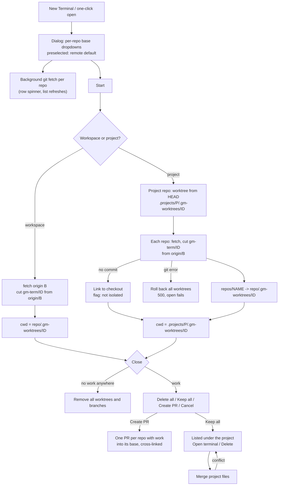
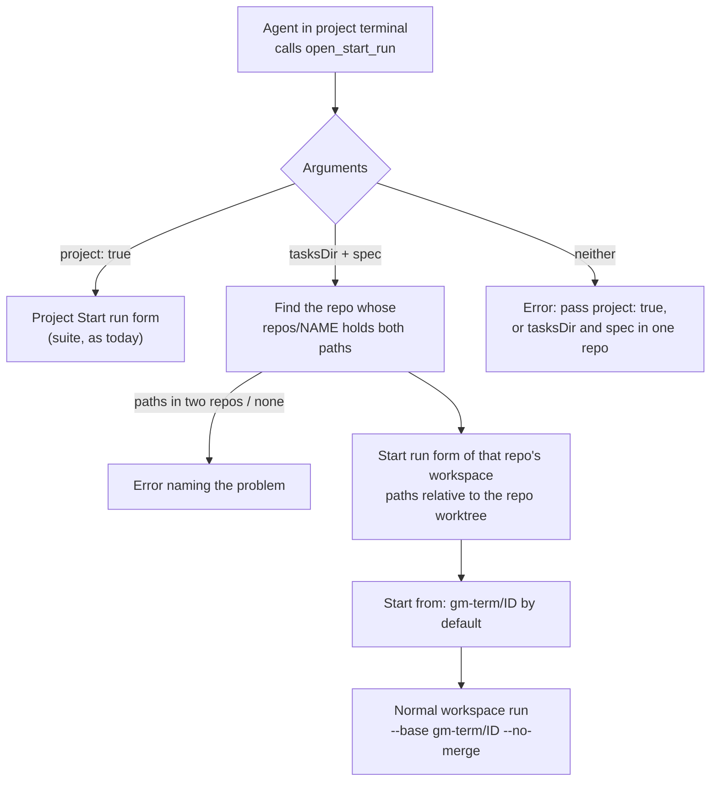

# Isolated project terminals and a base-branch picker for every terminal

## Problem

graph-manager gives every terminal opened on a **workspace** its own git worktree (`<workspace>/.gm-worktrees/<id>`, branch `gm-term/<id>`, see `docs/prd/done/isolated-workspaces.md`). Terminals opened on a **project** (`docs/prd/done/multi-repo.md`) get nothing of the kind:

- **Project terminals are not isolated.** A project terminal starts in the project folder `.projects/<project>/` (`routes/terminals.ts:66-70`). Its `repos/<name>` entries are symlinks to the real workspace checkouts (`projects.ts:163`). Everything an agent changes through `repos/…` lands directly in the checkouts, on whatever branch they have checked out, and mixes with every other project terminal and with work done in those checkouts.
- **A project terminal can only start a whole-project run.** `open_start_run` in a project terminal always opens the project's suite form and ignores `tasksDir` and `spec` (`tools/open-start-run.ts`). When only one repo of the project changes, an agent working in the project has no way to hand the user a normal single-repo run of that repo.
- **There is no way to choose where a terminal starts.** A workspace terminal's worktree is always cut from the checkout's current `HEAD` (`worktrees.ts` `addTerminalWorktree`). If the checkout is on `development` but the work should go to `main`, the user has to switch branches by hand inside the terminal, and the Create PR target defaults to the wrong branch. The base can also be stale, because nothing fetches before the cut.

## Goals

1. Every terminal opened on a project works in its own folder: a worktree of the project folder's own repo, whose `repos/<name>` link to that terminal's own worktree of each repo. Nothing a project terminal does changes the workspace checkouts, the shared project folder or any other terminal.
2. Every new terminal, on a workspace or a project, starts from a base branch the user picks per repo in the New Terminal dialog. The dialog preselects each repo's remote default branch, and the worktree is cut from the freshly fetched `origin/<branch>`.
3. Closing a project terminal works like closing a workspace terminal: with no work anywhere it disappears, otherwise one dialog offers **Delete all / Keep all / Create PR / Cancel**.
4. **Create PR** on a project terminal opens one PR per repo with work, each into that repo's chosen base, with the PR bodies linking to each other.
5. Changes to the project's own files (`project.json`, `CLAUDE.md`, specs, …) made in a project terminal can be merged back into the project folder with **Merge project files**.
6. Kept project worktrees are listed under their project in the Terminals sidebar, where they can be reopened or deleted.
7. From a project terminal, an agent can open either the project's suite form (`project: true`, as today) or a normal **single-repo run** of one repo of the project. The single-repo run reads its tasks and spec from that terminal's worktree of the repo, starts from the terminal's `gm-term/<id>` branch by default, and is listed under that repo's workspace like any workspace run.

## Flow

Starting a run from a project terminal:

## Decisions

| Decision | Why |
| --- | --- |
| A project terminal works in `.projects/
/.gm-worktrees/<id>`, a git worktree of the project folder's own repo on branch `gm-term/<id>`. Its `repos/<name>` (gitignored, so absent from the worktree) are created as symlinks to `<repo>/.gm-worktrees/<id>`. | The shared `repos/` links can't point at a different place for each terminal. A worktree of the project repo gives each terminal real copies of `project.json`, `CLAUDE.md` and specs, with changes tracked by git, and tools that read `project.json` and `repos/` work unchanged. |
| The same `<id>` (`w` + 8 hex digits, `newWorktreeId()`) and the same branch name `gm-term/<id>` are used in the project repo and in every repo. | One id names the whole set. It is easy to find in `git worktree list`, and it can't clash with the engine's `graph/` and `graph-task/` branches. |
| The project repo's worktree is always cut from the project folder's `HEAD`. It has no dropdown. | The project repo has no remote and only one line of history, so there is nothing to choose from. |
| Every new terminal picks a base per repo. The preselected value is `origin/HEAD`'s branch, else the forge's `defaultBranch`, else the checkout's current branch. | It matches the usual PR target, so a terminal's PR diff is clean. Checkouts are often left on a feature or `development` branch. |
| At create time graph-manager runs `git fetch origin <b>` and cuts `gm-term/<id>` from `origin/<b>`. If the fetch fails (offline, no remote, auth), it cuts from local `<b>` and returns a warning. If neither exists, the request fails with 400. | You always start from the latest code, and a network problem doesn't block work. `base` is the commit that was cut from, and `baseBranch` is `<b>`, which becomes the default Create PR target. |
| The dialog fills each dropdown from the repo's local refs (`branchList`) right away, then starts `git fetch --prune origin` per repo in the background with a loading indicator per row, and refreshes the list when it finishes (timeout 15 s). | The user asked for fetch-on-open, but the dialog must not block on the network. **Start** stays enabled, and the chosen branch is fetched again at create time anyway. |
| Every terminal open goes through the dialog. That includes the one-click paths: `?workspace=` and `?project=` (`Terminals.tsx:338,360`) and agent quick start. The dialog opens prefilled with that workspace or project and agent. Reopening a kept worktree never shows it. | The user wants an explicit choice of base every time. A kept worktree already has its base. |
| A repo without a commit links `repos/<name>` to its checkout. Its row shows a disabled dropdown with "No commits yet: not isolated", and the pane header shows the same flag. | This matches workspace terminals today: a worktree needs a commit. |
| Any other git failure while creating a project terminal removes the worktrees and branches already made (project repo included) and answers 500 naming the repo and git's last stderr line. | A half-isolated terminal would be worse than none. |
| The store gets a new `projectWorktrees` record per project terminal holding all of its repos. `terminalWorktrees` keeps its shape, with `baseBranch` now always set to the picked branch. | Keep, Delete, Reopen and Create PR act on the whole set. Workspace sidebars never show stray project entries. |
| A project terminal has work when the project-repo worktree or any repo worktree is dirty or ahead of its own `base` (`worktreeState`). | It is the same rule as workspace terminals, applied to every repo. |
| Close with work shows one dialog listing dirty/ahead counts per repo, with **Delete all / Keep all / Create PR / Cancel**. It has no per-repo choices. | It is simple, and the set stays consistent. |
| Create PR on a project terminal opens one PR per repo with work, from `gm-term/<id>` into that repo's chosen base (editable per repo), with the bodies cross-linked. It reuses the job, linking and Retry machinery of `project-pr.ts`. Clean repos are skipped. The project repo is never pushed. | That machinery already does linked multi-repo PRs with progress and Retry. |
| **Merge project files** fast-forwards the project folder's branch to the worktree's `gm-term/<id>` when possible, and otherwise tries `git merge --no-edit`. On a conflict it runs `git merge --abort`, reports the conflicting files and leaves the worktree kept. | The project repo has no remote to open a PR against. A failed merge must never leave the shared project folder half-merged. |
| The action is offered in the close dialog (it runs before Delete or Keep) and on kept project worktrees. After a successful merge, Delete no longer counts the project repo as work. | Project-level edits must not be silently lost on Delete. |
| In a project terminal, `open_start_run` works by its arguments. `project: true` opens the project suite form, as today. `tasksDir` + `spec` (without `project: true`) opens a single-repo run of the repo that contains both paths. With neither, it returns an error. | The user wants a normal run of one repo without a project run. Since the paths already say which repo is meant, no extra argument is needed. |
| The repo is found by resolving each path (against the tool call's `cwd`, then the terminal's folder) and matching its real path against each `repos/<name>` link of the terminal's folder (the repo worktree, or the checkout for a repo that isn't isolated). Both paths must be in the same repo. | It works the same whether the agent `cd`'d into `repos/<name>` or passes `repos/<name>/…` from the project root. |
| A single-repo run from a project terminal behaves like a run from a workspace terminal (`docs/prd/done/isolated-workspaces.md`). It reads its paths from the terminal's worktree of that repo, its **Start from** defaults to that worktree's `gm-term/<id>` branch, and it runs with `--base` and `--no-merge`. | It reuses the isolated workspace run path completely: the checkout is never touched, and Create PR works in a temporary worktree. |
| For a repo that isn't isolated (no commits), the single-repo run reads paths from the checkout, and **Start from** defaults to the checkout's current branch. | That folder is where the agent actually wrote the files. |
| Project suite runs started from a project terminal still use the shared project and its checkouts (`routes/internal.ts:87` `projectOf`). | Out of scope (see Non-goals). Suite runs already isolate themselves in their own worktrees. They just start from the checkouts' `HEAD`. |

## Non-goals

- Starting a **project suite** run from a project terminal's branches. A suite started in a project terminal keeps using the shared project folder and each checkout's `HEAD`. This is a known gap, to be specified separately. Single-repo runs from a project terminal do use the terminal's branch (Goal 7).
- Changing how project suite runs apply results or open PRs (they still apply to the checkouts and run Create PR there).
- Per-repo choices when closing (deleting some repos and keeping others).
- Choosing a base for the project folder's own repo.
- Pushing the project repo anywhere.
- Listing branches from the forge API.
- Changing how runs, run worktrees or the run-start branch picker work.
- Sandboxed terminals: they behave as today, and the worktrees are inside the mounted workspaces either way.

## User stories

- As a user opening a terminal on a project, I get a folder of my own, so my agent's changes never touch the repo checkouts or another terminal.
- As a user opening any terminal, I pick the branch each repo starts from, and by default it is the latest remote default branch, so I don't start from a stale or wrong branch.
- As a user opening the New Terminal dialog while offline, I can still start right away from local branches and I am told the list is local.
- As a user closing a project terminal that did nothing, it just closes, and nothing is left behind in any repo.
- As a user closing a project terminal with work, I see which repos changed and choose to delete, keep or open PRs.
- As a user with work in several repos, Create PR opens linked PRs, each into the branch I started that repo from.
- As a user who edited the project's `CLAUDE.md` in a terminal, I can merge that change back into the project folder, and I am told when it conflicts.
- As a user who kept a project terminal, I find it under the project in the sidebar and reopen it in the same folders.
- As a user whose change touches only one repo of a project, I ask the agent in my project terminal to start the run. It opens a normal single-repo Start run form for that repo, prefilled with the tasks and spec it wrote and starting from my terminal's branch, instead of the project suite form.

## Requirements

### Git helpers: `apps/graph-manager/src/server/worktrees.ts`

- `addTerminalWorktree(wsPath, opts?: { id?: string; baseBranch?: string })`:
  - Without `baseBranch` it behaves as today, cutting from `HEAD` (used for the project repo).
  - With `baseBranch: b`, it runs `git fetch origin <b>` (`GIT_TERMINAL_PROMPT=0`, 30 s timeout) and cuts from `origin/<b>`. If the fetch fails or `origin/<b>` is missing, it cuts from local `<b>` and returns `warning: "could not fetch origin/<b>: <last stderr line>; started from local <b>"`.
  - If neither ref exists it throws `WorktreeError(400, "branch <b> not found")`.
  - It returns `{ id, path, branch, base, baseBranch: b, warning? }`.
- `defaultBaseBranch(ws)`: `git symbolic-ref --short refs/remotes/origin/HEAD` without the `origin/` prefix, else the forge's `defaultBranch` (`clientFor(...).getRepo`, errors ignored), else `currentBranch(ws.path)`.
- `addProjectWorktrees(projectDir, repos: { name, workspace, baseBranch? }[], id)`:
  - Creates the project-repo worktree at `<projectDir>/.gm-worktrees/<id>` (`ensureExcluded(projectDir)`), then one `addTerminalWorktree` per repo.
  - Creates `<worktree>/repos/<name>` symlinks with `LINK_TYPE` from `projects.ts`. A repo without a commit links to its checkout and gets `isolated: false`.
  - If any step fails, it calls `removeWorktree` on everything already made and rethrows with the repo's name.
- `removeProjectWorktrees(rec)`: removes each repo worktree and its branch, unlinks `repos/*` first (never following the links), then removes the project-repo worktree and its branch.
- `projectWorktreeState(rec)`: `{ project: WorktreeState, repos: { name, isolated, dirty, ahead }[] }`. A project-repo `dirty` count ignores `repos/` (it is gitignored, so no change is needed).
- `mergeProjectFiles(projectDir, rec)`:
  - Commits the worktree's uncommitted changes as `gm: project files from <title>`, then runs `git merge --ff-only gm-term/<id>` in `projectDir`, else `git merge --no-edit gm-term/<id>`.
  - On conflict it runs `git merge --abort` and throws `WorktreeError(409, "merge conflict", { files })`.
  - It refuses with 409 `"the project folder has uncommitted changes"` when `projectDir` is dirty.

### Store: `apps/graph-manager/src/server/store.ts`

- Add `projectWorktrees: z.record(z.string(), z.object({ projectId, path, branch, base, title, createdAt, terminalId: optional, kept: optional, mergedAt: optional, repos: z.array(z.object({ name, workspaceId: optional, path, branch: optional, base: optional, baseBranch: optional, isolated: z.boolean() })) })).default({})`.
- `terminalWorktrees[*].baseBranch` stays optional in the schema for old data. New records always set it.

### API

- `GET /api/workspaces/:id/branches?fetch=1` → `{ branches: string[], default: string, current?: string, fetched: boolean, error?: string }`.
  - `branches` lists the remote branches without the `origin/` prefix first, then local-only branches (those without an `origin/` counterpart), using `branchList`.
  - Without `fetch` it answers from local refs immediately. With `fetch=1` it runs `git fetch --prune origin` first (15 s timeout). On failure it answers `fetched: false` with `error`, still 200.
  - A workspace without a commit answers `{ branches: [], noCommit: true }`.
- `GET /api/projects/:id/branches` → `{ repos: [{ name, workspaceId, branches, default, current?, noCommit? }] }` from local refs. The dialog then calls `/api/workspaces/:id/branches?fetch=1` per repo in parallel.
- `POST /api/terminals`:
  - `body.base?: string` for a workspace (default `defaultBaseBranch`).
  - `body.bases?: Record<repoName, string>` for a project (missing entries use the default).
  - A project open creates the `projectWorktrees` record. The response gains `worktree: { id, path, branch, repos?: [{ name, branch, baseBranch, isolated }] }` and `warnings?: string[]`.
  - `body.projectWorktreeId` reopens a kept project worktree: 404 `"worktree not found"`, 404 `"repo <name>'s worktree is missing"`, 409 `"the worktree is open in another terminal"`.
- `DELETE /api/terminals/:id?worktree=delete|keep` for a project terminal with work and no choice → 409 `{ error: "the terminal has work", needsChoice: true, project: { dirty, ahead }, repos: [{ name, isolated, dirty, ahead }], worktreeId }`.
- `GET /api/projects/:id/worktrees` → the kept project worktrees with their state. `GET /api/worktrees` gains `projectWorktrees: [...]`.
- `DELETE /api/projects/:id/worktrees/:wid` → 204, removes all of the record's worktrees and branches.
- `POST /api/terminals/:id/pr` and `POST /api/projects/:id/worktrees/:wid/pr` with body `{ title?, body?, bases?: Record<repoName, string>, retry?: boolean }` → 202 `{ job }`, with the same job shape as `ProjectPrJob`. `GET` on the same paths returns `{ job?, prs? }`.
  - Repos without work get `status: "skipped"`. The project repo is never pushed.
  - After all PRs open, the repo worktrees are removed. The project-repo worktree stays (kept) if it has unmerged work.
- `POST /api/terminals/:id/merge-project` and `POST /api/projects/:id/worktrees/:wid/merge-project` → 200 `{ merged: true, fastForward: boolean }`, or 409 `{ error: "merge conflict", files: [...] }`, or 409 `"the project folder has uncommitted changes"`.

### Web: `apps/graph-manager/src/web/`

- `NewTerminalDialog` (`pages/Terminals.tsx` ~854) adds a **Base** section:
  - A workspace gets one dropdown. A project gets one row per repo, labelled with the repo name.
  - Each dropdown is preselected with `default` and shows a small spinner while its background fetch runs. When the fetch finishes, the list updates and the selection is kept if it still exists.
  - A failed fetch shows "Offline: local branches" under the row. A repo without commits shows a disabled dropdown and "No commits yet: not isolated".
  - **Start** is enabled while fetches are still running.
- The one-click paths (`?workspace=`, `?project=` and agent quick start) open `NewTerminalDialog` prefilled instead of calling `create` directly. Reopening a kept worktree (`worktreeId` / `projectWorktreeId`) still opens directly.
- Pane header (`pages/TerminalPane.tsx`): a workspace terminal shows `gm-term/<id> ← <baseBranch>`. A project terminal shows the id plus one chip per repo (`<name>: <baseBranch>`, or `<name>: not isolated`). `warnings` from the create response show as a dismissible notice.
- The close dialog for a project terminal shows a table of the project files and each repo with dirty/ahead counts, and **Merge project files** when the project repo has work. Its buttons are **Delete all / Keep all / Create PR / Cancel**.
- The Create PR dialog for a project terminal shows one row per repo with work, each with an editable **Merge into** (default: its `baseBranch`). Progress and Retry work as on the run page's project PR.
- `TerminalSidebar.tsx`: a project section lists its kept project worktrees with their title, repo count and work counts, plus **Open terminal**, **Merge project files** (when the project repo has work) and **Delete**.

### Single-repo runs from a project terminal

- `apps/graph-manager/src/server/tools/open-start-run.ts`:
  - The `project` description becomes "Open the project's suite form (all repos); tasksDir and spec are ignored". The `tasksDir`/`spec` descriptions drop "(workspace terminals only)" and say "in a project terminal, both must be inside the same repo under repos/".
  - The tool description says: "In a project terminal, pass project: true for a run across all repos, or tasksDir and spec inside one repo for a normal run of that repo."
  - In a project terminal:
    - With `project: true`, it behaves as today.
    - With `tasksDir` and `spec`, it resolves the repo (see Decisions), sets `ws = { ...repoWorkspace, path: <repo worktree or checkout> }`, reuses `resolveIn`, and queues `{ kind: "start-run", terminalId, workspaceId: <repo's workspace id>, agent, terminalTitle, prefill: { tasksDir, spec, ... } }` with no `projectId`.
    - It returns `Opened the Start run form of repo <name> in graph-manager with tasks folder <rel> and spec <rel>. …`.
  - Errors (`isError: true`):
    - `pass project: true for a run across the project's repos, or tasksDir and spec inside one repo`
    - `tasksDir and spec are in different repos (<a>, <b>)`
    - `<path> is not inside a repo of project <name>`
    - `repo <name> has no graph-manager workspace`
- `apps/graph-manager/src/server/routes/runs.ts`:
  - `POST /api/workspaces/:id/runs` with `terminalId` (line ~221) and `GET /api/workspaces/:id/run-defaults?terminal=` (line ~289) also accept a project terminal.
  - A new helper `repoWorktreeOfTerminal(ctx, terminalId, workspaceId)` in `routes/terminals.ts` returns `{ path, branch?, isolated }` from the terminal's `projectWorktrees` record for the repo whose `workspaceId` matches. Use it when `worktreeOfTerminal` finds nothing.
  - Paths are read from that `path`, and the default `base` is `branch` (`gm-term/<id>`), or the checkout's current branch when `isolated` is false.
  - It is still 404 `the terminal has no worktree in this workspace` when the project terminal has no repo for that workspace.
- `web/agentRequests.tsx` and `pages/StartRunDrawer.tsx` need no new flow: a request without `projectId` already opens the workspace form. The drawer shows `From terminal <title> · repo <name>` when the request's terminal is a project terminal.

### Tests

- `tools/open-start-run.test.ts`, for a project terminal:
  - `project: true` → project request (unchanged);
  - paths in one repo → workspace request with paths relative to the repo worktree;
  - paths in two repos → error;
  - no arguments → error;
  - a path outside every repo → error.
- `routes/runs.test.ts`: a run started with a project terminal's `terminalId` reads its tasks from the repo worktree and defaults `base` to `gm-term/<id>`.

- Route tests in `routes/terminals.test.ts` and `routes/projects.test.ts` use real git repos in temp folders (`test-helpers.ts`), with a bare repo as `origin`, for:
  - creating, closing with and without work, keeping, reopening and deleting a project terminal;
  - a repo without a commit;
  - rollback on a forced git failure;
  - the fetch fallback when `origin` is unreachable;
  - a merge-project fast-forward, a real merge and a conflict.
- Web tests in `pages/Terminals.test.tsx` for the Base section (preselection, spinner, offline note, disabled no-commit row) and for one-click opens showing the dialog.
- Validation: `npm run typecheck && npm run lint && npm test`.

## Acceptance criteria

- [ ] Opening a terminal on a project with three committed repos creates `.projects/
/.gm-worktrees/<id>/` with `project.json`. Its `repos/<name>` resolve (`realpath`) to `<repo>/.gm-worktrees/<id>`, each on branch `gm-term/<id>`, and the PTY's cwd is that folder.
- [ ] Touching a file in `repos/<name>/` of a project terminal leaves `git status` of the workspace checkout and of the shared project folder clean.
- [ ] `.projects/
/repos/*` still point at the checkouts after opening and closing project terminals.
- [ ] A repo without a commit is linked to its checkout. The dialog row says "No commits yet: not isolated", and the pane header shows `<name>: not isolated`.
- [ ] When `git worktree add` fails for the second repo, `POST /api/terminals` answers 500 naming that repo, and no `gm-term/<id>` branch or `.gm-worktrees/<id>` folder remains in any repo or in the project folder.
- [ ] The New Terminal dialog preselects `main` for a repo whose `origin/HEAD` is `origin/main` while its checkout is on `development`.
- [ ] The dialog opens with branches listed before any fetch finishes, shows a spinner per row during the fetch, and refreshes the list after it.
- [ ] With `origin` unreachable, the row shows "Offline: local branches", **Start** works, the worktree is cut from local `<b>`, and the response carries a warning.
- [ ] The new worktree's `base` equals `git rev-parse origin/<b>` after the fetch, and `baseBranch` is `<b>`. The default Create PR target is `<b>`.
- [ ] `/terminals?workspace=<id>` and `/terminals?project=<id>` open the New Terminal dialog prefilled instead of starting a terminal.
- [ ] **Open terminal** on a kept worktree starts it without the dialog.
- [ ] Closing a project terminal with no work answers 204 and removes every `gm-term/<id>` worktree and branch, including the project repo's.
- [ ] Closing one with work answers 409 with `needsChoice: true` and per-repo counts. The UI shows **Delete all / Keep all / Create PR / Cancel**.
- [ ] **Keep all** lists the worktree under the project in the sidebar. **Open terminal** reopens it in the same folder. **Delete** removes everything.
- [ ] Reopening a kept project worktree whose repo worktree was removed by hand answers 404 `repo <name>'s worktree is missing`.
- [ ] **Create PR** with work in two of three repos opens two PRs, each into its chosen base, with each body linking the other. The third repo shows **skipped**.
- [ ] After a failed push, **Retry** resumes the PR job.
- [ ] **Merge project files** with a committed `CLAUDE.md` edit fast-forwards the project folder, and `git log` there shows the commit.
- [ ] On a conflict it answers 409 with the files, the project folder has no merge in progress (`git status` clean), and the worktree is kept.
- [ ] In a project terminal, `open_start_run { tasksDir: "repos/graph-execution/.agents/tasks", spec: "repos/graph-execution/docs/prd/x.md" }` opens the **graph-execution workspace** Start run form, with paths `.agents/tasks` and `docs/prd/x.md` and **Start from** `gm-term/<id>`, not the project form.
- [ ] Starting that run lists it under the graph-execution workspace. The engine gets `--base gm-term/<id> --no-merge`, and the checkout's `git status` is unchanged.
- [ ] In a project terminal, `open_start_run { project: true }` still opens the project suite form, and `open_start_run {}` returns the "pass project: true … or tasksDir and spec inside one repo" error.
- [ ] A workspace terminal opened with base `main` while the checkout is on `development` has `gm-term/<id>` on `origin/main`'s commit.
- [ ] `npm run typecheck && npm run lint && npm test` pass.
