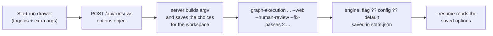

# PRD: Toggles for all run options in Start run (graph-manager)

Ticket: [KAN-89](https://graph-execution.atlassian.net/browse/KAN-89)

## Problem

graph-manager's **Start run** drawer only sends the tasks folder, the spec and the provider. A run can't be started from the UI with `--human-review`, `--no-merge`, a model, a concurrency or any other option. The server already accepts `concurrency` (`apps/graph-manager/src/server/routes/runs.ts:14-19`, `:84-85`), but the drawer never sends it.

The engine has the same gap one level down. Only `concurrency` and `humanReview` can be set from the CLI. Every other config key (`attempts`, `fixPasses`, `validationRounds`, `validateAt`, `validateParallel`, `idleTimeoutMinutes`) is read only from the repo's `graph-execution.config.json` (`packages/graph-execution/src/config/config.ts:51-75`). Writing temporary values into that file would also break `--resume`, because the run hashes the file at start (`state/state.ts:148-151`, checked in `launch/preflight.ts:203-210`).

## Goals (KAN-89)

1. **Engine flags for the config keys.** New run flags override the matching config keys for one run without touching the config file. They are saved in the run state, so `--resume` keeps them.
2. **Toggles in Start run.** The drawer has a control for every run option: human review, merge, model, concurrency, attempts, fix passes, validation rounds, when to validate, parallel validation and the idle timeout. An **Extra arguments** field covers anything else.
3. **The command preview shows every option** in the order the server runs it.
4. **Choices are remembered per workspace**, on the graph-manager server.

## Decisions

| Decision | Why |
| --- | --- |
| One engine flag per config key, not a generic `--set key=value`. | Same style as `--concurrency`, with typed parsing and `--help` text. |
| Flags override config. The effective values are saved in `state.json` and used by `--resume`. | Overrides must not touch the config file: its hash guards resume. |
| `--resume` refuses the new flags, like it refuses `--human-review` today (`preflight.ts:188-190`). | A run keeps the options it started with. |
| Resume and Retry from the UI take no options. | They reuse the run's original options. |
| Choices are remembered per workspace in `graph-manager.json` (`runDefaults`), written when a run starts. The repo's files are not touched. | The user chose per workspace. The server is the source of truth, so the choices are the same in every browser. |
| The provider stays remembered in `localStorage` (`gm.provider`) as the default for a workspace with no saved choices. | That is how it works today. |
| An option left at "Repo default" sends no flag. | The repo's `graph-execution.config.json` (or the engine default) then decides, as today. |
| **Extra arguments** are split with shell-style quoting and appended last. Flags the server sets itself (`--web`, `--web-serve`, `--resume`, `--run`, `--spec`, `--provider`, the tasks folder) are refused with 400. | An escape hatch for flags the form doesn't know, without letting it break the launch. |
| `setup`, `validate`, `keepRuns`, `loopDetection` and `e2eReview` get no toggle. | They are repo-specific command lists or cleanup settings, not per-run choices. |

## Non-goals

- Options for `suite` runs.
- Options for Resume or Retry.
- Editing `graph-execution.config.json` from the UI.
- Showing the repo's config values in the form (it shows "Repo default").

## User stories

1. As a user, I start a run from the UI with **Human review** on, and the run pauses for my review before it applies.
2. As a user, I set **Fix passes** to 1 and **Concurrency** to 5 for one run, without changing the repo's config.
3. As a user, I reopen Start run on the same workspace and my last choices for it are already set.
4. As a user, I see the exact command, with every option, before I start.
5. As a CLI user, I run `graph-execution tasks --spec PRD.md --provider claude --attempts 1 --validate-at end` for a quick experiment, and `--resume` keeps those values.

## Requirements

### Engine: new run flags (`packages/graph-execution/src/cli.ts`, `config/config.ts`, `runner/run.ts`)

| Flag | Overrides | Parse |
| --- | --- | --- |
| `--attempts <n>` | `attempts` | positive integer (`parsePositiveInt`, `cli.ts:58-62`) |
| `--fix-passes <n>` | `fixPasses` | non-negative integer |
| `--validation-rounds <n>` | `validationRounds` | non-negative integer |
| `--validate-at <when>` | `validateAt` | `task` or `end` |
| `--validate-parallel` / `--no-validate-parallel` | `validateParallel` | tri-state like `--human-review` |
| `--idle-timeout <minutes>` | `idleTimeoutMinutes` | number ≥ 0, fractions allowed, `0` turns it off |

- The effective config is `{ ...loadConfig(repo), ...flags }` and is validated with the same zod schema, so ranges match the config file.
- `state.json` gets an optional `overrides` object with the flag values given. Resume merges `loadConfig(repo)` with `state.overrides`. Runs without `overrides` behave as today.
- `--resume` with any of these flags exits 2 with `cannot change <flag> on --resume: the run keeps the options it started with`.
- `--web` forwards the new flags to the detached run, like the others.
- `--help` lists them. The engine README's Configuration section says each key can be overridden for one run with its flag.

### Server (`apps/graph-manager/src/server/routes/runs.ts`, `store.ts`)

- `startBody` gets an optional `options` object (strict zod):
  `{ humanReview?: boolean, merge?: boolean, model?: string, concurrency?: int 1-64, attempts?: int ≥1, fixPasses?: int ≥0, validationRounds?: int ≥0, validateAt?: "task" | "end", validateParallel?: boolean, idleTimeoutMinutes?: number ≥0, extraArgs?: string }`.
  The existing top-level `concurrency` stays accepted for compatibility. When both are given, `options.concurrency` wins.
- The argv order is `<tasksDir> --spec <spec> --provider 
 [option flags in the table order] [extra args] --web`. A field that is absent sends no flag. `humanReview: false` sends `--no-human-review`. `merge: false` sends `--no-merge`.
- `extraArgs` is split with shell-style quoting. A reserved flag (`--web`, `--web-serve`, `--resume`, `--run`, `--spec`, `--provider`, or a value that is not a flag in first position) gives 400 `{ error: "extra arguments: <flag> is set by graph-manager" }`.
- `dataSchema` gets `runDefaults: z.record(workspaceId, { provider, tasksDir, spec, options })` with `.default({})`. A successful start saves the body for that workspace.
- `GET /api/workspaces/:id/run-defaults` returns the saved body or `{}`.

### Web: Start run drawer (`apps/graph-manager/src/web/pages/StartRunDrawer.tsx`)

- Below the provider, an **Options** section:
  - **Human review**: segmented Repo default / On / Off.
  - **Merge into my branch**: segmented On (default) / Off (`--no-merge`).
  - **Model**: text field, empty for the provider default.
  - **Concurrency**, **Attempts**, **Fix passes**, **Validation rounds**, **Idle timeout (min)**: number fields, empty for repo default.
  - **Validate**: segmented Repo default / After each task / At the end.
  - **Parallel validation**: segmented Repo default / On / Off.
  - **Extra arguments**: text field.
- The less common fields (attempts, validation rounds, validate, parallel validation, idle timeout, extra arguments) sit in a collapsed **More options** group. Human review, merge, model and concurrency are always visible.
- When the drawer opens on a workspace, or the workspace changes, it loads `run-defaults` and fills the form. Without saved defaults, the provider comes from `gm.provider`.
- `commandPreview` takes the whole form and prints one line per flag, in the server's argv order.
- Invalid numbers show an inline error and disable **Start**.

## Acceptance criteria

- [ ] `graph-execution tasks --spec PRD.md --provider fake --fix-passes 0 --attempts 1` runs with those values. `state.json` has `overrides: { fixPasses: 0, attempts: 1 }`, and the config file is unchanged.
- [ ] `--resume --attempts 2` exits 2 with the "cannot change" message. A plain `--resume` of that run keeps `attempts: 1`.
- [ ] `--validate-at sometimes` exits 2 with a usage error.
- [ ] `POST /api/runs/:ws` with `options: { humanReview: true, merge: false, fixPasses: 2 }` spawns `… --provider fake --no-merge --human-review --fix-passes 2 --web` (the order in the table above).
- [ ] `options.extraArgs: "--web"` and `"--spec x.md"` give 400. `"--model 'a b'"` passes `--model` and `a b` as two arguments.
- [ ] After a start, `GET /api/workspaces/:id/run-defaults` returns those choices, and reopening the drawer on that workspace shows them.
- [ ] The command preview in the drawer matches the argv the server spawns, for a form with every option set.
- [ ] Starting a run with **Human review** on, using the fake provider, pauses at "Waiting for your review".
- [ ] `npm run typecheck && npm run lint && npm test` pass.
