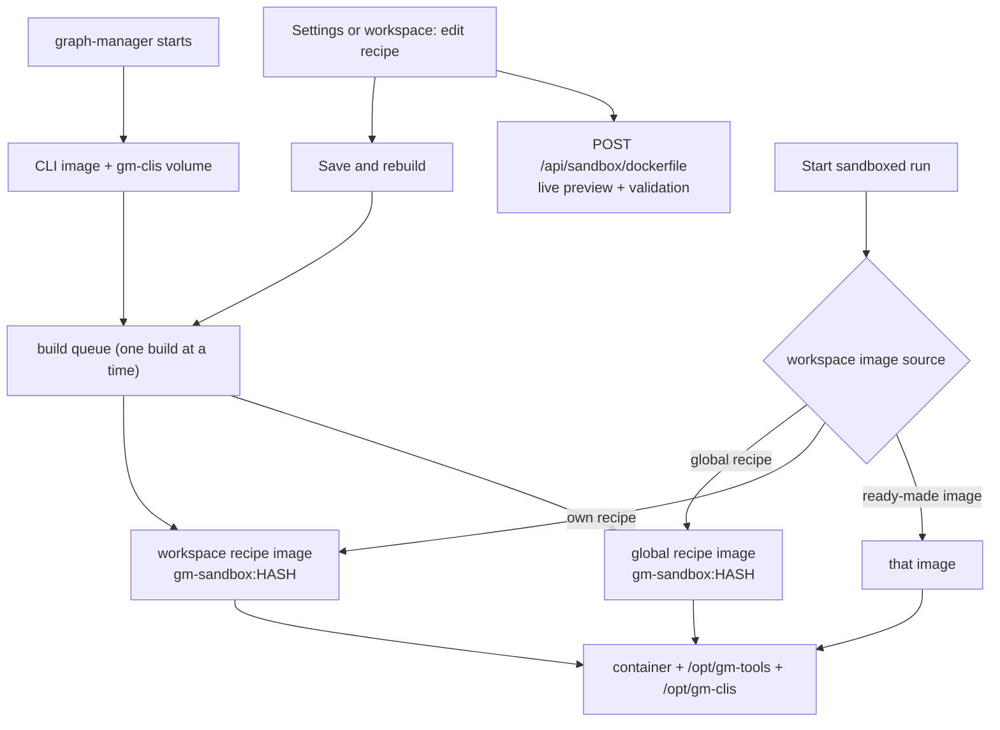

# Sandbox image: Node by default, toolchains on demand

## Problem

PR #13 (`feat/sandbox-image`, spec `docs/prd/done/sandbox-image.md`) makes graph-manager build the default sandbox image from a recipe: a base image, a flat list of apt packages and extra Dockerfile lines. The default recipe installs everything up front: Python, Java with Maven and Gradle, Go, Rust, Ruby, PHP and C/C++. That has three problems for the user:

- **Every user pays for every language.** The default image is several GB and takes minutes to build, even for a workspace that only needs Node.
- **Languages can't be switched on or off.** Python is a handful of names hidden in a package list, and Go and Rust are `COPY --from=` lines in a text box. To drop or add a language, the user has to know which lines belong to it.
- **One image for all workspaces.** The only per-workspace choice is a free image name. A workspace that needs Java can't get "the global image plus Java" without publishing its own image.

## Goals

1. The default sandbox image is **Node only**: `FROM node:24.22.1-bookworm` and nothing else. The Node base image can be changed globally and per workspace.
2. Each language is an **opt-in toolchain** with its own checkbox: Python, Java, Go, Rust, Ruby, PHP and C/C++. All are unchecked by default.
3. Each toolchain has an **editable Dockerfile snippet**, prefilled with a default and with its own **Reset to default** button. The toolchains can be **reordered**, and the Dockerfile follows that order.
4. The free **Extra Dockerfile lines** box and the **Dockerfile preview** stay. The preview updates as the user edits.
5. The recipe is **global** (Settings → Sandbox). A **workspace can switch to its own full copy** of the recipe, including its own Node base image. That workspace's image is built when its settings are saved, and its sandboxed runs answer 409 until the build is done.
6. The workspace's free **image** field stays as an escape hatch: a ready-made image used instead of any recipe.

No Jira ticket. This reworks PR #13 before it is merged, and lands in the same PR.

## Flow

## Decisions

| Decision | Why |
| --- | --- |
| A recipe is `{ base, toolchains, extraLines }`. `toolchains` always lists all 7 built-in toolchains, each as `{ id, enabled, snippet }`, and the array order is the Dockerfile order. | One shape covers the checkbox, the edited snippet and the order. Keeping unchecked toolchains in the list remembers their edited snippet and position when they are unchecked. |
| The flat `packages` list of PR #13 is removed. | Packages now belong to a toolchain's snippet. A package that fits no toolchain goes in the extra lines. |
| The default recipe is `FROM node:24.22.1-bookworm` with every toolchain unchecked and no extra lines. No ripgrep, jq, zip or corepack by default. | The user asked for Node only at the start. The full bookworm image already has git, curl and the build basics the engine needs. |
| The built-in toolchains and their default snippets live in one table in `sandbox-image.ts` (below). Users can't add new toolchain entries; anything else goes in the extra lines. | The user chose "keep the free extra lines" over user-defined toolchains. |
| Go and Rust are separate toolchains, both copied from their official images with `COPY --from=`. The other toolchains use apt. | Debian bookworm's Go (1.19) and Rust (1.63) are too old. Separate checkboxes because the user asked for one per language. |
| The Dockerfile is `FROM <base>`, then for each checked toolchain in order a `# <Name>` comment and its snippet, then the extra lines. Snippet and extra lines are kept verbatim (only `\r` and trailing blank lines are dropped), not trimmed line by line. | The comment makes the preview and the build log readable. Keeping lines verbatim fixes review follow-up F7 (indentation in `RUN <<EOF` heredocs). |
| `FROM` is rejected (400) in any snippet and in the extra lines, as a line whose first word is `FROM`, case-insensitively. | A `FROM` would throw away the base and everything before it. |
| Reordering uses **Move up** / **Move down** buttons on each row, not drag and drop. | Works with the keyboard and on a phone, and is easy to test. |
| The live preview is a server route, `POST /api/sandbox/dockerfile`, that returns the Dockerfile, its tag and the validation error for a recipe that isn't saved. The UI calls it 300 ms after the last edit. | One implementation of the Dockerfile and its rules, on the server. The web bundle doesn't import server code. |
| A workspace has one **image source**: `global` (the default), `recipe` (its own copy) or `image` (a ready-made image). The three are exclusive; saving one clears the others. | No ambiguity about which image a run gets. "Ready-made image" is the escape hatch the user wanted to keep. |
| Switching a workspace to `recipe` starts it as a copy of the global recipe at that moment. It doesn't follow later global changes. **Copy global again** replaces it with the current global recipe. | The user chose "own full copy". |
| Images are tagged by the hash of their Dockerfile (`gm-sandbox:<12 hex>`), as in PR #13. Two recipes with the same Dockerfile share one image. | No duplicate builds when a workspace copy is unchanged. |
| Builds go through one queue and run one at a time: the CLI image first, then the global recipe, then each workspace recipe. A target already queued isn't queued twice. | Parallel builds of several GB images would compete for disk, network and CPU. |
| Saving a workspace recipe whose image is missing queues its build at once. A sandboxed start in that workspace answers 409 while its build is queued or running, and 400 with the error when its last build failed. Other workspaces aren't blocked. | The user chose "build on save". One workspace's build shouldn't block runs elsewhere. |
| At startup, and before a start whose image went missing (for example after an image prune), the missing images of the global recipe and of every workspace recipe are queued. | The same behaviour as the global image in PR #13. |
| After each successful build, images labelled `gm.sandbox-image` are removed unless they belong to the CLI image, the global recipe or a workspace recipe. Images a container still uses are skipped. | Many workspace recipes would otherwise fill the disk. Review follow-up F5 (two graph-manager versions on one daemon) stays open. |
| All images, the escape-hatch image included, get the same shared `gm-clis-<id>` volume at `/opt/gm-clis`. | The CLIs don't depend on the recipe. |
| A recipe saved by an earlier build of this branch (with `packages`) is migrated on read: its packages become one `RUN apt-get …` line at the start of the extra lines, and all toolchains are unchecked. | Nothing is lost for someone who tried the branch. Since the PR isn't merged, no released version stored that shape. |
| `GM_SANDBOX_IMAGE` still sets only the base image of the default recipe. | As in PR #13. |

## Built-in toolchains

These are the default order and snippets. `<apt>` stands for `RUN apt-get update && apt-get install -y --no-install-recommends <packages> && rm -rf /var/lib/apt/lists/*`.

| id | Name | Default snippet |
| --- | --- | --- |
| `python` | Python | `<apt>` with `python3 python3-pip python3-venv pipx` |
| `java` | Java | `<apt>` with `default-jdk-headless maven gradle` |
| `go` | Go | `COPY --from=golang:1-bookworm /usr/local/go /usr/local/go` `ENV PATH=/usr/local/go/bin:$PATH` |
| `rust` | Rust | `COPY --from=rust:1-bookworm /usr/local/cargo /usr/local/cargo` `COPY --from=rust:1-bookworm /usr/local/rustup /usr/local/rustup` `ENV RUSTUP_HOME=/usr/local/rustup CARGO_HOME=/usr/local/cargo PATH=/usr/local/cargo/bin:$PATH` `RUN chmod -R a+rwX /usr/local/cargo /usr/local/rustup` |
| `ruby` | Ruby | `<apt>` with `ruby-full` |
| `php` | PHP | `<apt>` with `php-cli composer` |
| `cpp` | C/C++ | `<apt>` with `build-essential pkg-config cmake` |

## Non-goals

- User-defined toolchain entries, or toolchains that depend on each other (for example "Kotlin needs Java").
- Choosing versions in a separate field. The version is whatever the snippet installs.
- A workspace recipe that inherits item by item from the global one.
- Drag-and-drop reordering.
- Building workspace images in parallel, or per-workspace CLI versions.
- Fixing F5 (two graph-manager versions on one daemon) or slimming the CLI image.

## User stories

- As a user who only writes Node, I get a small Node image without doing anything.
- As a user, I tick **Python** in Settings → Sandbox, press **Save and rebuild**, and every workspace's sandbox has Python.
- As a user, I edit the Python snippet to add `python3-dev`, see the change in the Dockerfile preview straight away, and can press **Reset to default** on that snippet to undo it.
- As a user, I move **Rust** above **Python** and the Dockerfile follows that order.
- As a user, I switch one workspace to **Own recipe**, tick **Java** and change its base image to `node:22-bookworm`. Only that workspace builds and uses the new image; its runs wait for the build, while other workspaces keep running.
- As a user, I set a ready-made image on a workspace and no recipe is used for it.

## Requirements

### Recipe model (`apps/graph-manager/src/server/sandbox-image.ts`)

- `ToolchainId = "python" | "java" | "go" | "rust" | "ruby" | "php" | "cpp"`.
- `TOOLCHAINS: { id: ToolchainId; name: string; snippet: string }[]` holds the table above, in the default order.
- `SandboxRecipe = { base: string; toolchains: { id: ToolchainId; enabled: boolean; snippet: string }[]; extraLines: string }`.
- `DEFAULT_RECIPE` is `{ base: "node:24.22.1-bookworm", toolchains: TOOLCHAINS.map(t => ({ id: t.id, enabled: false, snippet: t.snippet })), extraLines: "" }`. `defaultRecipe(config)` replaces the base with `config.sandboxImage` when it is set.
- `recipeSchema` (zod, strict) validates that shape. Each snippet is at most 20 000 characters, the extra lines at most 20 000, and the base at most 255.
- `validateRecipe(r)` returns the 400 message, or undefined when the recipe is valid:
  - `base: not a valid image reference` (`IMAGE_PATTERN`)
  - `toolchains: must list each of python, java, go, rust, ruby, php, cpp exactly once`
  - `toolchains.<id>: FROM is not allowed; use COPY --from=<image>`
  - `extraLines: FROM is not allowed; use COPY --from=<image>`
- `normalizeRecipe(r)` trims the base and drops `\r` from snippets and extra lines.
- `migrateRecipe(raw)` turns an old `{ base, packages, extraLines }` into the new shape, as described in Decisions. The store uses it when it reads `sandboxRecipe` and a workspace's `recipe`.
- `sandboxDockerfile(r)` builds the Dockerfile as described in Decisions, and ends with `\n`. A recipe with nothing checked and no extra lines gives exactly `FROM node:24.22.1-bookworm\n`.
- `sandboxImageTag`, `ensureSandboxImage`, `ensureCliImage`, `ensureClisVolume` and `cliDockerfile` keep their behaviour. `removeOldImages(docker, keepIds)` takes the ids of every image still in use.

### Store (`apps/graph-manager/src/server/store.ts`)

- `sandboxRecipe` is the global recipe (optional; missing means the default).
- `workspaceSettings[id]` becomes `{ sandbox?: boolean; image?: string; recipe?: SandboxRecipe }`. At most one of `image` and `recipe` is set. With neither, the workspace uses the global recipe.

### Builds (`apps/graph-manager/src/server/sandbox.ts`)

- A build **target** is `"global"` or a workspace id. Each target has a `SandboxBuild` (`state`, `step`, `startedAt`, `finishedAt`, `error`, `log` of up to 1000 lines). `state` gains `"queued"`.
- `Sandboxes.queueBuild(target, { force?, clis? })` adds the target to the queue unless it is already queued or running. The queue runs one target at a time, and each target first makes sure the CLI image and volume exist.
- `imageFor(wsId)` returns `{ kind: "image" | "recipe" | "global", image: string }`: the workspace's ready-made image, the tag of its recipe, or the tag of the global recipe.
- `start()`:
  - Uses `p.image`, or else `imageFor(p.ws.id).image`.
  - For a recipe target that is queued or building, it answers 409 with `the sandbox image of this workspace is building; try again when it is ready`, or for the global target the existing `the sandbox image is building; try again when it is ready`.
  - For a recipe target whose last build failed, it answers 400 with `the sandbox image build failed: <error>`.
  - For a recipe image that is missing and not building, it queues the build and answers 409.
- `status()` keeps describing the CLI image and the global recipe only, so a workspace build doesn't make sandboxes "building" everywhere.
- After each successful build, `removeOldImages` keeps the CLI image, the global image and the image of every workspace recipe. `gm-clis` volumes other than the current one are removed, as before.
- At startup, after the CLI image and the global image, the images of workspace recipes that are missing are queued.

### Routes (`apps/graph-manager/src/server/routes/sandbox.ts`)

- `GET /api/settings/sandbox` returns `{ limits, recipe, defaultRecipe, toolchains: [{ id, name, snippet }], dockerfile, image }`. `toolchains` gives the names and default snippets for the UI and for **Reset to default**.
- `PUT /api/settings/sandbox` takes `{ limits?, recipe? }`, where `recipe: null` goes back to the default. An invalid recipe answers 400 with the `validateRecipe` message. A changed Dockerfile queues the global build. While the global build runs, a change answers 409 (as now).
- `POST /api/sandbox/dockerfile` takes `{ recipe }` and returns `{ dockerfile, image, error? }`. `error` is the `validateRecipe` message; the route answers 200 even then, so the preview can show it. It doesn't save anything.
- `POST /api/sandbox/rebuild` and `GET /api/sandbox/build` work on the global target, as now.
- `GET /api/workspaces/:id/settings` returns `{ sandbox, source: "global" | "recipe" | "image", image: string | null, recipe: SandboxRecipe | null, dockerfile: string | null, effectiveImage: string }`.
- `PUT /api/workspaces/:id/settings` takes one of:
  - `{ source: "global" }`
  - `{ source: "image", image }`, rejected with 400 `image: not a valid image reference` when invalid
  - `{ source: "recipe", recipe }`, with 400 for an invalid recipe; the route queues the build when the image is missing
  - and still the old `{ image: string | null }` (a string means `source: "image"`, null means `global`)
- `GET /api/workspaces/:id/sandbox/build` returns that workspace's `SandboxBuild` (`{ state: "idle", log: [] }` when it has none). `POST /api/workspaces/:id/sandbox/rebuild` rebuilds its recipe image with `nocache`. It answers 400 `the workspace has no own recipe` when its source isn't `recipe`, and 409 while that target is queued or building.

### UI

- **Shared editor** `apps/graph-manager/src/web/pages/RecipeEditor.tsx`, used by both Settings → Sandbox and the workspace drawer. Props: the recipe, the built-in toolchains, `onChange`, and `disabled`. It shows:
  - **Base image**: an input (`data-testid="recipe-base"`).
  - **Toolchains**: one row per toolchain in recipe order (`data-testid="toolchain-<id>"`). Each row has:
    - a checkbox labelled with the name (`toolchain-<id>-enabled`)
    - an **Edit** disclosure that opens the snippet textarea (`toolchain-<id>-snippet`); the snippet can be edited whether or not the box is checked
    - a **Reset to default** button (`toolchain-<id>-reset`), disabled when the snippet equals the default
    - an `edited` badge when the snippet differs from the default
    - **Move up** and **Move down** buttons (`toolchain-<id>-up`, `toolchain-<id>-down`), disabled at the ends, with `aria-label`s like "Move Python up"
  - **Extra Dockerfile lines**: a textarea (`recipe-extra`), with the hint about `COPY --from=` and `FROM`.
  - **Dockerfile**: a preview (`recipe-dockerfile`) from `POST /api/sandbox/dockerfile`, refreshed 300 ms after the last edit, with the validation error under it (`recipe-error`).
- **Settings → Sandbox → Image** (`SandboxImage.tsx`) uses the editor and keeps **Save and rebuild**, **Reset to defaults**, **Rebuild**, the build badge and the live log. The badge has a new `queued` state.
- **Workspace settings drawer** (`WorkspaceSettingsDrawer.tsx`) gets a **Sandbox image** radio group (`workspace-image-source`) with three choices:
  - **Global recipe**: shows the global image's tag.
  - **Own recipe**: the editor, prefilled with a copy of the global recipe the first time, plus a **Copy global again** button, its build badge and its log (polled every 2 s while queued or building), and a **Rebuild** button.
  - **Ready-made image**: the existing image input and its hint ("Needs node 20+, git and glibc (not Alpine)").
- **Save** in the drawer sends the chosen source and toasts `Saved the workspace settings`. When a build was queued, the toast says `Saved; building the workspace's sandbox image`.
- **Start run drawer**: when the workspace's own image is queued or building, the sandbox switch is disabled with `Building this workspace's sandbox image… (workspace settings)`.

### Docs

- Update `apps/graph-manager/README.md` (the Sandbox section), `docs/wiki/features/sandboxes.md` (a decision table and follow-ups) and the PR #13 body.

## Acceptance criteria

- [ ] With no saved recipe, `GET /api/settings/sandbox` returns `dockerfile` equal to `FROM node:24.22.1-bookworm\n`, and all 7 toolchains have `enabled: false`.
- [ ] Checking Python and saving gives a Dockerfile of `FROM node:24.22.1-bookworm`, then `# Python`, then the Python snippet, and queues the global build.
- [ ] Moving Rust above Python (both checked) puts `# Rust` before `# Python` in the Dockerfile.
- [ ] An edited snippet shows `edited`, and its **Reset to default** brings back the default text; the preview follows.
- [ ] A snippet or extra lines with a `FROM` line answers 400 `toolchains.python: FROM is not allowed; use COPY --from=<image>` (or `extraLines: …`), and the preview shows the same message.
- [ ] Indented lines inside a `RUN <<EOF` heredoc in the extra lines keep their indentation in the Dockerfile.
- [ ] `PUT /api/workspaces/:id/settings` with `{ source: "recipe", recipe }` (Java checked, base `node:22-bookworm`) saves it, queues that workspace's build, and `GET …/sandbox/build` shows `queued` or `building` and then `ready`.
- [ ] While that build runs, a sandboxed start in that workspace answers 409 with `the sandbox image of this workspace is building; try again when it is ready`, while a sandboxed start in another workspace on the global recipe still starts.
- [ ] After that build, the sandbox of that workspace runs `gm-sandbox:<hash of its Dockerfile>`, and other workspaces still run the global image.
- [ ] A workspace with `source: "image"` runs that image, with `/opt/gm-clis` mounted.
- [ ] A failed workspace build gives 400 `the sandbox image build failed: …` on start, and the drawer shows `failed` and the log.
- [ ] After a successful build, images of recipes nobody uses any more are removed, and the global image and every workspace recipe's image are kept.
- [ ] A stored recipe in the old `{ base, packages, extraLines }` shape loads with its packages as a `RUN apt-get …` first line in the extra lines.
- [ ] Settings → Sandbox and the workspace drawer render without overflow in light, dark and at phone width (390 px). The toolchain controls work with the keyboard.
- [ ] `npm run typecheck && npm run lint && npm test` pass.
