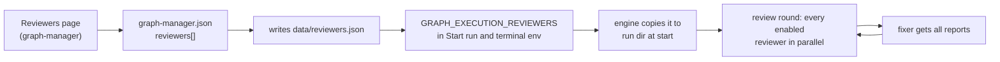

# PRD: Add and edit review agents from the UI (graph-manager + engine)

Ticket: [KAN-87](https://graph-execution.atlassian.net/browse/KAN-87)

## Problem

The review loop always runs the same two agents. They are hard-coded as `REVIEWERS = ["code", "tester"]` (`packages/graph-execution/src/review/phase.ts:285`), and the `reviewer` field of a report is `z.enum(["code", "tester"])` (`review/report.ts:8`). Their prompts are fixed in `agents/reviewer.ts:69-177` and `agents/tester.ts:47-171`, and the only way to influence them is the repo's `REVIEW.md` / `TESTING.md`. Every agent in a run uses the run's single `--provider` / `--model`.

A graph-manager user can't add a reviewer (security, performance, "follows our patterns"), can't change what the code reviewer looks for, and can't keep one set of reviewers for every repo they work on.

## Goals (KAN-87)

1. **Reviewers are edited and added in the UI.** graph-manager gets a **Reviewers** page: list, add, edit, enable/disable and delete reviewers.
2. **One global set.** Whatever repo is running, every run started from graph-manager (from **Start run** or typed in a graph-manager terminal) uses the reviewers from the UI.
3. **The engine loads reviewers from a file**, given with `--reviewers <file>` or `GRAPH_EXECUTION_REVIEWERS`. Without it, the engine behaves exactly as today.
4. **The code reviewer becomes an editable entry. The live tester stays built in**, with an editable prompt.
5. **Each reviewer can have its own provider and model**, falling back to the run's.



## Decisions

| Decision | Why |
| --- | --- |
| Reviewers are global only. There is no per-workspace on/off. | The user asked for it: whatever repo runs, it uses the reviewers from the UI. |
| graph-manager passes them with the env var `GRAPH_EXECUTION_REVIEWERS=<dataDir>/reviewers.json`, set for Start run and in terminal env. | The launcher already forwards every `GRAPH_EXECUTION_*` var to the detached run (`launch/script.ts:43-44`), so runs typed in a terminal get it too, with no shim change. |
| At run start, the engine copies the file into the run dir as `reviewers.json`, and its hash joins the run's input hashes. Resume and retry read the copy. | Editing reviewers in the UI must not change a run that is already going, or break its resume (`loadRound` reads one report per reviewer, `phase.ts:322-331`). |
| Without a reviewers file, the engine uses a built-in list equal to today's two reviewers, with ids `code` and `tester`. | Plain `graph-execution` and existing runs behave exactly as today. |
| Two reviewer types: `diff` (gets the diff, like the code reviewer) and the built-in `tester` (boots the app, checks the test plan). The `code` entry is a `diff` reviewer that can be edited, disabled or deleted. The `tester` entry can be edited and disabled, not deleted, and there is only one. | Only the tester has special behaviour (plan cases, booting the app). Every other reviewer is a prompt over the diff. |
| The UI edits a reviewer's **instructions**. The engine keeps the fixed parts of the prompt: the report path, the JSON shape, the finding rules, the previous-round verification, and the human comment verdicts. | A user's prompt can't break the report contract that the fixer and the summary parse. |
| Human review comments, and their verdicts, go to the `code` reviewer if it is enabled, otherwise to the first enabled `diff` reviewer. | Today only the code reviewer gives comment verdicts (`phase.ts:412-414`). Exactly one reviewer must answer each comment. |
| Every reviewer has two layers: general **instructions** in the UI, and a **repo file** at the repo root that adds that repo's own rules. `code` uses `REVIEW.md`, `tester` uses `TESTING.md`, and a new reviewer names its own file (prefilled `<ID>_REVIEW.md`, e.g. `SECURITY_REVIEW.md`). | The user asked for the same behaviour as the two built-in reviewers: general instructions plus a repo file with more specifics. |
| A reviewer gets only its own repo file, not the other reviewers' files. A missing file is not an error: the reviewer works from its instructions and logs `no <file> at the repo root`, like today. | Each file is that reviewer's specification. Today a missing `REVIEW.md` / `TESTING.md` never fails a run. |
| The repo file is read from the repo root at startup, so it works even when it isn't committed, like `REVIEW.md` today (`review/context.ts:7-8`). | Same behaviour as today. |
| The prefill is `<ID>_REVIEW.md`, not `<ID>.md`. | Names like `SECURITY.md` already mean something else on GitHub (the security policy). |
| Each reviewer has a `blockAt`: `major` (default: blockers and majors trigger a fix pass, as today), `blocker` (only blockers), or `never` (all of its findings are reported as minors). | "The lowest severity that blocks" from the discussion. |
| Finding ids of reviewers other than `code` and `tester` are prefixed with the reviewer id (`security-F1`). | Ids aren't namespaced today (`report.ts`), so two reviewers could both report `F1`. |
| The provider and model of a reviewer fall back to the run's `--provider` / `--model`. All providers in use are checked on `PATH` at startup. | The user chose per-reviewer providers. A missing CLI must fail at startup, not mid-review. |
| `suite` runs keep the built-in reviewers. | Out of scope for this change (see Non-goals). |

## Non-goals

- Reviewers per workspace or per repo.
- Reviewers for `suite` runs and the suite's end-to-end reviewers.
- Changing the fixer, its prompt, or the number of fix passes.
- Sharing reviewers between graph-manager deployments, or importing and exporting them.
- Showing per-reviewer statistics.

## User stories

1. As a graph-manager user, I open **Reviewers**, add a "Security" reviewer with my own instructions and the `claude` provider, and every run I start from then on, in any workspace, runs it next to the code reviewer and the live tester.
2. As a user, I edit the code reviewer's instructions to match my team's conventions.
3. As a user, I add a "Security" reviewer with general instructions, and in one repo I add `SECURITY_REVIEW.md` at the root with that repo's own rules (its auth model, which endpoints are public). The reviewer uses both there, and only the general instructions in other repos.
4. As a user, I turn the live tester off for a backend-only period, and runs skip it.
5. As a user, I set a "Style" reviewer to `blockAt: never`, so its findings show in the summary but never start a fix pass.
6. As a user, I edit a reviewer while a run is going, and that run keeps the reviewers it started with.
7. As a CLI user without graph-manager, nothing changes.

## Requirements

### Reviewers file (engine, new `packages/graph-execution/src/review/reviewers.ts`)

```json
{
  "reviewers": [
    { "id": "code", "type": "diff", "name": "Code review", "enabled": true, "instructions": "…", "repoFile": "REVIEW.md", "blockAt": "major" },
    { "id": "tester", "type": "tester", "name": "Live test", "enabled": true, "instructions": "…", "repoFile": "TESTING.md" },
    { "id": "security", "type": "diff", "name": "Security", "enabled": true, "instructions": "…", "repoFile": "SECURITY_REVIEW.md",
      "provider": "claude", "model": "opus", "files": ["src/**", "!**/*.test.ts"], "blockAt": "blocker" }
  ]
}
```

- Strict zod schema:
  - `id`: kebab-case, 1-32 chars, unique.
  - `type`: `diff` or `tester`. At most one `tester`, and only with id `tester`.
  - `name`: 1-60 chars.
  - `instructions`: up to 20 000 chars.
  - `repoFile`: a file name at the repo root (no `/`, no `..`, ends in `.md`). Required. Unique across reviewers.
  - `provider`: optional, one of the run providers.
  - `model`: optional string.
  - `files`: optional globs, with `!` to exclude, matched against the changed files.
  - `blockAt`: `major` (default), `blocker` or `never`.
- A file that is missing or invalid makes the run exit 2 at startup, with the path and the zod error.
- `BUILTIN_REVIEWERS` holds today's `code` (`repoFile: REVIEW.md`) and `tester` (`repoFile: TESTING.md`), with today's prompt text as their default `instructions`. graph-manager uses them to seed its list.

### Engine: loading and state

- `--reviewers <file>` (run command) or `GRAPH_EXECUTION_REVIEWERS`. The flag wins over the env var. `--resume` with `--reviewers` exits 2, like the other start-only options.
- At start the file is copied to `.graph-execution/<run-id>/reviewers.json`. `computeHashes` includes it (`state/state.ts:148-151`). Resume, retry and human-review rounds read the copy.
- `reviewerKindSchema` becomes the reviewer id (a string). `state.reports` becomes `z.record(z.string(), z.string())`. Old `{ code, tester }` state still parses.
- Disabled reviewers are dropped at load time. When no reviewer is enabled, the review phase logs `no reviewers enabled; the result is not reviewed` and the run goes on to apply.

### Engine: review round (`review/phase.ts`, `agents/reviewer.ts`, `agents/tester.ts`, `agents/fixer.ts`)

- `reviewRound` runs every enabled reviewer with `Promise.allSettled`, as today. Each one runs in its own worktree `worktrees/review-<id>-r<N>`, with the label `<id>-r<N>` and the report `reports/round<N>/<id>.json`.
- `diff` reviewers use the code reviewer's runner. The prompt is the engine's fixed frame plus the reviewer's `instructions`, in place of today's fixed role text, plus the reviewer's `repoFile` (when it exists) and the diff limited to `files`. A `diff` reviewer whose `files` match no changed file writes a "not needed" report, like `CODE_REVIEW_NOT_NEEDED` today.
- The `tester` keeps its runner. Its `instructions` replace the role text of `testerPrompt`, and its `repoFile` takes the place of `TESTING.md` (the default is `TESTING.md`).
- `ReviewerContext` (`review/context.ts`) reads each reviewer's `repoFile` from the repo root, in place of the fixed `REVIEW_FILE` / `TESTING_FILE`. The prompt section is titled with the file name (`## SECURITY_REVIEW.md`).
- `NOT_PERFORMED`, the log names (`phase.ts:469`) and the fixer's `NAME` map (`fixer.ts:65`) use the reviewer's `name`.
- `openBlocking` respects `blockAt`: `blocker` counts only blockers, and `never` downgrades every finding to minor when the report is read.
- Findings of reviewers other than `code` and `tester` get their ids prefixed with `<id>-` when the report is normalized, unless they already have that prefix.
- Each reviewer runs with its own `provider` / `model`, or the run's. `getProvider` is called for every distinct provider at startup.

### Engine: views

- The terminal UI and the web run page show one node per enabled reviewer (`@<id>`, titled with its `name`) instead of the fixed `@reviewer` / `@tester` (`runner/nodes.ts:6-11`, `ui/store.ts:80`, `ui/model.ts`, `runner/run.ts:107-108`). Retry works per reviewer (`runner/run.ts:560, 596`).
- The log label regexes accept any `<id>-r<N>` (`web/assets/logs.js:15`, `web/logtail.ts:27-28`).
- The suite page is unchanged.

### graph-manager: storage and API

- `dataSchema` (`apps/graph-manager/src/server/store.ts:8-26`) gets `reviewers`. It is seeded from `BUILTIN_REVIEWERS` (exported from `graph-execution/api`) the first time it is missing.
- On every change, the server writes `<dataDir>/reviewers.json` (mode 600, atomic, like `graph-manager.json`).
- Routes, behind login (new `routes/reviewers.ts`, like `routes/forges.ts`):
  - `GET /api/reviewers`
  - `POST /api/reviewers` (create)
  - `PUT /api/reviewers/:id`
  - `DELETE /api/reviewers/:id` (400 for `tester`)
  - `POST /api/reviewers/reset/:id` (restores the built-in instructions of `code` or `tester`)

  Validation uses the engine's schema, so the UI and the engine accept the same reviewers.
- `GRAPH_EXECUTION_REVIEWERS=<dataDir>/reviewers.json` is added to the env in `routes/runs.ts:86-89` and in `terminalEnv` (`terminals.ts:107-119`).
- `viewcache.ts` and `PhaseCards.tsx` stop hard-coding `reviewer` / `tester`. The "Review + live test" card lists each reviewer of the run with its status and finding counts.

### graph-manager: Reviewers page

- A nav item **Reviewers** between Workspaces and Settings (`Shell.tsx:154-184`), with the route `/reviewers` (`App.tsx`) and the shortcut `g v`.
- A list of reviewers, one row each: an enable switch, the name, the type, the provider/model ("run default" when empty), `blockAt`, and Edit and Delete buttons (no Delete for `tester`).
- An **Add reviewer** button and an Edit drawer with these fields: name, id (fixed after create), instructions (a large monospace text area), repo file (prefilled `<ID>_REVIEW.md`, with the hint "Optional file at the repo root with this repo's own rules for this reviewer"), provider (run default or a provider), model, files (one glob per line), block at.
- A **Reset to built-in** button for `code` and `tester`.
- A note at the top: "Used by every run started from graph-manager. Runs already going keep the reviewers they started with."

## Acceptance criteria

- [ ] A run without `--reviewers` or the env var writes `reports/round0/code.json` and `tester.json` and behaves as today. All existing engine tests pass unchanged.
- [ ] With a reviewers file holding `code`, `tester` and `security`, the fake-provider run writes `reports/round0/security.json` too, the web run page shows a `Security` node, and the fixer prompt contains the security findings with the ids `security-F1`, ….
- [ ] A `security` reviewer with `repoFile: SECURITY_REVIEW.md` gets that file's text in its prompt when the file exists at the repo root, and doesn't get `REVIEW.md`. Without the file, the run logs `no SECURITY_REVIEW.md at the repo root` and the reviewer still runs.
- [ ] Two reviewers with the same `repoFile`, or a `repoFile` of `../x.md`, give 400 from `POST /api/reviewers`.
- [ ] A reviewer with `blockAt: "never"` and a major finding does not start a fix pass. The finding is listed as minor in the summary.
- [ ] A reviewer with `provider: "codex"` when `codex` is not on `PATH` makes the run exit 2 at startup.
- [ ] Changing `<dataDir>/reviewers.json` during a run doesn't change that run's reviewers, and `--resume` still works.
- [ ] With the tester disabled, no tester report is written and the run still applies.
- [ ] `POST /api/reviewers` with a duplicate id, a second `tester` or an invalid glob gives 400. `DELETE /api/reviewers/tester` gives 400.
- [ ] A run started from **Start run**, and a `graph-execution … --web` typed in a graph-manager terminal, both have `reviewers.json` in their run dir equal to the UI's list of enabled reviewers.
- [ ] The Reviewers page adds, edits, disables and deletes a reviewer, and the changes survive a server restart.
- [ ] `npm run typecheck && npm run lint && npm test` pass.
