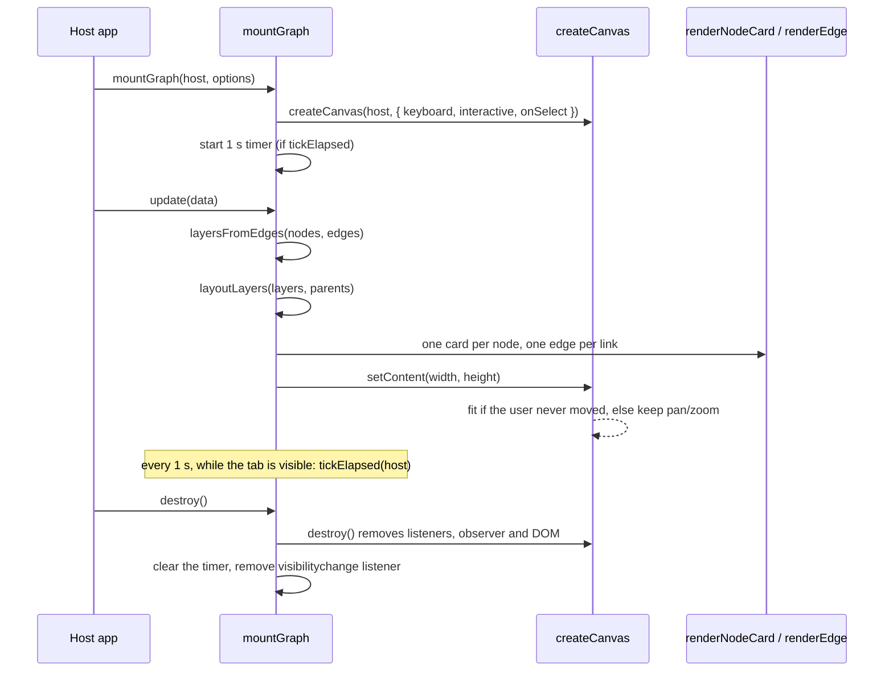

# Embeddable run graph: `graph-execution/graph`

## Problem

graph-execution Cloud (a separate app) wants to show graph-execution's own task graph on its run page, instead of a
hand-made copy. Today the graph lives in `dist/web/assets/graph.js` and `graph.css`, which are not in the package's
`exports`. Other apps can only reach them through private paths that may change in any release.

The module is also not built to be embedded:

- `createCanvas` (`packages/graph-execution/src/web/assets/graph.js:262-451`) adds a `keydown` listener to `document`
  (F, 0, +, −) and a `ResizeObserver`. It never removes them, and it has no `destroy`.
- `graph.css` uses common, unprefixed class names (`.node`, `.edge`, `.canvas`, `.spin`, `.sel`, `.ok`, `.active`). They
  clash with a host app's classes in both directions.
- The CSS custom properties come from `theme.css`, which sets them on `:root`. Without that file the graph has no colours.
- There is no read-only mode: every card gets `clickable` and a pointer cursor.
- The running timers tick only because the run page calls `tickElapsed` from its own 1-second interval.

## Goals

No Jira tickets: this request came in directly.

1. Publish two supported entry points: `graph-execution/graph` (a browser ES module with `.d.ts` types) and
   `graph-execution/graph.css`.
2. Add a high-level `mountGraph(host, options)` API with `update`, `fit` and `destroy`. Keep exporting the low-level
   functions (`layoutLayers`, `renderNodeCard`, `renderEdge`, `createCanvas`, `tickElapsed`).
3. Support a read-only mode (`interactive: false`).
4. Run live timers inside the graph. They pause while the tab is hidden and stop on `destroy`.
5. Scope the keyboard shortcuts to the host (`keyboard: 'host'`), to the page (`'document'`), or turn them off (`false`).
6. `destroy()` leaks nothing: no listeners, observers, timers or DOM left behind.
7. Theme the graph with a documented list of CSS custom properties, read from the host, each with a fallback. Prefix
   every class with `ge-`.
8. Add three statuses, `escalated` (restyled), `dropped` and `not_done`, plus blocked edges.
9. Document it in the README ("Embedding the graph") and treat it as public, semver-covered API.
10. The engine's own run page and suite page look and behave the same as before.

## Workflow



## Decisions

| Decision | Why |
| --- | --- |
| Prefix every class the graph adds with `ge-`, including modifiers and status classes (`ge-node`, `ge-s-running`, `ge-sel`, `ge-clickable`, `ge-canvas`). The run and suite pages move to the new names. | A root-class scope still lets a host's own `.node {…}` rule style our cards. Prefixing protects both ways. No other app imports these classes (checked `apps/`). |
| The types are a hand-written `src/web/assets/graph.d.ts`, with a type test that keeps it in sync with `graph.js`. `graph.js` stays plain JS with `// @ts-check`. | The pages load `graph.js` directly in the browser with no build step. The `.d.ts` is the public contract and is reviewed as one. |
| `mountGraph` is built from the low-level functions, so there is one implementation. The run page and suite page keep calling the low-level functions (`createCanvas`, `renderNodeCard`, `renderEdge`, `layoutLayers`). | Both pages draw things that `GraphData` does not carry: badges, `retryable`, `resumed`, the human review node, and the suite's feature clusters. |
| `mountGraph` works out the layers from `edges` with Kahn's algorithm, the same as `executionLayers` (`src/graph/validate.ts:71-88`). Inside a layer, nodes keep their order in `data.nodes`. | `GraphData` has no layers. Keeping the input order means that passing the run page's nodes in its layer order gives exactly the run page's positions. |
| A cycle in `edges` does not throw. Nodes left in the cycle go into one last layer, in input order, and a warning is printed with `console.warn`. | An embedding app should not crash on bad data. |
| An edge whose `from` or `to` is not in `nodes` is skipped. | Matches `layoutLayers`, which skips parents that are not laid out. |
| The engine's pages use `keyboard: 'document'` (today's behaviour). `mountGraph` defaults to `'host'`. `createCanvas` gets the same `keyboard` option, defaulting to `'document'`. | The engine's pages must not change. An embedded graph must not take over the host's keys. |
| `graph.css` gives every `var(--x)` a fallback equal to today's dark value from `theme.css`, and never sets anything on `:root`. The fonts fall back to `system-ui` / `ui-monospace`. `graph.css` loads no font files. | The graph renders with no setup. The engine's pages still get Inter and JetBrains Mono from `theme.css`. |
| `selectedId` highlights the node in both modes. `onSelect` is called only when `interactive` is true. | A read-only view can still show which task the host is focused on. |
| `update()` keeps the user's pan and zoom once they panned or zoomed, and fits otherwise. `fit()` resets that, so the next `update` fits again. | This is what `createCanvas` already does with `placed` and `moved`. |
| No version bump in this run. | The release sets the version (2.1.0, a minor: the change only adds API). |

## Non-goals

- No React, Vue or Web Component wrapper. Only the plain DOM API.
- No light theme. The fallbacks are today's dark values; a host can override them.
- No changes to the server's graph JSON, to `executionLayers`, or to the terminal UI.
- Do not move the run page or suite page onto `mountGraph`.
- No vertical layout option in `mountGraph`. Left to right only, as the run page does it today.
- No publish to npm and no version bump.
- No changes to graph-execution Cloud. It is a separate app.

## User stories

- As a graph-execution Cloud developer, I import `mountGraph` from `graph-execution/graph` and `graph-execution/graph.css`
  and show a run's task graph without copying any code.
- As that developer, I call `graph.update(data)` on every state push. The graph redraws without jumping back if the
  user had zoomed in.
- As that developer, I show a read-only graph on a summary page. Clicks do nothing and the cursor stays normal, but the
  user can still pan and zoom.
- As that developer, I unmount the run page and call `graph.destroy()`. No timers or key listeners stay behind.
- As a user typing in a search box on the Cloud page, pressing F or 0 types the letter and does not re-fit the graph.
- As a graph-execution user, my local run page and suite page look and behave exactly as before.

## Requirements

### Package entry points (`packages/graph-execution/package.json`)

Add to `exports`:

```json
"./graph": {
  "types": "./dist/web/assets/graph.d.ts",
  "import": "./dist/web/assets/graph.js"
},
"./graph.css": "./dist/web/assets/graph.css"
```

- The `postbuild` step already copies `src/web/assets` to `dist/web/assets`. It must also copy `graph.d.ts`. Today the
  filter drops only `*.test.ts`, so check that `graph.d.ts` arrives in `dist/web/assets/`.
- `graph.js` must not import anything: no Node built-ins and no other files. Today it imports nothing. Add a test that
  reads `graph.js` and checks it has no `import` statements.
- Add a test that runs `npm pack --dry-run --json` (or reads `files` and `exports`) and checks that
  `dist/web/assets/graph.js`, `graph.d.ts` and `graph.css` are in the package. If a pack test already exists, add to it.

### Public types (`src/web/assets/graph.d.ts`)

```ts
export type NodeStatus =
  | "pending" | "queued" | "waiting"
  | "running" | "validating" | "fixing" | "merging" | "integrating"
  | "merged" | "done" | "applied"
  | "failed" | "aborted" | "stopped" | "human"
  | "skipped" | "excluded"
  | "escalated" | "dropped" | "not_done";

export interface GraphNode {
  id: string;
  title: string;
  status: NodeStatus;
  provider?: string;
  startedAt?: number;          // ms epoch
  endedAt?: number;
  attempt?: number;
  detail?: string;             // the second-line status text, e.g. "checking 1/3"
  changes?: { added: number; deleted: number; files: number };
}
export interface GraphEdge { from: string; to: string; blocked?: boolean } // from is a dependency of to
export interface GraphData { nodes: GraphNode[]; edges: GraphEdge[] }

export interface GraphOptions {
  interactive?: boolean;                     // default true
  onSelect?: (id: string) => void;           // only when interactive
  selectedId?: string;
  tickElapsed?: boolean;                     // default true
  keyboard?: "host" | "document" | false;    // default "host"
  ariaLabel?: string;                        // default "Task graph"
}
export interface GraphHandle {
  update(data: GraphData): void;
  fit(): void;
  destroy(): void;
}
export function mountGraph(host: HTMLElement, options?: GraphOptions): GraphHandle;
```

The file also declares the low-level exports that already exist: `NODE_W`, `NODE_H`, `MIN_K`, `MAX_K`,
`layoutLayers`, `edgePath`, `edgeClass`, `nodeClass`, `formatElapsed`, `svg`, `renderEdge`, `renderNodeCard`,
`tickElapsed`, `pinchView`, `createCanvas`. Their signatures must match the JSDoc in `graph.js`, including the new
options below. Put a header comment in the file: "Public API, covered by semver. See README › Embedding the graph."

Type test: add `src/web/assets/graph-types.test.ts`. It imports from `./graph.js` and uses `expectTypeOf` (vitest) to
check that `mountGraph`, `GraphData` and `GraphOptions` have the shapes above, and that `typecheck` fails if they drift.
The `.d.ts` sits next to `graph.js` with the same base name, so TypeScript takes the types for `./graph.js` from it.
That stops `tsc` from checking `graph.js` through its imports. Keep `// @ts-check` in `graph.js` and add a runtime test:
the names `graph.js` exports must equal the names `graph.d.ts` declares (parse the `export` lines). If `npm run
typecheck` can still check `graph.js` without TS5055 or emit conflicts, for example through a separate
`tsconfig.assets.json` added to the `typecheck` script, do that as well.

### `mountGraph` (`src/web/assets/graph.js`)

- `mountGraph(host, options)` calls `createCanvas(host, { onSelect, interactive, keyboard })`. It adds the `ge-graph`
  class to the host and sets `role="group"` and `aria-label` (from `ariaLabel`, default `"Task graph"`).
- `update(data)`:
  1. Layers from `edges` with Kahn's algorithm (see Decisions). Inside a layer, nodes keep the order of `data.nodes`.
  2. `parents[to]` = the `from` of each edge into `to`.
  3. `layoutLayers(layers, parents)` with the default sizes.
  4. One `renderEdge(a, b, { from, to, blocked })` per layout edge, and one `renderNodeCard` per node. Map a node to the
     card's view like this: `{ status, attempt, attempts: attempt ?? 0, startedAt, endedAt, changes: changes ? { total: changes } : undefined }`,
     with opts `{ id, title, x, y, provider, detail, selected: id === selectedId, interactive }`.
  5. `canvas.root.replaceChildren(edges, cards)`, then `canvas.setContent(width, height)`.
  6. If `tickElapsed` is on, call `tickElapsed(host)` once, so new cards show the current time at once.
- `fit()` calls the canvas's `fit`.
- `destroy()` is idempotent. It clears the timer, removes the `visibilitychange` listener, calls `canvas.destroy()`,
  removes the `ge-graph` class, `role`, `aria-label` and `tabindex` it added, and leaves the host empty of everything
  it created. Any later `update` or `fit` call does nothing.

### `createCanvas` changes

- New options: `interactive` (default `true`) and `keyboard` (`"host" | "document" | false`, default `"document"`).
- Returns `destroy()` as well. It removes every listener it added: on the host, on the zoom bar buttons, and on
  `document`. It disconnects the `ResizeObserver`, and removes the SVG and the zoom bar from the host and the `ge-canvas`
  and `ge-panning` classes. Keep the observer and the listeners in variables so they can be removed. For listeners on
  the host, an `AbortController` with `{ signal }` is fine.
- `interactive: false`:
  - no `onSelect` calls;
  - clicking empty space does nothing. Today a double-click on empty space re-fits; in read-only mode it does not;
  - pan, wheel zoom, pinch and the zoom bar still work.
- `keyboard: "host"`: the host gets `tabindex="0"` (unless it already has one) and the `keydown` listener goes on the host
  instead of `document`. The `typing(ev.target)` check stays, so typing in an input inside the host does nothing either.
  `keyboard: false` adds no keyboard listener and no `tabindex`.

### `renderNodeCard` and `renderEdge` changes

- `renderNodeCard` opts get `interactive` (default `true`). When `false`, the card has no `ge-clickable` class. Cards
  never get a `tabindex`, in either mode, as today, so the engine's pages do not change. With `interactive: false`, the
  card also gets `aria-disabled="true"`. Selecting cards from the keyboard is a follow-up.
- `renderEdge` opts get `blocked`. A blocked edge gets the class `ge-blocked`, which is dashed (`stroke-dasharray: 4 4`),
  dimmed (`opacity: 0.35`) and never animated, even when its target runs.
- Hollow statuses: add `dropped` to `HOLLOW`.

### Live timers

- If `tickElapsed` is on (the default), `mountGraph` runs `setInterval(() => tickElapsed(host), 1000)`.
- On `document.visibilitychange`: stop the interval while `document.hidden`. When the tab shows again, tick once at
  once, then restart the interval.
- `destroy()` clears the interval and removes the `visibilitychange` listener.
- The engine's pages keep their own timers. Do not change them.

### CSS (`src/web/assets/graph.css`)

- Rename every class to the `ge-` form. The full list from today's file: `canvas`→`ge-canvas`, `panning`→`ge-panning`,
  `canvas-svg`→`ge-canvas-svg`, `zoombar`→`ge-zoombar`, `edge`→`ge-edge`, `arrow`→`ge-arrow`, `ok`/`dim`/`active`→
  `ge-ok`/`ge-dim`/`ge-active`, `node`→`ge-node`, `clickable`→`ge-clickable`, `mark`/`hollow`→`ge-mark`/`ge-hollow`,
  `ttl`, `icon`, `meta`, `detail`, `resumed`, `reused`, `badge`, `warn`, `add`, `del`, `tries`, `el`→ the `ge-` form,
  `spin`→`ge-spin`, `s-<status>`→`ge-s-<status>`, `retryable`→`ge-retryable`, `sel`→`ge-sel`, `cluster`, `ctitle`,
  `cmeta`, `unchanged`→ the `ge-` form. Also the keyframes: `flow`→`ge-flow`, `spin`→`ge-spin`.
- Update every user of these classes: `graph.js` (`edgeClass`, `nodeClass`, `renderNodeCard`, `renderEdge`,
  `tickElapsed`'s `.el[data-start]` selector, `createCanvas`), `runpage.js`, `suitepage.js` (feature clusters), and
  `shell.css:26` (`#graph .canvas, #graph.canvas`). Search `src/web` and `src/suite` for every old name, and update the
  tests that check class names (`graph.test.ts`'s `nodeClass` and `edgeClass` tests). `nodeClass(s)` now returns
  `ge-node ge-s-<s>`.
- Theming: `graph.css` reads only these custom properties, each as `var(--x, <fallback>)`, with the fallback taken from
  `theme.css`:

  | Property | Fallback |
  | --- | --- |
  | `--bg` | `#141415` |
  | `--panel` | `#19191b` |
  | `--raised` | `#232325` |
  | `--text` | `#ededed` |
  | `--muted` | `#a1a1a6` |
  | `--faint` | `#5c5c62` |
  | `--border` | `rgba(237, 237, 237, 0.08)` |
  | `--border-strong` | `rgba(237, 237, 237, 0.14)` |
  | `--accent` | `#7aa2ff` |
  | `--ok` | `#4cc38a` |
  | `--warn` | `#f2b04e` |
  | `--bad` | `#e5484d` |
  | `--glow` | `0 0 0 1px rgba(237, 237, 237, 0.14), 0 8px 24px rgba(0, 0, 0, 0.4)` |
  | `--font-ui` | `system-ui, sans-serif` |
  | `--font-code` | `ui-monospace, monospace` |
  | `--diff-add-mark` | `#3fb950` |
  | `--diff-del-mark` | `#f85149` |

  `--ease` is used today. Replace it with `cubic-bezier(0.22, 1, 0.36, 1)` written out. The internal `--c` (status
  colour) stays, renamed `--ge-c`. Hard-coded `rgba(237, 237, 237, …)` values in the canvas background and the clusters
  may stay. Add a test that parses `graph.css` and checks: every `var(--name` is in this list or is `--ge-c`; every
  `var()` of a listed property has a fallback; there is no `:root` selector; every class selector starts with `.ge-`.
- `.ge-zoombar button` must not depend on `theme.css`'s global `button` rule. Give it its own `font`, `border`,
  `border-radius`, `cursor`, `background` and `color`, so it looks the same without `theme.css`.
- New status styles, each distinct from the others:
  - `ge-s-escalated` ("needs decision"): `--ge-c: var(--warn)`, warn stroke at `stroke-width: 1.5`, and a warn-tinted
    fill (`fill: color-mix(in srgb, var(--warn, #f2b04e) 10%, var(--panel, #19191b))`). The detail line defaults to
    "needs decision" when the node has no `detail`. Set that in `renderNodeCard` for `escalated`.
  - `ge-s-dropped`: hollow mark, the whole card at `opacity: 0.5`, title with `text-decoration: line-through`.
    `--ge-c: var(--faint)`.
  - `ge-s-not_done`: `--ge-c: var(--bad)`, the card at `opacity: 0.6`, filled mark, no red stroke (so it differs from
    `failed`).
- Reduced motion: keep the `prefers-reduced-motion` rule for `ge-active` and `ge-spin`.

### Engine pages

- `runpage.js` and `suitepage.js` keep their current calls. They pass `keyboard: "document"` (the default for
  `createCanvas`) and the run page's look stays identical, apart from the class names.
- `page.html` and `suite/page.html` keep loading `assets/theme.css` and `assets/graph.css`.

### Documentation

- `packages/graph-execution/README.md`: a new section "Embedding the graph", placed after "The web app"/"Suites" (where it
  fits best). It contains:
  - a ~15-line example: `import { mountGraph } from "graph-execution/graph"`, `import "graph-execution/graph.css"`,
    mount on a sized `div`, `update` with three nodes and two edges, `onSelect`, and `destroy` on unmount;
  - an options table (`interactive`, `onSelect`, `selectedId`, `tickElapsed`, `keyboard`, `ariaLabel`, with defaults);
  - a statuses table with the look of each;
  - the CSS custom properties table with fallbacks, and a note that they are read from the host element (set them on
    the host, not on `:root`);
  - a note that the host needs a size (for example `height: 480px`), and that `GraphData`, `GraphOptions`, the status
    names, the `ge-` class names and the CSS property names are public API: changing them is a breaking change
    (semver major).
- The repo-root `README.md` gets a one-line pointer if it lists the package's features.
- `docs/wiki/features/embeddable-graph.md`: decision table (decision, why, ticket = "none"), follow-ups and code
  references. Link it from `docs/wiki/index.md`.

### Tests

All new DOM tests use `// @vitest-environment jsdom` (as in `escalation-advisor.test.ts`). jsdom has no
`ResizeObserver`; stub it on `globalThis` with a class that records `observe` and `disconnect`.

- **Layout** (`graph.test.ts`): for a fixture of the run page's graph (four tasks in a diamond plus `@gate`, a
  reviewer, `@fixer`, `@merge`), the node positions from `mountGraph`'s layering + `layoutLayers` equal those from
  `layoutLayers(model.layers, model.parents)`, the run page's path. Also test: order within a layer follows
  `data.nodes`; a cycle does not throw; an edge to a missing node is skipped.
- **Snapshots** (`graph-mount.test.ts`): `toMatchInlineSnapshot` or `toMatchSnapshot` of the card's `outerHTML` for every
  `NodeStatus` (with fixed `now`, `startedAt`, `endedAt`, and `performance.now` stubbed so the `animation-delay` is
  stable). Snapshots of interactive vs read-only cards, and of a normal vs blocked edge.
- **Behaviour** (`graph-mount.test.ts`):
  - `update()` after a simulated pan (pointerdown, pointermove 20 px, pointerup on the host) keeps the SVG transform;
    `update()` with no pan re-fits (the transform changes when the content size changes).
  - Fake timers: a running card's elapsed text advances after `vi.advanceTimersByTime(1000)`. With `document.hidden`
    set to true and a `visibilitychange` sent, it does not advance. When visible again it advances. After `destroy()` it
    never advances and `vi.getTimerCount()` is 0.
  - Keyboard: with the default `keyboard: "host"`, a `keydown` "f" sent from an `<input>` outside the host, or on
    `document.body`, does not change the transform. "f" sent on the focused host does fit. With `keyboard: "document"`,
    "f" on `document.body` fits, and from an `<input>` it does not. With `false`, nothing fits and the host has no
    `tabindex`.
  - Read-only: no `ge-clickable`, no `tabindex` on cards, `aria-disabled="true"`, a click on a card does not call `onSelect`, a double-click on
    empty space does not re-fit, and the zoom bar's "+" still zooms.
  - Leaks: spy on `document.addEventListener` / `removeEventListener` and `window.addEventListener` /
    `removeEventListener`. Then `mountGraph` → `update` → `destroy` 100 times on the same host. Every added listener was
    removed (count by type and handler), every stubbed `ResizeObserver` was disconnected, `vi.getTimerCount()` is 0, and
    the host has no children and no `ge-` classes.
- **CSS** (`graph-css.test.ts`): the custom-property, fallback, no-`:root` and `.ge-` checks above.
- **Package**: `graph.js` has no imports; the `exports` entries exist and point to files that the build produces.
- **Engine pages**: the existing `server.test.ts`, `web-e2e.test.ts` and `suite/server.test.ts` pass. Add a test that
  renders a card through `renderNodeCard` with every option the run page uses (`badge`, `badgeClass`, `retryable`,
  `resumed`, `detail`, `selected`). It checks that the card has the same elements, attributes and texts as before,
  with the class names mapped old→new by the list above. Write the expected markup by hand from today's code before
  renaming. `test-plan.json` covers the visual check in a browser with `--provider fake --web`.

## Acceptance criteria

- [ ] `package.json` `exports` has `./graph` (with `types` and `import`) and `./graph.css`. After
      `npm run build -w graph-execution`, `dist/web/assets/graph.js`, `graph.d.ts` and `graph.css` exist.
- [ ] In a scratch ESM project, `import { mountGraph } from "graph-execution/graph"` type-checks with TypeScript and
      resolves `GraphData`, `GraphOptions` and `NodeStatus`.
- [ ] `graph.js` has no `import` statements.
- [ ] `mountGraph(host).update(data)` draws one card per node and one edge per edge whose ends exist.
- [ ] `NodeStatus` includes every status listed above. `escalated`, `dropped` and `not_done` each have their own style:
      the snapshots differ from each other and from `failed` and `skipped`.
- [ ] An edge with `blocked: true` has the class `ge-blocked` and is not animated.
- [ ] With `interactive: false`: no `ge-clickable`, no focusable cards, no `onSelect`, double-clicking empty space does
      not re-fit, and the zoom bar still works.
- [ ] Timers tick every second, stop while `document.hidden`, and `vi.getTimerCount()` is 0 after `destroy()`.
- [ ] With the default `keyboard: "host"`, F and 0 do nothing unless focus is inside the host, and never while typing in
      an input.
- [ ] 100 cycles of `mountGraph` → `destroy` leave no `document` or `window` listeners, no connected `ResizeObserver`s,
      no timers and no DOM.
- [ ] `graph.css` has no `:root`, every class selector starts with `.ge-`, and every listed custom property has a
      fallback. With only `graph.css` loaded (no `theme.css`), the graph shows the dark colours.
- [ ] `nodeClass("running")` returns `ge-node ge-s-running`.
- [ ] The engine's run page and suite page (`--provider fake --web`) look the same as before: the same layout, colours,
      zoom bar, F/0 shortcuts on the page, and clicking a node opens its panel.
- [ ] README has "Embedding the graph" with the example, the options, the statuses, the CSS properties and the semver
      note. `docs/wiki/features/embeddable-graph.md` exists and is linked from `docs/wiki/index.md`.
- [ ] `npm run typecheck && npm run lint && npm test` pass (apart from the known `cli.test.ts` PATH failure).
