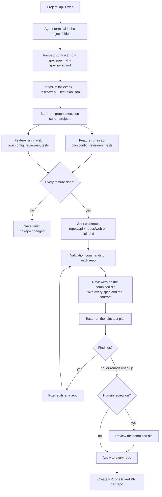

# Multi-repo runs: graph-manager projects, one suite across repos, a joint verification

## Problem

Today a run, and a suite, lives in one git repository. A change that spans repositories, for example an API in one repo and the client that calls it in another, has to be split into separate runs by hand. Nothing checks the two halves against each other: each repo is reviewed and tested alone, and a mismatch between them is found only after both PRs are merged.

In graph-manager, an agent terminal is tied to one workspace, so the agent can't read or plan across repos either.

Separately:

- Suites ignore custom reviewers: `packages/graph-execution/src/suite/spawn.ts:38` blanks `GRAPH_EXECUTION_REVIEWERS` for every feature run, and the e2e phase always uses the built-in reviewers. A reviewer added on graph-manager's Reviewers page never runs in a suite.
- On a wide screen, the Settings, Reviewers and Runs pages stop at a fixed width and leave the right side of the window empty.
- graph-manager's browser tab has no icon.

## Goals

Ids are not Jira tickets; the work was agreed with the user in conversation.

1. **MR-01** Projects in graph-manager: a saved, named group of workspaces from one forge, with its own folder.
2. **MR-02** An agent terminal on a project: the agent works in the project folder and sees every repo of the project.
3. **MR-03** Project mode in the `to-spec`, `to-tasks` and `run-graph` skills: a contract, one spec per repo, one task folder per repo and a joint test plan.
4. **MR-04** A multi-repo suite in the engine: `graph-execution suite --project <dir>` runs one feature per repo, in parallel, each in its own repo with its own config and reviewers.
5. **MR-05** A joint phase after the features: every repo's validation commands, the reviewers on the combined diff of all repos, the tester on the joint test plan, and a fixer that can edit any repo.
6. **MR-06** All or nothing: no repo is changed until every feature and the joint phase have passed (and the human review, when it is on). Then every repo gets its changes in one apply.
7. **MR-07** Custom reviewers in every suite, single-repo and multi-repo: the feature runs and the e2e or joint phase use the same reviewers file as a run.
8. **MR-08** graph-manager runs a project: Start run, the Runs list, the run page, resume, sandboxes and the human review.
9. **MR-09** Create PR on a project run opens one linked PR per changed repo, each with its spec and the contract.
10. **MR-10** Settings, Reviewers and Runs use the full width of the main area.
11. **MR-11** A graph-manager favicon in the browser tab.

## Workflow



## Decisions

| Decision | Why |
| --- | --- |
| Extend the suite rather than build a new kind of graph. A multi-repo run is a suite whose features live in different repos, followed by a joint phase in place of the git merge. | The suite already runs child runs in parallel, then a shared review phase, then one apply, on one page. Only the merge step means nothing across repos. |
| Repos are coupled through a contract written into the specs, not through task dependencies across repos. A task in one repo never sees another repo's unfinished code. | The user chose "contract is enough". Each repo's feature run stays a normal run, and the engine needs no cross-repo scheduler. |
| Exactly one feature per repo in a multi-repo run. | The user chose it. There is no merge step and no integration agent in a multi-repo run. |
| One spec per repo plus one contract. Each repo's feature run gets its own spec with the contract appended. The joint reviewers get every spec and the contract. | The user chose it. A repo's agents read only what concerns them plus the shared interface, and the joint reviewers see the whole change. |
| The spec, contract, task folders, test plan and run state live in a project folder outside every repo. | The user chose it. No repo's history carries another repo's plan. |
| The project folder is `<workspacesDir>/.projects/<id>/`. It is a git repo that graph-manager creates with `git init`, and it never gets a remote. It holds `project.json`, and `repos/<name>` links to each workspace (a symlink, or a junction on Windows). | The engine's run machinery (`.graph-execution/`, locks, `list`, `clean`, `open`) assumes a git repo as its home. A dot folder is skipped by `listWorkspaces`, so a project is never mistaken for a workspace. The links let the agent and the test plan reach every repo at `repos/<name>`. |
| The engine reads the project from a manifest file, `project.json`, not from a three-part `--feature` flag. | `--feature` already splits on the last `:`, and a third Windows path with a drive letter can't be split reliably. The file is also what graph-manager writes and what a CLI user writes by hand. |
| The file layout of a project is fixed: `contract.md`, `specs/<repo>.md`, `tasks/<repo>/` and `test-plan.json`. | The skills, the engine and graph-manager agree without extra flags. A repo with no `tasks/<repo>/` folder is not changed, but it is still checked out in the joint phase. |
| Each feature run starts in its repo with that repo's `graph-execution.config.json` (when it exists), so it runs that repo's validation commands, reviewers' repo files and test plan. The suite's own settings (concurrency, `e2eReview`, `validationRounds`) come from the project folder's config. | The user asked for each repo's own validation, based on each repo's config. |
| The joint phase runs in `<suiteDir>/worktrees/joint/`, which holds one worktree per repo at `repos/<name>/`, on branch `suite/<rid>` in that repo. | The same layout as the project folder, so a joint test plan command such as `cd repos/web && npm run e2e` works in both places. |
| In the combined diff, every file path is prefixed with its repo name: `api/src/routes.ts`. The same paths are used by the reviewers' findings, the run page, the human review comments and `reviewFiles`. | One diff format covers every consumer, and a finding always names its repo. |
| The joint phase runs every enabled reviewer, including the code reviewer. | The user changed their mind on excluding it. No new reviewer setting is needed. |
| A reviewer's `repoFile` is read from each repo that has it. In the joint phase the texts are joined under `## <repo>` headings. | A repo's review rules still apply to its part of the combined diff. |
| Suites pass the reviewers file to their feature runs and use it in the e2e or joint phase. The suite keeps a copy in `<suiteDir>/reviewers.json` for `--resume`. | The user asked for custom reviewers to work in suites as well. A run already keeps its copy the same way (`runner/run.ts:171`). |
| All or nothing: a failed feature fails the suite, and no repo is changed. Once the joint phase passes, every repo is applied. | The user chose it. A half-applied cross-repo change is worse than none. |
| Create PR on a project run opens one PR per changed repo with a single button. Each PR body links the others, and each commit adds that repo's spec as `docs/prd/done/<project>.md` and the contract as `docs/prd/done/<project>-contract.md`. | The user chose "one PR per repo, spec copied into each". Each repo keeps the record of why it changed. |
| A project's workspaces must all come from one forge connection. | The user's only non-goal. One token opens every PR. |
| A project's id goes wherever a workspace id goes in graph-manager's routes, as `project~<id>`. | The run list, run detail, run-page proxy, resume and Create PR then need a resolver change, not a second set of routes. Forges are only `github` and `gitlab`, so `project` can't clash with a workspace id. |
| Drop the `max-width` of `.settings-page`, `.reviewers-page` and `.runs-page`. | The user asked for full-width content on large screens. |
| The favicon is the existing `logo` mark from `ui/Icon.tsx` as a static SVG, with a `prefers-color-scheme` rule for dark browser chrome. | The user asked for the graph-manager icon. A static file needs no build step and no login. |

## Non-goals

- Repos from different forges, or from two connections of one forge, in one project.
- Several features in one repo within a multi-repo run.
- Task dependencies across repos, or a task that reads another repo's unfinished code.
- A per-reviewer switch for the joint phase.
- Pushing the project folder anywhere. It is local to the graph-manager deployment.
- Changing how a single-repo suite merges its features.

## User stories

- As a graph-manager user, I create a project named `billing` from the workspaces `github~acme~api` and `github~acme~web`, and it shows on a Projects page.
- As a graph-manager user, I open Claude Code on the `billing` project. The agent starts in the project folder, sees `repos/api` and `repos/web`, and we plan the change together.
- As that agent, I write `contract.md`, `specs/api.md` and `specs/web.md` with `to-spec`, then `tasks/api/`, `tasks/web/` and a joint `test-plan.json` with `to-tasks`, then open the Start run drawer with `open_start_run`.
- As a graph-manager user, I start the project run and watch one page: a box per repo, then the joint phase with each repo's validation, the reviewers and the tester.
- As a graph-manager user whose `web` feature failed, I see the suite failed and find both repos unchanged. I retry the feature from the page or resume the suite.
- As a graph-manager user, I review the combined diff of both repos with human review on, comment on `web/src/client.ts`, and request changes.
- As a graph-manager user, I press Create PR once and get one PR in `acme/api` and one in `acme/web`, each linking the other.
- As a graph-manager user, I add a security reviewer on the Reviewers page, and it runs in my suites as well as my runs.
- As a CLI user without graph-manager, I write `project.json` by hand and run `graph-execution suite --project . --provider claude --web`.
- As a user on a 2560px screen, I see the Runs table, the Reviewers list and Settings use the whole main area.
- As a user with many tabs open, I find graph-manager by its icon.

## Requirements

### Engine: the project manifest (MR-04)

- `project.json` in the project folder (the suite's home, a git repo):

  ```json
  {
    "name": "billing",
    "repos": [
      { "name": "api", "path": "repos/api" },
      { "name": "web", "path": "repos/web" }
    ]
  }
  ```

  - `name`: `[A-Za-z0-9_-]+`, used in branch-free places only (PR file names, page titles).
  - `repos`: at least 2 entries. Each `name` is unique and matches `[A-Za-z0-9_-]+`. Each `path` is relative to the project folder or absolute, and must resolve to the root of a git checkout. Two entries may not resolve to the same repo.
- The layout around it is fixed: `contract.md` (required), `specs/<name>.md` and `tasks/<name>/` per repo, and an optional `test-plan.json` (the format of `graph/testPlan.ts`).
- A repo with a `tasks/<name>/` folder is a feature and needs `specs/<name>.md`. A repo without one is not changed but is still checked out in the joint phase. At least one repo must have tasks.
- Parse and validate it in a new `packages/graph-execution/src/suite/project.ts` with zod. Every problem is reported at once, in the style of `GraphError` (`graph/errors.ts`), and the CLI exits 2 with them.

### Engine: the multi-repo suite (MR-04, MR-06)

- CLI: `graph-execution suite --project <dir> --provider <name> [--concurrency n] [--model m] [--no-merge] [--human-review|--no-human-review] [--reviewers <file>] [--web]`. `--project` and `--feature` exclude each other (exit 2: `--project takes no --feature`). `suite --resume` works for both kinds.
- `suite.json` (`suite/state.ts`) gains:
  - `project?: { dir, name, contract }`, set only for a multi-repo suite;
  - per feature, `repo?: { name, path, startingCommit, startBranch? }`;
  - `repos?: { name, path, startingCommit, startBranch?, applied? }[]`, for every repo of the project, features or not.

  The existing fields keep their meaning for single-repo suites. Every new field is optional, so an existing `suite.json` still loads.
- Preflight, before anything starts: every repo is a clean checkout (`.graph-execution/` ignored) on a branch, unless `--no-merge` is given, and has a git identity. Every feature passes the existing `preflight` with `cwd` set to its repo. A failure names the repo: `api: working tree has uncommitted changes`.
- The suite dir is `<project>/.graph-execution/suite-<id>/`. Feature runs keep their folders under `features/<run-id>/` (through `RUNS_ROOT_ENV`, as today) but run with `cwd` set to their repo. They therefore load that repo's `graph-execution.config.json`, create their worktrees and branches in that repo, and read its reviewers' repo files.
- A feature's spec is the file `<suiteDir>/specs/<name>.md`: `specs/<name>.md`, then `## Contract`, then `contract.md`. It is written when the suite starts.
- No merge step. Once every feature is `done`, each feature run's integration branch becomes `suite/<rid>` in its repo. A repo with no feature gets `suite/<rid>` at its `startingCommit`.
- A feature that fails, or is stopped, ends the suite as `failed` (in a web suite, after the page's retry options, as for a feature in a single-repo suite today). No repo's checkout is touched.

### Engine: the joint phase (MR-05)

- `<suiteDir>/worktrees/joint/repos/<name>/` is a worktree of each repo on `suite/<rid>`. The fixer, the reviewers and the tester run with `cwd` set to `<suiteDir>/worktrees/joint/`.
- The phase reuses `runReviewPhase` (`review/phase.ts`) through the same entry as the single-repo e2e phase (`suite/e2e.ts`), with a multi-repo workspace in place of the single worktree:
  - **Diff**: each repo's `rangeChanges` from its `startingCommit` to its `suite/<rid>`, with paths prefixed by `<name>/`. The per-file diff reads from the right repo.
  - **Spec**: `<suiteDir>/joint/spec.md`, holding `# Contract` then `# Repo <name>` with each spec.
  - **Test plan**: the project's `test-plan.json`. When it has none, the tester reports "live test not performed: the project has no test-plan.json".
  - **Validation**: each repo's `validation` commands from its own config, run in its joint worktree. Every repo's commands run after every fix pass. A failure names the repo and command.
  - **Fixer**: it may edit any repo under `repos/`. After it ends, leftovers are committed in each joint worktree that changed (`commitLeftovers`), with the same message in each.
  - **`reviewFiles`**: every changed file of every repo, prefixed.
- `e2eReview: false` in the project's config keeps only the validation, as in a single-repo suite.

### Engine: apply, resume and the other commands (MR-06)

- Once the joint phase (and the human review, when it is on) passes, each repo is applied with `applyToCheckout(repo, startBranch, "suite/<rid>")`. The repos are applied one after another, and `repos[i].applied` is recorded after each one. The suite becomes `applied` when every repo is, with its conflicts listed per repo.
- `--no-merge`, a detached HEAD in any repo, or a code review that was not performed leave every repo's result on `suite/<rid>`, and nothing is applied. The final log names each repo's branch.
- `suite --resume` restarts the unfinished features in their repos and continues the joint phase or the apply where it stopped. It never applies a repo twice.
- `list` shows a multi-repo suite as one line with its repo names. `clean <suite-id>` also removes each repo's `suite/<rid>` branch, its joint worktree, and the feature runs' branches and worktrees in their repos.
- `open --run suite-<id>` works from the project folder.

### Engine: custom reviewers in suites (MR-07)

- `suite` takes `--reviewers <file>` and otherwise reads a non-empty `GRAPH_EXECUTION_REVIEWERS` (`reviewersFileOf`, `review/reviewers.ts:174`). It validates the file at start (exit 2 on an invalid file) and copies it to `<suiteDir>/reviewers.json`. Without either, nothing is copied and the built-ins apply, as today.
- Feature runs are spawned with `--reviewers <suiteDir>/reviewers.json` when the copy exists. Remove the blanking at `suite/spawn.ts:38`, but keep `GRAPH_EXECUTION_REVIEWERS` empty in the child's env, so that only the copy counts.
- The e2e phase (single-repo) and the joint phase (multi-repo) run the copy's enabled reviewers (`readRunReviewers` on the suite dir), else the built-ins. Their repo files are read from the integration worktree, or from each joint worktree joined under `## <name>` headings.
- `--resume` uses the copy, never a newer file.
- The suite page draws the e2e or joint phase's reviewers as nodes, named and ordered as on a run's page (`reviewerNode`).

### Engine: the suite page (MR-04, MR-05)

- In a multi-repo suite, each feature box is titled with its repo name, and there are no merge nodes. A repo with no feature is drawn as a small box marked `unchanged`. The joint phase node is labelled `Joint review` and lists each repo's validation result.
- Diffs on the page, in the joint phase and in the human review, use the prefixed paths. A file tree groups them by repo.
- The human review (`--human-review`) works on the combined diff. A comment's path carries its repo prefix, and the fixer is told which repo it is in.

### graph-manager: projects (MR-01)

- Store (`server/store.ts`): `projects: Record<id, { name, workspaces: string[], createdAt }>`. The id is the name's slug (`[a-z0-9-]+`), and it is unique.
- Routes, behind login:
  - `GET /api/projects` returns `[{ id, name, workspaces: [{ id, fullPath }], path }]`.
  - `POST /api/projects { name, workspaces }`: 400 for fewer than 2 workspaces, a workspace from another forge (`all workspaces of a project must come from one forge`) or a bad name; 404 for an unknown workspace; 409 for a name in use.
  - `PATCH /api/projects/:id { workspaces }` adds or removes repos and rewrites `project.json` and the links. It returns 409 while a run of the project is live.
  - `DELETE /api/projects/:id` removes the record and the project folder, never a workspace. It returns 409 while a run is live.
- Creating a project writes `<workspacesDir>/.projects/<id>/`: `git init`, `project.json`, `repos/<repo>` links (`fs.symlink(target, path, "junction")` on Windows), and a `.gitignore` holding `repos/` and `.graph-execution/`, then a first commit. Each link is named after the repo's last path segment, with `-2` added on a clash.
- `DELETE /api/workspaces/:id` returns 409 `workspace is part of project <name>` while a project uses it.
- A Projects page (nav item **Projects**, after Workspaces) lists projects with their repos. It has **New project** (a dialog: name, then a multi-select of workspaces, filtered to the forge of the first one picked), **Edit repos**, **Delete** and **Open terminal** (the agent buttons). The look follows `pages/Workspaces.tsx` and the design tokens.

### graph-manager: terminals and tools (MR-02)

- `POST /api/terminals` accepts `projectId` instead of `workspaceId`. The cwd is the project folder, the title is the project name, the env gets `GM_PROJECT_ID`, and agent buttons work with it (`routes/terminals.ts:59` accepts a project). Qwen Code's committed `.qwen/settings.json` goes into the project folder's own git repo.
- `open_start_run` (`server/tools/open-start-run.ts`), called from a project terminal, opens the project's Start run drawer. Its `tasksDir` and `spec` inputs are ignored there; a new optional `project: true` makes it explicit.

### graph-manager: runs of a project (MR-08)

- Everywhere a workspace id is resolved for runs (`listRuns`, `GET /api/runs/:ws/:runId`, `POST /api/runs/:ws`, the run-page proxy `/runs/<ws>/<runId>/view/`, resume, Create PR, sandboxes), `project~<id>` resolves to the project folder. Add one resolver next to `resolveWorkspace` and use it in those places.
- `RunSummary` gains `project?: { id, name, repos: string[] }`. The Runs list shows a project's runs with a project chip and the repo names, and the workspace filter lists projects after workspaces.
- The Start run drawer for a project shows the repos, with a check per repo for `specs/<name>.md` and `tasks/<name>/`, and for `contract.md` and `test-plan.json`. It has the usual provider, run options, human review and sandbox controls. It starts `graph-execution suite --project . --provider <p> --web …` in the project folder. The reviewers file is passed as for any run.
- A sandboxed project run mounts the project folder and every repo of the project, each at its path under `/workspaces`, so the `repos/` links resolve inside the container (`sandbox.ts:611` mounts one workspace today).

### graph-manager: Create PR for a project run (MR-09)

- One **Create PR** button on an applied project run. For each repo that the apply changed, in `project.json` order:
  1. create branch `gm/<runId>`;
  2. copy `specs/<name>.md` to `docs/prd/done/<project>.md` and `contract.md` to `docs/prd/done/<project>-contract.md`;
  3. commit and push;
  4. open the PR with the title and body graph-manager uses today, plus a `Related PRs` section;
  5. switch back to the original branch.
- Once every PR is open, each PR body is updated to link all the others.
- PRs are stored as `${projectId}/${runId}/${repo}` in `prs`. When one repo fails, the panel shows the error for that repo, and pressing the button again opens only the missing PRs.
- `PrPanel` lists one row per repo: repo, PR link, state.

### Skills (MR-03)

- `to-spec`, `to-tasks` and `run-graph` (`packages/graph-execution/skills/`, and the repo copies in `.claude/skills/` and `.agents/skills/`) gain a **project mode**, used when the cwd holds `project.json`:
  - `to-spec` writes `contract.md` first (the APIs, schemas or messages between the repos), then `specs/<name>.md` for each repo that changes. It asks for approval of all of them together.
  - `to-tasks` writes `tasks/<name>/` per repo and a joint `test-plan.json` whose commands run from the project root and reach repos through `repos/<name>`. The validator runs once per task folder.
  - `run-graph` starts `graph-execution suite --project . --provider <name> --web`, or calls `open_start_run` when it is available.
- In project mode the skills commit to the project folder's own repo, not to the repos.

### graph-manager UI fixes (MR-10, MR-11)

- Remove `max-width` from `.settings-page` (`pages/Settings.css:2`), `.reviewers-page` (`pages/Reviewers.css:2`) and `.runs-page` (`pages/Runs.css:2`). Check that no child of those pages keeps a narrower cap that leaves the right side empty. Forms and cards inside may keep their own widths where a full-width line would be hard to read.
- Add `apps/graph-manager/src/web/public/favicon.svg`: the `logo` mark of `ui/Icon.tsx` with fixed colors (`#16171a` square, `#ffffff` graph; `#ecedef` and `#16181b` under `@media (prefers-color-scheme: dark)`). Add `<link rel="icon" type="image/svg+xml" href="/favicon.svg" />` to `src/web/index.html`. It is served without login, and in the Docker image and the npm package.

### Docs

- Engine README: a **Multi-repo suites** section under Suites, with `project.json`, the layout and the CLI. Also add `--reviewers` to the suite usage, and remove "Suites keep the built-in reviewers".
- graph-manager README: Projects, project terminals, project runs and Create PR.
- `docs/wiki/features/multi-repo.md` with the decision table, follow-ups and code references, linked from `docs/wiki/index.md`.

## Acceptance criteria

### Engine

- [ ] `graph-execution suite --project <dir>` with a `project.json` naming one repo exits 2 and prints `repos: at least 2 repos`. With a dirty repo, it exits 2 and prints `api: working tree has uncommitted changes`.
- [ ] `--project` together with `--feature` exits 2 with `--project takes no --feature`.
- [ ] With `--provider fake` and a project of two repos with tasks: each repo gets a feature run whose worktrees and branches are in that repo, then `suite/<rid>` in both repos and a joint worktree at `<suiteDir>/worktrees/joint/repos/<name>/`.
- [ ] Each feature run uses its repo's `graph-execution.config.json`: a validation command that exists in only one repo's config runs only in that repo's feature run, and in that repo's joint worktree.
- [ ] Each feature run's spec contains its repo's spec and the contract. The joint reviewers' spec contains the contract and both repos' specs.
- [ ] The joint reviewers' diff lists files as `api/…` and `web/…`.
- [ ] The tester runs the project's `test-plan.json` from the joint folder, and a command `cd repos/web && …` works there.
- [ ] When one feature fails, the suite is `failed`, and `git status` is clean in both repos on their starting branches.
- [ ] After a passing joint phase, both repos have the suite's changes as uncommitted changes, and `suite.json` records `applied` per repo.
- [ ] `suite --resume` after a stop in the joint phase continues there and applies each repo once.
- [ ] `graph-execution list` shows the multi-repo suite as one line with `api, web`. `clean <suite-id>` removes the `suite/<rid>` branches and the worktrees in both repos.
- [ ] A single-repo suite with `--reviewers <file>` naming a custom reviewer `security` runs `security` in each feature run and in the e2e phase. `suite.json`'s folder holds `reviewers.json`, and the suite page shows a `security` node in the e2e phase.
- [ ] A single-repo suite without `--reviewers` and without `GRAPH_EXECUTION_REVIEWERS` behaves as today (code reviewer and tester).
- [ ] Every existing suite test still passes.

### graph-manager

- [ ] `POST /api/projects` with one workspace returns 400. With a GitHub and a GitLab workspace, it returns 400 `all workspaces of a project must come from one forge`. With two GitHub workspaces, it returns 201, and `<workspacesDir>/.projects/<id>/project.json` and `repos/<repo>` exist.
- [ ] `DELETE /api/workspaces/:id` of a workspace in a project returns 409.
- [ ] The Projects page lists a project with its repos, and its Claude Code button opens a terminal whose cwd is the project folder, titled with the project name.
- [ ] `open_start_run` from a project terminal opens the project's Start run drawer, which shows both repos with their checks.
- [ ] A started project run shows in the Runs list with a project chip and both repo names. Its detail page proxies the suite page.
- [ ] A sandboxed project run can read both repos through `repos/` inside the container.
- [ ] Create PR on an applied project run opens one PR per changed repo. Each PR adds `docs/prd/done/<project>.md` and `docs/prd/done/<project>-contract.md`, and its body links the other PR. A second press after a failure in one repo opens only that repo's PR.
- [ ] At a 2560px wide window, the Runs table, the Reviewers list and the Settings content reach the right edge of the main area, minus the page padding.
- [ ] `GET /favicon.svg` returns 200 with `image/svg+xml` without a session, and the tab shows the logo.

### Checks

- [ ] `npm run typecheck && npm run lint && npm test` pass.
