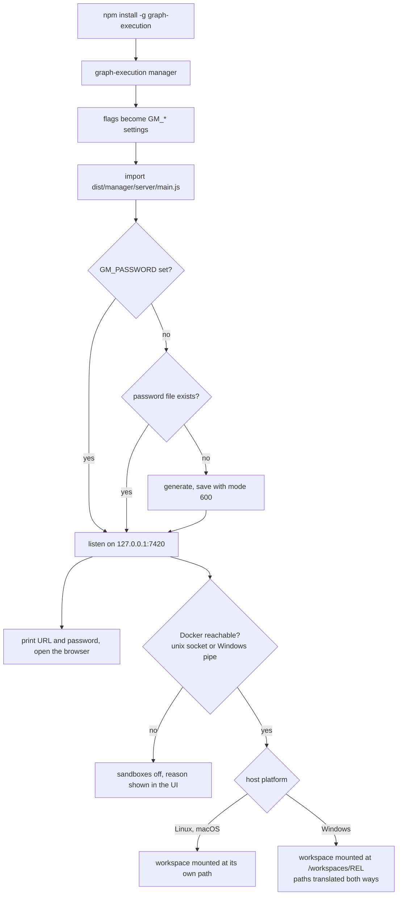

# graph-manager from npm: `graph-execution manager`

## Problem

graph-manager (the web service in `apps/graph-manager`) can only be run by cloning this repository: either `docker compose up --build` from the checkout, or `npm run build` and `npm start -w graph-manager`. The published npm package `graph-execution` contains only the engine. Someone who installed the engine from npm has no way to get the manager without the repository.

Three more things stand in the way of a plain local start:

- The server exits with `GM_PASSWORD is required` unless a password is set in the environment.
- On Windows the manager starts but its terminals have no `graph-execution` command and no agent tools, because both shims are POSIX shell scripts that are not written on `win32`.
- Sandboxed runs talk to Docker only through `/var/run/docker.sock` and mount the workspace at its host path. That path does not exist as a socket on Windows or on a default Docker Desktop for macOS, and a Windows path cannot be a mount target in a Linux container. The README also contradicts itself about macOS (line 104 says it works, line 195 says it is not supported).

## Goals

1. `npm install -g graph-execution` followed by `graph-execution manager` starts graph-manager, with no clone and no Docker needed for the manager itself.
2. The manager ships **inside the `graph-execution` npm package** (one package, the user's choice).
3. A local start needs no configuration: a password is generated once, saved, and printed with the URL.
4. The manager's terminals work on Windows: the `graph-execution` command and the agent tools shim exist there.
5. Sandboxed runs work wherever Docker with Linux containers runs: Linux, macOS (Docker Desktop and compatible) and Windows (Docker Desktop), for a manager started from npm.
6. The Docker image and the compose file keep working, built from the same code.

No Jira ticket.

## Flow

## Decisions

| Decision | Why |
| --- | --- |
| One npm package. The manager's built files are copied into the engine package at `dist/manager/` (`dist/manager/server/*.js`, `dist/manager/web/*`, `dist/manager/package.json`). | The user chose one package over a separate `graph-manager` package. |
| The manager's source stays in `apps/graph-manager` (still `private`, still its own workspace with its own tests). A script, `packages/graph-execution/scripts/bundle-manager.mjs`, copies `apps/graph-manager/dist` into `packages/graph-execution/dist/manager`. | Moving 30 000 lines into the engine's source tree would be a large, conflict-prone change with no benefit to users. The engine's source still imports nothing from the manager. |
| The manager keeps importing `graph-execution/api`. From `node_modules/graph-execution/dist/manager/server` this resolves through the normal `node_modules` lookup to the package itself (checked in the workspace and in an installed tarball). | No import has to be rewritten, and the same compiled files work in the workspace, in the Docker image and in `node_modules`. It would fail only if the package folder were not `node_modules/graph-execution`, which npm never does. |
| The sandbox tools copy of the engine (`copyEngine` in `sandbox-tools.ts`) leaves out `dist/manager` and the manager-only dependencies. | A sandbox only runs the engine; node-pty and the manager would add about 70 MB of host-built files to every tools folder. |
| `graph-execution manager` removes a `NODE_ENV=production` that the CLI itself defaulted before it loads the manager. | The engine's `env.ts` defaults `NODE_ENV`; terminals inherit the manager's environment, and `npm install` in a terminal would silently skip devDependencies. |
| The manager's server dependencies (`fastify`, `@fastify/cookie`, `@fastify/static`, `@fastify/websocket`, `node-pty`) become `dependencies` of `graph-execution`. The web UI's dependencies do not: Vite bundles them into `dist/manager/web`. | The server files are plain compiled TypeScript that import these at runtime. |
| `node-pty` is a hard dependency. | The user chose it over an optional dependency. Consequence, stated in the README: on a platform without a node-pty prebuild (Linux), `npm install graph-execution` needs Python, make and a C++ compiler. |
| No `postinstall` script in the published package. The macOS `spawn-helper` chmod that `apps/graph-manager/package.json` does at postinstall also runs when the manager starts. | Install scripts in a published package are often disabled (`--ignore-scripts`) and are a supply-chain concern. |
| The command is `graph-execution manager`. | The user chose it. `run` could be read as "run a task folder", which the bare command does. |
| `graph-execution manager` takes `--port`, `--host`, `--data-dir`, `--workspaces-dir` and `--no-open`. Each flag overrides the matching `GM_*` variable; everything else is still set through `GM_*`. | The four settings a local user changes. One source of truth (`loadConfig`) stays. |
| Without `GM_PASSWORD`, the password is read from `<dataDir>/password`; when that file is missing, 24 random bytes (base64url) are generated and saved there with mode `0600`. `GM_PASSWORD` always wins and is never written to the file. This applies to every start, also `npm start` and Docker. | The user chose "generate and save one". One rule everywhere is simpler than a rule per entry point. |
| At startup the manager prints the URL, then `Password: <password> (saved in <file>)` when it comes from the file, or `Password: from GM_PASSWORD` when it comes from the environment. | A local user needs it to log in. A password set by the operator is not echoed into logs. |
| `graph-execution manager` opens the browser at the URL once the server listens, unless `--no-open`, `GRAPH_EXECUTION_NO_OPEN=1` (new), an SSH session (`SSH_CONNECTION` or `SSH_TTY`, the rule `--web` uses), or no TTY. | A server start in a script or over SSH must not try to open a browser. |
| When `dist/manager` is missing (a workspace build that didn't run the bundle step), `graph-execution manager` exits 2 with `error: graph-manager is not part of this build: run npm run build at the repository root`. | A clear message instead of a module-not-found stack. |
| The root `npm run build` builds the engine, then the manager, then bundles. The engine's `prepublishOnly` does the same, so a published tarball always contains `dist/manager`. | The manager's build needs the engine's `dist` for types, so the order is fixed. |
| The Docker image is built the same way and starts `node /app/packages/graph-execution/dist/cli.js manager`. | One code path for both ways of running. |
| `GM_VERSION` (used in sandbox image tags and the tools version) is read from `dist/manager/package.json` when bundled, and from `apps/graph-manager/package.json` in the workspace; the bundle step writes the engine's version into the copied file. | `../../package.json` relative to `dist/manager/server` does not exist in the bundle. In the published package the manager's version is the package's version. |
| On Windows the shims are `.cmd` files next to the POSIX ones: `graph-execution.cmd` and `graph-manager-mcp.cmd` in `<dataDir>/bin`. | PowerShell and cmd find `.cmd` files on `PATH`. |
| The Docker endpoint is: `GM_DOCKER_SOCKET`; else `DOCKER_HOST` when it is `unix://…` or `npipe://…`; else on Windows `//./pipe/docker_engine`; else the first existing of `/var/run/docker.sock`, `~/.docker/run/docker.sock`, `~/.docker/desktop/docker.sock`, and `/var/run/docker.sock` when none exists. | Docker Desktop for macOS no longer always creates `/var/run/docker.sock`; Windows uses a named pipe. `node:http`'s `socketPath` accepts a named pipe, so the client itself barely changes. |
| `tcp://` and `ssh://` values of `DOCKER_HOST` are ignored (the next rule applies). | A remote daemon can't see the workspace folder. |
| On Linux and macOS a sandbox mounts the workspace at its own absolute path, as today. | It works: Docker Desktop for macOS shares `/Users`, and the run page is already reached through a published port. |
| On Windows a sandbox mounts the workspace at `/workspaces/<rel>` (`rel` with `/`). Every path the manager hands to the container (working directory, run folder, ready file, reviewers file, absolute path arguments under the workspace) is translated to that form, and paths the manager reads back from a sandboxed run's `state.json` (`tasksDir`, `specPath`) are translated back. | A Windows path can't be a mount target in a Linux container. Mapping at the manager's edge keeps the engine unchanged. |
| On Windows the container runs as `1000:1000`, with git settings passed as `GIT_CONFIG_COUNT`/`GIT_CONFIG_KEY_n`/`GIT_CONFIG_VALUE_n`: `safe.directory=*`, `core.filemode=false`, and `core.autocrlf` set to the workspace's effective value on the host. | `stat` on Windows reports uid 0, and provider CLIs refuse to run unattended as root. Docker Desktop shows mounted Windows files as owned by another user (git's "dubious ownership") and as executable, and git for Windows usually has `autocrlf=true` in a config file the container can't see, which would make every file look modified. |
| Sandboxes need Linux containers. When Docker's `/info` reports `OSType` other than `linux`, sandboxes are off with the reason `Docker is running Windows containers: switch Docker Desktop to Linux containers`. | The sandbox images are Linux images. |
| The engine CLI keeps refusing `--sandbox` outside a graph-manager terminal. | Unchanged: only the manager talks to Docker. |
| macOS and Windows behaviour is covered by unit tests with an injected platform, by the fake Docker daemon, and by CI on macOS and Windows. It is not run against a real Docker Desktop in this change. | The run happens on Linux. The README says which combinations were exercised only by tests. |

## Non-goals

- A separate `graph-manager` npm package, or publishing to npm from CI.
- Moving the manager's source into `packages/graph-execution/src`.
- Making `node-pty` optional.
- Sandboxed terminals, sandboxed `suite` runs, egress filtering, rootless Docker, Podman, Windows containers, a remote Docker daemon (`tcp://`, `ssh://`).
- Sandboxes for the plain engine CLI without the manager.
- Changing how the manager installs the engine's skills into `~/.claude/skills` and `~/.agents/skills` at startup.
- A desktop wrapper, a system service, or auto-update.

## User stories

- As a new user, I run `npm install -g graph-execution` and `graph-execution manager`, my browser opens the login page, and I log in with the password printed in my terminal.
- As a returning user, I start `graph-execution manager` again and the same password still works.
- As an operator, I set `GM_PASSWORD` and `GM_HOST=0.0.0.0`, and the manager uses my password and never prints it.
- As a Windows user, I open a terminal in the manager and `graph-execution --version` works, and an agent started there has the graph-manager tools.
- As a macOS or Windows user with Docker Desktop running, **Run in sandbox** is enabled without setting any variable, and a sandboxed run starts, shows its live page, and applies its result to my workspace.
- As a user without Docker, the manager starts normally and **Run in sandbox** is disabled with the reason.
- As someone deploying on a server, `docker compose up --build` in `apps/graph-manager` still gives me the manager.

## Requirements

### Packaging (`packages/graph-execution`)

- `scripts/bundle-manager.mjs`: removes `dist/manager/server`, `dist/manager/web` and `dist/manager/package.json` (not the whole folder: the engine's own `src/manager/*.ts` compiles into `dist/manager/`), copies `apps/graph-manager/dist/server` and `dist/web` into it (no `*.test.*`, no `*.map` requirement), and writes `dist/manager/package.json` as `{ "name": "graph-manager", "version": <engine version>, "type": "module", "private": true }`. Exits 1 with `apps/graph-manager/dist is missing: build graph-manager first` when the source is missing.
- `package.json`: new `dependencies` `fastify`, `@fastify/cookie`, `@fastify/static`, `@fastify/websocket`, `node-pty` at the versions `apps/graph-manager/package.json` uses. A script `bundle:manager` runs the bundle script. `prepublishOnly` becomes: typecheck, lint, test, then the root build (engine, manager, bundle). `files` stays `dist`, `skills`, `README.md`.
- Root `package.json`: `build` runs `npm run build -w graph-execution && npm run build -w graph-manager && npm run bundle:manager -w graph-execution`. The root `typecheck` runs the root build first, and the engine's `vitest.global-setup.ts` bundles after its own build when `apps/graph-manager/dist` exists, so CI exercises the bundle tests.
- A test asserts that every bare module specifier imported by a file under `apps/graph-manager/src/server` (not tests) is `graph-execution/api`, a `node:` builtin, or a key of the engine's `dependencies`.
- A test packs the engine (`npm pack --dry-run --json`, after the root build) and asserts the tarball lists `dist/manager/server/main.js`, `dist/manager/web/index.html` and `dist/manager/package.json`, and no `*.test.js`.
- The engine's own tests must not depend on the manager being built, except tests that say so and skip when `dist/manager` is missing.

### `graph-execution manager` (`packages/graph-execution/src/cli.ts` and a new `src/manager/` folder)

- A subcommand `manager` with description `Start graph-manager, the web app for workspaces, terminals and runs`, and options `--port <n>`, `--host <host>`, `--data-dir <dir>`, `--workspaces-dir <dir>`, `--no-open`.
- It sets `GM_PORT`, `GM_HOST`, `GM_DATA_DIR`, `GM_WORKSPACES_DIR` from the flags, sets `GM_GRAPH_EXECUTION_BIN` to its own `dist/cli.js` when that variable is unset, then loads `dist/manager/server/main.js` through a computed `import()` (the engine has no compile-time import of manager code).
- `main.js` exports `startManager(env): Promise<{ url: string; close(): Promise<void> }>` and still starts the server when run directly (`node dist/server/main.js`).
- The process stays in the foreground until SIGINT or SIGTERM, then exits 0.
- A port in use exits 1 with `port <n> is already in use: pass --port or set GM_PORT`.
- `graph-execution --help` lists `manager`. `graph-execution manager --help` lists the five options. The root `--web` / `--web-serve` rule for subcommands is unchanged.

### Password (`apps/graph-manager/src/server`)

- A new module `password.ts`: `resolvePassword(env, dataDir): Promise<{ password: string; source: "env" | "file"; file: string; created: boolean }>`. The file is `<dataDir>/password`, one line, mode `0600`, written through a temp file and rename. An empty or whitespace-only file is treated as missing.
- `loadConfig` no longer throws for a missing `GM_PASSWORD`; the server resolves the password after creating the data dir.
- Startup output, in this order:
  - `graph-manager listening on http://<host>:<port>`
  - `Password: <password> (saved in <file>)` or `Password: from GM_PASSWORD`
- The compose file keeps requiring `GM_PASSWORD` (a server deployment should set it).

### Windows terminals (`apps/graph-manager/src/server/terminals.ts`, `app.ts`, `sandbox-tools.ts`)

- `writeGraphExecutionShim` on `win32` writes `<binDir>\graph-execution.cmd`: `@echo off`, then `set "GM_ENGINE_BIN=<bin>"` (when the manager's shim is used) and `node "<shim or bin>" %*`. It returns true.
- `writeMcpShim` on `win32` writes `<binDir>\graph-manager-mcp.cmd` the same way.
- Both functions take the platform as an optional last parameter (default `process.platform`) so tests run on any OS. Paths containing `%` or `"` make the function return false (no shim) rather than write a broken file.
- The agent-tools configuration that names the MCP command uses `graph-manager-mcp.cmd` on `win32` where the consumer needs a file name.
- The POSIX output is byte-for-byte unchanged.

### Docker endpoint (`apps/graph-manager/src/server/config.ts`, `docker.ts`, `sandbox.ts`)

- `defaultDockerSocket(env, platform, exists)` implements the order in the decisions table. `Config.dockerSocket` gets its result.
- `unix:///path` becomes `/path`; `npipe:////./pipe/name` becomes `//./pipe/name`.
- `DockerClient` works with a named pipe path unchanged in behaviour; the "not reachable" reason names the endpoint it tried, and on `win32` and `darwin` ends with `; is Docker Desktop running?`.
- `DockerClient.info()` returns `/info`; `doInit` turns a non-`linux` `OSType` into the reason in the decisions table.
- `inspectSelf()` returns undefined on `win32` and `darwin` without calling Docker (the manager is never inside a Linux container there).

### Windows sandboxes (`apps/graph-manager/src/server/sandbox-run.ts`, `sandbox.ts`, `runs.ts`, `routes/runs.ts`, `routes/resume.ts`)

- A pure module `sandbox-paths.ts`:
  - `containerRoot(ws, platform)`: `ws.path` unless `win32`; on `win32`, `/workspaces/<ws.rel with "/">`.
  - `toContainer(ws, hostPath, platform)` and `toHost(ws, containerPath, platform)`: translate a path inside the workspace; a path outside it is returned unchanged; identity unless `win32`. Windows comparison ignores case and accepts both separators.
- `workspaceMount` on `win32` (no `self`, no override): `{ Type: "bind", Source: ws.path, Target: containerRoot(ws) }`.
- Translated to container form on `win32`: the container's `WorkingDir`, `GRAPH_EXECUTION_READY_FILE`, the reviewers file variable, and each engine argument that is an absolute path inside the workspace (the tasks folder, `--spec`, `--reviewers`). The manager keeps using host paths for its own file access (waiting for the ready file, writing the reviewers copy).
- Owner on `win32`: `1000:1000`. The `chown` calls stay best-effort.
- Git settings on `win32`, appended to the container `Env` as described in the decisions table. `core.autocrlf` comes from `git config --get core.autocrlf` run in the workspace; when unset, the variable is not passed.
- Reading a run for the UI or a PR: when the run has a sandbox record or its state marks it as sandboxed, `tasksDir` and `specPath` go through `toHost` before they are used.
- The sandbox tools folder on `win32`: `fillTools` writes the POSIX wrapper with `\n` line endings (unchanged content). The bind source is the Windows path of `<dataDir>\sandbox-tools`.
- All of this is selected by a `platform` value passed down from one place (default `process.platform`), so every branch is unit-testable on Linux. `scripts/fake-docker.mjs` is used for the start-to-ready path with `platform: "win32"` where it can run on any OS.

### Docker image (`apps/graph-manager/Dockerfile`, `docker-compose.yml`)

- The build stage runs the root `npm run build`; the final `CMD` is `["node", "/app/packages/graph-execution/dist/cli.js", "manager", "--no-open"]`. `GM_*` defaults in the image are unchanged. The compose file is unchanged apart from comments.

### Documentation

- `packages/graph-execution/README.md` and the root `README.md`: a section "graph-manager" with the two commands, the password line, the flags, the node-pty build-tools note, and a link to the manager README.
- `apps/graph-manager/README.md`: leads with `graph-execution manager`, then Docker. The env table gains the `DOCKER_HOST` and password-file behaviour. The sandbox section has a platform table (Linux, macOS, Windows: endpoint, mount path, what was tested how). Line 195's "not supported" entry for macOS is removed; the Windows shim limitation near line 305 is removed.
- `docs/wiki/features/npm-manager.md` with the decision table, follow-ups and code references, linked from `docs/wiki/index.md`. `docs/wiki/features/graph-manager.md` and `sandboxes.md` get a one-line pointer where a decision here supersedes theirs.
- `packages/graph-execution/CHANGELOG.md`: an entry for the new command.

## Acceptance criteria

- [ ] After `npm ci && npm run build` at the root, `packages/graph-execution/dist/manager/server/main.js`, `dist/manager/web/index.html` and `dist/manager/package.json` exist.
- [ ] `npm pack` of `packages/graph-execution`, installed with `npm install <tarball>` into an empty folder outside the repository, gives a `graph-execution` whose `manager --help` prints the five options and exits 0.
- [ ] From that install, `graph-execution manager --no-open --port 0 --data-dir <tmp>/d --workspaces-dir <tmp>/w` with no `GM_PASSWORD` prints `graph-manager listening on http://127.0.0.1:<port>` and `Password: <x> (saved in <tmp>/d/password)`; `GET /healthz` answers 200; `POST /api/auth/login` with `<x>` answers 204 and with a wrong password 401; `GET /` returns the UI's HTML.
- [ ] A second start with the same data dir prints the same password; the file's mode is `600` on POSIX.
- [ ] With `GM_PASSWORD=pw`, the output has `Password: from GM_PASSWORD`, no `password` file is created, and `pw` logs in.
- [ ] SIGINT ends the process with exit code 0.
- [ ] `graph-execution manager` in a build without `dist/manager` exits 2 with `graph-manager is not part of this build: run npm run build at the repository root`.
- [ ] `graph-execution list`, `graph-execution --version` and a `--provider fake` run behave as before, and none of them loads `fastify` or `node-pty`.
- [ ] In a terminal opened in the npm-installed manager on Linux, `graph-execution --version` prints the installed version.
- [ ] Unit tests cover, with an injected platform: the `.cmd` shims, `defaultDockerSocket` for each rule, the Windows mount and path translation, the Windows `User` and git `Env`, and the Windows-containers reason.
- [ ] With the fake Docker daemon, a sandboxed `--provider fake` run started through the manager's API reaches a final status on Linux, as before this change.
- [ ] With no Docker endpoint, `GET /api/sandbox/status` answers `available: false` with a reason naming the endpoint, and the manager works otherwise.
- [ ] `docker build -f apps/graph-manager/Dockerfile .` is unchanged in what it needs; the Dockerfile's `CMD` starts the manager through `cli.js manager` (checked by a test that reads the Dockerfile; the image is not built in the run).
- [ ] `npm run typecheck && npm run lint && npm test` pass at the root (apart from the known `--provider claude is not on the PATH` environment failure).
- [ ] The READMEs and the wiki page describe the command, the password, the flags and the platform table.
