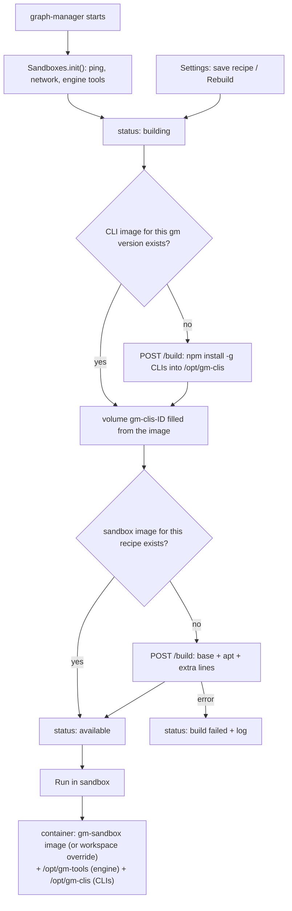

# Sandbox image built by graph-manager

## Problem

Sandboxed runs (KAN-88) get the provider CLIs from the tools folder, which graph-manager fills by copying `claude`, `codex`, `opencode` and `qwen` from its own PATH. When graph-manager runs on macOS, those are Mach-O binaries (claude's native build, `@openai/codex-darwin-arm64`, `@opencode/cli-darwin-arm64`), and the Linux sandbox container fails at once:

```
/opt/gm-tools/bin/claude: 3: exec: /opt/gm-tools/bin/../lib/claude/2.1.319: Exec format error
```

Only qwen (pure JavaScript) works. Even on Linux the copy only works when graph-manager's CPU matches the Docker daemon's.

The sandbox image itself is also hard to extend. The default `node:24.22.1-bookworm` has Node and git but no Go, Java, Rust, Ruby or PHP, and a workspace that needs one must find or publish its own image with Node in it. Users try `FROM` lines to "add" images, but each `FROM` starts a new image and only the last one is kept.

## Goals

1. Provider CLIs in a sandbox are always Linux builds for the Docker daemon's CPU, whatever OS graph-manager runs on. graph-manager no longer copies CLIs from its PATH.
2. graph-manager builds the default sandbox image itself, from a recipe edited in Settings → Sandbox: a base image, apt packages and extra Dockerfile lines.
3. The default recipe already has the common languages: Python, Go, Java, Rust, Ruby, PHP, C/C++, plus pnpm/yarn through corepack.
4. The images are built at startup, rebuilt when the recipe changes, and rebuilt on demand with a **Rebuild** button. While a build runs, sandboxed runs can't start and the UI says why.

No Jira ticket; this follows the macOS "Exec format error" report on sandboxes.

## Flow



## Decisions

| Decision | Why |
| --- | --- |
| Two images. `gm-sandbox-clis:<gm version>` holds only the provider CLIs; `gm-sandbox:<recipe hash>` is the default sandbox image. | Workspaces can still override the image, and those images need the CLIs too. Keeping the CLIs apart means a recipe change never reinstalls them, and the reverse. |
| The CLIs are installed with `npm install -g` inside a Docker build (`FROM node:24.22.1-bookworm-slim`). | Docker builds on its own OS and CPU, so npm picks the Linux build for the daemon's architecture. No guessing on graph-manager's side. |
| The CLIs are the latest versions at build time, not the versions on graph-manager's PATH. The image is rebuilt when graph-manager's version changes, or with **Rebuild**. | The user doesn't need the host versions; graph-manager no longer needs the CLIs installed at all. |
| The CLIs reach a sandbox through a named volume `gm-clis-<first 12 hex of the image id>`, filled from the image (Docker copies an image's files into an empty named volume on its first mount) and mounted read-only at `/opt/gm-clis`. | Works with any sandbox image and with Docker 26 (API 1.45). Image mounts need Docker 28. Naming the volume by image id lets a rebuild make a new volume while running sandboxes keep the old one. |
| The sandbox image recipe is base image + apt packages + extra Dockerfile lines. No list of "added images" with several `FROM`s. | Several `FROM`s don't merge images. `COPY --from=<image> <dir> <dir>` in the extra lines covers adding a tool from another image. |
| Extra lines may not contain `FROM` (400). | A `FROM` would replace the base and drop everything before it. |
| Go and Rust come from their official images through `COPY --from=` in the default extra lines; the rest from apt. | Debian bookworm's Go (1.19) and Rust (1.63) are too old for most projects. Python 3.11, OpenJDK 17, Ruby 3.1 and PHP 8.2 from bookworm are fine. |
| The sandbox's PATH is `/opt/gm-tools/bin:/opt/gm-clis/bin:` + the image's own `PATH` (from image inspect), not a fixed list. | Images put tools on their PATH with `ENV` (Go, Cargo). A fixed PATH hid them. |
| Builds run in the background. `init()` returns at once with `building: true`; `status()` is `available: false` until both images exist. Starting a sandboxed run during a build answers 409. | A build can take minutes; the Start run drawer must not hang on the status call. The user asked that sandboxed runs wait for the build. |
| A failed build leaves sandboxes unavailable, with the error and the log in Settings. | The user asked that sandboxed runs wait for the image; a half-built image would hide the error. |
| **Rebuild** builds both images with `nocache=1`. Saving a changed recipe builds only the sandbox image (normal cache). | Rebuild is how the user gets newer CLIs and newer apt packages; a recipe edit only needs its own layers. |
| Old `gm-sandbox*` images and `gm-clis-*` volumes are removed after a successful build; ones still in use are skipped silently. | They are large (the default sandbox image is a few GB). A running sandbox must keep its image and volume. |
| `GM_SANDBOX_IMAGE` now sets the base image of the default recipe. graph-manager's own image is no longer a default. | The built image replaces both old defaults; graph-manager's own image has no compilers. |
| Sandbox images must be glibc-based (Debian, Ubuntu…), not Alpine. The workspace image hint says so. | The CLIs in the volume are glibc builds. |

## Non-goals

- No per-workspace recipes. A workspace can still set a whole image (existing field); it is not built by graph-manager.
- No building from a repo's own Dockerfile.
- No pinned CLI versions or version picker.
- No registry push; the images stay on the local daemon.
- No change to the engine's tools folder (`/opt/gm-tools`) other than dropping the CLI copy.
- No Docker 28 image mounts.

## User stories

- As a user running graph-manager on my Mac, I start a sandboxed run with the claude provider and the agent runs.
- As a user, I open Settings → Sandbox and see the base image, packages and extra lines that make the sandbox image, and the Dockerfile they produce.
- As a user with a Python, Go, Java or Rust repo, I don't need to change anything: the default image has those tools.
- As a user who needs something else, I add an apt package or a Dockerfile line, save, and the image is rebuilt.
- As a user, I click **Rebuild** to get the newest CLIs and packages.
- As a user, while the image builds, I see "Building the sandbox image…" in Start run, the switch is off, and I can follow the build log in Settings.
- As a user whose build failed, I see the error and the log, fix the recipe, and save to try again.

## Requirements

### Docker client (`apps/graph-manager/src/server/docker.ts`)

- `buildImage(tag, contextTar, { nocache?, labels?, onLine? }): Promise<void>`: `POST /build?t=<tag>&nocache=<0|1>&labels=<json>&rm=1&forcerm=1`, body `application/x-tar`, timeout 30 minutes. Read the JSON-lines stream; pass each `stream` text (split into lines) to `onLine`; throw `DockerError` with `errorDetail.message` (or `error`) when one appears, as `pullImage` does.
- `inspectImage(name): Promise<{ Id: string; Config: { Env?: string[] } } | undefined>` (404 → undefined).
- `listImages(label): Promise<{ Id: string; RepoTags: string[] }[]>`: `GET /images/json?filters={"label":[label]}`.
- `removeImage(name)`: `DELETE /images/<name>`; 404 and 409 (in use) are not errors.
- `listVolumes(label)` and `removeVolume(name)`: same rules (404 and 409 not errors). `createVolume(name, labels?)`.
- Build contexts use the existing `tarArchive` in `src/server/tar.ts`; the context holds only `Dockerfile`.

### Images (`apps/graph-manager/src/server/sandbox-image.ts`, new)

- Constants: `CLI_IMAGE_REPO = "gm-sandbox-clis"`, `SANDBOX_IMAGE_REPO = "gm-sandbox"`, `CLIS_TARGET = "/opt/gm-clis"`, label `gm.sandbox-image=1` on both images and `gm.clis=1` on volumes.
- CLI Dockerfile:
  ```dockerfile
  FROM node:24.22.1-bookworm-slim
  RUN npm install -g --prefix /opt/gm-clis --no-audit --no-fund \
      @anthropic-ai/claude-code @openai/codex opencode-ai @qwen-code/qwen-code \
   && /opt/gm-clis/bin/claude --version && /opt/gm-clis/bin/codex --version
  ```
  Tag `gm-sandbox-clis:<graph-manager version>`.
- Volume: after the CLI image exists, if volume `gm-clis-<id12>` doesn't exist, create it, then create a container from the CLI image with that volume mounted read-write at `/opt/gm-clis` and `Cmd: ["true"]`, start it, wait for it, remove it. Docker fills the empty volume from the image.
- Recipe type and default:
  ```ts
  interface SandboxRecipe { base: string; packages: string[]; extraLines: string }
  const DEFAULT_RECIPE: SandboxRecipe = {
    base: "node:24.22.1-bookworm",
    packages: [
      "python3", "python3-pip", "python3-venv", "pipx",
      "default-jdk-headless", "maven", "gradle",
      "ruby-full", "php-cli", "composer",
      "build-essential", "pkg-config", "cmake",
      "ripgrep", "jq", "zip", "unzip", "sqlite3",
    ],
    extraLines: [
      "COPY --from=golang:1-bookworm /usr/local/go /usr/local/go",
      "COPY --from=rust:1-bookworm /usr/local/cargo /usr/local/cargo",
      "COPY --from=rust:1-bookworm /usr/local/rustup /usr/local/rustup",
      "ENV RUSTUP_HOME=/usr/local/rustup CARGO_HOME=/usr/local/cargo PATH=/usr/local/go/bin:/usr/local/cargo/bin:$PATH",
      "RUN chmod -R a+rwX /usr/local/cargo /usr/local/rustup && corepack enable",
    ].join("\n"),
  };
  ```
  `GM_SANDBOX_IMAGE`, when set, replaces `base` in the default.
- `sandboxDockerfile(recipe)`: `FROM <base>`, then (when packages is not empty) `RUN apt-get update && apt-get install -y --no-install-recommends <packages sorted, space-separated> && rm -rf /var/lib/apt/lists/*`, then the extra lines, each line trimmed, empty lines dropped.
- Tag `gm-sandbox:<first 12 hex of sha256(dockerfile)>`.
- Validation (route returns 400 with the message): `base` matches `IMAGE_PATTERN`; each package matches `/^[a-z0-9][a-z0-9.+\-]*(=[A-Za-z0-9.+~:\-]+)?$/` ("packages: <name> is not a Debian package name"); at most 200 packages; `extraLines` at most 20 000 characters; no line whose first word is `FROM` (case-insensitive) ("extraLines: FROM is not allowed; use COPY --from=<image>").

### Builder state (`Sandboxes` in `src/server/sandbox.ts`)

- One builder per `Sandboxes`, with `build: { state: "idle" | "building" | "ready" | "failed"; step?: "clis" | "image"; startedAt?; finishedAt?; error?; log: string[] }`. Keep the last 1000 log lines.
- `init()` (after the network and the engine tools, as today) starts `ensureImages()` without awaiting it and returns `{ available: false, building: true, reason: "building the sandbox image" }` while it runs. Calling `ensureImages()` again while it runs returns the same promise; the 10 s retry of an unavailable status must not start a second build.
- `ensureImages({ force?: boolean; clis?: boolean })`: builds the CLI image if missing (or if `force && clis`), fills its volume, builds the sandbox image if missing (or `force`), then removes older labelled images and `gm-clis-*` volumes (skipping in-use ones). On success `state: "ready"`; status becomes available with `defaultImage: "gm-sandbox:<hash>"`. On error `state: "failed"`; status is `{ available: false, reason: "the sandbox image build failed: <message>" }`.
- `defaultImage()` returns the built sandbox image tag. `toolsMount()` stays; a new `clisMount()` returns `{ Type: "volume", Source: "gm-clis-<id12>", Target: "/opt/gm-clis", ReadOnly: true }`.
- `start()`: if a build is running, throw `SandboxError(409, "the sandbox image is building; try again when it is ready")`. Mount both the tools and the CLIs volume. Pass the chosen image's `PATH` (from `inspectImage(...).Config.Env`, default `/usr/local/sbin:/usr/local/bin:/usr/sbin:/usr/bin:/sbin:/bin`) to `sandboxEnv`, which sets `PATH=/opt/gm-tools/bin:/opt/gm-clis/bin:<image PATH>`. `SANDBOX_PATH` goes away.

### Tools folder (`src/server/sandbox-tools.ts`)

- Remove `copyProviderClis`, `PROVIDER_CLIS` and the CLI wrappers; `fillTools` copies only the engine and its `bin/graph-execution` wrapper. Remove `pathEnv` from `Sandboxes` options if nothing else uses it. Update the header comment.

### Store and routes

- Store: `sandboxRecipe: { base, packages, extraLines }` optional; absent = the default recipe.
- `GET /api/settings/sandbox` → `{ limits, recipe, defaultRecipe, dockerfile }` (`dockerfile` = `sandboxDockerfile(recipe)`).
- `PUT /api/settings/sandbox` accepts `{ limits?, recipe? }`. `recipe: null` resets to the default. A changed recipe starts `ensureImages()` and the answer includes the new `dockerfile`. Keep accepting the old body (`{ cpus, memoryMb, pids }`) as limits.
- `POST /api/sandbox/rebuild` → 202 `{ build }`; runs `ensureImages({ force: true, clis: true })`. 409 if a build is already running. 400 if Docker is not reachable.
- `GET /api/sandbox/build` → `{ state, step, startedAt, finishedAt, error, log }`.
- `GET /api/sandbox/status` adds `building: boolean`.
- `POST /api/runs/:ws` and the internal sandbox-runs route answer 409 with the builder's message when a sandboxed start hits a running build.

### UI (`apps/graph-manager/src/web`)

- `SandboxCard.tsx`, Settings → Sandbox, a new **Image** section under the status:
  - **Base image** input (`data-testid="sandbox-base"`).
  - **Packages** textarea, one per line or space-separated (`sandbox-packages`).
  - **Extra Dockerfile lines** textarea, monospace (`sandbox-extra`), hint: "Runs after the packages. Use `COPY --from=<image> <dir> <dir>` to add a tool from another image. FROM is not allowed."
  - A collapsible **Dockerfile** preview (`sandbox-dockerfile`) from the server's answer.
  - Buttons: **Save and rebuild** (`sandbox-save-recipe`, enabled when changed), **Reset to defaults** (`sandbox-reset-recipe`), **Rebuild** (`sandbox-rebuild`, also rebuilds the CLIs; disabled while building).
  - Build state badge (`sandbox-build-state`): `building (CLIs)`, `building (image)`, `ready`, `failed`; the error (`sandbox-build-error`) and the log in a scrolling `<pre>` (`sandbox-build-log`, tail, auto-scroll). Poll `GET /api/sandbox/build` every 2 s while building.
  - The **Default image** line shows the built tag.
- `StartRunDrawer.tsx`: when `status.building`, the **Run in sandbox** switch is disabled with the hint "Building the sandbox image… (Settings → Sandbox)". Re-check the status every 5 s while the drawer is open and a build runs.
- `WorkspaceSettingsDrawer.tsx`: image hint becomes "Needs node 20+, git and glibc (not Alpine). Empty: the image built in Settings → Sandbox."
- `types.ts`: `SandboxStatus.building`, `SandboxRecipe`, `SandboxBuild`.

### Tests

- `scripts/fake-docker.mjs`: support `POST /build` (record the Dockerfile and tag, stream `{"stream":"Step 1/2 …\n"}` lines, create the image with a new id; fail with `errorDetail` when the Dockerfile contains `FAKE_BUILD_FAIL`), `GET /images/{name}/json` with `Config.Env`, `GET /images/json` with a label filter, `DELETE /images/{name}` (409 when a container uses it), volume list/remove (409 when mounted). Expose the recorded builds in its state.
- Unit tests for `sandboxDockerfile`, the tag hash, recipe validation (FROM, bad package), `buildImage` stream parsing (success, error line), and `sandboxEnv`'s PATH.
- Route tests: settings GET/PUT (recipe, reset, 400s), rebuild (202, 409), build status, start during a build (409).
- `Sandboxes` tests against the fake: init returns `building`, then available; both images built once; a second init builds nothing; Rebuild builds both with `nocache=1` and a new `gm-clis-*` volume; old images and volumes removed, in-use ones kept; a failed build makes status unavailable with the reason; the container body mounts `/opt/gm-clis` read-only and its PATH starts with `/opt/gm-tools/bin:/opt/gm-clis/bin:`.
- Update tests that expect CLI copies in the tools folder, the fixed `SANDBOX_PATH`, or graph-manager's own image as the default.
- The real-Docker e2e test (`sandbox.e2e.test.ts`, skipped without Docker) asserts `claude --version` succeeds inside the sandbox.

### Docs

- `apps/graph-manager/README.md`, Sandboxes section: the two images, the recipe and its defaults, Rebuild, build time and size, glibc requirement, `GM_SANDBOX_IMAGE`'s new meaning.
- `docs/wiki/features/sandboxes.md`: update the tools and image decisions; add the ones above.

## Acceptance criteria

- [ ] With graph-manager on macOS (arm64) and Docker Desktop, a sandboxed run with `--provider claude` gets past agent start: no `Exec format error` in the task log.
- [ ] In a sandbox, `file /opt/gm-clis/lib/node_modules/@anthropic-ai/claude-code*/**/claude` reports an ELF binary for the daemon's CPU; `/opt/gm-tools/lib` has no `claude`, `codex`, `opencode` or `qwen`.
- [ ] In a default sandbox, `python3 --version`, `go version`, `java -version`, `cargo --version`, `ruby --version`, `php --version`, `gcc --version` and `pnpm --version` all succeed as the non-root workspace owner, and `cargo build` of a crate with a dependency works.
- [ ] On first start, `GET /api/sandbox/status` answers within 1 s with `building: true`, and later `available: true` with `defaultImage` `gm-sandbox:<12 hex>`.
- [ ] A second start of graph-manager with the same version and recipe runs no `POST /build`.
- [ ] `POST /api/runs/:ws` with `sandbox: true` during a build answers 409 `the sandbox image is building; try again when it is ready`.
- [ ] `PUT /api/settings/sandbox` with extra lines containing `FROM ubuntu` answers 400 `extraLines: FROM is not allowed; use COPY --from=<image>`; with package `Python3!` answers 400.
- [ ] Saving a recipe with an added package builds a new `gm-sandbox:<hash>` and removes the previous one (when no sandbox uses it); the CLI image is not rebuilt.
- [ ] `POST /api/sandbox/rebuild` answers 202, builds both images with `nocache=1`, and creates a new `gm-clis-<id12>` volume; a second call during the build answers 409.
- [ ] A build whose Dockerfile fails leaves `status.available: false` with reason starting `the sandbox image build failed:`, and Settings shows `failed`, the error and the log.
- [ ] Settings → Sandbox shows the base image, packages, extra lines, the Dockerfile preview, Save and rebuild, Reset to defaults and Rebuild; the log updates while building.
- [ ] In Start run, the Run in sandbox switch is disabled with "Building the sandbox image…" during a build and enabled after it.
- [ ] `npm run typecheck && npm run lint && npm test` pass.
