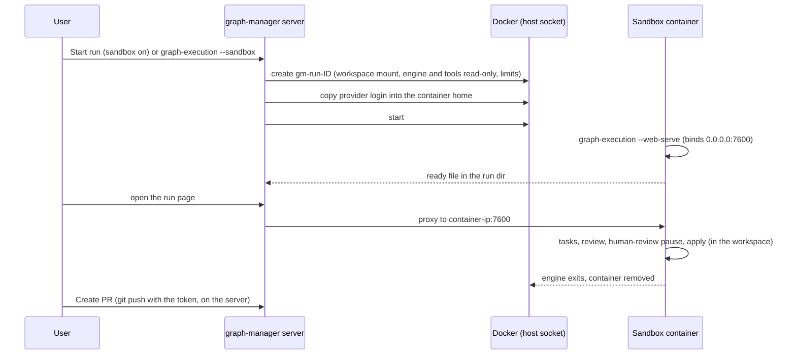

# PRD: Sandboxes for runs (graph-manager + engine)

Ticket: [KAN-88](https://graph-execution.atlassian.net/browse/KAN-88)

## Problem

graph-manager starts every run inside its own container, as its own user (`apps/graph-manager/Dockerfile:36-40`, `HOME=/data/home`). Agents run in full-auto mode, so any agent in any run can:

- read `/data/graph-manager.json`, which holds the GitHub and GitLab tokens and the session secret (`src/server/store.ts:8-26`);
- read and change every other workspace under `/workspaces`;
- change the provider login in `/data/home`.

A user who runs tasks or specs they don't fully trust has no way to limit an agent to the repo it is working on.

## Goals (KAN-88)

1. **An option per run, off by default.** A sandboxed run runs in its own Docker container, started by graph-manager through the host's Docker socket.
2. **The container sees only that workspace**, plus a copy of the provider login. It never sees `/data`, the forge tokens or other workspaces.
3. **Push and Create PR stay on the server**, as today.
4. **Two ways to turn it on:** a **Run in sandbox** toggle in Start run (remembered per workspace), and `graph-execution … --sandbox` typed in a graph-manager terminal. Terminals themselves are not sandboxed.
5. **The image is set per workspace.** The default is graph-manager's own image.
6. **Everything works as for a normal run:** the live run page, abort, retry, the human-review pause, resume, and the apply to the workspace's branch.
7. **Resource limits** (CPU, memory) are set in Settings.

## Decisions

| Decision | Why |
| --- | --- |
| The sandbox is an option per run, off by default. | The user asked for it: not every run. |
| One container per run, with the whole engine inside it (engine + every agent of the run), not one per agent. | Much simpler. The engine already isolates agents in worktrees, and the sandbox's job is to keep the run away from the server and the other workspaces. |
| graph-manager talks to the Docker Engine API over `/var/run/docker.sock` with a small HTTP client (`node:http`, `socketPath`). No `dockerode` dependency. | The user chose the mounted Docker socket. The API calls needed are few: create, start, inspect, stop, remove, put archive, network connect. |
| The workspace is mounted read-write **at the same absolute path** as on the server (`/workspaces/<forge>/<owner>/<repo>`). | git worktrees and `state.json` store absolute paths (`state/state.ts:69-70`, `.git/worktrees/*/gitdir`). |
| When graph-manager runs in Docker, it finds the source of its own `/workspaces` mount by inspecting its own container, and mounts only the workspace's subfolder (`volume-subpath` for a named volume, a bind of the subfolder for a host path). `GM_SANDBOX_WORKSPACES_SOURCE` overrides it. Outside Docker, the workspace folder is bind-mounted directly. | Other workspaces must not be visible. Users shouldn't have to configure the volume name. |
| The engine and the provider CLIs come from a **tools volume** (`gm-tools`) that graph-manager fills at startup and mounts read-only into every sandbox at `/opt/gm-tools`. | A custom workspace image then only needs `node` (20+) and `git`. graph-manager can't mount paths from its own image into a sibling container. |
| The image is set per workspace, with graph-manager's own image as the default (found by self-inspect, or `GM_SANDBOX_IMAGE`). | The user's choice. Repos that need Python or other build tools get an image that has them. |
| The provider login is **copied** into the container's home at create time, using `PUT /containers/{id}/archive`. Only the provider's login files go in (table below). `/data` is never mounted. | The user chose a copy per run. A token refreshed inside the sandbox stays there, and an agent can't change the server's login. |
| Provider API keys from graph-manager's env (`ANTHROPIC_API_KEY`, `OPENAI_API_KEY`), the `GIT_AUTHOR_*` / `GIT_COMMITTER_*` vars and `GRAPH_EXECUTION_*` vars (reviewers file, provider args) are passed in as env. `GM_*` vars are never passed. | Agents need the keys and a git identity. The engine never pushes, so no forge token is needed. |
| Inside the container the engine runs `--web-serve` directly as the main process (with `--init`), binds `0.0.0.0` on port 7600 (`GRAPH_EXECUTION_WEB_HOST` / `GRAPH_EXECUTION_WEB_PORT`), and writes its ready file into the run dir. | The detached launcher (`launch/launch.ts`) is for a host shell. In a container, the container is the detached process. |
| The proxy reaches a sandboxed run at `<container ip>:7600` on the `gm-sandbox` Docker network. It keeps rewriting `Host` to `127.0.0.1:<port>`. When graph-manager runs in Docker it joins `gm-sandbox` at startup. | The engine's Host check (`web/server.ts:508-512`) then needs no change. A container's localhost isn't reachable from the server. |
| A sandboxed run is "live" while its container is running (Docker inspect), not by checking the pid in `web.json` / the lock. | PIDs in another PID namespace mean nothing to the server (`server/runs.ts:106-109`, `routes/workspaces.ts:106-127`). |
| The engine records the host name (the container id inside a container) in the run lock and the process registry. A lock or registry entry from another host is never treated as stale, and its processes are never killed. | Without this, `--resume` or `clean` typed in a terminal would see the sandbox's PIDs as dead, take the lock over and kill unrelated processes (`state/state.ts:160-233`, `state/processes.ts:172+`). |
| A run started in a sandbox is resumed in a sandbox: `graph-execution --resume --run <id> --sandbox`, or **Resume** in graph-manager. A plain `--resume` of it exits 2 with a hint. Only graph-manager, after checking that the run's container is gone, lets the new container take the lock over (`GRAPH_EXECUTION_TAKE_LOCK_FROM=<old host>`). | Only the server can tell that a lock from another host is really dead. |
| The container is removed when the engine exits. Everything that matters (state, logs, reports, the applied changes) is in the workspace's `.graph-execution/` and working tree. | No leftover containers. The run stays inspectable after it ends. |
| The human-review pause needs nothing special: the engine waits in the container, and the container stays up until the run ends. | Same behaviour as today. |
| This feature is built in the same suite as KAN-89 (run options) and KAN-87 (reviewers), in parallel, so it uses none of their code: its own `sandbox` field in the start body and its own saved toggle. It passes every `GRAPH_EXECUTION_*` var from graph-manager's env into the container, so the reviewers file (KAN-87) reaches sandboxed runs once both are merged. | Suite features can't depend on each other. |
| `graph-execution --sandbox` in a terminal is handled by graph-manager's shim. The shim sends the run to the server (`POST /api/internal/sandbox-runs`, authenticated with a per-boot `GM_INTERNAL_TOKEN` in the terminal env) and prints `Run <id> started in a sandbox: <graph-manager run URL>`. Without `--sandbox` the shim runs the engine as today. | The user chose the toggle plus a terminal flag. Only the server can talk to Docker. Terminals are already fully trusted, so a token in their env adds no exposure. |
| The plain engine (outside graph-manager) refuses `--sandbox` with exit 2: `--sandbox needs graph-manager`. | Sandboxes are a graph-manager feature. |
| Limits in Settings: CPUs (default 2), memory (default 4096 MB), PIDs (default 2048), stored in `graph-manager.json`. The network is open (a `gm-sandbox` bridge network with internet access). | The user chose limits in Settings and an open network. |
| The sandbox container runs as the owner of the workspace folder (uid:gid from `stat`), with `HOME=/home/sandbox` (a tmpfs) and `--security-opt no-new-privileges`. No extra capabilities. | Files the agents write stay owned by the same user as before. Nothing in the container runs as root. |
| When Docker isn't reachable, the toggle is disabled with the reason, and `--sandbox` exits 2 with the same message. | Clear failure instead of a run that dies at start. |

### Provider login files copied into `/home/sandbox`

| Provider | Files (relative to the server's `HOME`, only those that exist) |
| --- | --- |
| `claude` | `.claude/.credentials.json`, `.claude.json` |
| `codex` | `.codex/auth.json`, `.codex/config.toml` |
| `opencode` | `.local/share/opencode/auth.json`, `.config/opencode/` |
| `qwen` | `.qwen/oauth_creds.json`, `.qwen/settings.json` |

Each provider's files are copied only when a reviewer or the run uses that provider. If none of its files exists and its API key isn't set, the start fails with `no <provider> login to copy into the sandbox: log in once in a terminal, or set <KEY>`.

## Non-goals

- Sandboxing terminals.
- Network allow-lists or egress filtering.
- Kubernetes / OpenShift pods, rootless Docker, Sysbox, gVisor.
- Sandboxed `suite` runs.
- Building images from a repo's Dockerfile.
- Live previews (KAN-90).
- Docker Desktop on macOS for local development of graph-manager outside Docker (container IPs aren't reachable from the host there). graph-manager in Docker on macOS works.

## User stories

1. As a user, I turn on **Run in sandbox** in Start run. The run's agents can't read my GitHub token or touch my other workspaces, and I follow the run page, review and create the PR as usual.
2. As a user in a graph-manager terminal, I type `graph-execution .agents/tasks/x --spec docs/prd/x.md --provider claude --web --sandbox` and get a link to the run in graph-manager.
3. As a user, I set the image of a Python workspace to `python:3.12-bookworm` plus node and git, and its sandboxed runs can run `pytest` in `validate`.
4. As a user, I set the sandbox memory to 8 GB in Settings for heavy builds.
5. As a user, I abort a sandboxed run from its page and its container is gone. Later I press **Resume** and it continues in a new sandbox.
6. As a user without the Docker socket mounted, I see why the toggle is disabled.

## Requirements

### Engine (`packages/graph-execution/src`)

- `GRAPH_EXECUTION_WEB_HOST` and `GRAPH_EXECUTION_WEB_PORT` set the bind address and port of the run page (`web/server.ts:573`). The defaults (`127.0.0.1`, port 0) are unchanged. `web.json` keeps `url: http://127.0.0.1:<port>`.
- The run lock (`<runDir>/lock`) gets a third line, the host name (`os.hostname()`). Old two-line locks are read as "this host". `isStale` returns false for a lock whose host differs from this host, unless `GRAPH_EXECUTION_TAKE_LOCK_FROM` equals that host.
- The process registry entries (`state/processes.ts:9-28`) get a `host` field. `reapOrphans` skips entries of another host. Entries of the host named in `GRAPH_EXECUTION_TAKE_LOCK_FROM` are deleted without signals.
- `state.json` gets an optional `sandbox: { image: string }`, set when `GRAPH_EXECUTION_SANDBOX=1` is in the env at start (graph-manager sets it). A `--resume` of such a run without `GRAPH_EXECUTION_SANDBOX=1` exits 2 with `run <id> ran in a sandbox: resume it from graph-manager, or with graph-execution --resume --run <id> --sandbox in a graph-manager terminal`.
- `--sandbox` is accepted by the parser only to give the error `--sandbox needs graph-manager` (exit 2). graph-manager's shim strips it before the engine sees it.
- `graph-execution/api` exports the lock and registry helpers that graph-manager needs (`lockHolder` with its host).

### graph-manager: Docker client and sandbox runner (new `apps/graph-manager/src/server/docker.ts`, `sandbox.ts`)

- `docker.ts`: a minimal Docker Engine API client over the unix socket (`GM_DOCKER_SOCKET`, default `/var/run/docker.sock`), API version `v1.44`. It covers `ping`, `inspectSelf` (by `HOSTNAME`), `createContainer`, `putArchive`, `startContainer`, `inspectContainer`, `stopContainer`, `removeContainer`, `createNetwork` / `connectNetwork`, `createVolume`, and `listContainers` (by label).
- `GET /api/sandbox/status` returns `{ available: boolean, reason?: string, defaultImage?: string }`.
- At startup, when Docker is available, graph-manager:
  - creates the network `gm-sandbox` if it is missing, and joins it when it runs in a container;
  - creates the volume `gm-tools` if it is missing, and fills it with the built engine (`packages/graph-execution` with its production `node_modules`) and the provider CLIs found on its `PATH`, when the volume's `VERSION` file differs from graph-manager's version.
- `startSandboxRun({ workspace, args, runId })`:
  1. Docker create with:
     - name `gm-run-<runId>`;
     - labels `gm.run`, `gm.workspace`;
     - the image (the workspace setting, or the default);
     - the user from the workspace owner;
     - env as in the Decisions table, plus `GRAPH_EXECUTION_SANDBOX=1`, `RUN_ID_ENV`, `GRAPH_EXECUTION_WEB_HOST=0.0.0.0`, `GRAPH_EXECUTION_WEB_PORT=7600`, `GRAPH_EXECUTION_READY_FILE=<runDir>/.ready.json`, `HOME=/home/sandbox`, and `PATH=/opt/gm-tools/bin:$PATH`;
     - mounts: the workspace (rw, same path), `gm-tools` at `/opt/gm-tools` (ro), and a tmpfs at `/home/sandbox`;
     - `HostConfig`: `Init: true`, `NanoCpus`, `Memory`, `PidsLimit`, `SecurityOpt: ["no-new-privileges"]`, `AutoRemove: true`, network `gm-sandbox`;
     - command `node /opt/gm-tools/graph-execution/dist/cli.js <args> --web-serve`, working dir the workspace.
  2. `putArchive` of the provider login files into `/home/sandbox`.
  3. Start the container. Wait up to 60 s for the ready file. On timeout or exit, return 400 with the last 20 lines of the container log.
- The sandbox record `{ runId, workspace, container, image, startedAt }` is kept in `graph-manager.json` under `sandboxes`, and removed when the container is gone and the run is no longer live.

### graph-manager: runs, proxy, Start run, terminals

- `routes/runs.ts`: the start body gets a top-level `sandbox?: boolean` (next to `tasksDir`, `spec`, `provider`, `concurrency`; it doesn't depend on the KAN-89 `options` object, which is built in parallel). With `sandbox: true` the server calls `startSandboxRun` instead of spawning the engine. The answer is the same `{ runId, viewUrl }`.
- `POST /api/runs/:ws/:runId/resume` (new): resumes a run that is not live. A sandboxed run gets a new container with `--resume --run <id>` and `GRAPH_EXECUTION_TAKE_LOCK_FROM=<old container id>`, after Docker confirms the old container is gone. A run that is not sandboxed is resumed with the engine directly. The run detail page gets a **Resume** button for runs that are not live and not finished.
- `server/runs.ts`: a run with a sandbox record is live while its container is running. `routes/workspaces.ts` (`liveRunPid`) also counts a running sandbox container as a live run (it blocks Delete).
- `proxy.ts` and `viewcache.ts`: for a sandboxed run, the upstream is `<container ip>:7600` from Docker inspect, with `Host: 127.0.0.1:7600`.
- Abort is unchanged (the run page's `POST /abort` through the proxy). If the page doesn't answer, a **Stop sandbox** action on the run detail page stops the container.
- Start run drawer (`StartRunDrawer.tsx`): a **Run in sandbox** switch in Options, disabled with the reason from `/api/sandbox/status`. It shows the image that will be used. Its last value is saved per workspace in `workspaceSettings[<id>].sandbox` (written by the server on a successful start) and preselected next time. The command preview adds `--sandbox`. The switch is added as its own block below the provider, so it merges cleanly with the KAN-89 options section, which is built in parallel.
- Workspaces: each workspace gets a **Sandbox image** setting (empty for the default), stored in `graph-manager.json` under `workspaceSettings[<id>].image`, with `GET/PUT /api/workspaces/:id/settings`.
- Settings: a **Sandbox** card with the Docker status, the default image and the limits (CPUs, memory MB, PIDs). `GET/PUT /api/settings/sandbox`.
- Terminals (`terminals.ts`): the shim becomes `exec node "<gm>/dist/server/shim.js" "$@"`. `shim.js` runs the engine as today unless `--sandbox` is among the arguments. With `--sandbox` it removes the flag, requires `--web` or adds it, and posts `{ cwd, args }` to `http://127.0.0.1:<GM_PORT>/api/internal/sandbox-runs` with `Authorization: Bearer $GM_INTERNAL_TOKEN`. It prints the run URL, or the error, and exits 0 or 2. The server maps `cwd` to its workspace and refuses a cwd outside one.
- `GM_INTERNAL_TOKEN` is random per server start and set only in terminal env. It is accepted only on `/api/internal/*`, and only from `127.0.0.1`.

### Packaging

- `docker-compose.yml`:
  - mounts `/var/run/docker.sock`;
  - adds `group_add: ["${DOCKER_GID:-0}"]` so UID 1000 can use the socket;
  - declares the `gm-tools` volume, also mounted in graph-manager at `/opt/gm-tools` so it can fill it.
- The README documents the sandbox: what it isolates and what it doesn't (it is a container, not a VM), `DOCKER_GID`, the image requirements (node 20+, git), and that the Docker socket gives graph-manager root-equivalent access to the host.

## Acceptance criteria

- [ ] With the Docker socket mounted, a fake-provider run started with **Run in sandbox** runs in a container named `gm-run-<id>`, shows its live page in graph-manager, applies its result to the workspace, and leaves no container behind.
- [ ] Inside a sandboxed run, an agent command `cat /data/graph-manager.json` fails, `ls /workspaces` shows only the run's workspace path, and `env` contains no `GM_` variable.
- [ ] `~/.claude/.credentials.json` exists in the sandbox home, and changing it in the sandbox doesn't change the server's copy.
- [ ] Abort from the run page ends the run with `aborted` and removes the container. **Resume** continues it in a new container and it completes.
- [ ] `graph-execution --resume --run <id>` typed in a graph-manager terminal, for a sandboxed run, exits 2 with the "ran in a sandbox" hint. `graph-execution clean` doesn't delete or kill anything of a live sandboxed run.
- [ ] `graph-execution … --web --sandbox` in a graph-manager terminal prints `Run <id> started in a sandbox: …` and the run appears on the Runs page.
- [ ] With `--human-review`, a sandboxed run pauses at "Waiting for your review" and its container keeps running until Apply.
- [ ] Without the Docker socket, `/api/sandbox/status` gives `available: false` with a reason, the toggle is disabled, and `--sandbox` in a terminal exits 2.
- [ ] A workspace with the sandbox image `node:22-bookworm` (no claude installed) runs a sandboxed claude run using the tools volume.
- [ ] The memory limit from Settings appears as `HostConfig.Memory` of the run's container.
- [ ] Engine unit tests: a lock from another host is not stale, `TAKE_LOCK_FROM` takes it over, and `reapOrphans` skips other hosts. graph-manager tests use a fake Docker API server on a unix socket. One end-to-end test with real Docker is skipped when no Docker daemon is reachable.
- [ ] `npm run typecheck && npm run lint && npm test` pass.
