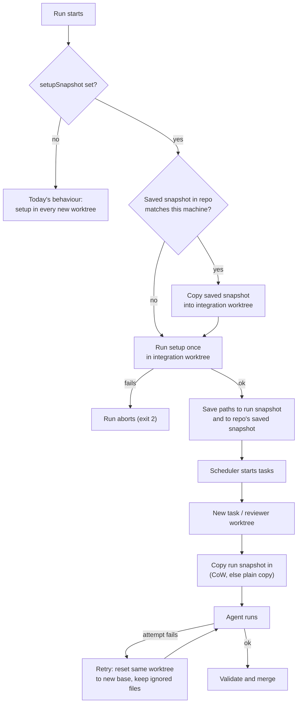

# Setup snapshot: install once per run, copy into every worktree

## Problem

Every new worktree a run creates starts without the files that git ignores: `node_modules`, `.venv`, `vendor/`, build caches. So the `setup` commands of `graph-execution.config.json` (for example `npm ci`) run in full in each one:

- each task attempt, retries included (`packages/graph-execution/src/runner/run.ts`, `attemptAndMerge` → `prepare` → `runSetup`);
- each reviewer and live tester attempt of each review round (`packages/graph-execution/src/agents/reviewer.ts`, `prepare` → `runSetup`);
- each reviewer checkout of a multi-repo suite's joint phase, once per repo (`packages/graph-execution/src/suite/joint.ts`, the `cd repos/<name> && <command>` list).

A run with 6 tasks, a few retries and 2 review rounds does 10–15 full installs, up to `concurrency` of them at once, competing for disk and network. On a large project setup takes longer than the agent's own work. This holds for every repo that uses graph-execution, not only this one.

## Goals

1. **Install once per run.** Before the first task starts, the run runs `setup` once in the integration worktree and saves the folders the config names (`setupSnapshot.paths`) as the run's snapshot.
2. **Copy instead of installing.** Every new task, reviewer and tester worktree gets the run's snapshot copied in (copy-on-write where the filesystem supports it, a plain copy otherwise), and `setup` does not run there.
3. **Keep it for the next run.** The snapshot is also saved in the repo, and the next run restores it into its integration worktree *before* running `setup`, so an incremental install (`npm install`, `pnpm install`, `pip install`) only fetches what changed. Every run's setup brings it up to date, so it is never stale.
4. **Reuse the worktree on a retry.** A task or reviewer retry resets the previous attempt's worktree to the new base instead of deleting it and creating a new one. Ignored files survive, so neither the copy nor `setup` runs again. This holds with or without `setupSnapshot`.
5. **Multi-repo suites too.** The joint phase's reviewer checkouts restore each repo's saved snapshot under `repos/<name>/` instead of running that repo's setup.

## Flow



## Decisions

| Decision | Why |
| --- | --- |
| Opt-in with a new top-level key `setupSnapshot: { "paths": [...] }`. `setup` stays an array. Without `setupSnapshot`, setup runs per worktree as today. | Not every folder can be copied safely (a Python `.venv` holds absolute paths), so only the user can say which folders to keep. Existing configs keep working unchanged. |
| No cache key or lockfile hash. Every run runs `setup` once, on top of the restored saved snapshot, and saves the result. | Simpler than a cache, and never stale: the run's own install brings the folders up to date with the repo at the run's start. |
| `setup` runs in the integration worktree. | It is created at run start, already exists before any task, and is the base every task is cut from. Today it has no installed dependencies at all; end-of-run validation there works only because Node finds the main checkout's `node_modules` by walking up the directory tree. |
| Tasks copy from the run's own snapshot (`.graph-execution/<run-id>/setup-snapshot/`), not from the integration worktree or the repo's saved snapshot. | The integration worktree changes as the run goes on (a fixer may install), and another run may replace the saved snapshot mid-copy. The run's copy changes only at run start. |
| The repo's saved snapshot is `.graph-execution/_setup-snapshot/`. | Folders starting with `_` are skipped by the run scan (`cleanup/scan.ts`, line 216), so `clean` and graph-manager never list or delete it as a run. It stays in the repo's own `.graph-execution` even for suite feature runs whose run folders live elsewhere (`GRAPH_EXECUTION_RUNS_ROOT`). |
| The saved snapshot records platform, CPU architecture, Node major version and the `paths`. It is restored only when all match. | Native modules built on macOS do not load on Linux (a graph-manager sandbox shares the repo with the host). A mismatch means a full install from scratch, never a broken one. |
| Mid-run dependency changes are not tracked. A task that merges a new dependency does not refresh the run's snapshot. | Kept simple. The task that adds a package installs it in its own worktree. A later task that needs it is told in its prompt to run the install itself. |
| Copy file by file with `fs.copyFile(src, dst, COPYFILE_FICLONE)`: a copy-on-write clone where the filesystem supports it (APFS, btrfs, XFS, ReFS), a plain copy otherwise. | One code path on every OS, and the fastest copy each disk allows. |
| Symlinks are copied as links. An absolute link that points inside the source folder is re-pointed to the same place inside the destination. | npm workspaces link `node_modules/<pkg>` to `packages/<pkg>`. On Windows those are junctions with absolute targets, which would otherwise point into another worktree. |
| A snapshot problem (restore, save or copy) never fails a task or the run: it falls back to the slower path, which ends up running `setup` in each worktree as today, with a log line. Only a failing setup command or a non-ignored snapshot path aborts the run. | A snapshot is only a speed-up, so a problem with it should cost time, never work. A failing setup command fails today too, and a non-ignored path is a config mistake worth stopping for. |
| A retry reuses the previous attempt's worktree: `git worktree move` to the new attempt's path, `git reset --hard <base>` on the new integration HEAD, then `git clean -fd` (no `-x`). `setup` and the copy are skipped. If the move or reset fails, the retry falls back to a fresh worktree as today. | Ignored files (the installed dependencies) survive, so a retry costs seconds. The per-attempt path (`task-<id>-a<n>`) stays, so logs and the state keep pointing at the attempt that ran. |
| A reused worktree does not run `setup` again, with or without `setupSnapshot`. | What setup produces that matters lives in ignored files, which survive. Tracked or untracked non-ignored output (for example generated code) is wiped by the reset; that case is documented. |
| A snapshot path must be ignored by git (`git check-ignore`). A path that is not aborts the run at the save step with a clear message. | Copying a tracked or untracked non-ignored folder would show up as changes in every task's diff. |
| Paths take simple globs: `*` matches within one path segment (`packages/*/node_modules`). A pattern that matches nothing is skipped with a log line. | Monorepos have one `node_modules` per workspace, and the list should not have to name each one. |
| The joint phase restores each repo's saved snapshot (`<repo>/.graph-execution/_setup-snapshot/`) under `repos/<name>/` and skips that repo's setup commands. A repo without `setupSnapshot`, or without a matching saved snapshot, runs its commands as today. | By the joint phase each repo's feature runs have already saved an up-to-date snapshot. |

## Non-goals

- Refreshing the snapshot during a run when a task changes dependency files.
- Sharing one dependency folder between worktrees through symlinks. Agents and the live tester could change it under each other.
- Snapshots of folders outside the repo (a global npm or pip cache). Package managers already handle those.
- A UI to edit `setupSnapshot` in graph-manager. It is set in `graph-execution.config.json`.
- Pruning old saved snapshots: there is exactly one per repo, replaced by each run.
- Changing this repo's own `graph-execution.config.json`. That is done separately once the feature has shipped.

## User stories

- As a user with a large Node monorepo, I set `setupSnapshot.paths` and a run installs dependencies once instead of once per task attempt and per reviewer.
- As a user, my second run is faster than my first because the install starts from the folders the previous run saved.
- As a user whose task failed and is retried, the retry starts within seconds instead of reinstalling everything.
- As a user who added a package between two runs, the next run picks it up without me doing anything.
- As a user on an ext4 or NTFS disk, the snapshot still works; it just uses more disk.
- As a user of a multi-repo suite, the joint review's checkouts start without running every repo's install.
- As a user who did not set `setupSnapshot`, nothing changes except that retries reuse their worktree.

## Requirements

### Config (`packages/graph-execution/src/config/config.ts`)

- New optional key in `configSchema`:
  ```ts
  setupSnapshot: z.strictObject({ paths: z.array(z.string().min(1)).min(1) }).optional(),
  ```
- Each path is relative to the repo root, uses `/` as the separator, and may contain `*` within a segment. An absolute path, a `..` segment or `**` is a config error: `invalid config <file>:\n  setupSnapshot.paths.<i>: <reason>`.
- `setupSnapshot` with an empty `setup` is a config error: `setupSnapshot needs setup commands`.

### Snapshot module (new `packages/graph-execution/src/setup/snapshot.ts`)

- `expandPaths(root, patterns): Promise<string[]>`: the existing folders and files under `root` matching the patterns, relative, sorted.
- `copyTree(src, dst, { signal })`: copies a folder recursively, creating `dst`; files with `fs.copyFile(..., fs.constants.COPYFILE_FICLONE)`; symlinks as symlinks (absolute targets inside `src` re-pointed into `dst`; on Windows directory links are created as junctions); file modes kept; at most 32 file copies in flight; stops with `InterruptedError` when `signal` aborts.
- `saveSnapshot(worktree, paths, dest)`: writes the matched paths of `worktree` into `dest` (same relative layout) plus `dest/meta.json`. It is written into `<dest>.tmp-<pid>` and then renamed into place (old one renamed aside, then removed), so a reader never sees a half-written snapshot.
- `meta.json`:
  ```json
  { "version": 1, "platform": "darwin", "arch": "arm64", "node": 22, "paths": ["node_modules"], "createdAt": "<iso>", "runId": "<run-id>" }
  ```
- `restoreSnapshot(src, worktree, { signal })`: when `src/meta.json` exists and matches the current `process.platform`, `process.arch`, Node major and the config's `paths`, copies every saved path into `worktree` (replacing what is there) and resolves `true`; otherwise resolves `false` without touching the worktree.
- `checkIgnored(worktree, paths)`: rejects with `setupSnapshot path <p> is not ignored by git; add it to .gitignore` for the first path that `git check-ignore -q` says is not ignored.

### Run start (`packages/graph-execution/src/runner/run.ts`)

- Only with `setupSnapshot` set, in `execute` before `runGraph` is first called, when `<runDir>/setup-snapshot/meta.json` does not exist yet (a resumed run that already has it skips this step):
  1. log `setup: restoring the saved snapshot` and `restoreSnapshot(<repo>/.graph-execution/_setup-snapshot, integrationWorktree)`; when it returns `false` log `setup: no saved snapshot for this machine; installing from scratch`;
  2. log `setup: running setup in the integration worktree` and run `config.setup` there with `runCommands`. A failure aborts the run with `AbortRunError("setup command \`<cmd>\` failed with exit code <n>")`, step `setup`, as `runSetup` does today;
  3. `checkIgnored`, then `saveSnapshot` to `<runDir>/setup-snapshot/` and to `<repo>/.graph-execution/_setup-snapshot/`; log `setup: saved snapshot (<n> paths)`.
- Failures at each step:

  | Step | On failure |
  | --- | --- |
  | 1. Restore the saved snapshot (copy error, disk full) | Remove what was partly restored, log `setup: could not restore the saved snapshot (<reason>); installing from scratch`, go on to step 2. |
  | 2. Run `setup` | Abort the run (exit 2) with `setup command \`<cmd>\` failed with exit code <n>`, as a failed setup does today. `--resume` runs step 1 again. |
  | 3a. A path is not ignored by git | Abort the run (exit 2) with `setupSnapshot path <p> is not ignored by git; add it to .gitignore`. It is a config mistake, caught before any agent runs. |
  | 3b. Save the run snapshot (`<runDir>/setup-snapshot/`) | Remove the partial copy, log `setup: could not save the snapshot (<reason>); every worktree runs setup`, and run the rest as without `setupSnapshot`. |
  | 3c. Save the repo's saved snapshot | Log `setup: could not save the snapshot for later runs (<reason>)`; the run goes on with its own snapshot, and the previous saved snapshot is left as it was. |
- The web view's phase shows this step as part of the `tasks` phase; the log lines above are enough.
- `ensureExcluded` already keeps `.graph-execution/` out of git; nothing new is committed.

### Task worktrees (`runner/run.ts`, `attemptAndMerge` → `prepare`)

- Fresh worktree (first attempt, or a fallback): with `setupSnapshot`, `restoreSnapshot(<runDir>/setup-snapshot, worktree)` instead of `runSetup`; log `task <id>: copied setup snapshot`. If it throws or returns `false`, log `task <id>: setup snapshot unavailable (<reason>); running setup` and call `runSetup`. Without `setupSnapshot`, `runSetup` as today.
- Retry (attempt > 1): when the previous attempt's worktree exists, `git worktree move <old> <new>`, then `resetHard(<new>, base)` with `base` = the integration HEAD read now (as today, under the merge lock), and `git checkout -B <branch> <base>` so the task branch points at it. Log `task <id>: reusing the worktree of attempt <n-1>`. Skip the restore and `runSetup`. On any error, remove both paths and fall back to a fresh worktree.
- `dirtyAtStart` is taken after the reset, as today after setup.

### Task prompt (`packages/graph-execution/src/agents/task.ts`, `taskPrompt`)

- With `setupSnapshot` set, add one line to the prompt: `Dependencies were installed when the run started. If you add or change a dependency, or one a merged task added is missing, run the install yourself.`

### Reviewer and tester worktrees (`packages/graph-execution/src/agents/reviewer.ts`)

- `opts` gets `snapshot?: string` (the run snapshot folder) next to `setup`; `review/phase.ts` passes `<runDir>/setup-snapshot` when `setupSnapshot` is set.
- First attempt: restore the snapshot instead of running setup, with the same fallback to `runSetup` as tasks.
- Retry: reset the existing checkout to `opts.head` (`resetHard`) instead of removing and re-adding it; fall back to remove and re-add on error. This applies with or without a snapshot.

### Multi-repo joint phase (`packages/graph-execution/src/suite/joint.ts`)

- For each repo whose own config has `setupSnapshot`: instead of pushing `cd repos/<name> && <command>` into `setup`, record the repo's saved snapshot `<repo.path>/.graph-execution/_setup-snapshot` to restore into `<checkout>/repos/<name>/`.
- The reviewer's setup step restores each recorded snapshot. A repo whose snapshot is missing or does not match falls back to running its own commands with the `cd repos/<name> &&` prefix. Repos without `setupSnapshot` run their commands as today.

### Docs

- `packages/graph-execution/README.md`, Configuration table: a `setupSnapshot` row. Include the example below, the recommendation to use an incremental install command (`npm install`, not `npm ci`, which deletes `node_modules` first), the warning about folders holding absolute paths (Python virtualenvs), and the note that a retry reuses its worktree and does not re-run setup.
  ```json
  {
    "setup": ["npm install --include=dev"],
    "setupSnapshot": { "paths": ["node_modules", "packages/*/node_modules", "apps/*/node_modules"] }
  }
  ```
- Update the `setup` row: "Commands run once in every new worktree … With `setupSnapshot`, run once per run in the integration worktree instead."

## Acceptance criteria

- [ ] Without `setupSnapshot`, a fake-provider run with 2 tasks runs `setup` once per task worktree, as before (the log shows `task <id>: running setup` for each).
- [ ] With `setupSnapshot: { paths: ["deps"] }` and a setup command that writes `deps/marker`, a fake-provider run with 3 tasks runs the setup command exactly once (a counter file the command appends to has one line), and every task worktree has `deps/marker` before its agent starts.
- [ ] After that run, `.graph-execution/_setup-snapshot/meta.json` exists with `version`, `platform`, `arch`, `node`, `paths` and `runId`, and `.graph-execution/_setup-snapshot/deps/marker` exists.
- [ ] A second run restores `deps/` into the integration worktree before setup runs (the setup command sees `deps/marker` from the first run), then saves the new result.
- [ ] A saved snapshot whose `meta.json` names a different platform or `paths` is not restored; the log shows `setup: no saved snapshot for this machine; installing from scratch`.
- [ ] `graph-execution clean` neither lists nor deletes `.graph-execution/_setup-snapshot`.
- [ ] A setup command that exits 1 at run start aborts the run with exit code 2 and `setup command \`<cmd>\` failed with exit code 1`.
- [ ] A snapshot path that git does not ignore aborts the run with `setupSnapshot path <p> is not ignored by git; add it to .gitignore`.
- [ ] When saving the run snapshot fails (the test makes `<runDir>/setup-snapshot` unwritable), the log shows `setup: could not save the snapshot`, every task runs `setup` in its own worktree, and the run still merges every task.
- [ ] A saved snapshot that cannot be restored (a file in it made unreadable) logs `setup: could not restore the saved snapshot` and the run installs from scratch and goes on.
- [ ] When the run snapshot is missing at task start (deleted by the test), the task logs `setup snapshot unavailable` and runs `setup` in its worktree instead, and the task still merges.
- [ ] A task whose first attempt fails is retried in the same worktree: the log shows `task <id>: reusing the worktree of attempt 1`, an ignored file created in attempt 1 still exists in attempt 2, a tracked change and an untracked non-ignored file from attempt 1 are gone, the branch points at the integration HEAD read at the retry, and setup does not run again.
- [ ] If the old worktree cannot be moved (removed by the test), the retry falls back to a fresh worktree and the task still merges.
- [ ] A reviewer retry reuses its checkout reset to the review head, and does not run setup again.
- [ ] A symlink `deps/link -> <abs path inside deps>` in the snapshot points inside the destination worktree after the copy; a relative symlink is copied unchanged.
- [ ] `setupSnapshot` with an empty `setup`, an absolute path, a `..` segment or `**` fails config loading with the messages above.
- [ ] In a multi-repo suite whose repos have `setupSnapshot`, the joint reviewer checkout gets `repos/<name>/<path>` from each repo's saved snapshot and runs no setup command for those repos.
- [ ] The task prompt contains the dependency line only when `setupSnapshot` is set.
- [ ] `npm run typecheck && npm run lint && npm test` pass on ubuntu, macOS and Windows CI.
