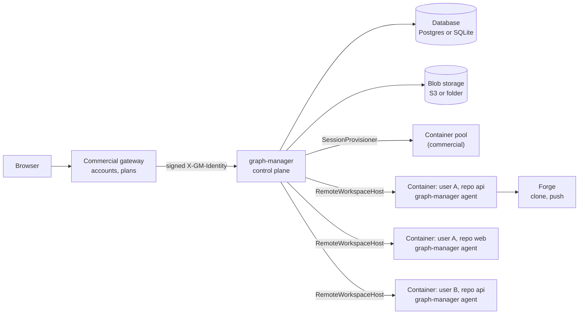
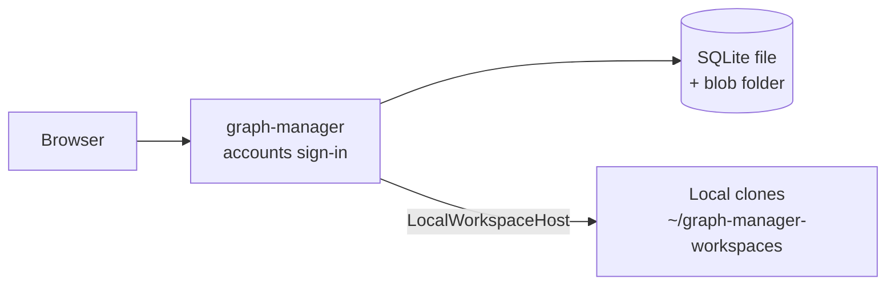
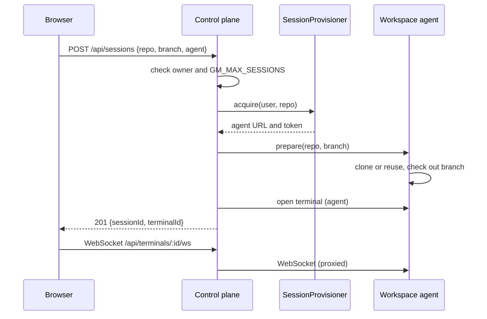
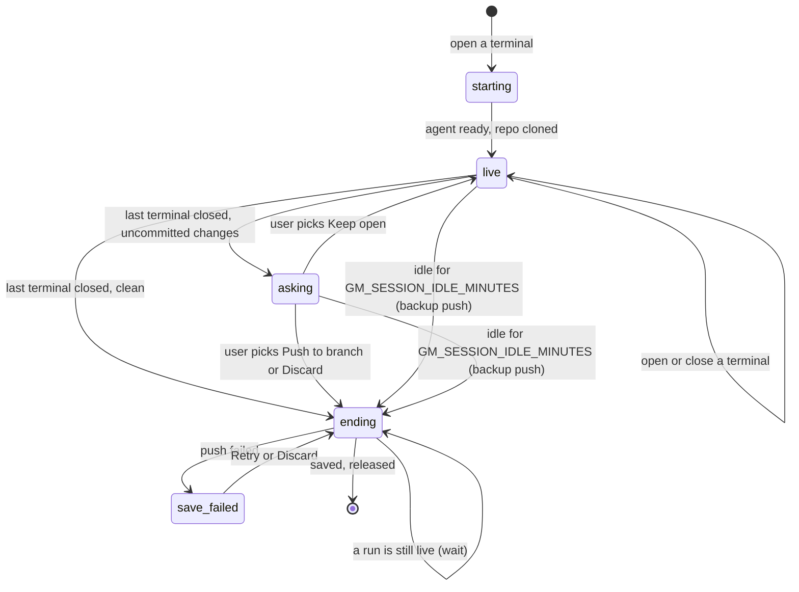

# Hosted sessions: repo sessions, a workspace agent, accounts, gateway sign-in and session limits

## Summary

graph-manager now has accounts, per-user data in a database, and repo sessions instead of the Workspaces page. The same code serves an open-source install on one machine and a hosted, commercial deployment with one container per open repository.

For a self-hoster:

- **Built-in accounts.** Sign-in is a username and a password. An upgraded install becomes the account `admin`, with the password it had (`GM_PASSWORD` or `<dataDir>/password`). `GM_SIGNUP=open` adds **Create account** to the login page; otherwise `graph-execution manager users add <username>` prints a set-password link. Each user has their own forge tokens, reviewers, sandbox recipe, repository settings, run defaults and agent keys. There is no admin role.
- **SQLite by default.** The state is in `<dataDir>/graph-manager.db`; `GM_DATABASE_URL=postgres://…` uses Postgres instead. An old `graph-manager.json` is imported on the first start. Ended runs are archived (database row plus a `.tar.gz` of the run folder) so the Runs page keeps them.
- **Repo sessions.** The Workspaces tab is gone. **New terminal** picks a repository (or a project), a branch and an agent; a repository with at least one open terminal is a live session on one branch. Closing its last terminal ends the session, after asking what to do with uncommitted changes.
- **Settings → Repositories** holds the per-repository settings (sandbox image, Run in sandbox, run defaults). **Settings → Account** changes the display name and password; **Settings → Agents** holds API keys per provider.
- **Docker sessions.** Once the install has two or more accounts, each session runs in its own Docker container with the user's own volume, so users cannot read each other's files from a terminal (`GM_SESSION_RUNTIME`).

For the commercial deployment:

- **Gateway sign-in** (`GM_AUTH=gateway`): graph-manager trusts a signed `X-GM-Identity` header and has two server-to-server endpoints to disable and delete users.
- **A workspace agent.** `graph-manager agent` serves every `WorkspaceHost` operation over HTTP and a WebSocket from inside a container; `RemoteWorkspaceHost` is its client. A `SessionProvisioner` passed to `buildApp` creates and removes the containers.
- **Caps**, all off by default: `GM_MAX_SESSIONS`, `GM_MAX_RUN_CONTAINERS`, `GM_SESSION_IDLE_MINUTES`.
- **UI plugins** (`GM_UI_PLUGINS`): ES modules that add nav items, pages, a top-bar item and settings sections.
- **Hosted runs end in a PR.** A run of a remote session runs in its own run container from the session branch and ends in a PR into that branch (see [hosted runs](hosted-runs.md)).

- Spec: `docs/prd/done/hosted-sessions.md`.
- Tasks: `.agents/tasks/hosted-sessions/` (15 tasks).
- Ticket: none (hosted-sessions spec).
- User docs: "Accounts", "Sessions and limits", "Database and blobs", "Gateway mode", "UI plugins" and the Configuration table in `apps/graph-manager/README.md`.

## Diagrams

Hosted: one control plane, one container per open repository.



Open source: the same code on one machine (with one account; with two or more, sessions run in Docker containers through `DockerProvisioner` and `RemoteWorkspaceHost`).



Opening a terminal.



Session lifecycle. The states are the code's (`starting`, `live`, `asking`, `ending`, `save-failed` in `store.ts`). Changed from the spec's diagram: the idle limit is `GM_SESSION_IDLE_MINUTES` (not a fixed 15 minutes), an `asking` session can also end idle, and a failed idle backup goes to `save-failed` too.



`save_failed` in the diagram is the `save-failed` state (Mermaid state names cannot contain `-`).

## Decisions

| Decision | Why | Ticket |
| --- | --- | --- |
| One container per (user, repository). More terminals on the same repository open as more shells in the same container. | A shell costs a few MB; a container costs real money. | hosted-sessions spec |
| The branch is chosen when the session starts and is fixed while it is live. A new terminal on a live repository joins it and shows the branch read-only. | One checkout per container; no branch switch under a running agent. | hosted-sessions spec |
| `GM_MAX_SESSIONS` (integer ≥ 1) caps the sessions per user. Above it `POST /api/sessions` answers 409 "You have 3 open repositories. Close all terminals of one to open another." (the number is the limit). A session counts until it is released, also while kept open with no terminal. | The commercial deployment sets 3; per-plan limits can come later from the gateway. | hosted-sessions spec |
| Every cap is an environment variable and off by default: `GM_MAX_SESSIONS`, `GM_MAX_RUN_CONTAINERS`, `GM_SESSION_IDLE_MINUTES`. | All caps configurable, none by default; open-source installs never hit one. | hosted-sessions spec |
| A project session counts as one session. `POST /api/sessions { projectId }` clones or updates every repository on the same new or existing branch and writes the project folder; it has one terminal in the project folder. | One change across repositories is one unit of work, as in a KAN-95 suite. | hosted-sessions spec |
| Projects are made of forge repositories (`repos: RepoRef[]`), picked with the same search as New terminal; nothing is cloned until a project session starts. Projects saved as workspace ids are read as the same repositories. | The Workspaces tab is gone, so projects can no longer be built from clones. | hosted-sessions spec |
| Hosted runs end in a PR. **Start run** on a remote session pushes the session branch, takes a run container from `acquireRun`, clones the branch there and runs. The drawer has no Run in sandbox toggle and warns "Uncommitted changes in acme/api are not part of the run." When the run is applied, Create PR runs in the run container: branch `gm/<runId>`, spec moved to `docs/prd/done/`, PR into the session branch (one linked PR per changed repository for a project run). Then the run is archived and its container released. `GM_MAX_RUN_CONTAINERS` caps live run containers; above it `POST /api/runs/:ws` answers 409 "You have 3 sandboxed runs. Wait for one to finish or stop it." | Every hosted run ends with a PR, and the session's files are never touched, so there are no conflicts. Details in [hosted runs](hosted-runs.md). | hosted-sessions spec |
| Local sandboxed runs are unchanged (Docker, KAN-88). `LocalProvisioner.acquireRun` throws; a local session never calls it. | No behaviour change for open-source users with one account. | hosted-sessions spec |
| The engine (`packages/graph-execution/src`) is unchanged; its `package.json` only gains graph-manager's dependencies (`better-sqlite3`, `pg`). | Only graph-manager changes; the plain CLI flow stays as it is. | hosted-sessions spec |
| If opening the PR fails, the pushed `gm/<runId>` stays, the PR panel shows the error and **Create PR** retries it. The run container is released anyway. | The work is safe on the forge; no container is held. | hosted-sessions spec |
| Each user connects their own GitHub or GitLab token in Settings, kept in their own store data. | A GitHub App can come later in the commercial repo. | hosted-sessions spec |
| Closing the last terminal ends the session. If a run of the session is live, the session stays `ending` until the run ends, then it is released. | Frees the slot; never kills a running run. | hosted-sessions spec |
| Ask before closing: when the last terminal closes and the clone has uncommitted changes, the UI asks "acme/api has uncommitted changes." with **Push to branch**, **Keep open** and **Discard** (which asks "Discard all uncommitted changes in acme/api?" first). A clean clone ends without a question. | The user decides what happens to half-done work. | hosted-sessions spec |
| The same question is asked in open source. There, release keeps the clone on disk; after Push or Discard it is clean, so the next session can switch branch. | Local and hosted behave the same. | hosted-sessions spec |
| Commits made by graph-manager (Push to branch, idle backup) include every change git does not ignore; what `.gitignore` (or `.git/info/exclude`) covers is never committed. There is no fixed list of secret file names. The message is `graph-manager: save session <id>`. | The repository's own ignore rules decide; a fixed list also skipped files a repo commits on purpose (for example `.env.example`) and left the clone dirty. | user decision after the run |
| Idle: with `GM_SESSION_IDLE_MINUTES` set, a `live` or `asking` session with no terminal input or output and no live run for that long closes its terminals, pushes its uncommitted changes to `gm/backup/<session id>` (never the session branch) and ends without asking. The check runs every 60 s. The next `GET /api/notices` returns "Your session on acme/api was closed after 15 minutes idle. Changes were saved to branch gm/backup/<id>." (without the second sentence when there were no changes), shown in the notice banner. | Nobody is there to ask; the backup branch keeps the work without touching the working branch. | hosted-sessions spec |
| A failed push (Push to branch or idle backup) leaves the session in `save-failed` with the error; the container is kept and the sidebar shows **Retry** and **Discard**. A failed idle backup also leaves a notice. | Never delete unsaved work silently. | hosted-sessions spec |
| Agent logins: the login files of `LOGIN_FILES` are saved from the session's host to the user's store when the session ends (at most 256 KB per file, 2 MB in all) and written into the user's next session. **Settings → Agents** saves a key per variable of `LOGIN_KEYS` (`ANTHROPIC_API_KEY`, `CLAUDE_CODE_OAUTH_TOKEN`, `OPENAI_API_KEY`), added to that user's terminals and runs. A key wins over saved files. | A user logs in once per agent, or uses an API key. | hosted-sessions spec |
| New branches default to `gm/<user-id>-<yyyymmdd>-<4 random [a-z0-9]>`; the user can pick an existing branch instead. | A predictable, unique branch the session can push to. | hosted-sessions spec |
| The control plane talks to an agent with a per-container random token (`Authorization: Bearer <token>`, 32 random bytes in `DockerProvisioner`). The agent answers 401 `{"error":"unauthorized"}` to anything else, except `GET /agent/v1/healthz`. | One container's token cannot drive another container. | hosted-sessions spec |
| Security is five points: (1) every store access is `store.forUser(req.user)`; (2) every session, terminal, workspace and run route checks the owner and answers 404 otherwise; (3) per-container agent tokens; (4) containers are never reused for another user; (5) `GM_GATEWAY_SECRET`, `GM_AGENT_TOKEN` and `GM_PASSWORD` are stripped from terminal and run environments. | These close the real cross-user paths; container hardening is the commercial repo's job. | hosted-sessions spec |
| The identity is an HS256 JWT in `X-GM-Identity`, signed with `GM_GATEWAY_SECRET` (≥ 32 characters), verified with `node:crypto`. Only `alg: HS256`; claims `sub` (1–128 characters) and `name` required, `email` optional, integer `iat`/`exp`, lifetime 1–600 s, 30 s clock skew. A missing or bad token answers 401 `{"error":"gateway identity required"}`. | Standard for a gateway, short-lived, no new dependency. | hosted-sessions spec |
| In gateway mode `POST /api/auth/login` and `/api/auth/logout` answer 404 "not available in gateway mode" and session cookies are not read. The Origin check stays on. | One way in per mode; CSRF protection still applies. | hosted-sessions spec |
| Built-in accounts (`GM_AUTH=users`, the default): a `users` table with a unique username (3–32 characters of `a-z`, `0-9`, `_`, `-`), display name, scrypt password hash (`node:crypto`, random 16-byte salt), created-at and disabled flag. Passwords are at least 10 characters. | Several people can use one install, each with their own data; no new dependency. | hosted-sessions spec |
| An existing install becomes the account `admin` with the password it has (`GM_PASSWORD` or `<dataDir>/password`). While `GM_PASSWORD` is set, every start sets admin's password to it (no minimum length, so `GM_PASSWORD=pw` works). Once admin changed a file-based password in Settings → Account, the startup line is "Accounts: N; manage them with graph-execution manager users". | Upgrading changes nothing for a single user except typing `admin` as the username. | hosted-sessions spec |
| `GM_AUTH=password` is accepted as an alias of `users`. | Old configs keep working. | hosted-sessions spec |
| Sign-up: `GM_SIGNUP=closed` (default) or `open`. Open shows **Create account** on the login page. Closed: `graph-execution manager users add <username>` prints a one-time `<url>/set-password?token=…` link valid 7 days; `users list`, `users reset <username>` (a new link) and `users disable <username>` also exist. The command refuses to run in gateway mode. | No admin role, so the server's command line is where accounts are managed. | hosted-sessions spec |
| No admin role. Reviewers, sandbox recipe and limits, repository settings, run defaults, forge tokens and agent keys are per user. Caps stay environment variables. | The store already keeps `Data` per user. | hosted-sessions spec |
| **Settings → Account** changes the display name and the password (the current one is required). A changed password, or one set through a link, ends the user's other sign-ins. | Basic account hygiene. | hosted-sessions spec |
| The session cookie carries the user id; a disabled user's cookies stop working at once. Failed logins are counted per IP and per username, 10 in 15 minutes each, then 429 "too many failed logins; try again later". | Extends the old cookie and rate limit to many users. | hosted-sessions spec |
| In gateway mode a user row (no password) is created on the first request of a new `sub`, and the display name is kept current. A `sub` that is a built-in account (one with a password) is refused with 403. | One `users` table for both modes; the two kinds never mix. | hosted-sessions spec |
| Gateway-only user management: `POST /api/gateway/users/:id/disable` (blocks the user, ends their sessions, releases their containers) and `DELETE /api/gateway/users/:id` (deletes the user's data, run rows, blobs, containers and volume, then the row). Both need `Authorization: Bearer <GM_GATEWAY_SECRET>` (else 401 "wrong gateway secret"), answer 204, 404 "no such user" for an unknown id, and exist only in gateway mode. | The gateway owns accounts but must be able to stop a user and delete their data. | hosted-sessions spec |
| Docker sessions in open source: `GM_SESSION_RUNTIME` is `auto` (default), `local` or `docker`. `auto` is `local` with one account and `docker` with two or more, decided each time a session opens. `DockerProvisioner` starts `gm-s-<sessionId>` from the owner's sandbox image running `graph-manager agent`, with the owner's volume `gm-user-<userId>` at `/workspaces`. Runs of a Docker session get their own container from `acquireRun`. | Real isolation between users on one server, and the same code path as hosted. | hosted-sessions spec |
| In `docker` mode, when Docker is not reachable, opening a session answers 503 "Sessions need Docker when this graph-manager has more than one account. Start Docker, or set GM_SESSION_RUNTIME=local if everyone here trusts each other." | A clear failure instead of falling back to shared terminals. | hosted-sessions spec |
| When `auto` switches to `docker` (a second account appears), live local sessions keep running; new sessions start in containers. A session keeps the provisioner that started it. | No surprise interruption. | hosted-sessions spec |
| Session and run containers run as `1000:1000`, are not privileged, have `no-new-privileges`, do not get the Docker socket, and are reached only through their agent port 7700. | Minimal container hygiene that matters. | hosted-sessions spec |
| Database: SQLite at `<dataDir>/graph-manager.db` (`better-sqlite3`, file mode 600 outside Windows) when `GM_DATABASE_URL` is unset; Postgres (`pg`) with `GM_DATABASE_URL=postgres://…` or `postgresql://…`. Both pass the same contract tests (`db.contract.test.ts`; on Postgres with `GM_TEST_DATABASE_URL`). | Nobody is forced to run Postgres; SQLite needs no setup. | hosted-sessions spec |
| Tables: `instance(key, value)`, `user_data(user_id, data, updated_at)` with one JSON `Data` document per user, `users`, `password_links`, `runs` (with real columns for listing), `schema_version`. Migrations are numbered SQL files (`001-base.sql`, `002-users.sql`, `003-runs.sql`) run at startup. | One document per user keeps the store code almost unchanged; runs get columns for listing and filtering. | hosted-sessions spec |
| On the first start with a database, an existing `graph-manager.json` is imported into `admin` and renamed `graph-manager.json.imported`. | Existing installs keep all their data with no manual step. | hosted-sessions spec |
| Blob storage: `<dataDir>/blobs/` by default; with `GM_BLOB_URL=s3://bucket/prefix` any S3-compatible store with the standard AWS credentials. `@aws-sdk/client-s3` is loaded only then; when it is missing, startup stops with `GM_BLOB_URL needs @aws-sdk/client-s3: npm install @aws-sdk/client-s3`. | Run folders are too big for database rows; works with nothing set up. | hosted-sessions spec |
| The archive keeps the whole run folder without git worktrees as a `.tar.gz` blob, key `runs/<user>/<workspace>/<runId>.tar.gz`, plus the `runs` row. | Task logs, review notes and tester notes are what people read when a run goes wrong. | hosted-sessions spec |
| One control-plane process per database. | Terminals and the in-memory session state live in one process. | hosted-sessions spec |
| Open source ships the agent, `RemoteWorkspaceHost` and the `SessionProvisioner` interface, plus `LocalProvisioner` and `DockerProvisioner`. Only the Kubernetes provisioner and warm pool are commercial. | The split is tested end to end here (an agent as a local process). | hosted-sessions spec |
| `RunArchive` writes the `runs` row when a run's status changes and the run-folder blob when it ends (and when its session ends). | History outlives the container. The view cache still snapshots live run pages. | hosted-sessions spec |
| Repository settings (sandbox image or recipe, Run in sandbox, run defaults) are in **Settings → Repositories**, keyed by repository id as before. | The Workspaces page is gone. | hosted-sessions spec |
| UI plugins: `GM_UI_PLUGINS` lists ES module URLs (`https://` or a path starting with `/`). Each default-exports `(api) => void`; `api` has `React`, `registerNav({ label, path })`, `registerRoute({ path, element })`, `registerTopbar(element)` and `registerSettingsSection({ title, element })`. A plugin that throws is logged and skipped. | Commercial UI without a build tie between repos; graph-manager's own React is passed in. | hosted-sessions spec |
| Built on `main` (with KAN-95). `feat/automation-api` (KAN-96) is rebased onto this work later. | Start now. | hosted-sessions spec |
| The Projects tab stays, for creating, editing and deleting projects; a project also opens from New terminal. | Projects need a place to be managed. | hosted-sessions spec |
| Every run of a remote session is sandboxed in its own run container and counts toward `GM_MAX_RUN_CONTAINERS`; the Run in sandbox toggle is hidden for it. Local sessions keep the toggle. | Runs never execute inside the session container. | hosted-sessions spec |
| The whole spec was built in one graph-execution run, tasks chained so the `WorkspaceHost` seam landed first. | The user's choice. | hosted-sessions spec |

## Environment variables

| Variable | Values / default | Meaning |
| --- | --- | --- |
| `GM_AUTH` | `users` (default), `password` (alias of `users`), `gateway` | How people sign in. Anything else stops startup with `GM_AUTH must be "users" or "gateway"`. |
| `GM_SIGNUP` | `closed` (default), `open` | Whether the login page offers **Create account**. Ignored in gateway mode. Other values: `GM_SIGNUP must be "open" or "closed"`. |
| `GM_DATABASE_URL` | unset = SQLite in `<dataDir>/graph-manager.db`; `postgres://…` or `postgresql://…` | The database. Another scheme: `invalid GM_DATABASE_URL: must start with postgres:// or postgresql://`. |
| `GM_BLOB_URL` | unset = `<dataDir>/blobs/`; `s3://bucket/prefix` | Where run archives go. With S3, the AWS SDK reads `AWS_ACCESS_KEY_ID`, `AWS_SECRET_ACCESS_KEY`, `AWS_REGION` and optionally `AWS_ENDPOINT_URL`. Another scheme: `invalid GM_BLOB_URL: must start with s3://`. |
| `GM_GATEWAY_SECRET` | at least 32 characters; required with `GM_AUTH=gateway` | Signs `X-GM-Identity` and is the bearer token of `/api/gateway/*`. Errors: `GM_GATEWAY_SECRET is required when GM_AUTH=gateway`, `GM_GATEWAY_SECRET must be at least 32 characters`. |
| `GM_GATEWAY_LOGOUT_URL` | an absolute `http(s)` URL | Where **Log out** goes in gateway mode (returned as `logoutUrl` by `GET /api/auth/me`). |
| `GM_MAX_SESSIONS` | integer ≥ 1; unset = no cap | Sessions per user. |
| `GM_MAX_RUN_CONTAINERS` | integer ≥ 1; unset = no cap | Live run containers (runs of remote sessions) per user. |
| `GM_SESSION_IDLE_MINUTES` | integer ≥ 1; unset = never | Minutes without terminal input or output and without a live run after which a session ends by itself. |
| `GM_SESSION_RUNTIME` | `auto` (default), `local`, `docker` | Where new sessions run; see Decisions. Other values: `GM_SESSION_RUNTIME must be "auto", "local" or "docker"`. |
| `GM_UI_PLUGINS` | comma-separated `https://` URLs or paths starting with `/` | UI plugin modules. A bad entry: `GM_UI_PLUGINS entries must be https:// URLs or paths starting with /: <entry>`. |
| `GM_AGENT_TOKEN` | at least 32 characters; `graph-manager agent` only | The agent's bearer token. Missing or short: `GM_AGENT_TOKEN is required (at least 32 characters)`. The agent removes it from its own environment at startup. |
| `GM_TEST_DATABASE_URL` | a Postgres URL; tests only | Runs the database contract suite on Postgres too. |

`GM_PASSWORD` is still read: it is the `admin` account's password, and it is not read in gateway mode. Integer variables that are not integers ≥ 1 stop startup with `invalid <NAME>: …`.

`GM_GATEWAY_SECRET`, `GM_AGENT_TOKEN` and `GM_PASSWORD` are removed from the environment of every terminal (`STRIPPED_ENV` in `terminals.ts`) and every engine run (`LocalWorkspaceHost.startEngine`).

## The workspace agent API

Start it with a token of 32 or more characters:

```bash
GM_AGENT_TOKEN=<32+ characters> graph-manager agent --workspaces <dir> [--port <port, default 7700>] [--host <address, default 0.0.0.0>]
```

It prints `graph-manager agent listening on http://<host>:<port>` and stops on SIGINT or SIGTERM. Inside it is a `LocalWorkspaceHost` on `<dir>`, so it behaves exactly like local mode.

Every request needs `Authorization: Bearer <GM_AGENT_TOKEN>`, except `GET /agent/v1/healthz`, which answers `{"ok":true}`. Anything else answers 401 `{"error":"unauthorized"}`. Bodies are JSON (up to 16 MB). A body that does not match answers 400 `{"error":"<field>: <reason>"}`; a refused host operation answers its `HostError` status with `{"error"}`; an unknown path 404 `{"error":"not found"}`.

| Method and path | Body | Answer | WorkspaceHost method |
| --- | --- | --- | --- |
| `GET /agent/v1/healthz` | | `{"ok":true}`, no token needed | |
| `POST /agent/v1/prepare` | `{ repo, branch, cloneUrl?, auth? }` or `{ project: { id, name?, repos, cloneUrls? }, branch, cloneUrl?, auth? }`; `branch` is `{ new }` or `{ existing }`, `auth` is `{ forge, token }` | `{ workspaceId, branch }` | `prepare` |
| `POST /agent/v1/pty` | `{ workspaceId, argv, env, cols, rows }` (`cols`, `rows` 1–1000) | `{ id, pid }` | `spawnPty` |
| `GET /agent/v1/pty/:id` (WebSocket) | client messages `{type:"input",data}`, `{type:"resize",cols,rows}`, `{type:"kill",signal?}` | server messages `{type:"data",data}` (output buffered before attach is sent first), `{type:"exit",code}`; closes 4404 "pty not found", 4409 "pty already attached". Closing the socket kills the PTY. | the PTY of `spawnPty` |
| `POST /agent/v1/engine/start` | `{ workspaceId, args, env, timeoutMs, resumeRunId? }` | `EngineStart` | `startEngine` |
| `POST /agent/v1/file` | `{ workspaceId, path }` | `{ text }`, 404 when missing | `readFile` |
| `POST /agent/v1/stat` | `{ workspaceId, path }` | `FileStat`, 404 when missing | `stat` |
| `POST /agent/v1/files` | `{ workspaceId, path, glob? }` | `{ files }` | `listFiles` |
| `POST /agent/v1/runs` | `{ workspaceId }` | `{ runs }` | `listRuns` |
| `POST /agent/v1/run` | `{ workspaceId, runId }` | `RunDetail`, 404 when missing | `runDetail` |
| `POST /agent/v1/git` | `{ workspaceId, args, timeoutMs? }` | `{ exitCode, stdout, stderr }` | `git` |
| `GET /agent/v1/activity` | | `{ terminals, liveRuns, lastInputAt, lastOutputAt }` | `activity` |
| `POST /agent/v1/changes` | `{ workspaceId }` | `{ changes }` | `changes` |
| `POST /agent/v1/save` | `{ workspaceId, branch, message, auth? }` | `{ pushed, skipped, error? }`; secret files are always skipped (`filter` never crosses the wire) | `save` |
| `POST /agent/v1/discard` | `{ workspaceId }` | 204 | `discard` |
| `POST /agent/v1/login-files` | `{ op: "get" \| "put", providers, files? }` | `{ files }` | `loginFiles` |
| `POST /agent/v1/push-branch` | `{ workspaceId, auth? }` | `{ ok, error? }` | `pushBranch` |
| `POST /agent/v1/write-files` | `{ workspaceId, files: { "<rel path>": "<text>" } }` | `{ paths }` (absolute paths); 400 for a path with `..`, an absolute path or `.git` | hosted runs only (`RemoteWorkspaceHost.writeFiles`) |
| `POST /agent/v1/run-folder` | `{ workspaceId, runId }` | `{ files: [{ path, content (base64) }], skipped }`, at most 50 MB, without `worktrees/` and `.git` | hosted runs only (`RemoteWorkspaceHost.runFolder`) |
| `POST /agent/v1/project-pr` | `{ projectId, runId, auth? }` | `{ repos }` | hosted project runs only (`commitProjectRun`) |
| `ANY /agent/v1/view/:workspaceId/:runId/…` | | the run's live page, proxied (the `Authorization` header is not passed on) | |

## The SessionProvisioner contract

```ts
export interface SessionProvisioner {
  /** A session container for one repository or one project. Must be idempotent per sessionId (graph-manager calls it again after a restart). */
  acquire(p: { user: User; sessionId: string }): Promise<WorkspaceHost>;
  release(p: { user: User; sessionId: string }): Promise<void>;
  /** A run container for a sandboxed run (hosted only). */
  acquireRun(p: { user: User; sessionId: string; runId: string }): Promise<WorkspaceHost>;
  releaseRun(p: { user: User; runId: string }): Promise<void>;
}
```

What each method must do:

- `acquire` returns a ready `WorkspaceHost`: for a hosted provisioner, a `RemoteWorkspaceHost` on a new container running `graph-manager agent`, with a random per-container `GM_AGENT_TOKEN`, once `GET /agent/v1/healthz` answers. Called again with the same `sessionId` (a second open, a restart), it returns a host on the same container.
- `release` removes the session's container. A container is never reused for another user. graph-manager calls it only after the session's login files were saved and after its live runs ended.
- `acquireRun` returns a host on a new run container for one run of the session; `releaseRun` removes it (and its volume). A run container is released after Create PR (or after a failed or aborted run is archived).

The implementations in this repo:

- `LocalProvisioner`: `acquire` returns the one shared `LocalWorkspaceHost`; `release` does nothing (the clone stays on disk); `acquireRun` throws "LocalProvisioner has no run containers: local sandboxed runs use Docker".
- `DockerProvisioner`: session containers `gm-s-<sessionId>`, run containers `gm-r-<runId>`, from the owner's sandbox image. A session gets the owner's volume `gm-user-<userId>` at `/workspaces` (clones persist between sessions); a run gets a fresh volume and the owner's sandbox CPU, memory and PID limits. Each runs `graph-manager agent --port 7700 --workspaces /workspaces` from a read-only agent runtime volume at `/opt/gm-agent`, as `1000:1000`, not privileged, with `no-new-privileges`, on the `gm-sandbox` network, without the Docker socket. It waits up to 60 s for healthz and answers 502 with the container's last log lines when the agent does not start. After a restart it re-attaches to a running container with that container's own token. A disabled or deleted user's containers are removed; a deleted user's volume too.
- `RuntimeProvisioner` chooses between the two for each new session from `GM_SESSION_RUNTIME` and the number of accounts, and remembers which one started a session.

A commercial provisioner is passed to `buildApp`, which then uses it instead of the runtime choice:

```ts
// apps/graph-manager/src/server/app.ts
const app = await buildApp(config, { provisioner, store, runArchive });
```

A provisioner returns a `WorkspaceHost` (`host/types.ts`):

```ts
export interface WorkspaceHost {
  readonly kind: "local" | "remote";
  prepare(p: PrepareTarget & { branch: BranchChoice; cloneUrl?: string; auth?: GitAuth }): Promise<{ workspaceId: string; branch: string }>;
  /** argv [] = the host's default shell. env is ADDED to the host's own terminal base env. cwd = the workspace. */
  spawnPty(p: { workspaceId: string; argv: string[]; env: Record<string, string>; cols: number; rows: number }): Promise<PtyProcess>;
  /** env is ADDED to the host's engine base env. resumeRunId: take over a foreign lock of that run, as resume does. */
  startEngine(p: { workspaceId: string; args: string[]; env: Record<string, string>; timeoutMs: number; resumeRunId?: string }): Promise<EngineStart>;
  readFile(workspaceId: string, rel: string): Promise<string | undefined>;
  /** lstat-style info of a path inside the workspace; undefined when missing, absolute, or resolving outside it. */
  stat(workspaceId: string, rel: string): Promise<FileStat | undefined>;
  /** Files (not dirs, not symlinks) directly in `rel` matching `glob` (only `*` wildcards; default `*`), names sorted. */
  listFiles(workspaceId: string, rel: string, opts?: { glob?: string }): Promise<string[]>;
  listRuns(workspaceId: string): Promise<RunSummary[]>;
  runDetail(workspaceId: string, runId: string): Promise<RunDetail | undefined>;
  git(
    workspaceId: string,
    args: string[],
    opts?: { onStderr?: (chunk: string) => void; timeoutMs?: number },
  ): Promise<{ exitCode: number; stdout: string; stderr: string }>;
  activity(): Promise<HostActivity>;
  changes(workspaceId: string): Promise<string[]>;
  save(p: {
    workspaceId: string;
    branch: string;
    message: string;
    auth?: GitAuth;
    filter?: (path: string) => boolean;
  }): Promise<{ pushed: boolean; skipped: string[]; error?: string }>;
  discard(workspaceId: string): Promise<void>;
  loginFiles(op: "get" | "put", providers: string[], files?: Record<string, string>): Promise<Record<string, string>>;
  pushBranch(workspaceId: string, opts?: { auth?: GitAuth }): Promise<{ ok: boolean; error?: string }>;
}
```

`RepoRef` is `{ forge: "github" | "gitlab"; owner: string; name: string; baseUrl?: string }`, and a repository's workspace id is `<forge>~<owner…>~<name>` (`workspaceIdOf`).

## Testing against a local agent

From the repository root:

```bash
npm run build -w graph-execution && npm run build -w graph-manager

# Start an agent on a free port with a temp workspaces folder
export GM_AGENT_TOKEN=$(node -e 'console.log(require("node:crypto").randomBytes(32).toString("hex"))')
WS=$(mktemp -d)
node apps/graph-manager/dist/server/cli.js agent --port 17700 --host 127.0.0.1 --workspaces "$WS" &
AGENT_PID=$!

curl -s http://127.0.0.1:17700/agent/v1/healthz                       # {"ok":true}
curl -s -o /dev/null -w '%{http_code}\n' -X POST http://127.0.0.1:17700/agent/v1/runs \
  -H 'content-type: application/json' -d '{"workspaceId":"x"}'         # 401
curl -s http://127.0.0.1:17700/agent/v1/activity -H "Authorization: Bearer $GM_AGENT_TOKEN"
# {"terminals":0,"liveRuns":0,"lastInputAt":null,"lastOutputAt":null}

kill $AGENT_PID
```

The test suite does the same: `hostContractSuite` (`apps/graph-manager/src/server/host/contract.ts`) is one set of tests every `WorkspaceHost` must pass. `host/local.test.ts` runs it against `LocalWorkspaceHost`, and `agent/agent.test.ts` against `RemoteWorkspaceHost` talking to an agent started for the test, plus the agent's own checks (token, healthz, the PTY WebSocket). Run them with:

```bash
npm test -w graph-manager -- agent contract local
```

**Gateway mode locally:** start graph-manager with `GM_AUTH=gateway` and a secret, then make a header with `signIdentity` (exported by `identity.ts`, valid 5 minutes):

```bash
export GM_GATEWAY_SECRET=$(node -e 'console.log(require("node:crypto").randomBytes(32).toString("hex"))')
D=$(mktemp -d)
GM_AUTH=gateway GM_PORT=17421 GM_DATA_DIR=$D/data GM_WORKSPACES_DIR=$D/ws node apps/graph-manager/dist/server/cli.js &
GM_PID=$!
# prints "Sign-in: gateway (X-GM-Identity)"

TOKEN=$(node --input-type=module -e '
import { signIdentity } from "./apps/graph-manager/dist/server/identity.js";
console.log(signIdentity({ id: "ada", name: "Ada" }, process.env.GM_GATEWAY_SECRET));
')
curl -s http://127.0.0.1:17421/api/auth/me -H "X-GM-Identity: $TOKEN"   # {"user":{"id":"ada","name":"Ada"},"mode":"gateway"}
curl -s http://127.0.0.1:17421/api/auth/me                              # {"error":"gateway identity required"}
curl -s -o /dev/null -w '%{http_code}\n' -X POST http://127.0.0.1:17421/api/gateway/users/ada/disable \
  -H "Authorization: Bearer $GM_GATEWAY_SECRET"                         # 204

kill $GM_PID
```

A browser cannot add the header; put a small proxy in front (any reverse proxy that sets `X-GM-Identity` on each request) to use the UI in this mode.

**Docker sessions:** `sessions/docker-provisioner.test.ts` covers `DockerProvisioner` with a stubbed Docker client, and `sessions/docker-provisioner.docker.test.ts` runs a real session container (Linux, a daemon on `/var/run/docker.sock`, `node:24.22.1-bookworm` pulled, graph-manager built; otherwise skipped):

```bash
docker pull node:24.22.1-bookworm && npm run build -w graph-manager && npm test -w graph-manager -- docker-provisioner.docker
```

To see the 503 without Docker, start graph-manager with `GM_SESSION_RUNTIME=docker` and `GM_DOCKER_SOCKET` pointing at a socket that does not exist, connect the fake forge (`apps/graph-manager/scripts/fake-forge.mjs`, `GM_GITHUB_API_URL=http://127.0.0.1:<port>/github`, token `gh-good`) and open a session on `octo/hello`: `POST /api/sessions` answers 503 with the "Sessions need Docker…" message. The fake Docker (`apps/graph-manager/scripts/fake-docker.mjs`, TESTING.md "Sandboxes (fake Docker)") serves the sandbox routes for manual checks.

## Known follow-ups

- Several control-plane processes behind a load balancer: terminals and the in-memory session state (hosts, live sessions, hosted-run monitor) live in one process today.
- A GitHub App (or Sign in with GitHub) instead of personal access tokens.
- Per-plan limits from the gateway instead of one environment value per cap.
- Row-level security in Postgres. Today isolation is `store.forUser` and the owner checks in the routes.
- The Kubernetes provisioner and the warm pool of containers (commercial repo).
- Rebasing `feat/automation-api` (KAN-96) onto this work.
- Resuming a hosted run in a new run container is not built.
- A run container that stays open on its page (a failed task waiting for a retry) is held until it is closed; there is no idle limit for run containers (see [hosted runs](hosted-runs.md)).
- `RemoteWorkspaceHost.writeFiles`, `runFolder` and `commitProjectRun` are not on the `WorkspaceHost` interface.
- Gateway mode has no built-in way for a browser to send `X-GM-Identity`; it needs the gateway in front.
- Terminals do not survive a restart of graph-manager; a session container does, and is re-attached, but its shells are gone.

## Code references

- `apps/graph-manager/src/server/identity.ts`: `User`, `ADMIN_USER`, `verifyIdentity`, `signIdentity`, `IDENTITY_HEADER`.
- `apps/graph-manager/src/server/auth.ts`: the auth hook (cookie or `X-GM-Identity`), login, logout, `/api/auth/me`, `/api/auth/info`, the rate limit, `resolveGatewayUser`.
- `apps/graph-manager/src/server/accounts.ts`, `apps/graph-manager/src/server/routes/accounts.ts`: users, scrypt hashes, set-password links, `ensureAdmin`; sign-up, set-password and `/api/account`.
- `apps/graph-manager/src/server/cli.ts`, `apps/graph-manager/src/server/cli/users.ts`: the `graph-manager` bin (`serve`, `users`, `agent`) and `graph-execution manager users`.
- `apps/graph-manager/src/server/routes/gateway.ts`, `apps/graph-manager/src/server/user-lifecycle.ts`: the gateway disable/delete endpoints and the hooks that end a user's sessions and delete their data.
- `apps/graph-manager/src/server/config.ts`, `apps/graph-manager/src/server/password.ts`, `apps/graph-manager/src/server/main.ts`: every `GM_*` variable, the admin password, the startup lines.
- `apps/graph-manager/src/server/db/db.ts`, `apps/graph-manager/src/server/db/sqlite.ts`, `apps/graph-manager/src/server/db/postgres.ts`, `apps/graph-manager/src/server/db/migrate.ts`, `apps/graph-manager/src/server/db/migrations/`, `apps/graph-manager/src/server/db/import-json.ts`: the database layer, migrations and the `graph-manager.json` import (see [database store](database-store.md)).
- `apps/graph-manager/src/server/store.ts`: `Store`, `store.forUser`, `Data` (sessions, notices, agent keys, login files, hosted runs).
- `apps/graph-manager/src/server/blobs.ts`, `apps/graph-manager/src/server/runarchive.ts`: `BlobStore` (folder, S3), `RunArchive`, `runBlobKey`.
- `apps/graph-manager/src/server/host/types.ts`, `apps/graph-manager/src/server/host/local.ts`, `apps/graph-manager/src/server/host/remote.ts`, `apps/graph-manager/src/server/host/contract.ts`: `WorkspaceHost`, `RepoRef`, `LocalWorkspaceHost`, `RemoteWorkspaceHost`, `hostContractSuite`.
- `apps/graph-manager/src/server/agent/server.ts`, `apps/graph-manager/src/server/agent/cli.ts`: the workspace agent and `graph-manager agent`.
- `apps/graph-manager/src/server/sessions/provisioner.ts`, `apps/graph-manager/src/server/sessions/runtime.ts`, `apps/graph-manager/src/server/sessions/docker-provisioner.ts`, `apps/graph-manager/src/server/sessions/agent-image.ts`: `SessionProvisioner`, `LocalProvisioner`, `RuntimeProvisioner`, `DockerProvisioner`, the agent runtime image and user volumes.
- `apps/graph-manager/src/server/sessions/sessions.ts`, `apps/graph-manager/src/server/routes/sessions.ts`: `SessionManager` (open, join, close, end, `GM_MAX_SESSIONS`, `defaultBranchName`), `/api/sessions`, `/api/repos`, the owner check.
- `apps/graph-manager/src/server/sessions/idle.ts`, `apps/graph-manager/src/server/routes/notices.ts`: the idle loop, `gm/backup/<id>`, `/api/notices`.
- `apps/graph-manager/src/server/sessions/secrets.ts`: the secret files a save never commits.
- `apps/graph-manager/src/server/hosted-runs.ts`, `apps/graph-manager/src/server/hosted-project-pr.ts`, `apps/graph-manager/src/server/routes/runs.ts`: hosted runs and `GM_MAX_RUN_CONTAINERS` (see [hosted runs](hosted-runs.md)).
- `apps/graph-manager/src/server/sessions/logins.ts`, `apps/graph-manager/src/server/routes/agent-keys.ts`, `apps/graph-manager/src/server/sandbox-run.ts`: agent login files, Settings → Agents keys, `LOGIN_FILES` and `LOGIN_KEYS`.
- `apps/graph-manager/src/server/projects.ts`, `apps/graph-manager/src/server/routes/projects.ts`: projects as `repos: RepoRef[]`.
- `apps/graph-manager/src/server/routes/ui.ts`, `apps/graph-manager/src/web/plugins.ts`: `/api/ui/plugins` and the plugin loader.
- `apps/graph-manager/src/server/app.ts`: `buildApp` and its options (`provisioner`, `store`, `runArchive`, `blobs`, `db`).
- `apps/graph-manager/src/web/pages/NewTerminalDialog.tsx`, `apps/graph-manager/src/web/pages/TerminalSidebar.tsx`, `apps/graph-manager/src/web/pages/CloseSessionDialog.tsx`, `apps/graph-manager/src/web/sessions.ts`: New terminal, the session sidebar, the close dialog.
- `apps/graph-manager/src/web/pages/RepositoriesCard.tsx`, `apps/graph-manager/src/web/pages/AccountCard.tsx`, `apps/graph-manager/src/web/pages/AgentKeysCard.tsx`, `apps/graph-manager/src/web/pages/Settings.tsx`: Settings → Repositories, Account and Agents.
- `apps/graph-manager/src/web/pages/Login.tsx`, `apps/graph-manager/src/web/pages/Signup.tsx`, `apps/graph-manager/src/web/pages/SetPassword.tsx`: the login, sign-up and set-password pages.
- `apps/graph-manager/src/web/components/NoticeBanner.tsx`: the notices banner.

## Related

- [graph-manager](graph-manager.md)
- [Sandboxed runs](sandboxes.md)
- [Multi-repo runs](multi-repo.md)
- [Agent tools](agent-tools.md)
- [Database store](database-store.md)
- [Hosted runs](hosted-runs.md)
- [Wiki index](../index.md)

## Last updated

2026-11-14
