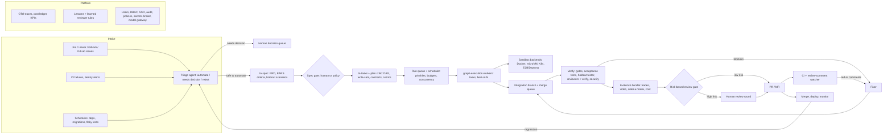

# Win on verified evidence, then become the factory

graph-execution is already one of the few open-source tools that runs the whole loop of spec → dependency DAG → parallel agents in isolated worktrees → integration branch with AI conflict resolution → validation gates → PRD-judged multi-reviewer, live-tester and fixer loop → human review. Its "next level" should not be more orchestration, because vendors are absorbing orchestration fast: Claude Code's dynamic workflows run up to 1,000 subagents from a script ([Claude Code docs](https://code.claude.com/docs/en/workflows)), Cursor 3.3 turns a plan into a dependency graph and dispatches the parallel branches to subagents (secondary, [DEV](https://dev.to/davekurian/cursor-3s-parallel-agents-change-what-a-template-ships-with-joc)), and GitHub's Agent HQ offers a "mission control" across Claude, Codex and Copilot agents ([GitHub Blog](https://github.blog/news-insights/company-news/welcome-home-agents/)). The defensible ground is **verification quality, cost governance and evidence a reviewer can trust**, because review is now the bottleneck and the research says selection and verification, not generation, limit results. The highest-value additions are, in order: structured agent results with a cost ledger and budgets; a verify-the-findings stage, acceptance-tests-first and a test-tamper guard; declared write-sets to prevent "clean merge, broken build"; per-task best-of-N with cross-provider candidates; evidence bundles (traces, video, screenshots) that reach the PR; a post-PR loop that routes CI failures and review comments back to the fixer; and a safer default security posture than today's `--dangerously-skip-permissions`. On the factory question the answer is **yes, but as an open-core, self-hostable "light factory" (human-gated, around level 3–4 of the community's five-level scale)**, not a dark factory. The path is intake and a run queue, then holdout scenarios and evidence, then teams, audit and pluggable remote sandboxes. The repo's own CLAUDE.md workflow (Jira → spec → tasks → run → verify → PR) is the first factory to automate.

> **How to read the evidence in this report.** The research notes behind it could not reach several primary sites (arXiv full texts, cursor.com, docs.devin.ai, developers.openai.com, factory.strongdm.ai, warp.dev, the GitHub API). Claims marked **(secondary)** rest on search summaries, aggregators or third-party write-ups. Claims marked **(unverified)** come from a single weak source or the researchers' background knowledge and should be re-checked before anyone quotes them publicly. Vendor numbers (resolution rates, % of PRs automated) are self-reported. Unmarked claims cite a primary page the researchers read. Effort is S (under 1 week), M (2–4 weeks) or L (1–3 months) for one experienced engineer, or for one graph-execution run plus verification when the work is dogfooded.

## A git-native, review-gated DAG runner already sits a layer above its rivals

graph-execution is an MIT-licensed npm CLI in a TypeScript monorepo. A run takes a folder of task JSON files (`id`, `content`, `dependencies`, optional per-task `validate`) that form a DAG, validates the graph up front, and runs each task as a headless coding agent (Claude Code, Codex, OpenCode or Qwen Code, one provider per run) in its own git worktree, up to a concurrency cap. Each finished task merges into an integration branch `graph/<run-id>`, with an AI resolver for conflicts, which unblocks its dependents. Validation commands gate per task or at the end, with validation-fix rounds. When all tasks are merged, a review loop runs: configurable parallel reviewers (diff reviewers with file globs, a `blockAt` severity, per-reviewer provider and model, plus a live tester that runs the app against a `test-plan.json` of `must` and `should` cases) judge the result against the PRD; a fixer handles blockers and majors for up to N passes; reviewers re-verify earlier findings each round, and a finding without a concrete failure scenario is downgraded to minor. Optional human review adds GitHub-style comments, verdicts and further fix rounds. A clean result lands on the starting branch as **uncommitted changes**. Suites run several features in parallel, integrate them on `suite/<id>`, and run a cross-feature reviewer and e2e tester. The engine has resume (with config, task and spec hashes checked), loop detection, idle timeouts, failure summaries with a retry verdict, a terminal live view, a web view and cleanup. The `to-spec`, `to-tasks` and `run-graph` skills let an interactive agent write the PRD, the task DAG and the test plan, for example from Jira.

graph-manager wraps this in a single-user Docker web service: GitHub and GitLab workspaces, browser terminals running agents, per-run Docker sandboxes built from toolchain recipes (CPU, memory and PID limits; no access to the forge tokens in `/data`), MCP tools for agents such as `open_start_run`, a run dashboard, a reviewers editor and Create PR/MR.

Reading the code confirms the gaps the brief lists, and adds two that matter for security. There is **no cost or token capture and no OpenTelemetry** anywhere in `packages/` or `apps/`. The Claude provider spawns `claude -p --dangerously-skip-permissions --output-format stream-json --verbose` (`packages/graph-execution/src/providers/claude.ts:31`), so it already parses stream-json but uses neither the `result` event's cost fields nor `--json-schema`. And graph-manager's sandbox copies provider login files and passes `ANTHROPIC_API_KEY`, `CLAUDE_CODE_OAUTH_TOKEN` and `OPENAI_API_KEY` into the container as environment variables, which is the opposite of the "credentials never reach the sandbox" pattern Anthropic describes for Managed Agents ([Anthropic](https://www.anthropic.com/engineering/managed-agents)). There is also no ticket intake or run queue (`list` expects one run at a time), no multi-user support, no best-of-N, and no loop from a PR's CI results or review comments back into the run.

## Rivals lead on reach and polish, graph-execution on verified integration

The market converged during 2025–26 on five patterns: an isolated sandbox per agent, a mission-control UI with mid-run steering, a plan artifact a human can steer before coding, self-verification with visual evidence attached to the PR, and triggers from trackers and chat (sources in the table below). graph-execution has the first and parts of the third; it lacks the rest. Against open source, its combination of DAG execution, integration branch, gates and a PRD-judged review loop is unusual: session managers "still leave task alignment, conflict resolution, and merge decisions" to the human (secondary, [Verdent](https://www.verdent.ai/guides/multi-agent-coding-tools)), and spec tools such as Spec Kit, Kiro, BMAD and Task Master stop at a task list (secondary, [ssojet](https://ssojet.com/blog/best-spec-driven-development-tools)).

| Product | What it does better than graph-execution today | Where graph-execution is ahead |
|---|---|---|
| **Claude Code** (workflows, agent teams, Code Review) | Script-defined fan-out to 1,000 agents with deterministic replay resume, stall restarts and prompt-cache sharing; managed Code Review that verifies, dedups and ranks findings ([workflows](https://code.claude.com/docs/en/workflows), [Code Review](https://code.claude.com/docs/en/code-review)) | Workflows run inside one session with no worktree per task, no merge step, no mid-run human input and one provider; agent teams do not work under `-p` ([agent teams](https://code.claude.com/docs/en/agent-teams)) |
| **OpenAI Codex** (cloud, CLI, Symphony) | Best-of-N with 1–4 attempts (secondary, [Vaughan](https://codex.danielvaughan.com/2026/04/01/codex-cloud-exec-best-of-n-attempts/)); reusable cloud environments with VM state recoverable for 7 days (secondary, [TechCrunch](https://techcrunch.com/2026/09/29/openai-gives-codex-reusable-cloud-environments-that-work-across-devices/)); Symphony turns a Linear board into the control plane ([OpenAI](https://openai.com/index/open-source-codex-orchestration-symphony)) | Explicit DAG with dependencies and an integration branch; PRD-judged review and live tester; multi-provider |
| **GitHub Copilot / Agent HQ** | Issue and Jira assignment (Jira GA 2026-06-25), self-review plus code, secret and dependency scanning before the PR, policy and audit control plane ([GitHub Blog](https://github.blog/ai-and-ml/github-copilot/whats-new-with-github-copilot-coding-agent/), [Changelog](https://github.blog/changelog/2026-06-25-github-copilot-for-jira-is-now-generally-available/)) | Feature-level decomposition and integration; runs locally with any of four CLIs; no per-seat lock-in |
| **Cursor 3.x** (cloud agents, Bugbot) | VM per agent with computer use and video/screenshot artifacts on PRs ([Cursor](https://cursor.com/changelog/02-24-26)); automatic plan → DAG → parallel subagents (secondary); Bugbot learned rules at a reported 78% resolution rate (vendor, [Cursor](https://cursor.com/blog/bugbot-learning)) | Open source and self-hostable; human-reviewable task files; review against a spec rather than only the diff |
| **Google Antigravity** (absorbing Jules) | Agent Manager plus inline-commentable artifacts (plans, task lists, recordings) ([Google](https://developers.googleblog.com/build-with-google-antigravity-our-new-agentic-development-platform/)); Jules's Planning Critic (secondary, [Jules changelog](https://jules.google/docs/changelog/)) | Jules winds down on 2026-12-31 (secondary), a reminder that self-hosted tools outlive vendor pivots |
| **Devin / Windsurf** | Auto-generated repo wiki, playbooks, knowledge (unverified); automations and automated PR reviews (secondary, [Releasebot](https://releasebot.io/updates/devin)) | Verification depth, multi-provider, cost of entry |
| **Amazon Kiro** | EARS requirements with requirement → task traceability; property tests from acceptance criteria; lifecycle hooks (secondary, [axonbuild](https://axonbuild.com/blog/kiro-ide-review/)) | Kiro is IDE-only and supervised; graph-execution executes the task list in parallel |
| **Composio Agent Orchestrator** | Routes failed CI logs and PR review comments back to the authoring agent, with retry limits and escalation ([docs](https://mintlify.com/ComposioHQ/agent-orchestrator/introduction)) | DAG scheduling, integration branch, PRD review |
| **Gas Town + beads** | Git-backed persistent work state and a Refinery merge-queue role; beads issues with typed dependency edges (secondary, [ascii.co.uk](https://ascii.co.uk/news/article/news-20260125-f25263de/steve-yegges-gas-town-reveals-agent-orchestration-design-pat)) | Far simpler mental model ("a folder of JSON tasks") with explicit gates |
| **OpenHands** | Rolling integration branch for refactors; Refactor SDK auto-decomposition (private beta) ([OpenHands](https://openhands.dev/blog/automating-massive-refactors-with-parallel-agents)) | The integration-branch design is validated, and graph-execution ships it in OSS today |
| **Warp Factories** | Hosted control plane launching Claude Code, Codex, Cursor and Warp agents (closed beta, Aug 2026) ([Fortune PR](https://fortune.com/press-releases/warp-launches-warp-factories-automate-software-development-2026-08-18/)) | Open and self-hosted; review loop built in |

Two caveats temper the "ahead" column. No head-to-head benchmark yet shows that a DAG orchestrator beats a single strong agent on feature-level work, and the scaling literature warns it may not on tightly coupled changes (Section 2 of the roadmap below). And graph-execution's mindshare is small next to OpenCode (about 210k stars), Spec Kit (115k+) or vibe-kanban (about 28.6k) (all secondary snapshots, [morphllm](https://www.morphllm.com/comparisons/opencode-vs-kilo-code), [ssojet](https://ssojet.com/blog/best-spec-driven-development-tools), [GitHub](https://github.com/BloopAI/vibe-kanban)). Distribution and a published benchmark therefore belong on the roadmap alongside features.

## Nine themes turn a strong runner into a trustworthy one

The roadmap below groups about forty capabilities into nine themes. Priorities are **P0** (do in the next month: cheap, unblocks other work, or closes a safety gap), **P1** (next quarter) and **P2** (within the year). Impact is judged against the two complaints users repeat most: agents produce more code than humans can review ([HN](https://news.ycombinator.com/item?id=49465119)), and multi-agent runs burn tokens unpredictably (multi-agent systems use about **15× the tokens of chat** per Anthropic, [Anthropic](https://www.anthropic.com/engineering/multi-agent-research-system)).

### Verification is the bottleneck and the moat

The best-supported finding across the research is that independent, skeptical, tool-using verification moves quality more than anything else. Anthropic's harness posts found that out of the box "Claude was a weak QA agent" that talked itself into approving issues it had found, and that a separate tuned evaluator driving the app with Playwright caught stubbed features ([Anthropic](https://www.anthropic.com/engineering/harness-design-long-running-apps)). The C-compiler project concluded that "the verifier must be nearly perfect" ([Anthropic](https://www.anthropic.com/engineering/building-c-compiler)). The research numbers point the same way: generating tests from the issue before any patch exists and using them as a fail-to-pass filter raised patch precision **from 60.8% to 91.9%**, at a cost of 33% recall ([Otter, arXiv](https://arxiv.org/html/2502.05368v2)); diff-only LLM reviewers caught only **15–31% of human-flagged issues** ([SWE-PRBench, arXiv](https://arxiv.org/html/2603.26130v1)); and agents with write access to tests cheat often, while one prompt clause ("STOP if tests are flawed") cut GPT-5's hacking rate **from 93% to 1%** on one ImpossibleBench variant ([ImpossibleBench, arXiv](https://arxiv.org/pdf/2510.20270)). graph-execution's review loop has the right shape; it needs sharper filters and anti-gaming guards.

The second verification problem is specific to parallel agents. Patches that pass alone can fail together without any textual conflict: a 2026 benchmark saw that in 97% of runs on constructed Django tasks, and one coordination message recovered most cases (secondary, snippet-level, [arXiv 2609.25396](https://arxiv.org/html/2609.25396)). About **27.7% of roughly 107k agentic PRs** conflicted with their base at merge time, and cross-agent pairs conflicted more than same-agent pairs, 41.7% versus 19.8% (secondary, [summary](https://codex.danielvaughan.com/2026/07/28/agent-pr-merge-conflicts-concurrent-coding-agents-codex-cli-worktree-isolation-coordination-defence/)). HN users describe the same failure in plain words: "neither worktree is 'wrong' but the code is incoherent" ([HN](https://news.ycombinator.com/item?id=45489884)).

| Capability | Evidence / who does it | Design sketch for this codebase | Effort | Impact | Priority |
|---|---|---|---|---|---|
| **Verify-findings stage** | Claude Code Review verifies, dedups and ranks; Bugbot's validator ([Code Review docs](https://code.claude.com/docs/en/code-review)) | New phase between reviewers and fixer: one cheap agent per round gets all blocker/major findings and must reproduce each (cite file:line plus a command or test) or mark it `refuted`. Dedup across reviewers by file, line and rationale similarity. Only survivors reach the fixer; refuted ones show in the summary. | M | High: fewer wasted fix passes, less noise for humans | P0 |
| **No-progress stop for fixer** | Claude Code workflows' "two rounds make no progress" rule ([docs](https://code.claude.com/docs/en/workflows)) | Track the open finding ids and failing test ids per pass; if two consecutive passes leave the set unchanged or oscillating, end the loop early and go to human review. | S | Medium: saves cost on hopeless loops | P0 |
| **Test-tamper guard** | ImpossibleBench; METR reward-hacking reports ([arXiv](https://arxiv.org/pdf/2510.20270)) | After every task and fixer commit, diff a protected-paths list (tests, CI config, the validate scripts, snapshots, `test-plan.json`). Flag deleted tests, new `.skip`/`xit`/`@pytest.mark.skip`, loosened assertions, edits to validate commands; raise a blocker that only a human can clear. Add the "STOP and report if a test contradicts the spec" clause to every task and fixer prompt. | S | High: closes the cheapest way to fake green | P0 |
| **Acceptance tests first** | Otter's issue-to-test filter; Anthropic's "sprint contract" ([Otter](https://arxiv.org/html/2502.05368v2), [Anthropic](https://www.anthropic.com/engineering/harness-design-long-running-apps)) | Optional DAG root task `acceptance` generated by `to-tasks`: write failing tests from the PRD's acceptance criteria, merge them first, mark them protected. Every task's validate then includes them; the reviewer reports per-criterion pass/fail. | M | High: turns "reviewer opinion" into executable evidence | P1 |
| **Holdout scenarios** | StrongDM keeps scenarios from implementers and verifies against simulated services (secondary, [Stanford CodeX](https://law.stanford.edu/2026/02/08/built-by-agents-tested-by-agents-trusted-by-whom/)) | A `holdout` section of `test-plan.json` (or a separate file outside the tasks folder) that only the tester sees, never copied into task or fixer worktrees. The fixer gets the failure symptom, not the scenario text. | M | High for factory mode | P1 |
| **Declared write-sets and overlap check** | Claim Plane pre-write admission ([arXiv](https://arxiv.org/pdf/2608.00947)); CLAUDE.md already tells humans to group tickets that edit the same code | Add optional `writes: ["src/foo/**"]` to the task schema; `validate-tasks.mjs` and the engine reject or warn when two tasks without a dependency path overlap. At runtime, warn when an agent commits outside its claim; the reviewer flags out-of-scope hunks (FeatBench's scope creep). | S–M | High: prevents merge hell before it starts | P0 |
| **Interface-contract tasks and decision log** | "Passes alone, fails together" oracle message; Cognition's "share full traces" (secondary) | `to-tasks` emits a small upstream task that fixes shared types and signatures plus stub tests. After each merge, append a short entry to `.graph-execution/<run>/decisions.md` (interfaces added, helpers, conventions) and inject it into downstream task prompts. | M | Medium–high | P1 |
| **Cross-task regression on merge** | Same semantic-conflict papers | After each merge, run the union of all merged tasks' acceptance tests, not only the latest; optionally refresh still-running sibling worktrees with the new integration head ("rebase early"). | M | Medium | P1 |
| **Evidence bundle** | Cursor cloud agents attach video and screenshots; ProofShot posts evidence to PRs ([Cursor](https://cursor.com/blog/agent-computer-use), [ProofShot](https://github.com/belinwu/proofshot)) | Tester records Playwright traces, `recordVideo` and screenshots per case into `.graph-execution/<run>/evidence/<case-id>/`; each `must` verdict must reference a file that exists and is non-empty (Cursor's broken-mp4 failure mode, [forum](https://forum.cursor.com/t/getting-video-demos-out-of-cloud-agents/157217)). Web view shows them; graph-manager's Create PR embeds them. | M | High: directly shrinks human review time | P0–P1 |
| **Security gate** | Copilot agent runs code, secret and dependency scanning before the PR ([GitHub Blog](https://github.blog/ai-and-ml/github-copilot/whats-new-with-github-copilot-coding-agent/)); slopsquatting found 4.62–6.10% hallucinated packages (secondary, [CSA](https://labs.cloudsecurityalliance.org/research-rb/csa-research-note-slopsquatting-ai-coding-assistant-supply-c/)) | Built-in `security` reviewer type fed by Semgrep and gitleaks output, plus a lockfile-diff gate: every new dependency must exist, be older than N days and pass OSV/Socket checks, otherwise escalate to a human. | M | High in factory mode | P1 |
| **Mutation and API cases** | Meta ACH: 73% of mutation-guided generated tests accepted ([alphaXiv](https://www.alphaxiv.org/abs/2501.12862v1)) | `http` case type in `test-plan.json` (request, expected status, JSON schema) that runs without a browser; an advisory "test adequacy" reviewer that runs StrykerJS on changed files and asks the fixer to kill surviving mutants. | M | Medium | P2 |
| **Stall restarts and fast-sample validation** | Workflows restart a stalled agent up to 5×; C compiler's `--fast` 1%/10% test sample ([docs](https://code.claude.com/docs/en/workflows), [Anthropic](https://www.anthropic.com/engineering/building-c-compiler)) | Extend idle detection to resume (not restart) via the provider's session id; add `validateFast` for inner loops with the full `validate` at the gate; truncate validation output to a grep-able error summary with the full log on disk. | S | Medium | P1 |

### Test-time scaling converts parallel worktrees into accuracy

Repeated sampling is the most reliable published lever for resolve rate, and the bottleneck is selection: with 250 samples, coverage on SWE-bench Lite rose from 15.9% to 56% (unverified background, [arXiv](https://arxiv.org/abs/2407.21787)). Hybrid selection beats either signal alone: execution-based plus LLM-judge verification reached 51.0% at Best@26 on SWE-bench Verified ([R2E-Gym](https://arxiv.org/pdf/2504.07164)), and task-specific rubrics written by an exploring agent beat both test-based and judge-only selection ([Agentic Rubrics](https://arxiv.org/html/2601.04171v1)). Cost is the open problem, but selective verification recovered +1.73 points at about 1.09× cost (snippet-level, [SWE-Verifier](https://arxiv.org/html/2610.30284)) and trajectory reuse cut cost by up to 17.4% ([SWE-Replay](https://arxiv.org/html/2601.22129v2)). Codex ships best-of-N, but practitioners report near-identical attempts when the task is deterministic (secondary, [Vaughan](https://codex.danielvaughan.com/2026/04/01/codex-cloud-exec-best-of-n-attempts/)). graph-execution can force diversity across providers, which no single-vendor product can do.

| Capability | Evidence | Design sketch | Effort | Impact | Priority |
|---|---|---|---|---|---|
| **Per-task best-of-N** | Codex attempts; Agentless, CodeMonkeys | `candidates: k` on a task or `risk: high`; the scheduler runs k sibling worktrees (`task-<id>-c<j>`), optionally a different provider/model per candidate. Selection: (1) validate must pass, (2) acceptance tests, (3) a pairwise rubric judge against the PRD criteria. Losers' diffs stay in the run folder. | M | High on hard nodes | P1 |
| **Adaptive N** | SWE-Verifier, SWE-Replay | Start at N=1; spawn extra candidates only after a validation failure or a low-confidence review, replacing today's serial retries with "diverse parallel candidates + select". | M | High cost/quality ratio | P1 |
| **Rubric per task at authoring time** | Agentic Rubrics | `to-tasks` writes a short scored rubric into each task file; judges and reviewers use it. | S | Medium | P1 |
| **Retry with reflection** | Reflexion (unverified background) | Attempt 2+ gets a structured reflection (cause, what not to repeat) generated from attempt 1's log and the failure summary that already exists. | S | Medium | P0 |
| **Session resume for fixer and retries** | `--resume <session_id>` and fork in headless mode ([headless docs](https://code.claude.com/docs/en/headless)) | Store each agent's session id in `state.json`; fixer passes and "retry" resume the same session within the cache TTL instead of a cold start. | S–M | Medium: cost and continuity | P1 |

### Planning should catch bad decompositions before any code runs

The scaling study is the key caution here: across 180 configurations, coordination helped parallelizable tasks (+81% on Finance-Agent) but hurt sequential ones (−39% to −70%), independent multi-agent setups amplified errors up to 17.2×, centralized orchestration contained errors best, and returns turned negative once a single agent already exceeded about 45% ([Google Research](https://research.google/blog/towards-a-science-of-scaling-agent-systems-when-and-why-agent-systems-work/)). graph-execution is centralized, which the study favours, but its value depends on cutting tasks along low-coupling seams. Jules added a Planning Critic that refines the plan before code runs (secondary, [Jules changelog](https://jules.google/docs/changelog/)), Kiro adds EARS requirements with traceability (secondary, [particula](https://particula.tech/blog/spec-driven-development-tools-spec-kit-vs-kiro-vs-tessl)), and with frontier models' 50% time horizon reported around 14.5 hours (secondary, [OfficeChai](https://officechai.com/ai/exponential-progress-claude-opus-4-6-has-50-time-horizon-of-14-5-hours-on-metr-time-horizons-benchmark)) tasks can be larger and fewer than they used to be.

| Capability | Evidence | Design sketch | Effort | Impact | Priority |
|---|---|---|---|---|---|
| **Plan critic** | Jules Planning Critic; Anthropic keeps the planner because generators under-scope | A pre-run phase (and a `to-tasks` step) where an agent reviews the task folder against the PRD: missing criteria, coupling, oversize tasks, missing contracts. Output is findings the human accepts in the quiz step or in the web view. | S–M | High per dollar | P0–P1 |
| **Coupling score and single-task fallback** | Scaling study; FeatBench scope creep | From declared write-sets and import graphs, compute pairwise coupling; above a threshold, `to-tasks` merges or chains tasks, and for tightly coupled PRDs recommends one task. | M | Medium–high | P1 |
| **EARS criteria and traceability** | Kiro | `to-spec` writes numbered EARS acceptance criteria; tasks list `covers: [AC-3]`; reviewer and tester report per criterion; the summary shows a criterion × status matrix. | M | High for reviewability | P1 |
| **Importers** | Spec Kit `[P]` tasks, Task Master `tasks.json`, beads JSONL with dependency edges | `graph-execution import --from spec-kit|taskmaster|beads|kiro`, producing a validated task folder; write status back to beads. | S each | Medium: distribution | P1 |
| **Discovered follow-ups** | beads `discovered-from` | Agents write out-of-scope findings to `followups.jsonl` instead of drifting; the summary lists them and graph-manager can file them as tickets. | S | Medium | P1 |
| **Re-plan on repeated failure** | Factory gap analysis | When a node fails after all attempts with the same error signature as a sibling, propose a split or merge of tasks to the human instead of retrying blindly. | M | Medium | P2 |
| **Run-time decomposition mode** | Cursor 3.3 "Build in Parallel" (secondary) | `--plan auto`: a planner agent writes the task folder at run start, validated and critic-reviewed, for users who skip `to-tasks`. Keep it opt-in; the explicit, auditable DAG is the differentiator. | M | Medium | P2 |

### Memory should be small, curated and owned by the orchestrator

Anthropic reports that memory raised CL-Bench database-task scores from 0.655 to 0.838 for Opus 5.5, that a rule to record only failures hurt, and that concurrent writers to one memory page overwrite each other, so each page should have one owner ([Anthropic](https://www.anthropic.com/engineering/components-of-agent-memory)). ACE's incremental "playbook" updates gained +10.6% on agent benchmarks and warn that rewriting the whole memory causes "context collapse" ([arXiv](https://arxiv.org/abs/2510.04618)). ReasoningBank memories cut 2.8 steps per task on SWE-bench Verified ([Google Research](https://research.google/blog/reasoningbank-enabling-agents-to-learn-from-experience/)). Bugbot turns reactions to its comments into candidate rules, promoting useful ones and retiring stale ones, with 44k+ learned rules across 110k+ repos (vendor, [Cursor](https://cursor.com/blog/bugbot-learning)). A caution: an AGENTS.md auto-optimized against real PRs regressed on a clean holdout (secondary, [feedbagel](https://feedbagel.com/post/i-used-autoresearch-to-improve-my-agentsmd-measured-against-real-tasks)), so learned memory needs human approval and evals.

| Capability | Evidence | Design sketch | Effort | Impact | Priority |
|---|---|---|---|---|---|
| **Post-run "dreaming" lessons store** | Anthropic memory post; ACE; ReasoningBank | After apply, a reflector reads `run.log`, failure summaries and review findings and proposes delta items (title, trigger, lesson, evidence run id) into `.graph-execution/memory/lessons.jsonl`, capped in size, edited item by item, written only by the orchestrator. Top-k by file/area are injected into task prompts and read by `to-tasks`. Human approves promotion into AGENTS.md/CLAUDE.md. | M | High over time | P1 |
| **Learned reviewer rules** | Bugbot learned rules | When a human dismisses a reviewer comment or a finding is refuted, store it as a candidate rule; inject into future reviewer prompts; retire rules that later correlate with missed bugs. | M | Medium–high | P1 |
| **Repo onboarding cache** | Cursor agents "onboard themselves"; Devin Wiki (unverified) | One agent per run (cached by commit hash) writes a compact repo map (tree-sitter symbol outline plus conventions) shared as a stable prompt prefix. | M | Medium; also improves caching | P2 |
| **AGENTS.md everywhere** | AGENTS.md is a cross-vendor convention under the Linux Foundation's AAIF (secondary, [getgalaxy](https://www.getgalaxy.io/articles/ai-agent-communication)) | Read AGENTS.md and CLAUDE.md uniformly for every provider; pass them explicitly because `--bare` (recommended for scripted calls and slated to become the `-p` default) skips CLAUDE.md, hooks and skills ([headless docs](https://code.claude.com/docs/en/headless)). | S | Prevents a silent regression | P0 |
| **Per-task progress file** | Anthropic long-running harness ([Anthropic](https://www.anthropic.com/engineering/effective-harnesses-for-long-running-agents)) | Each worktree gets `NOTES.md`; retries start from it rather than from scratch. | S | Low–medium | P1 |

### Cost and observability are the price of admission for fleets

graph-execution multiplies agent calls (tasks × attempts × reviewers × fix passes), yet records no cost. The data is already on the wire: Claude Code's headless JSON result carries `total_cost_usd` and a per-model breakdown, `--json-schema` yields a `structured_output` field, `--max-budget-usd` caps spend, and stream-json emits `api_retry`, `permission_denied` and MCP/plugin errors in `system/init` ([headless docs](https://code.claude.com/docs/en/headless)). The Agent SDK's `maxBudgetUsd` is a soft cap checked between turns, and its cost is a client-side estimate ([cost tracking](https://code.claude.com/docs/en/agent-sdk/cost-tracking)). Claude Code also exports OTel metrics (`claude_code.cost.usage`, `claude_code.token.usage` by type and model) and events ([monitoring docs](https://code.claude.com/docs/en/monitoring-usage?m=1)), while OTel's GenAI agent conventions (`invoke_workflow`, `invoke_agent`, `execute_tool`) remain at Development stability with breaking renames in v1.41 ([TrueFoundry](https://www.truefoundry.com/blog/opentelemetry-genai-semantic-conventions)). Prompt caching matters more than routing: cache reads cost about 0.1× base input, and switching models mid-session throws the cache away, so route at agent boundaries ([JFrog](https://jfrog.com/blog/why-model-routing-backfires)). graph-execution already spawns one process per role, which is exactly that boundary.

| Capability | Evidence | Design sketch | Effort | Impact | Priority |
|---|---|---|---|---|---|
| **Structured results** | `--json-schema` → `structured_output` | Per-role JSON schemas (task: status, summary, files, open questions, blockers; reviewer: findings array). Replaces much of the report repair/retry machinery for Claude; keep the repair path for other providers. | M | High: reliability and simpler code | P0 |
| **Cost ledger** | `total_cost_usd`, `modelUsage`; Codex/OpenCode/Qwen equivalents unverified | `cost.jsonl` per run with tokens, cache-read ratio and $ by task, role, attempt and provider; summary table in `run.log`; web view column; `graph-execution cost <run>`. Mark estimates as estimates. | M | High: answers the top adoption fear | P0 |
| **Budgets with hard stops** | `--max-budget-usd`; MartinLoop/great_cto budget caps in OSS factories ([awesome list](https://github.com/varun1505/awesome-software-factories)) | `--budget-usd` per run and `budgetUsd` per task/role. A task over budget becomes `budget_exceeded` with "retry with +$X"; a run over budget stops dispatching and goes to human review. Pre-launch estimate and a "large run" warning, as workflows do above 25 agents or 1.5M projected tokens. | M | High | P0 |
| **Per-role model map** | Bugbot moved to an in-house fast model, 5 min → 90 s (secondary, [TheRouter](https://therouter.ai/news/cursor-bugbot-composer-2-5-model-block-list-governance/)); cascade routing +14% on SWE-bench ([arXiv](https://arxiv.org/pdf/2410.10347.pdf)) | `models: {task, resolver, reviewer, tester, fixer, summarizer}` in config plus per-task override; escalate to a stronger model on validation failure, using structural signals (files touched, fan-in) rather than LLM self-rating, which flagged only 7 of 147 hard steps ([arXiv](https://arxiv.org/html/2605.18859)). Also lifts "one provider per run" to "one provider per role". | M | High | P1 |
| **Cache-friendly prompt layout** | Workflows stagger siblings so they share the cache ([docs](https://code.claude.com/docs/en/workflows)) | Order prompts as PRD → repo conventions → rubric → task-specific text; stagger parallel reviewer starts by a few seconds; report cache-read ratio per role. | S | Medium–high on reviewer fan-out | P0 |
| **OTel export** | GenAI semconv; Phoenix, Braintrust and Langfuse ingest Claude Code telemetry ([Phoenix](https://arize.com/docs/phoenix/integrations/coding-agents/claude-code)) | Root `invoke_workflow` span per run, child spans per phase and agent; inject `TRACEPARENT` and `OTEL_RESOURCE_ATTRIBUTES` (run, task, role) into spawned CLIs; off by default behind `--otel-endpoint`; attribute names isolated in one module pinned to a `schema_url`. Write the same spans to `trace.jsonl` and draw a Gantt in the web view. Whether Claude Code honours an injected parent trace is untested. | M | Medium now, high for factory | P1 |
| **Health gates and denials** | `system/init` errors; `permission_denials` | Fail fast on MCP/plugin errors; surface `api_retry` and denials in the live view and failure summaries. | S | Medium | P0 |
| **Failure taxonomy** | MAST's 14 failure modes ([arXiv](https://arxiv.org/html/2503.13657v3)) | Tag each failed or retried node with a MAST category in the failure summary, so the dashboard shows systematic causes. | S | Medium | P1 |
| **Run KPIs** | Resolution rate as the reviewer KPI (Bugbot) | Per run and across runs: first-pass validation rate, fix passes to clean, finding resolution rate per reviewer, human-accept rate, $ per applied run, wall-clock per stage. | M | High for tuning and for selling | P1 |

### Integrations should make a PR the start of a loop, not its end

Every major vendor now triggers agents from where work lives and keeps working after the PR opens. Copilot takes Jira assignments with follow-ups in the Jira panel ([GitHub Changelog](https://github.blog/changelog/2026-06-25-github-copilot-for-jira-is-now-generally-available/)); Composio AO routes failed CI logs and review comments back to the agent that opened the PR ([docs](https://mintlify.com/ComposioHQ/agent-orchestrator/introduction)); Bugbot Autofix pushes fixes for its own findings (secondary). GitHub Agentic Workflows set the safe pattern for running agents in Actions: the agent runs read-only and writes happen in separate "safe output" jobs with scoped permissions and capped counts ([GitHub Blog](https://github.blog/ai-and-ml/github-copilot/automate-repository-tasks-with-github-agentic-workflows/)). On the protocol side, Zed's Agent Client Protocol registry grew from 9 agents at launch on 2026-01-28 to roughly 50–60 (secondary, [Zed](https://zed.dev/blog/acp-registry), [rywalker](https://rywalker.com/research/zed-agent-client-protocol)), which makes ACP the most leveraged way to add providers.

| Capability | Evidence | Design sketch | Effort | Impact | Priority |
|---|---|---|---|---|---|
| **PR feedback loop** | Composio AO; Bugbot Autofix | graph-manager watches PRs it created: a red check fetches logs, a review comment becomes a `human-*` finding, both re-enter the existing fixer + validation + re-review loop on the run's branch with retry limits and escalation. | M | High; the fixer already takes structured findings | P1 |
| **CI-friendly output** | gh-aw; JUnit in CI dashboards | `--json-summary out.json`, JUnit XML for tester cases, documented exit codes (0 applied, 1 review exhausted, 2 needs human/aborted). | S | Medium; prerequisite for the Action | P0 |
| **GitHub Action / GitLab job** | gh-aw safe outputs; the 2026 claude-code-action CVEs ([eSecurity Planet](https://www.esecurityplanet.com/threats/claude-code-github-actions-flaw/)) | `graph-execution-action` triggered by `workflow_dispatch`, an issue label (`graph:run`) or a committed task folder; agent job has `contents: read` and only a proxied model key; a separate write job pushes and opens the PR; fork-triggered runs need approval. | M | High for distribution | P1 |
| **graph-execution as an MCP server** | Task Master and Composio AO ship MCP surfaces | Tools: start run, status, list nodes, retry task, read review notes, post human comment. Lets any agent or IDE drive runs; graph-manager's `open_start_run` becomes one client of it. | S–M | Medium–high | P1 |
| **ACP client provider** | ACP registry | One provider adapter that drives any ACP agent and receives structured session, tool-call and permission events (better loop/idle detection than parsing four CLI formats). Spike first: ACP is editor-oriented and headless suitability is unverified. | M | High if it works | P1 (spike) |
| **Tracker intake** | Symphony polls Linear; Copilot for Jira | graph-manager webhooks or polling for Jira, Linear and GitHub/GitLab issues with a `factory-ready` label → a `to-spec` draft for approval → `to-tasks` → queued run → PR linked back to the ticket. Wrap ticket text as untrusted quoted data. | L | High; the core of the factory | P1–P2 |
| **Scheduled maintenance runs** | Airbnb migrated ~3.5k test files in ~6 weeks vs a 1.5-year estimate ([InfoQ](https://www.infoq.com/news/2025/03/airbnb-llm-test-migration/)); Amazon Q Transform (company-reported, [AWS](https://aws.amazon.com/blogs/devops/amazon-q-developer-just-reached-a-260-million-dollar-milestone)) | Cron in graph-manager for dependency upgrades, lint and flaky-test sweeps; a `fanout` task type that expands a file glob into per-file sub-tasks with validate-retry, or delegates to a Claude Code workflow for 500-file migrations. | M–L | High: migrations are the most checkable factory workload | P2 |
| **External reviewers** | Bugbot, CodeRabbit, Claude Code Review | `type: external` reviewer that requests a review on the PR and pulls comments back as findings. | M | Medium | P2 |
| **Stacked commits per task** | Reviewability complaints | Option to apply as one commit per task (or a stack of PRs) instead of one uncommitted blob, so humans review in DAG order. | M | Medium–high for review load | P1 |

### Security must move from "trust the tasks" to containment by default

Today's README is honest that agents run with full permissions and "this is not a sandbox". That was defensible for a single developer's laptop, but a tool that runs many unattended agents in parallel has a larger blast radius than an interactive session, and it becomes indefensible once tickets from a tracker drive runs. Anthropic's containment guidance is to build isolation at the environment layer first: in a February 2026 red team, a phished employee's Claude exfiltrated `~/.aws/credentials` in **24 of 25** retries and only egress and filesystem boundaries would have stopped it; project hooks ran before the trust prompt in three vulnerabilities; and "custom proxies and glue code failed" where standard hypervisors held ([Anthropic](https://www.anthropic.com/engineering/how-we-contain-claude)). Auto mode's classifier still misses 17% of real overeager actions ([Anthropic](https://www.anthropic.com/engineering/claude-code-auto-mode)), which supports keeping graph-execution's final human gate. Crafted PR titles prompt-injected Claude Code in GitHub Actions to exfiltrate API keys (CVSS 9.4, secondary, [eSecurity Planet](https://www.esecurityplanet.com/threats/claude-code-github-actions-flaw/)).

| Capability | Evidence | Design sketch | Effort | Impact | Priority |
|---|---|---|---|---|---|
| **Safer permission defaults** | `--permission-mode auto`, `--permission-prompts none`, `permissions.blockWritesOutsideWorkingDirectories` ([headless docs](https://code.claude.com/docs/en/headless), [CHANGELOG](https://github.com/anthropics/claude-code/blob/main/CHANGELOG.md)) | Default the Claude provider to auto mode with prompts denied and writes blocked outside the worktree; keep `--dangerously-skip-permissions` behind an explicit `--yolo`. Map equivalents for Codex/OpenCode/Qwen where they exist (unverified). Send SIGINT before SIGTERM so aborts leave a resumable transcript. | S–M | High | P0 |
| **`--bare` for untrusted repos** | Without `--bare`, `-p` runs a repo's hooks and MCP servers "even in a folder you've never trusted" ([headless docs](https://code.claude.com/docs/en/headless)) | Use `--bare` in graph-manager and for any tracker-triggered run; pass project context explicitly with `--append-system-prompt-file` and `--plugin-dir`. Note `--bare` requires an API key. | S | High | P0 |
| **SandboxProvider interface** | sandbox-runtime (bubblewrap/seatbelt), Docker Sandboxes microVMs with a credential-injecting egress proxy ([Docker](https://docs.docker.com/ai/sandboxes/get-started/)), E2B/Daytona at about $0.05 per vCPU-hour ([Northflank](https://northflank.com/blog/ai-sandbox-pricing)) | Backends: `worktree-local` (today), `srt` (zero-dependency CLI option), `docker` (graph-manager today), `docker-sbx` microVM, later `k8s-agent-sandbox`/`e2b`/`daytona`. Per-task granularity solves the port and database collisions users report with plain worktrees ([CircleCI](https://circleci.com/blog/parallel-coding-agents/)). | L | High | P1–P2 |
| **Secrets brokering** | Managed Agents keeps the git token out of the sandbox; Claude Code on the web uses a git proxy that checks the target branch ([Anthropic](https://www.anthropic.com/engineering/claude-code-sandboxing)) | Stop copying provider login files and API keys into graph-manager sandboxes; route model and git traffic through a host-side proxy that injects credentials and only allows pushes to `graph/*`. Scrub env; deny reads of `~/.ssh`, `~/.aws`. Redact logs. | M | High | P1 |
| **Egress allowlist** | Default-deny proxies are the 2026 consensus; sandbox-runtime had an empty-allowlist CVE ([srt README](https://cdn.jsdelivr.net/gh/anthropics/sandbox-runtime/README.md)) | `network` block per run (registries, model API, git host); log denied attempts as reviewer input. Prefer a standard proxy over custom glue. | M | High | P1 |
| **Inter-agent trust** | Agent teams mark peer messages as untrusted; "multi-agent trust escalation" is an emerging risk ([Anthropic](https://www.anthropic.com/engineering/how-we-contain-claude)) | Wrap reviewer, tester, resolver and ticket text as quoted data in prompts; least-privilege MCP tools per role (reviewers read-only); read REVIEW.md and reviewer configs from the base commit, never the agents' diff; screen lessons and memory files before injection. | S–M | Medium–high | P1 |

### Steering beats approvals for keeping humans in the loop

Anthropic's autonomy study recommends designing "for visibility and simple intervention rather than per-action approval": the most common reason Claude stops itself is to present a choice between approaches (35%), and the most common reason humans interrupt is missing context (32%) ([Anthropic](https://www.anthropic.com/research/measuring-agent-autonomy)). Mission control with mid-run steering is the standard surface at GitHub ([GitHub Blog](https://github.blog/ai-and-ml/github-copilot/how-to-orchestrate-agents-using-mission-control/)) and Antigravity, whose artifacts users comment on inline ([Antigravity docs](https://antigravity.google/docs/artifacts/)). The Ruflo episode, where documented features turned out to be stubs and uninstall left state behind, shows how fast trust erodes in this category ([ruflo #1375](https://github.com/ruvnet/ruflo/issues/1375)).

| Capability | Design sketch | Effort | Impact | Priority |
|---|---|---|---|---|
| **Mid-run steering** | "Send message" on a running node: interrupt cleanly, resume the session with the human note; "pause after this task". | M | High | P1 |
| **Needs-decision questions** | Structured `question` output from task agents (options plus default); the node waits or proceeds with the default after a timeout; answers go into the decision log. | M | High | P1 |
| **Comments on spec and tasks** | Extend graph-manager's GitHub-style comments from code diffs to the PRD and task files before a run starts. | M | Medium | P1 |
| **Review levels** | `--review quick|standard|deep` mapping to reviewer count, model and verify depth, mirroring Claude Code Review's levels. | S | Medium: a clear cost knob | P1 |
| **Risk-ranked diff summary** | Human review opens on a ranked list (files touching auth, payments or migrations first; per-criterion evidence) instead of a raw diff. | M | High for review load | P1 |
| **Kanban and take-over** | Kanban board over runs and tickets in graph-manager; a terminal attached to a task's sandbox to take over manually. | M | Medium | P2 |
| **Honest maturity matrix** | README table of stable / experimental / planned for every feature; `.graph-execution/` stays self-contained. | S | Medium: trust | P0 |

### Evals and a public benchmark answer the question every buyer asks

No one has published a DAG/worktree orchestrator versus a single agent on feature-level work, so the field's central question ("does all this machinery beat one strong agent, and at what cost?") is open. Feature-level benchmarks leave room to show a gain: FeatBench's best resolved rate is 29.94% across 157 tasks ([arXiv](https://arxiv.org/html/2509.22237v2)), and Augment reported 51.8% on SWE-bench Pro against 45.89% for the same model on Scale's baseline scaffold (vendor-reported, [Augment](https://www.augmentcode.com/blog/auggie-tops-swe-bench-pro)), so scaffold gains of about 6 points are publishable. The practical internal method is a private golden suite compiled from your own merged PRs at their base commits, with hidden checkers and several attempts per task, as InstaLILY did with 46 tasks × 3 attempts ([InstaLILY](https://instalily.ai/research/build-the-environment-optimize-the-harness)); Harbor, the Terminal-Bench 2.0 harness, is the de facto runner format ([arXiv](https://arxiv.org/html/2601.11868v1)). Harness claims need held-out sets: one automated harness-evolution gain shrank to about +0.6 points on disjoint data (secondary, [levelup](https://levelup.gitconnected.com/harness-engineering-ai-harness-evolution-ahe-harness-r1-and-overfitting-without-a-holdout-46458415623b)).

| Capability | Design sketch | Effort | Impact | Priority |
|---|---|---|---|---|
| **`graph-execution eval`** | `evals/` of 10–20 golden cases (repo at base commit, PRD, task folder, test plan, hidden checker that fails on the untouched tree and passes on the golden one). Record pass@1/pass@k, $, wall-clock, fix passes. Nightly with a pinned model; fake provider stays for deterministic orchestration tests. | M | High: guards every other change | P0 (seed) / P1 |
| **Seeded-bug reviewer evals** | Inject bugs into known-good diffs; measure reviewer recall and precision per model and per reviewer config. | S–M | High for reviewer tuning | P1 |
| **Ablation mode** | `--ablate reviewers,fixer,tester,plan-critic` to re-justify each stage per model, as Anthropic did when it removed sprints and per-sprint QA for Opus 4.6. | S | Medium | P1 |
| **Public benchmark** | FeatBench (or Commit0-lite) run as single agent vs full pipeline vs ablations, with regressions, $ and wall-clock; a SWE-bench Pro public-set number against the SEAL scaffold for the same model. Ship a Harbor adapter. | L | High for positioning | P2 |
| **Canary checks** | Occasionally inject a known-impossible test to measure each provider's gaming rate. | S | Medium | P2 |

## A light software factory is reachable; a dark factory is the wrong target

### What the word means in late 2026

"Software factory" now means a closed loop in which work arrives (tickets, alerts, schedules), fleets of headless agents plan, build and verify it in parallel sandboxes, and humans move upstream to specs, scenarios and gates. Vendors converged on the word in 2026: Factory.ai, Warp Factories, OpenAI's open-source Symphony, GitHub Agent HQ, Mastra and others (secondary, [awesome-software-factories](https://github.com/varun1505/awesome-software-factories)). The useful yardstick is Dan Shapiro's five levels, modelled on driving automation: from L0 "spicy autocomplete" to L5, the "dark factory", where specs go in and software comes out with no human writing or reviewing code ([Simon Willison](https://simonwillison.net/2026/Jan/28/the-five-levels/), secondary summary). The sharpest critique is that "the five levels are gated by verification, not intelligence" ([understandingdata](https://understandingdata.com/posts/five-levels-gated-by-verification/)). StrongDM runs the reference dark factory with a three-person team whose charter forbids humans writing or reviewing code; humans write specs and curate hidden scenarios verified against digital twins of external services, and the CTO's benchmark is $1,000 of tokens per engineer per day (all secondary, [Stanford CodeX](https://law.stanford.edu/2026/02/08/built-by-agents-tested-by-agents-trusted-by-whom/)). Critics note the human only moved upstream, the satisfaction score is LLM-judged and therefore circular, and AI code carries an estimated 1.5–2× the vulnerability rate of human code (secondary, same source). Dex Horthy ran a lights-off factory for three months and abandoned it (secondary, [awesome list](https://github.com/varun1505/awesome-software-factories)).

graph-execution plus graph-manager is today a manually started **L3–L4 "light factory"**: agents do all the coding, verification is automated and multi-layered, and a human approves at the spec gate and the final apply. The two things it lacks to be a factory rather than a power tool are an intake-driven loop (nothing starts without a person typing a command) and the platform layer that lets a team, not one person, trust and pay for it. The target should be a **policy-driven light factory** in which risk decides how much human review a change gets: dependency bumps and lint sweeps can auto-merge with evidence, while changes under `auth/` or `payments/` always need a human. That is both what the evidence supports and what enterprise buyers will sign off.

### Reference architecture

### Gap analysis

| Factory layer | Market reference | graph-execution / graph-manager today | To build |
|---|---|---|---|
| Intake and triage | Symphony polls Linear; Copilot for Jira | A person runs `to-spec` from a terminal | Webhooks/polling, `factory-ready` label, triage agent, ticket ↔ run ↔ PR links |
| Spec and plan | Spec Kit, Kiro, StrongDM's human specs | `to-spec`, `to-tasks`, `validate-tasks.mjs`, spec view | Spec approval in the web UI, EARS criteria, holdout scenarios, plan critic |
| Scheduling | Symphony restarts stalled agents; Gas Town | One run at a time per repo (`list`); suites queue features | Cross-run queue with priorities, global concurrency and budget limits, stall restart |
| Execution fleet | Warp Factories, Devin, hosted sandboxes | Worktrees on one host; per-run Docker sandbox | SandboxProvider backends, remote workers, warm pools |
| Verification | StrongDM scenarios and digital twins | Gates, test plan, live tester, parallel reviewers, fixer | Verify stage, acceptance-first, tamper guard, holdout, security and dependency gates, mock services |
| Review and merge | Agent HQ mission control; merge queues | Human review round; Create PR/MR | Risk policies, evidence in PR, stacked commits, merge queue |
| Post-PR loop | Composio AO; Bugbot Autofix | None | CI and review-comment watcher feeding the fixer |
| Continuous work | Amazon Q Transform, Airbnb pipeline, gh-aw | None | Cron, fan-out migration task type |
| Teams and governance | GitHub control plane (policy, audit, agent/MCP admin) | One user, one password, PATs | Users/orgs, OIDC/SAML SSO, GitHub/GitLab apps, RBAC, per-repo policies, audit export, signed provenance |
| Secrets | Proxy-injected credentials | Forge tokens kept out; model keys and logins copied in | Credential-injecting proxy, short-lived scoped tokens, vault |
| Cost and observability | Copilot AI credits, Devin ACUs | None | Ledger, budgets, chargeback, OTel, KPI dashboard |
| Self-hosting | Enterprise tiers of Factory/Devin, Ona | One Docker image (laptop, VM, OpenShift) | Helm chart, external database for HA, air-gapped image |

### Phased plan

**Phase 1, "the repo's own factory" (about 6 weeks).** Automate exactly the loop this repo's CLAUDE.md describes, for this repo: a labelled Jira ticket produces a draft PRD for approval in graph-manager, then tasks, a queued run, verification, evidence and a PR with a ticket table, with the PR watcher routing CI and review comments to the fixer. This needs the P0 items (structured results, cost ledger, budgets, safer defaults, write-sets, verify stage, evidence) plus intake for one tracker and the PR loop. Dogfooding gives the first credible KPIs (cost per merged PR, fix passes, human review minutes).

**Phase 2, "trust at team scale" (one quarter).** Multi-user graph-manager with SSO and RBAC, append-only audit log, per-repo policies (providers and models allowed, egress allowlist, protected paths, risk gates), secrets broker, OTel export, lessons store and learned reviewer rules, holdout scenarios, and the GitHub Action for teams who want runs on their own CI runners.

**Phase 3, "fleet" (two quarters).** Run queue across repos, remote sandbox backends (microVM, Kubernetes agent-sandbox, E2B/Daytona), warm pools, scheduled maintenance factories with a fan-out migration task type, risk-based auto-merge for low-risk classes, chargeback, Helm chart and HA, and a published benchmark.

### Business and open-core considerations

The economics favour an open-core model. Pricing in the category converged on seat plus metered compute: Copilot moved to usage-based AI Credits on 2026-06-01 at $19 and $39 per user for Business and Enterprise (secondary, [The New Stack](https://thenewstack.io/github-copilot-usage-billing/)); Devin sells ACUs of roughly 15 minutes at about $2 (secondary, [pensero](https://pensero.ai/blog/devin-pricing)). Sandboxes are cheap (about $0.17 for an hour of a 2-vCPU sandbox at E2B/Daytona rates, derived from [Northflank](https://northflank.com/blog/ai-sandbox-pricing)); **tokens, not compute, dominate cost**, so a self-hosted, bring-your-own-key product that makes token spend visible and capped has a real pitch. Keep the engine and single-user graph-manager MIT, and sell a team edition (SSO, RBAC, audit, policies, budgets and chargeback, fleet backends, support), optionally hosted. Vendor churn is a selling point: Bloop shut down and left vibe-kanban to the community ([DEV](https://dev.to/agentverateam/vibe-kanban-alternatives-after-the-bloop-shutdown-2026-p80)), Terragon shut down (secondary), Conductor Cloud reportedly closes on 2026-11-20 (unverified), and Jules winds down at year end (secondary). But the open-source field is crowded, with about 70 OSS "factories" and about 130 session managers on one curated list (secondary, [awesome list](https://github.com/varun1505/awesome-software-factories)), and single-maintainer orchestrators rarely survive; differentiate on verification and evidence, not orchestration.

Two licensing constraints shape any hosted offer. The Claude Agent SDK terms say third parties may not offer claude.ai login or its rate limits without approval, so a hosted product needs customers' API keys, and it may not call itself "Claude Code" ([Agent SDK overview](https://code.claude.com/docs/en/agent-sdk/overview)). graph-manager's current practice of copying a user's subscription login into sandboxes is fine for self-hosting by that user, but should not be the model for a multi-tenant service. Also consider a "Managed Agents" provider for very long tasks, since Anthropic now offers a hosted, durable harness ([Anthropic](https://www.anthropic.com/engineering/managed-agents)); pricing and GA status were not found.

### Risks

The biggest risk is **shifting the bottleneck to review rather than removing it**. Faros telemetry reportedly shows high-AI teams with +98% PR volume, +154% PR size and +91% review time (secondary, [DevOps.com](https://devops.com/coding-agents-moved-the-bottleneck-from-writing-to-reviewing-prs)), and Assembled saw median time to first review rise from 3.5 to over 16 hours as PR counts climbed ([Assembled](https://www.assembled.com/blog/code-review-bottlenecks-how-we-hill-climbed-our-way-to-higher-pr-throughput)). A factory that only produces more PRs will make teams slower; McKinsey found about a quarter of companies with meaningful acceleration and **30% where productivity fell** after adopting agentic AI ([CIO Dive](https://www.ciodive.com/news/enterprises-bet-coding-agents-despite-ROI/830943/)). Mitigation is the evidence bundle, per-criterion verdicts, risk-ranked review and smaller per-task commits. The second risk is **circular verification**: AI judging AI drifts toward approval, and LLM judges flip under prompt bias ([arXiv](https://arxiv.org/html/2604.16790)); anchor verdicts in executable checks, hidden scenarios and humans for high-risk paths. Third, **security**: prompt injection through tickets and PR text, slopsquatting, and agents holding credentials; the fixes are containment and brokering, not prompts. Fourth, **cost blowups** from fan-out (agent teams reportedly use about 7× the tokens of a normal session, secondary, [Substack](https://joseparreogarcia.substack.com/p/claude-code-agent-teams)); budgets must be hard stops. Fifth, **platform absorption**: Claude Code workflows, Cursor's automatic DAGs and Agent HQ will keep eating the generic layer, so graph-execution should be the provider-neutral, git-native, verification-heavy layer that can also call those native features inside a task. Finally, **provider churn** (models retired, CLI flags renamed, `--bare` becoming the default) argues for a thin, tested provider layer, ideally ACP.

## Three horizons put the cheap verification wins first

| Horizon | Goal | Deliverables (priority items from the themes above) | Exit criteria |
|---|---|---|---|
| **Next month** (to mid-Dec 2026) | Make every run measurable, cheaper and safer | Structured results via `--json-schema`; cost ledger and `cost` command; run and task budgets with pre-launch estimate; cache-friendly prompt layout and staggered reviewers; safer permission defaults, `--bare` plus explicit AGENTS.md/CLAUDE.md context; health gates; declared write-sets with overlap check in `validate-tasks.mjs`; test-tamper guard and "STOP if tests are wrong" clause; no-progress fixer stop; retry with reflection; verify-findings stage (first version); tester evidence capture; `--json-summary` and JUnit output; README maturity matrix; seed eval suite of 10–20 golden tasks from this repo's own merged PRs | Every run reports $ and tokens per task and role; no run uses `--dangerously-skip-permissions` by default; baseline numbers for pass rate, fix passes and $ per applied run on the eval suite |
| **Next quarter** (to Feb 2027) | Higher first-pass quality and a closed PR loop | Best-of-N with adaptive N and cross-provider candidates; acceptance-tests-first task; holdout scenarios; EARS criteria and per-criterion matrix; plan critic; per-role model map; session resume for fixer; lessons store and learned reviewer rules; OTel export and run Gantt; KPI view; PR/CI feedback loop and GitHub Action with safe outputs; graph-execution MCP server; ACP provider spike; mid-run steering and needs-decision questions; secrets broker and egress allowlist in graph-manager; importers for Spec Kit, Task Master and beads; seeded-bug reviewer evals; ablation mode | Measurable gains on the eval suite with confidence intervals (pass@1 and $ per pass); Phase 1 factory running on this repo with ticket → PR automation and KPIs published internally |
| **Next year** (2027) | A team-grade, self-hostable light factory | Tracker intake with triage; cross-run queue; multi-user graph-manager with SSO, RBAC, audit and policies; risk-based gates and auto-merge for low-risk classes; SandboxProvider backends (microVM, Kubernetes, E2B/Daytona) with per-task isolation; scheduled maintenance factories and fan-out migrations; mock-service fixtures for external APIs; chargeback; Helm and HA; public FeatBench and SWE-bench Pro results with ablations; open-core team edition | External teams run graph-manager factories in production; published benchmark shows where the pipeline beats a single agent and where it does not |

## Conclusion

The research reframes what "next level" means for graph-execution. Its competitors are converging on the same orchestration shape it already has, so the scarce asset is no longer the ability to run many agents but the ability to prove that what they produced is correct, cheap enough and safe to merge. That makes the most valuable work unglamorous: capturing data the CLIs already emit, adding filters that refute false findings and catch gamed tests, declaring write-sets so parallelism stops producing incoherent merges, and getting evidence in front of the reviewer. These are mostly S and M items that build on existing machinery (the review loop, the fixer, the test plan, the web view), which is why they belong in the first month rather than after a platform rewrite.

The factory question has a precise answer: graph-execution should automate its own CLAUDE.md loop first, measure it, and only then generalize into a multi-tenant platform, aiming for policy-gated light autonomy rather than a dark factory. The research also leaves graph-execution one rare opening: nobody has published whether a DAG of agents with integrated review actually beats a single strong agent on feature-level work. Running that experiment honestly, including the cases where it loses, would be the strongest differentiator in a crowded, churning market, and would tell the project which of the forty capabilities above to build first.
